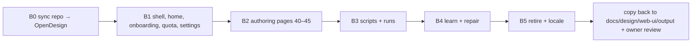

# CR-D-2 UI update: review, plan and OpenDesign prompts

This folder holds the work to bring the Web UI mockups (`../output/`, 39 pages) in line with CR-D-2 direction (a). The product's centre moves from release evidence to authoring and repair. Source of truth for scope:

- [plan 13](../../../../plans/13-product-phases.md)
- [CR-D-2](../../../../docs/decisions/CR-D-2-direction-a.md)

The prompts are small **delta prompts**. Each run reads two briefs from the OpenDesign project root:

- [`00-shared-brief.md`](../prompts/00-shared-brief.md): brand, accessibility, state and safety rules;
- [`00-delta-brief.md`](00-delta-brief.md): CR-D-2 vocabulary and the phase-gated navigation rule. It is uploaded as `crd2-delta-brief.md`.

## 1. Review: what each existing page needs

The phase of a page comes from the Milestone cells of the 09.x tasks behind it (plan 09) or from plan 13, except where CR-D-2 hides a surface longer (page 06: release verdicts stay hidden until G4, see the delta brief). "Hidden" means the sidebar item disappears until the workspace reaches that phase; the file stays.

| # | Page | Phase | Action | Why (plan id) | Prompt |
|---|---|---|---|---|---|
| 01 | app shell + nav (`assets/evidgate.js`) | G1 | **Modify** | Nav regrouped by phase, phase switch, Authoring group first (13.4.1-T7) | B1-01 |
| 02 | login | G1 | Keep | Unchanged by CR-D-2 | — |
| 03 | run list | G2 | **Modify** | Local `evidgate run` vs CI source, script status, link to manual case (13.5.2) | B3-03 |
| 04 / 05 | run detail, evidence panel | G2 | **Modify** | Manual case + script links, profile captured per bound step (13.5, 13.6.1) | B3-04 |
| 06 | decision + waivers | G4 | Hide | 09.3.1-T5/T9/T11 moved to G3/G4 | — |
| 07 | report comparison | G2 | **Modify** | Remove the stored release-decision field: no release verdict in G1–G3 (09.2.1-T4/T8 G2) | B3-07 |
| 08 | failure inbox | G3 | **Modify** | Failure label + drift class filter/column (13.8.1, 08.2.2) | B4-08 |
| 09 | failure detail / triage | G3 | **Modify** | Classification panel with rule reason and outcome (13.8.1) | B4-09 |
| 10 / 11 | case history, artifact viewer | G3 | Keep | Unchanged; 11 reused by 13.8.2 screenshots | — |
| 12 | healing queue | G3 | **Modify** | Becomes the repair-proposal queue: locator-drift candidates and UI-change proposals (13.8.1) | B4-12 |
| 13 | candidate detail (shadow) | G3 | **Modify** | Before/after screenshots (opt-in), a11y/DOM diff, matching test case edit, PR delivery (13.8.2-T2) | B4-13 |
| 14 / 15 | approval, knowledge lineage | G3 | **Modify** | `data-nav` of 14 becomes `repairs`; fixtures follow the canonical incidents (`inc-91` product defect, no repair; `cand-73` on `inc-92`) (09.5.2) | B4-14 |
| 16 | healing availability | G3 | Keep | 09.5.2 is G3; no CR-D-2 change beyond shared nav | — |
| 17–19 | Test Studio V2 | G4 | Hide + banner | Superseded by authoring (03.7.1-T1/T2 → 13.3.1); kept for G4 reference | B5-01 |
| 20 | suite composition | G4 | Hide | 09.6.1 G4 | — |
| 21 | release view | G4 | Hide | 09.3.1-T10 G4 | — |
| 22 | quality overview | G4 | Hide | 09.9.1 G4 | — |
| 23 | onboarding wizard | G1/G2 | **Modify** | G1 path: project → AI settings → first requirement → first checklist; CI steps appear at G2 (13.4.1, 09.2.1) | B1-03 |
| 24 | project overview | G1 | **Modify** | Becomes the authoring home: coverage, recent versions, pending changes, credits; CI health only from G2 | B1-02 |
| 25 | test catalog | G2 | **Modify** | Automated `test_case` ↔ manual case links, uncovered view (13.1.1-T4) | B3-25 |
| 26 | mapping resolution | G2 | Keep | 09.2.1-T8 G2 | — |
| 27 | settings shell | G1 | **Modify** | AI settings tab + AI opt-in status; G4 tabs hidden by phase | B1-05 |
| 28 / 29 | members, secret refs | G1 / G2 | Keep | New permission names appear in 28's matrix via fixture only | — |
| 30 | policy revisions | G4 | Hide | 09.7.1-T4 G4 | — |
| 31 | usage & retention | G1 | **Modify** | AI credit balance and usage by action (13.4.1-T7, 08.5.5) | B1-04 |
| 32 / 33 / 36 | audit, security events, support | G1–G2 | Keep | Authoring actions appear as audit rows in the fixture only | — |
| 34 / 35 / 37 / 38 | agents, webhooks, API tokens, deploy targets | G4 | Hide | 09.7.1-T7/T8, 09.7.2 G4 | — |
| 39 | locale stress review | G3 | **Modify** | Add longest-vi specimens of the new authoring and drift strings (09.8.1) | B5-02 |

New pages (all built by OpenDesign, then copied into `../output/`):

| # | Page | Phase | Plan id | Prompt |
|---|---|---|---|---|
| 40 | feature tree + test case table | G1 | 13.4.1-T2 | B2-40 |
| 41 | test case editor, checklist review, timeline tab | G1 | 13.4.1-T3, T5 | B2-41 |
| 42 | pending changes (batched review) | G1 | 13.4.1-T3, 13.1.2 | B2-42 |
| 43 | generation flow (input → checklist → test cases) | G1 | 13.4.1-T4, 13.3.1 | B2-43 |
| 44 | project AI settings | G1 | 13.4.1-T5, 13.2.1 | B2-44 |
| 45 | import / export | G1 | 13.4.1-T5, 13.1.1-T5 | B2-45 |
| 46 | generated scripts + testability | G2 | 13.5.1-T7 | B3-46 |
| 47 | UI-change test case review proposal | G3 | 13.8.1-T3, 13.8.2-T2 | B4-47 |

## 2. Plan: batches and order

Run batches in order: they share one OpenDesign conversation, `assets/` and the nav array. Each batch has 4–6 pages, following the skill `opendesign-batched-redesign-review-loop`.

| Batch | Phase | Prompts | Gate before the next batch |
|---|---|---|---|
| B0 | — | none (coordinator step) | OpenDesign project mirrors `../output/` (folders, `assets/`, NAV.md) and holds both briefs |
| B1 | G1 | B1-01 … B1-05 | design review: nav phase switch hides G2–G4 items on every page |
| B2 | G1 | B2-40 … B2-45 | design review + **owner approval** (13.4.1-T1 is the gate for G1 build) |
| B3 | G2 | B3-03, B3-04, B3-07, B3-25, B3-46 | design review |
| B4 | G3 | B4-08, B4-09, B4-12, B4-13, B4-14, B4-47 | design review |
| B5 | G3/G4 | B5-01, B5-02 | design review, then copy back |

**B0 detail.**

- The OpenDesign project `Evidgate — Web UI` holds flat files from 2026-10-13, older than the repo's S49 nav pass.
- Before B1, upload `docs/design/web-ui/output/` with its folder structure, `assets/` and `NAV.md`, plus `prompts/00-shared-brief.md` and `00-delta-brief.md` (as `crd2-delta-brief.md`).
- Use `write_file` with nested paths. Start a run only after the upload.

**Per batch.**

1. `start_run` with `skill: "frontend-design"`, one prompt per run, a fresh `requestId` (UUID) per prompt.
2. When the batch ends, run one read-only design review (agent `ui-design-architect`). It checks 1280 + 360 px, dark, vi + one en spot check, keyboard open/close and no overflow. It also checks that the new structure is baked into the static HTML (`grep -c` on the new class), not injected by page-specific JS.
3. Send its fix prompt (if any) before the next batch.

**Copy back.**

- After B5, copy the changed and new pages into `../output/<NN-name>/` and update `../output/NAV.md` and `../output/index.html`.
- Open a docs-only PR: the copy is an owner-content change.

## 3. Prompt files

Format: [`TEMPLATE.md`](TEMPLATE.md). Each prompt is ≤ 60 lines and names one page, so a failed run is re-sent alone.

| Batch | Files |
|---|---|
| B1 | [B1-01](B1-01-nav-shell.md) · [B1-02](B1-02-project-home.md) · [B1-03](B1-03-onboarding.md) · [B1-04](B1-04-usage-credits.md) · [B1-05](B1-05-settings-ai.md) |
| B2 | [B2-40](B2-40-feature-tree.md) · [B2-41](B2-41-test-case-editor.md) · [B2-42](B2-42-pending-changes.md) · [B2-43](B2-43-generation-flow.md) · [B2-44](B2-44-ai-settings.md) · [B2-45](B2-45-import-export.md) |
| B3 | [B3-03](B3-03-run-list.md) · [B3-04](B3-04-run-detail.md) · [B3-07](B3-07-report-compare.md) · [B3-25](B3-25-test-catalog.md) · [B3-46](B3-46-generated-scripts.md) |
| B4 | [B4-08](B4-08-failure-inbox.md) · [B4-09](B4-09-failure-detail.md) · [B4-12](B4-12-repair-queue.md) · [B4-13](B4-13-repair-detail.md) · [B4-14](B4-14-approval-lineage-fixtures.md) · [B4-47](B4-47-ui-change-proposal.md) |
| B5 | [B5-01](B5-01-retire-studio.md) · [B5-02](B5-02-locale-review.md) |

## 4. Open questions for the owner

1. Is the nav label for the authoring group "Test design / Thiết kế kiểm thử" or "Authoring / Soạn kiểm thử"? The prompts use the first. It can be changed in one place, the nav array.
2. What is the credit price per action (plan 13 Q2)? Fixtures show credit counts only, with no money amounts.
3. Should the G1 workspace show CI health at all? The prompts hide it until G2.
