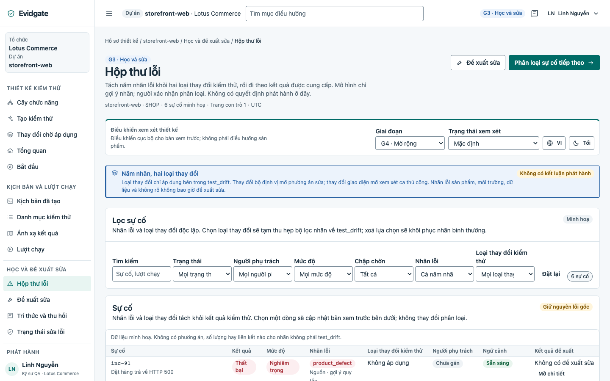
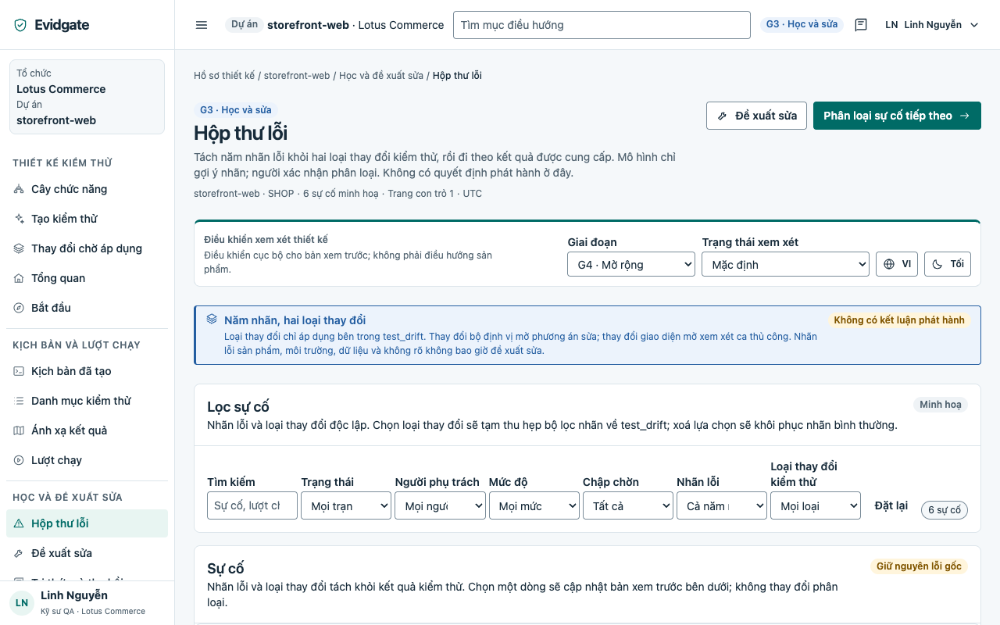
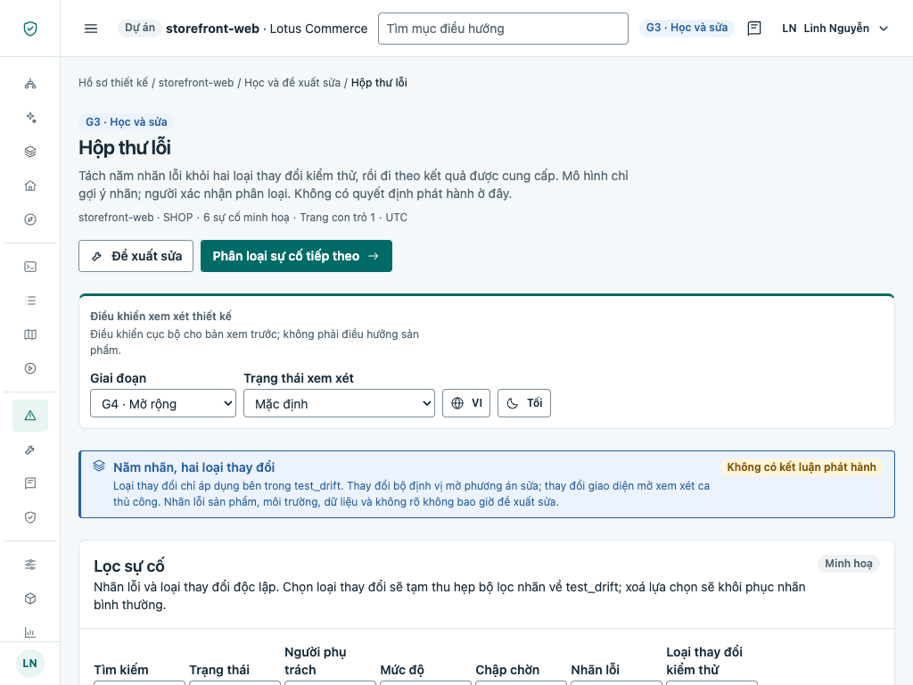
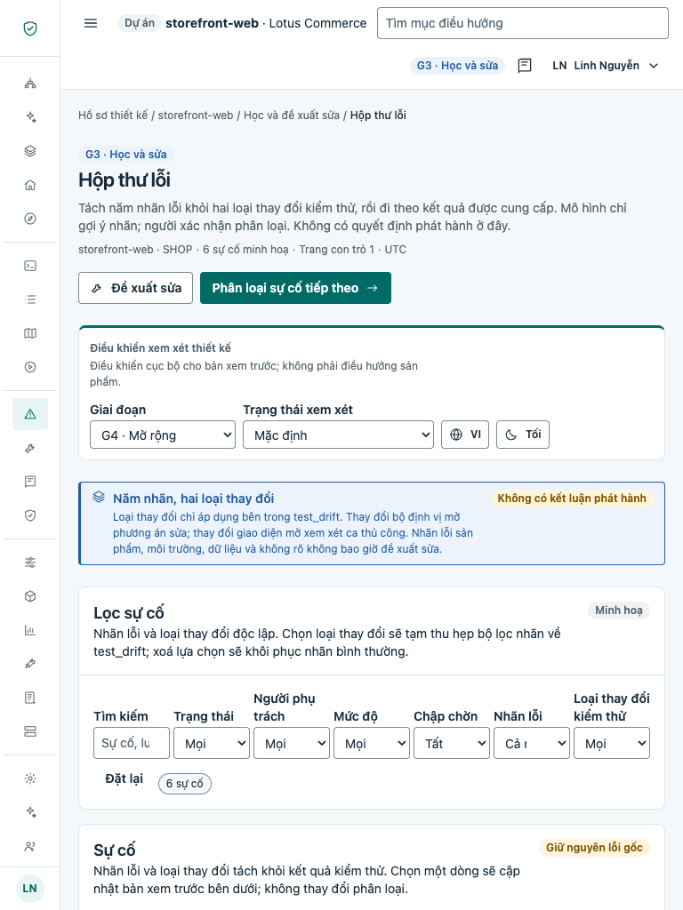
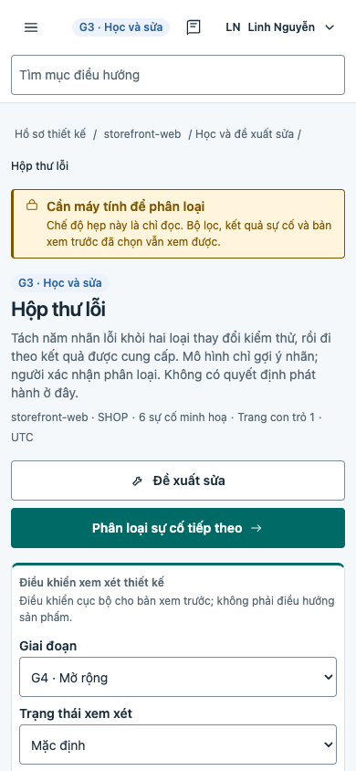

# Layout, breakpoints and dense-table density

Owner approval: pending (B2 / 09.1.1-T11.3)

This is a source-backed port specification for the owner-selected Web UI v2, not a new visual design or an implemented Angular component. The contract is [09.1.1-T11.3](../../../plans/features/09-web-ui/09.1.1-app-scaffold-and-build-acceptance-npm.md); screen approval remains pending under [B2](../web-ui/prompts-crd2/00-README.md). Source observations below are not browser-verification claims. `[DECISION]` identifies app adoption choices; `[OPEN]` identifies an unresolved implementation or evidence gap.

## Page grid and spacing

The inbox demonstrates this semantic order: skip link → navigation aside → main shell containing the topbar followed by the main content landmark ([inbox HTML:12–48][inbox-shell]). Navigation is a shell column, not a strip above the topbar. The context rail, when present on a page, is inside the content, not an additional global navigation column.

| Element | V2 rule and dimensions | Source |
| --- | --- | --- |
| Shell | CSS grid: navigation plus `minmax(0, 1fr)` main column; expanded navigation is `--eg-nav-width: 224px`. Review-only shell omits navigation. The outer shell has viewport minimum height. | [CSS:248–267][shell], [CSS:76–78][layout-tokens] |
| Main stack | Flex column with `min-width: 0`, keeping the topbar before page content. | [CSS:264–278][shell] |
| Topbar | Sticky at `top: 0`, using `--eg-z-sticky`; minimum height `--eg-space-12: 64px`. Horizontal padding `--eg-space-5: 16px`, vertical padding `--eg-space-3: 8px`, gap `--eg-space-4: 12px`; wrapping is allowed. It is not a fixed-height bar. | [CSS:561–573][topbar], [CSS:51–63][spacing] |
| Content | Full available width, capped at **1440px**; padding and vertical section gap both `--eg-space-7: 24px` on desktop. Global border-box sizing means padding is included in the cap. No centering margin is declared by this rule. | [CSS:270–278][shell], [CSS:120–125][box-sizing], [CSS:51–63][spacing] |
| Tablet gutters | Content padding becomes `--eg-space-6: 20px`; its section gap remains `--eg-space-7: 24px`. | [CSS:4029–4040][tablet], [CSS:270–278][shell], [CSS:51–63][spacing] |
| Narrow gutters | Content padding and section gap become `--eg-space-5: 16px`; smallest-view padding becomes `--eg-space-4: 12px`. Topbar padding becomes `--eg-space-3: 8px` vertically and `--eg-space-4: 12px` horizontally. | [CSS:4143–4151][mobile-chrome], [CSS:4416–4429][smallest], [CSS:51–63][spacing] |
| Optional context rail | `.eg-split-pane--context` is flexible primary content plus `--eg-rail-width: 320px`; inter-pane gap `--eg-space-7: 24px`. The ordinary/balanced split uses **2 equal columns**. These split panes stack below desktop. | [CSS:736–765][split], [CSS:76–78][layout-tokens], [CSS:51–63][spacing], [CSS:4029–4040][tablet] |
| Local grids | No universal page-wide column count is declared. `.eg-grid` auto-fits tracks with a **240px** preferred minimum bounded by available width; explicit `data-cols` variants provide **2, 3 or 4 columns**. Default gap is `--eg-space-5: 16px`; `data-gap` overrides use `--eg-space-3: 8px`, `--eg-space-4: 12px` or `--eg-space-7: 24px`. Explicit variants become a single column on mobile. | [CSS:803–832][grids], [CSS:4357–4365][mobile-grid], [CSS:51–63][spacing] |
| Vertical groups | `.eg-stack` and the secondary split pane use `--eg-space-5: 16px`; stack overrides include `--eg-space-2: 4px`, `--eg-space-3: 8px`, `--eg-space-4: 12px`, `--eg-space-7: 24px` and `--eg-space-8: 32px`. | [CSS:761–796][split], [CSS:51–63][spacing] |

The inbox itself is a content stack: filters, incident table, then selected-incident preview below it, rather than a permanently side-by-side rail ([inbox HTML:155–188][inbox-filters], [inbox HTML:270–275][inbox-preview]). Do not add a rail merely because the shared rail token exists. `[DECISION]` Preserve these existing structural variants instead of introducing a new page-wide column grid.

## Breakpoints and navigation

The authoritative natural navigation modes are **expanded at ≥1280px**, **rail at 768–1279px**, and **drawer below 768px**, both at initialization and resize ([JS:281][nav-init], [JS:2346–2353][nav-resize]). Above the drawer threshold, the user can toggle expanded/rail; resize only restores the natural mode when `navUserSet` is false ([JS:679–706][nav-interaction], [JS:2346–2353][nav-resize]). Thus “desktop expanded” and “tablet rail” describe defaults, not an unchangeable preference.

| Range | Navigation and content | Source |
| --- | --- | --- |
| Desktop primary: ≥1280px | Expanded navigation, **224px** wide; content remains fluid within its cap. Context split panes can remain side by side. | [JS:281][nav-init], [CSS:76–78][layout-tokens], [CSS:248–278][shell], [CSS:736–765][split] |
| Tablet: 768–1279px | Icon rail, **68px** wide; navigation labels, scope and account text are hidden. Split panes stack, but dense tables remain tables. | [JS:281][nav-init], [CSS:76–78][layout-tokens], [CSS:287–293][nav-columns], [CSS:509–530][rail], [CSS:4029–4040][tablet] |
| Read-only fallback: <768px | Navigation leaves the shell grid and becomes a closed off-canvas drawer, normally `min(84vw, 320px)` wide. Scope is hidden; topbar search moves to a full-width later row; page header/actions stack or wrap. | [JS:281][nav-init], [CSS:287–293][nav-columns], [CSS:542–559][drawer], [CSS:4143–4182][mobile-chrome] |
| V2 narrow refinement: ≤420px | Navigation width becomes **100vw**; content/card gutters reduce to **12px** (`--eg-space-4`); page-header buttons take full rows; classification facts become a single column. | [CSS:4416–4434][smallest], [CSS:51–63][spacing], [CSS:3989–4001][classification-small] |

CSS custom properties cannot be substituted into media-query conditions. `[DECISION]` Keep `--eg-bp-tablet: 768px` and `--eg-bp-desktop: 1280px` in [the app token file](../../../apps/web/src/styles/tokens.css) as documented values mirroring [JS:281][nav-init], while using the corresponding literal conditions in app CSS/viewport logic. Keep both sources synchronized; the tokens alone cannot drive CSS media evaluation.

### V2-internal queries and app adoption

| V2 internal cutoff | Actual purpose | App adoption |
| --- | --- | --- |
| `max-width: 1279px` | Reduce content padding and stack split/context panes ([CSS:4029–4040][tablet]). | `[DECISION]` Adopt as the CSS counterpart of the desktop threshold, not a separate navigation mode or extra breakpoint token. |
| `max-width: 899px` | Login-only composition stacks into a single column with a **640px** maximum width ([CSS:4047–4059][login-query]). | `[DECISION]` Retain only when porting that login composition; do not make it a global shell/table breakpoint. |
| `max-width: 420px` | Small-view gutters, full-width actions/drawer, review controls and classification-fact stacking ([CSS:3989–4001][classification-small], [CSS:4416–4462][smallest]). | `[DECISION]` Adopt these component-local refinements without adding a new global navigation mode or global breakpoint token. |

The companion `max-width: 767px` mobile rules ([CSS:4062–4065][mobile-start]) implement the tablet threshold's lower side; they are not an independent app mode.

### What “read-only” actually means in the mockup

- At the mobile cutoff, **all `[data-eg-mutate]` elements are hidden**; table selection cells and explicitly tagged mutation cells are also hidden ([CSS:4200–4208][mobile-mutations], [CSS:4342–4355][mobile-table-end]). The desktop-required banner becomes visible ([CSS:4180–4182][mobile-chrome]); the inbox explicitly says filters, outcomes and selected preview remain inspectable ([inbox HTML:61–67][inbox-readonly]).
- Tagged dialog openers also refuse editing from a mobile viewport and announce the desktop requirement ([JS:807–825][mutation-dialog]). `syncMutationTriggers()` disables controls for blocked scenarios/phase, **not for viewport width itself** ([JS:506–528][mutation-state]). This is not a global disable of every input.
- Search, filters, reset, row-preview selection and detail navigation remain available. Inbox filter controls are not mutation-tagged ([inbox HTML:162–170][inbox-filters]); row selection expressly does not change triage ([inbox HTML:183–185][inbox-filters]).
- The primary **“Triage next incident” link remains visible** because it is ordinary navigation and is not tagged `[data-eg-mutate]` ([inbox HTML:81–84][inbox-actions]). Following it is not evidence that mobile can save triage. `[OPEN]` The mutation boundary on destination screens still needs an app-level audit; a desktop-sounding navigation label is not a viewport permission check.
- Drawer interaction is modal: main content becomes inert, focus enters the close control, Tab is contained, Escape closes, and focus returns to the toggle ([JS:633–706][nav-interaction]). This interaction remains available in read-only mode.

### Smallest supported viewport

The assignment requires **360px without horizontal page scrolling**; this is a target, not a measured result in this document. It falls under the source's `max-width: 420px` refinement ([CSS:4416–4434][smallest]). Source mechanisms are border-box sizing ([CSS:120–125][box-sizing]), shrinkable main/content/grid children ([CSS:264–278][shell], [CSS:798–807][grids]), wrapping cell content ([CSS:2934–2945][table-text]), and conversion from wide tables into vertical records ([CSS:4266–4335][mobile-table]). Do not implement the target by clipping the whole page with `overflow-x: hidden`; content and actions must remain reachable. `[DECISION]` Require the real app to demonstrate this target in both locales and themes; the screenshot set below does not itself prove it.

## Dense-table rules

The reference inbox uses `.eg-table.eg-table--compact.eg-table--workbench` inside `.eg-table__wrap`, with **8 columns**: incident, outcome, severity, failure label, drift class, owner, context, resulting outcome ([inbox HTML:188–200][inbox-table]). It does **not** opt into `.eg-table--sticky`; shared sticky styling exists separately. Its cells include contextual secondary lines, so compact density does not imply single-line records.

| Concern | Source-backed rule and app contract |
| --- | --- |
| Density | `--eg-row-compact: 40px`; `--eg-row-default: 44px`; `--eg-control-touch: 44px` ([CSS:70–75][density-tokens]). Default cell padding is **8px vertical / 12px horizontal** (`--eg-space-3` / `--eg-space-4`), compact padding is **4px vertical** (`--eg-space-2`) ([CSS:2884–2904][table-base], [CSS:3002–3009][table-sticky], [CSS:51–63][spacing]). These are nominal CSS cell heights, not a guarantee of fixed row height: wrapped text and secondary lines can grow the row. |
| Touch | Mobile buttons/inputs/selects/tabs and the listed icon, navigation and other touch controls use the **44px** touch token; mobile cell blocks have at least **44px** height and table links have **44px** minimum dimensions ([CSS:4193–4198][mobile-chrome], [CSS:4215–4258][mobile-touch], [CSS:4302–4315][mobile-table], [CSS:70–75][density-tokens]). `[DECISION]` For touch-capable tablet/desktop usage, choose default density and retain the same touch-target minimum; v2's listed enlargement rules are width-based, not a general coarse-pointer rule. |
| Sticky header | `.eg-table--sticky thead th` uses `position: sticky`, `top: 0`, local `z-index: 1` and a **1px** border-coloured shadow ([CSS:3011–3015][table-sticky]). `[DECISION]` Enable this shared variant in the app's dense scrollable table demo, keeping stickiness inside its local scroll viewport rather than under the global topbar. This is an adoption choice, not a claim that the inbox already enables it. |
| Minimum widths | Generic table **640px**; workbench **900px**; identity cell **9.5rem**; selection column **44px**; action cell **1%** plus `white-space: nowrap` ([CSS:2863–2872][table-wrap], [CSS:2939–2951][table-text], [CSS:2982–3019][table-sticky]). Remaining columns have no fixed per-column minima beyond the shared `min-width: 0` rule and intrinsic content ([CSS:2884–2900][table-base]). Do not invent a fixed width for each inbox column. |
| Numeric alignment | `.eg-table__cell--numeric` declares right alignment, tabular numerals and no wrapping ([CSS:2948–2951][table-text]). **Cascade caveat:** the more-specific `.eg-table th, .eg-table td` declares left alignment ([CSS:2884–2887][table-base]), so the utility alone does not establish right alignment on those elements. Mobile explicitly declares left alignment ([CSS:4338–4340][mobile-table-end]). `[DECISION]` Port the intended right-aligned numeric role with sufficient app selector specificity on table views, left aligned on stacked records; verify computed style in the demo. |
| Overflow container | `.eg-table__wrap` owns horizontal overflow, never the body. Tables retain their source minimum width on desktop/tablet, so scrolling depends on actual available space, not only viewport width ([CSS:2849–2872][table-wrap]). Optional `[data-state="scroll"]` limits height to **18rem** and scrolls vertically ([CSS:2858–2860][table-wrap]); mobile removes that height cap ([CSS:4353–4355][mobile-table-end]). `[DECISION]` Give an overflow region an accessible name and keyboard focus when needed; ensure focused content scrolls into view. The inbox wrapper has no authored `tabindex` ([inbox HTML:188][inbox-table]). |
| Truncation and tooltip | **No table truncation class or automatic overflow-tooltip behavior is demonstrated in this inbox.** `.eg-table__cell` wraps anywhere, and identity code remains unbroken ([CSS:2934–2945][table-text]); inbox cells use `data-label`, `data-label-en`, `data-label-vi`, not truncation/title attributes ([inbox HTML:204–222][inbox-cells]). Actual ellipsis selectors are `.eg-nav__account strong/small` and `.eg-topbar__scope .eg-btn__label` ([CSS:495–506][account-ellipsis], [CSS:586–589][topbar]). Generic `.eg-tooltip [role="tooltip"]` appears on hover/focus-within ([CSS:3632–3663][tooltip]); JS localizes explicit `data-title-en` / `data-title-vi` into `title`, not automatically from overflow ([JS:439–443][localized-labels]). `[OPEN]` Do not claim the task's truncation-with-tooltip criterion is implemented by these assets; see hand-over below. |
| Long Vietnamese and English | Preserve complete labels and natural wrapping in both locales. Cells use `overflow-wrap: anywhere`, headers use `white-space: nowrap`, identity code uses `white-space: nowrap`, and badges use normal white space plus anywhere wrapping ([CSS:2934–2945][table-text], [CSS:2893–2899][table-base], [CSS:1062–1069][badge-wrap]). Mobile cells expose localized `data-label` as their visual field labels; JS updates that attribute on locale changes ([CSS:4322–4335][mobile-table], [JS:442–443][localized-labels]). Do not apply `word-break: break-all` globally or force Vietnamese copy into English-sized fixed rows. |
| Large lists | CDK virtual scroll is mandatory for lists **>200 rows**, with tracked identities, under [00 §5.6 W7:220](../../../plans/00-overview.md); this is a product performance requirement, not a v2 CSS measurement. `[OPEN]` The static mockup does not demonstrate virtualization. The app demo must reconcile wrapping/dynamic heights with its chosen virtual-scroll strategy without clipping Vietnamese or stacked records. |

### Keyboard, focus and semantic rules

- Keep the table caption, `thead`, scoped column headers and table cells as authored ([inbox HTML:188–203][inbox-table]). V2 sort buttons update `aria-sort`; selection uses native checkbox changes and `aria-selected` ([JS:1106–1109][table-sort], [JS:1134–1175][table-binding]). These generic features are not authored on the inbox's plain column headings.
- Inbox master-detail selection uses a roving row tab stop. Arrow Up/Down, Home and End move selection/focus among visible rows; Enter/Space selects and attempts to focus the active preview's first heading/link/button. Events originating in nested controls retain their own behavior ([JS:2138–2200][master-detail]). `[OPEN]` A heading selected by `focus()` is not necessarily programmatically focusable; confirm the real app's preview focus target rather than copying that attempt uncritically.
- Use the existing `:focus-visible` outline, `--eg-focus-width: 2px` and `--eg-focus-offset: 2px`; detail rows use an inset outline offset ([CSS:237–240][focus], [CSS:79–80][layout-tokens], [CSS:2930–2932][table-text]). Preserve hover and selected-row feedback ([CSS:2914–2927][table-base]) without treating selection as a verdict.
- `[DECISION]` When implementing ellipsis, expose the full value to assistive technology and a keyboard-accessible, dismissible tooltip associated with its trigger; do not rely solely on native `title` or hover. Ensure its overlay is not clipped by the table's scroll container. This completes the stated task requirement without inventing a v2 implementation.
- `[DECISION]` In the app's stacked rendering, keep field/value relationships programmatically available, not only CSS-generated `data-label` text. The source hides `thead` on mobile ([CSS:4284–4335][mobile-table]); the implementation needs an accessibility check before adopting that exact technique.

## Dense-table behavior by breakpoint

Breakpoint numbers are those in [JS:281][nav-init] and [CSS:4416][smallest]. Width minima and overflow are defined by [CSS:2849–2872][table-wrap].

| View | What collapses | What remains visible | Scrolling and density |
| --- | --- | --- | --- |
| Desktop primary, ≥1280px | Nothing is removed merely for width; optional split/context pane can sit beside primary content. | All inbox columns, filters and selected preview; expanded nav is the natural mode. | Wide tables scroll **inside the wrapper** if their available content width is insufficient. Compact/default nominal rows use **40px/44px** ([CSS:74–75][density-tokens]); shared sticky header is opt-in, not active in the reference inbox. |
| Tablet, 768–1279px | Navigation text collapses into icons; split/context panes stack ([CSS:514–519][rail], [CSS:4029–4040][tablet]). | Table remains tabular; **no inbox columns are hidden** by the tablet query. | Local horizontal overflow is retained; a **900px** workbench minimum can exceed available space ([CSS:2871–2872][table-wrap]). Do not squeeze labels or move overflow to the page. |
| Read-only fallback, <768px | `thead` is hidden; rows become vertical record cards; selection and mutation cells are removed. Local explicit-column grids become a single column ([CSS:4266–4365][mobile-table], [CSS:4357–4365][mobile-grid]). | Caption, non-mutation values, localized field labels, filters, detail links and selected preview remain. Numeric fields are presented left aligned ([CSS:4322–4350][mobile-table-end]). | Table minimum width is removed; wrapper overflow becomes visible; scrolling is the page's vertical flow, not a wide-table horizontal viewport. Cell blocks use auto height with **44px** minimum ([CSS:4272–4315][mobile-table], [CSS:75][density-tokens]). |
| Narrow refinement, ≤420px | Header actions take separate full-width rows; classification facts stack further ([CSS:4432–4434][smallest], [CSS:3989–4001][classification-small]). | Same read-only values and navigation remain reachable. | Keep mobile record flow; reduce gutters to **12px** ([CSS:4421–4429][smallest], [CSS:55][spacing]). The required **360px** page-no-overflow check remains a real-app acceptance target, not an assertion from the captures. |

Throughout all sizes, completeness, outcome and decision remain separate fields; missing/pending data must never be promoted to PASS, and pending uses neutral verdict-free styling. Healing remains a proposed PR, never an apply-from-UI action. These are product invariants, not density-dependent exceptions. The inbox itself explicitly separates labels/drift class from outcomes and does not add a release decision ([inbox HTML:183–185][inbox-filters], [inbox HTML:270–273][inbox-preview]).

## Layout reference captures

The capture slice supplies these images from the failure inbox, default state, light theme, Vietnamese locale, with phase G4 enabled. Image widths are capture configuration, not extra CSS breakpoints; these references do not claim browser or app acceptance results.

### Wide desktop capture — 1440px

### Desktop boundary capture — 1280px

### Tablet capture — 1024px

### Tablet boundary capture — 768px

### Narrow capture — 390px

## Open points / hand-overs

| Item | Receiving task / owner | Required completion evidence |
| --- | --- | --- |
| **CDK table demo restyled with tokens — explicitly outside this documentation slice.** The original T11.3 done-when includes the demo, but it requires the T2 integration-fit spike and actual app workspace. | **09.1.1-T11.4**, consuming 09.1.1-T2's CDK table spike. [Task contract:198–199](../../../plans/features/09-web-ui/09.1.1-app-scaffold-and-build-acceptance-npm.md). | Build the real token-styled table; exercise dense/default/touch density, local overflow, sticky header, numeric alignment and keyboard focus. This document does not close the demo acceptance criterion. |
| `[OPEN]` Truncation with tooltip is required but absent from the inbox table source. | **09.1.1-T11.4**. | Implement it only for genuinely clipped content, preserve accessible full values, support keyboard/touch access and dismissal, and avoid scroll-container clipping. Keep naturally wrapping narrative cells; do not claim a nonexistent v2 truncation utility. |
| `[OPEN]` Declared numeric utility loses to the base cell alignment selector; sticky headers are opt-in and absent from the inbox class list. | **09.1.1-T11.4**. | Show computed right alignment on tabular numeric cells, left alignment on mobile records and working local sticky headers without topbar overlap. |
| `[OPEN]` Read-only fallback relies on correct mutation tagging, not disabling every control. The inbox still exposes the untagged triage-navigation link. | **09.1.1-T11.4** state sheet, with the receiving screen implementer. | Verify no business mutation is reachable at narrow widths, including after navigation or resize; keep filters and inspection usable. Decide whether the existing triage-navigation wording needs clarification; do not silently redesign it here. |
| `[OPEN]` Virtual scroll, wrapped cell heights and stacked records are not demonstrated by static fixtures. | **09.1.1-T11.4**, consuming T2 and [W7](../../../plans/00-overview.md). | Demonstrate the mandated large-list threshold without row clipping, broken focus or loss of localized field/value semantics. |
| `[OPEN]` Smallest-viewport overflow and complete keyboard/screen-reader behavior have not been exercised by this documentation slice. | **09.1.1-T11.4** app demo and implementation QA. | Check the required narrow target in Vietnamese/English and light/dark, including long content, scroll-container keyboard access, preview focus and mobile semantics. The supplied narrow capture is not a substitute for this check. |
| `[OPEN]` Owner approval remains pending. | Owner, B2 / **09.1.1-T11.3**. | Record an explicit approval decision; neither the v2 port nor linked screenshots imply approval. |

## Evidence scope

This specification is derived from reading the v2 mockup sources: the reference stylesheet [evidgate.css](../web-ui/output/assets/evidgate.css) and script [evidgate.js](../web-ui/output/assets/evidgate.js), with the failure-inbox page cited above. The five layout screenshots are static captures of that failure-inbox mockup at 1440/1280/1024/768/390px. Browser behaviour beyond those captures — keyboard interaction, screen-reader output and virtual scroll — is not claimed here and is tracked in the Open points table above.

[box-sizing]: ../web-ui/output/assets/evidgate.css#L120-L125
[spacing]: ../web-ui/output/assets/evidgate.css#L51-L63
[density-tokens]: ../web-ui/output/assets/evidgate.css#L70-L75
[layout-tokens]: ../web-ui/output/assets/evidgate.css#L76-L80
[focus]: ../web-ui/output/assets/evidgate.css#L237-L240
[shell]: ../web-ui/output/assets/evidgate.css#L248-L278
[nav-columns]: ../web-ui/output/assets/evidgate.css#L287-L293
[account-ellipsis]: ../web-ui/output/assets/evidgate.css#L495-L506
[rail]: ../web-ui/output/assets/evidgate.css#L509-L530
[drawer]: ../web-ui/output/assets/evidgate.css#L542-L559
[topbar]: ../web-ui/output/assets/evidgate.css#L561-L603
[split]: ../web-ui/output/assets/evidgate.css#L736-L796
[grids]: ../web-ui/output/assets/evidgate.css#L798-L832
[badge-wrap]: ../web-ui/output/assets/evidgate.css#L1062-L1069
[table-wrap]: ../web-ui/output/assets/evidgate.css#L2849-L2872
[table-base]: ../web-ui/output/assets/evidgate.css#L2884-L2927
[table-text]: ../web-ui/output/assets/evidgate.css#L2930-L2951
[table-sticky]: ../web-ui/output/assets/evidgate.css#L2982-L3019
[tooltip]: ../web-ui/output/assets/evidgate.css#L3632-L3663
[classification-small]: ../web-ui/output/assets/evidgate.css#L3989-L4001
[tablet]: ../web-ui/output/assets/evidgate.css#L4029-L4040
[login-query]: ../web-ui/output/assets/evidgate.css#L4047-L4059
[mobile-start]: ../web-ui/output/assets/evidgate.css#L4062-L4065
[mobile-chrome]: ../web-ui/output/assets/evidgate.css#L4143-L4198
[mobile-mutations]: ../web-ui/output/assets/evidgate.css#L4200-L4208
[mobile-touch]: ../web-ui/output/assets/evidgate.css#L4215-L4258
[mobile-table]: ../web-ui/output/assets/evidgate.css#L4266-L4335
[mobile-table-end]: ../web-ui/output/assets/evidgate.css#L4322-L4355
[mobile-grid]: ../web-ui/output/assets/evidgate.css#L4357-L4365
[smallest]: ../web-ui/output/assets/evidgate.css#L4416-L4462
[nav-init]: ../web-ui/output/assets/evidgate.js#L276-L284
[nav-interaction]: ../web-ui/output/assets/evidgate.js#L633-L706
[nav-resize]: ../web-ui/output/assets/evidgate.js#L2346-L2353
[mutation-state]: ../web-ui/output/assets/evidgate.js#L506-L528
[mutation-dialog]: ../web-ui/output/assets/evidgate.js#L807-L825
[localized-labels]: ../web-ui/output/assets/evidgate.js#L439-L443
[table-sort]: ../web-ui/output/assets/evidgate.js#L1106-L1109
[table-binding]: ../web-ui/output/assets/evidgate.js#L1134-L1175
[master-detail]: ../web-ui/output/assets/evidgate.js#L2138-L2200
[inbox-shell]: ../web-ui/output/08-failure-inbox/evidgate-failure-inbox.html#L12-L48
[inbox-readonly]: ../web-ui/output/08-failure-inbox/evidgate-failure-inbox.html#L61-L67
[inbox-actions]: ../web-ui/output/08-failure-inbox/evidgate-failure-inbox.html#L81-L84
[inbox-filters]: ../web-ui/output/08-failure-inbox/evidgate-failure-inbox.html#L155-L188
[inbox-table]: ../web-ui/output/08-failure-inbox/evidgate-failure-inbox.html#L188-L203
[inbox-cells]: ../web-ui/output/08-failure-inbox/evidgate-failure-inbox.html#L204-L222
[inbox-preview]: ../web-ui/output/08-failure-inbox/evidgate-failure-inbox.html#L270-L275
