# Component state sheet — 09.1.1-T11.4

Status: design reference and implementation hand-over, not an Angular implementation or owner-approval record. The T7/T8 components and their specs do not exist in this slice.

Source task: [09.1.1 §2 AC8/AC9, §9, §10 T7/T8/T11 and T11 Notes](../../../plans/features/09-web-ui/09.1.1-app-scaffold-and-build-acceptance-npm.md), source lines 30–31, 107–116, 170–182, 198–207. Contracts: [00 §5.6 W1/W8/W9](../../../plans/00-overview.md) and [09 FR-09-1–FR-09-7, FR-09-13](../../../plans/09-web-ui.md), source lines 25–31, 37.

## Scope and evidence

- Collection completeness, test outcome and stored release decision are three different fields, labels and components. Missing evidence never means PASS. A UI error, successful request or approved healing proposal is not a release verdict.
- DecisionChip renders only its supplied SDK value. A pending-only fixture must contain the visible value `pending` and no PASS/FAIL element, including hidden elements or accessible names. Do not copy the gallery's sibling verdict specimens into one component.
- All nine requested states appear for each component below. `n/a — render-only` means no artificial interaction state; an [OPEN] row identifies a real unanswered contract instead of inventing one. The T8 route patterns replace each other; they are not nested loading/error/success modes of a badge.
- Source aliases below always mean these exact files. Line numbers refer to the frozen v2 sources read for this sheet, not to Angular files. Class names are visual references, not SDK enums.

| Alias | Verified source                                                                                   | Used ranges                                                                                                                                                                                                      |
| ----- | ------------------------------------------------------------------------------------------------- | ---------------------------------------------------------------------------------------------------------------------------------------------------------------------------------------------------------------- |
| G     | [00-components/evidgate-components.html](../web-ui/output/00-components/evidgate-components.html) | 55–110 matrix; 295–319 badges/chips; 342–345 tooltip; 508–522 state panels; 576–584 banners; 785 dialog opener; 1442–1452 conflict dialog                                                                        |
| C     | [assets/evidgate.css](../web-ui/output/assets/evidgate.css)                                       | 237–240 focus; 767–784 stacks; 864–1017 buttons; 1020–1159 badges/chips; 1317–1320 context; 1518–1589 dialogs; 3063–3139 state panels; 3204–3216, 3254–3334 banners; 3632–3663 tooltip; 4465–4479 reduced motion |
| J     | [assets/evidgate.js](../web-ui/output/assets/evidgate.js)                                         | 807–867 native modal open/close/focus return                                                                                                                                                                     |
| R     | [04-run-detail/evidgate-run-detail.html](../web-ui/output/04-run-detail/evidgate-run-detail.html) | 61–81 separate completeness/outcome and flaky explanation; 110–125 missing reasons                                                                                                                               |

The six sibling flow documents remain the page-level source: [onboarding](onboarding.md#states), [run detail](run-detail.md#states), [failure inbox](failure-inbox.md#states), [healing shadow review](healing-shadow-review.md#states), [settings](settings.md#states), [release view](release-view.md#states). Their HTTP distinctions and acknowledged static-fixture gaps are retained here. [Layout](layout.md) governs density, breakpoints and the read-only fallback.

## Shared accessibility and themes

These requirements apply to every applicable row, even where the table only names a recipe. They are implementation requirements, not claims that screenshots passed assistive-technology testing.

- Both themes resolve the same `var(--eg-*)` roles from [tokens.css](../../../apps/web/src/styles/tokens.css). Light/dark changes must not change copy, SDK value, revision identity or available permissions. Respect explicit theme choice and the OS fallback described in [tokens.md](tokens.md#themes).
- [Recorded contrast](tokens.md#contrast-table): text/surface 14.55:1 light / 13.66:1 dark; text-muted/surface 6.14 / 8.04; text/surface-raised 13.64 / 12.11; success-fg/success-bg 6.52 / 7.70; danger-fg/danger-bg 6.10 / 7.85; warning-fg/warning-bg 6.01 / 7.99; info-fg/info-bg 5.89 / 7.44; neutral-fg/neutral-bg and pending-fg/pending-bg 5.50 / 7.01. These text pairs exceed 4.5:1. The contrast script was not rerun in this design slice.
- Focus: `var(--eg-focus-width)` solid `var(--eg-focus)`, offset `var(--eg-focus-offset)` (C:237–240). On surface the ring is 6.37 / 9.52; on surface-raised 5.98 / 8.44; on bg 5.98 / 9.86, exceeding 3:1. Keep the ring outside the control, not against an unmeasured tinted fill, and do not crop it in app containers. Borders needed to identify controls use `var(--eg-border-control)`, not decorative `var(--eg-border)`.
- Every interactive target must be at least 24×24 CSS pixels; existing `var(--eg-control-sm)` is 32px. Retain `var(--eg-control-touch)` (44px) targets for touch, including coarse-pointer tablet/desktop per layout.md. Render-only badges are not targets and must not become tab stops merely to satisfy target-size rules. The gallery's 18px removable filter chip is not a T7 render-only chip.
- Keep visible labels and context; never convey meaning through colour alone. Hide decorative SVGs from assistive technology. Use native lists for reasons, anchors for real navigation, buttons for commands, semantic headings for patterns and a named modal dialog for conflict. Render supplied untrusted reasons/hashes as text.
- Async loading: mark the affected region `aria-busy=true`, expose a concise polite status, and mark decorative skeletons `aria-hidden=true`. On completion clear busy and announce only the meaningful change; do not continually announce a timer. Respect `prefers-reduced-motion: reduce` (C:4465–4479): stop continuous decorative motion, preserve a textual loading label and reserved geometry.
- Keyboard: native links use Enter, buttons Enter/Space; keep normal document order. A modal traps Tab/Shift+Tab, Escape closes without submission, and closing returns focus to its opener (J:807–852 supplies a native-dialog reference). Do not steal focus on background badge updates. Error route headings need an explicit programmatic focus target when navigation requires it.
- [OPEN O7] The conflict close button has the literal accessible label `Đóng` in G:1443 without localized label attributes. T8 must supply vi/en accessible names; the English screenshot does not establish localized screen-reader output.
- Overflow: badges/chips and state descriptions wrap (C:1066–1069, 1092–1095, 3094–3107); never truncate the only reason or verdict. Preserve full supplied identifiers; the gallery hash is already abbreviated and does not prove a full-hash tooltip exists. Generic `.eg-tooltip` (G:342–345; C:3632–3663) is not such a binding and has no demonstrated dismissible overflow behavior; T7/T8 must not add hover-only essential content.
- At ≥1280 use desktop layout; 768–1279 keep controls readable without changing semantics; below 768 use read-only fallback and retain inspection/navigation. At 360px permit wrapping/stacking without page-wide horizontal scrolling. Conflict comparisons stack rather than squeezing text. Do not turn mobile into a global disabled state for render-only data. Actual Angular responsive/keyboard/axe checks remain T7/T8 work.

## Token recipes

Recipes are normative expansions of each table row: background, foreground, border, focus, spacing and radius are not omitted when a row cites a recipe. All names below exist in tokens.css. `none` means no painted boundary/focus, not a new token. No token, component, dependency or palette is added by this sheet.

| Recipe              | Token-level specification                                                                                                                                                                                                                                                                                                                                                                                                                                                                                                                                                                                                                                                                 | Verified v2 and caveat                                                                                                                                                                                                                                                                                                             |
| ------------------- | ----------------------------------------------------------------------------------------------------------------------------------------------------------------------------------------------------------------------------------------------------------------------------------------------------------------------------------------------------------------------------------------------------------------------------------------------------------------------------------------------------------------------------------------------------------------------------------------------------------------------------------------------------------------------------------------- | ---------------------------------------------------------------------------------------------------------------------------------------------------------------------------------------------------------------------------------------------------------------------------------------------------------------------------------- |
| B — badge           | Background/text pairs: `var(--eg-neutral-bg)` / `var(--eg-neutral-fg)`, or matched `var(--eg-info-bg)` / `var(--eg-info-fg)`, `var(--eg-warning-bg)` / `var(--eg-warning-fg)`, `var(--eg-danger-bg)` / `var(--eg-danger-fg)`, `var(--eg-success-bg)` / `var(--eg-success-fg)` only for the supplied semantic variant. No border or ring. Gap `var(--eg-space-1)`; horizontal inset `var(--eg-space-3)`; radius `var(--eg-radius-pill)`; text `var(--eg-text-xs)`, `var(--eg-weight-semibold)`.                                                                                                                                                                                            | `.eg-badge` and modifiers C:1020–1069. [OPEN O2] Vertical inset and badge minimum height use non-spacing raw values in v2; the application token scale has no exact vertical-inset spacing token. Resolve before T7 styles, do not copy raw literals.                                                                              |
| H — hash/revision   | Background `var(--eg-surface-raised)`, text `var(--eg-text)`, decorative border `var(--eg-border-width)` / `var(--eg-border)`, no ring. Gap `var(--eg-space-1)`, padding `var(--eg-space-1)` vertical / `var(--eg-space-3)` horizontal, radius `var(--eg-radius-sm)`, `var(--eg-font-mono)`, `var(--eg-text-xs)` / `var(--eg-leading-xs)`.                                                                                                                                                                                                                                                                                                                                                | `.eg-chip--hash`, `.eg-chip--revision`, C:1077–1101; G:306–307.                                                                                                                                                                                                                                                                    |
| D — decision        | H geometry/type size, but pill radius `var(--eg-radius-pill)` and semibold `var(--eg-weight-semibold)`; do not inherit mono merely because H is referenced. Pending uses `var(--eg-pending-bg)`, `var(--eg-pending-fg)`, `var(--eg-pending-border)`. Supplied PASS/FAIL/INCONCLUSIVE use corresponding success/danger/warning paired tokens and foreground-coloured border. No ring.                                                                                                                                                                                                                                                                                                      | `.eg-chip--decision`, C:1114–1137, G:313–316. App pending tokens preserve v2 neutral colours while keeping independent semantic names; border is the existing application pending-border adoption, not pixel-identical gallery currentColor.                                                                                       |
| M — reasons         | Parent `var(--eg-surface)`, reason text `var(--eg-text)`, explanatory text `var(--eg-text-muted)`; no independent fill, border, radius or ring. Stack gap `var(--eg-space-3)`; parent card owns padding. Metadata uses `var(--eg-text-xs)` / `var(--eg-leading-xs)`, codes `var(--eg-font-mono)`.                                                                                                                                                                                                                                                                                                                                                                                         | R:110–115 `.eg-stack[data-gap=3]`, `.eg-kpi__context`; C:767–784, 1317–1320. App list semantics must improve the reference's div stack.                                                                                                                                                                                            |
| W — banner shell    | Neutral primitive: `var(--eg-neutral-bg)` / `var(--eg-neutral-fg)`, border `var(--eg-border-width)` / `var(--eg-border-control)`, gap `var(--eg-space-3)`, padding `var(--eg-space-3)` / `var(--eg-space-4)`, radius `var(--eg-radius-sm)`; no ring.                                                                                                                                                                                                                                                                                                                                                                                                                                      | `.eg-banner--neutral`, G:584; C:3204–3216, 3290–3294, 3325–3334. [OPEN O5] This is historical-metadata banner geometry, NOT an approved waiver palette or waiver specimen. The v2 3px leading stripe has no exact spacing/border-width token; do not introduce a raw replacement.                                                  |
| P — state panel     | Surface `var(--eg-surface)`; title `var(--eg-text)`; description `var(--eg-text-muted)`; dashed decorative border `var(--eg-border-width)` / `var(--eg-border)`; gap `var(--eg-space-3)`; padding `var(--eg-space-8)` vertical / `var(--eg-space-5)` horizontal; radius `var(--eg-radius-md)`; no container ring. Title `var(--eg-font-display)`, `var(--eg-text-lg)` / `var(--eg-leading-lg)`; body `var(--eg-text-sm)` / `var(--eg-leading-sm)`. Optional icon circle `var(--eg-control-touch)`, radius `var(--eg-radius-pill)`; matched info pair for loading, neutral for empty, danger for error/403/404, warning for conflict.                                                      | `.eg-state`, C:3063–3139. Gallery error/403/404 panels G:515–517 have no icon markup: modifier styling does not mean an icon is actually present. [OPEN O8] The 220px reserved minimum and optional 22px glyph have no matching size token; keep reserved geometry, resolve token adoption in T8 rather than inventing dimensions. |
| A — action          | Secondary: `var(--eg-surface)` / `var(--eg-text)`, border `var(--eg-border-control)`; hover `var(--eg-surface-raised)`, border `var(--eg-accent)`. Primary: `var(--eg-accent)` / `var(--eg-on-accent)`, same accent border; hover inset cue uses `var(--eg-on-accent)`. Width `var(--eg-border-width)`; gap `var(--eg-space-3)`; padding `var(--eg-space-0)` / `var(--eg-space-4)`, compact horizontal `var(--eg-space-3)`; radius `var(--eg-radius-sm)`; minimum `var(--eg-control-md)` or compact `var(--eg-control-sm)`, touch `var(--eg-control-touch)`; shared focus ring above. Disabled: `var(--eg-neutral-bg)` / `var(--eg-text-muted)`, border `var(--eg-border)`, no press cue. | `.eg-btn--primary/secondary`, C:864–931, 978–1017. [OPEN O8] V2 pressed translation is not in the spacing scale; retain a distinct pressed cue without copying a raw spacing literal. Disabled text pair is unrecorded below.                                                                                                      |
| X — conflict dialog | `var(--eg-surface)` / `var(--eg-text)`; secondary copy `var(--eg-text-muted)`; border `var(--eg-border-width)` / `var(--eg-border)`, top stripe `var(--eg-space-2)` / `var(--eg-warning-fg)`; radius `var(--eg-radius-lg)`; scrim `var(--eg-scrim)`; stacking `var(--eg-z-dialog)`, flat `var(--eg-elevation-2)`. Header/body padding `var(--eg-space-5)`; header gap `var(--eg-space-4)`; body gap `var(--eg-space-5)`; footer `var(--eg-surface-raised)`, padding `var(--eg-space-4)` / `var(--eg-space-5)`, action gap `var(--eg-space-3)`. Focus only on child controls via A.                                                                                                        | `.eg-dialog--conflict`, G:1442–1452; C:1518–1589. [OPEN O8] Fixed dialog width has no dedicated token; use the existing spacing tokens for viewport insets and resolve maximum width in T8.                                                                                                                                        |

## EvidenceBadge

T7.1 / FR-09-2. Collection completeness only; never label it Passed or use it as a DecisionChip. Keep the visible collection label separate from Test outcome and Release decision (R:61–63).

| State         | Token-level visual spec and verified v2 reference                                                                                                              | ARIA, keyboard and semantic contract                                                                                                                                                                               | Light / dark screenshot                         |
| ------------- | -------------------------------------------------------------------------------------------------------------------------------------------------------------- | ------------------------------------------------------------------------------------------------------------------------------------------------------------------------------------------------------------------ | ----------------------------------------------- |
| default       | B warning variant: `var(--eg-warning-bg)` / `var(--eg-warning-fg)`. `.eg-badge--warning` (G:300; C:1047–1050); R:61 demonstrates actual incomplete collection. | Visible collection-specific copy; the captured gallery word Incomplete is only the primitive. [OPEN O1] T7 must map all actual SDK completeness values explicitly; gallery Passed is not collection-complete copy. | [Light + dark](#capture-evidence-badge-default) |
| hover         | n/a — render-only; no pointer, tab stop, press or disabled control is introduced.                                                                              | Static text remains readable; no button role, tabindex or aria-disabled.                                                                                                                                           | n/a — no separate specimen                      |
| focus-visible | n/a — render-only; no pointer, tab stop, press or disabled control is introduced.                                                                              | Static text remains readable; no button role, tabindex or aria-disabled.                                                                                                                                           | n/a — no separate specimen                      |
| active        | n/a — render-only; no pointer, tab stop, press or disabled control is introduced.                                                                              | Static text remains readable; no button role, tabindex or aria-disabled.                                                                                                                                           | n/a — no separate specimen                      |
| disabled      | n/a — render-only; no pointer, tab stop, press or disabled control is introduced.                                                                              | Static text remains readable; no button role, tabindex or aria-disabled.                                                                                                                                           | n/a — no separate specimen                      |
| loading       | n/a — render-only; this component does not fetch.                                                                                                              | Owner renders the [loading pattern](#loading-pattern); pending data is not an animation or inferred result.                                                                                                        | n/a — no separate specimen                      |
| empty         | [OPEN O3] The plan does not define an absent/unknown SDK value specimen; T7 must specify omission or explicit unavailable copy, not fabricate a default.       | Never substitute zero, complete, PASS or FAIL for missing SDK data.                                                                                                                                                | n/a — no separate specimen                      |
| error         | n/a — render-only; request errors belong to the [error pattern](#error-pattern).                                                                               | An error tone on a supplied domain value is not a failed HTTP request.                                                                                                                                             | n/a — no separate specimen                      |
| success       | n/a — render-only; no success transition independent of the supplied value.                                                                                    | Render the matching default variant only when supplied; no inferred verdict or optimistic confirmation.                                                                                                            | n/a — no separate specimen                      |

## DecisionChip

T7.1 / AC8 / FR-09-1. The default specimen here is supplied pending, not the absence of an SDK value. The canonical visible value remains `pending`; any vi/en explanation may accompany it but must not replace it with PASS/FAIL.

| State         | Token-level visual spec and verified v2 reference                                                                                                                           | ARIA, keyboard and semantic contract                                                                                                                                                               | Light / dark screenshot                                        |
| ------------- | --------------------------------------------------------------------------------------------------------------------------------------------------------------------------- | -------------------------------------------------------------------------------------------------------------------------------------------------------------------------------------------------- | -------------------------------------------------------------- |
| default       | D pending: `var(--eg-pending-bg)` / `var(--eg-pending-fg)` / `var(--eg-pending-border)`; `.eg-chip--decision[data-state=pending]` (G:316; C:1134–1137).                     | Read-only span, no live verdict calculation. Gallery copy Pending / Đang chờ is a reference-copy difference from AC8's literal pending; the Angular spec asserts pending and zero PASS/FAIL nodes. | [Light + dark](#capture-decision-chip-default)                 |
| hover         | n/a — render-only; no pointer, tab stop, press or disabled control is introduced.                                                                                           | Static text remains readable; no button role, tabindex or aria-disabled.                                                                                                                           | n/a — no separate specimen                                     |
| focus-visible | n/a — render-only; no pointer, tab stop, press or disabled control is introduced.                                                                                           | Static text remains readable; no button role, tabindex or aria-disabled.                                                                                                                           | n/a — no separate specimen                                     |
| active        | n/a — render-only; no pointer, tab stop, press or disabled control is introduced.                                                                                           | Static text remains readable; no button role, tabindex or aria-disabled.                                                                                                                           | n/a — no separate specimen                                     |
| disabled      | n/a — render-only; no pointer, tab stop, press or disabled control is introduced.                                                                                           | Static text remains readable; no button role, tabindex or aria-disabled.                                                                                                                           | n/a — no separate specimen                                     |
| loading       | n/a — render-only; this component does not fetch.                                                                                                                           | Owner renders the [loading pattern](#loading-pattern); pending data is not an animation or inferred result.                                                                                        | n/a — no separate specimen                                     |
| empty         | [OPEN O3] The plan does not define an absent/unknown SDK value specimen; T7 must specify omission or explicit unavailable copy, not fabricate a default.                    | Never substitute zero, complete, PASS or FAIL for missing SDK data.                                                                                                                                | n/a — no separate specimen                                     |
| error         | D danger pair only for an explicitly supplied FAIL; `.eg-chip--decision[data-state=fail]` (G:314; C:1124–1127). This is a domain variant, not HTTP error feedback.          | A failed read uses the error pattern instead; FAIL must never be the fallback.                                                                                                                     | n/a — separate FAIL capture not exported; verified source only |
| success       | D success pair only for explicitly supplied PASS; `.eg-chip--decision[data-state=pass]` (G:313; C:1119–1122). Supplied INCONCLUSIVE uses warning pair (G:315; C:1129–1132). | No inferred transition from loading, empty, missing or waiver approval. Gallery Pass is a supplied visual variant, not a pass result from a screenshot.                                            | [Light + dark](#capture-decision-chip-success)                 |

## Status pills

T7.1. Render the SDK status and its dimension/context. Generic gallery Passed/Failed/Incomplete/Reviewing/Read-only samples are not a licence to equate lifecycle status, test outcome and release decision.

| State         | Token-level visual spec and verified v2 reference                                                                                                                                 | ARIA, keyboard and semantic contract                                                                                                       | Light / dark screenshot                       |
| ------------- | --------------------------------------------------------------------------------------------------------------------------------------------------------------------------------- | ------------------------------------------------------------------------------------------------------------------------------------------ | --------------------------------------------- |
| default       | B variants: `.eg-badge--success/danger/warning/info/neutral` (G:298–303; C:1037–1060). [OPEN O1] Exact per-SDK status-to-palette map belongs in T7, not guessed from these words. | Visible text supplies meaning; decorative status icons stay aria-hidden. No role=status on every static pill, to avoid announcement noise. | [Light + dark](#capture-status-pills-default) |
| hover         | n/a — render-only; no pointer, tab stop, press or disabled control is introduced.                                                                                                 | Static text remains readable; no button role, tabindex or aria-disabled.                                                                   | n/a — no separate specimen                    |
| focus-visible | n/a — render-only; no pointer, tab stop, press or disabled control is introduced.                                                                                                 | Static text remains readable; no button role, tabindex or aria-disabled.                                                                   | n/a — no separate specimen                    |
| active        | n/a — render-only; no pointer, tab stop, press or disabled control is introduced.                                                                                                 | Static text remains readable; no button role, tabindex or aria-disabled.                                                                   | n/a — no separate specimen                    |
| disabled      | n/a — render-only; no pointer, tab stop, press or disabled control is introduced.                                                                                                 | Static text remains readable; no button role, tabindex or aria-disabled.                                                                   | n/a — no separate specimen                    |
| loading       | n/a — render-only; this component does not fetch.                                                                                                                                 | Owner renders the [loading pattern](#loading-pattern); pending data is not an animation or inferred result.                                | n/a — no separate specimen                    |
| empty         | [OPEN O3] The plan does not define an absent/unknown SDK value specimen; T7 must specify omission or explicit unavailable copy, not fabricate a default.                          | Never substitute zero, complete, PASS or FAIL for missing SDK data.                                                                        | n/a — no separate specimen                    |
| error         | n/a — render-only; request errors belong to the [error pattern](#error-pattern).                                                                                                  | An error tone on a supplied domain value is not a failed HTTP request.                                                                     | n/a — no separate specimen                    |
| success       | n/a — render-only; no success transition independent of the supplied value.                                                                                                       | Render the matching default variant only when supplied; no inferred verdict or optimistic confirmation.                                    | n/a — no separate specimen                    |

## Hash chip

T7.1 / FR-09-5. Render the supplied identity without claiming that an abbreviated value is a complete digest.

| State         | Token-level visual spec and verified v2 reference                                                                                                        | ARIA, keyboard and semantic contract                                                                                                                                                                  | Light / dark screenshot                    |
| ------------- | -------------------------------------------------------------------------------------------------------------------------------------------------------- | ----------------------------------------------------------------------------------------------------------------------------------------------------------------------------------------------------- | ------------------------------------------ |
| default       | H: `.eg-chip--hash` (G:307; C:1077–1101).                                                                                                                | Plain text, no copy button added. [OPEN O4] Full-value availability and truncation/reveal contract must be specified by T7; tooltip G:342–345 is unrelated and cannot recover unavailable characters. | [Light + dark](#capture-hash-chip-default) |
| hover         | n/a — render-only; no pointer, tab stop, press or disabled control is introduced.                                                                        | Static text remains readable; no button role, tabindex or aria-disabled.                                                                                                                              | n/a — no separate specimen                 |
| focus-visible | n/a — render-only; no pointer, tab stop, press or disabled control is introduced.                                                                        | Static text remains readable; no button role, tabindex or aria-disabled.                                                                                                                              | n/a — no separate specimen                 |
| active        | n/a — render-only; no pointer, tab stop, press or disabled control is introduced.                                                                        | Static text remains readable; no button role, tabindex or aria-disabled.                                                                                                                              | n/a — no separate specimen                 |
| disabled      | n/a — render-only; no pointer, tab stop, press or disabled control is introduced.                                                                        | Static text remains readable; no button role, tabindex or aria-disabled.                                                                                                                              | n/a — no separate specimen                 |
| loading       | n/a — render-only; this component does not fetch.                                                                                                        | Owner renders the [loading pattern](#loading-pattern); pending data is not an animation or inferred result.                                                                                           | n/a — no separate specimen                 |
| empty         | [OPEN O3] The plan does not define an absent/unknown SDK value specimen; T7 must specify omission or explicit unavailable copy, not fabricate a default. | Never substitute zero, complete, PASS or FAIL for missing SDK data.                                                                                                                                   | n/a — no separate specimen                 |
| error         | n/a — render-only; request errors belong to the [error pattern](#error-pattern).                                                                         | An error tone on a supplied domain value is not a failed HTTP request.                                                                                                                                | n/a — no separate specimen                 |
| success       | n/a — render-only; no success transition independent of the supplied value.                                                                              | Render the matching default variant only when supplied; no inferred verdict or optimistic confirmation.                                                                                               | n/a — no separate specimen                 |

## Revision chip

T7.1 / FR-09-5. Preserve the supplied revision identity; no automatic switch to a newer evidence or policy revision.

| State         | Token-level visual spec and verified v2 reference                                                                                                        | ARIA, keyboard and semantic contract                                                                                                      | Light / dark screenshot                        |
| ------------- | -------------------------------------------------------------------------------------------------------------------------------------------------------- | ----------------------------------------------------------------------------------------------------------------------------------------- | ---------------------------------------------- |
| default       | H: `.eg-chip--revision` (G:306; C:1077–1101).                                                                                                            | Plain text with surrounding field label distinguishing evidence/policy/case revision. A revision is not an enabled selector or a verdict. | [Light + dark](#capture-revision-chip-default) |
| hover         | n/a — render-only; no pointer, tab stop, press or disabled control is introduced.                                                                        | Static text remains readable; no button role, tabindex or aria-disabled.                                                                  | n/a — no separate specimen                     |
| focus-visible | n/a — render-only; no pointer, tab stop, press or disabled control is introduced.                                                                        | Static text remains readable; no button role, tabindex or aria-disabled.                                                                  | n/a — no separate specimen                     |
| active        | n/a — render-only; no pointer, tab stop, press or disabled control is introduced.                                                                        | Static text remains readable; no button role, tabindex or aria-disabled.                                                                  | n/a — no separate specimen                     |
| disabled      | n/a — render-only; no pointer, tab stop, press or disabled control is introduced.                                                                        | Static text remains readable; no button role, tabindex or aria-disabled.                                                                  | n/a — no separate specimen                     |
| loading       | n/a — render-only; this component does not fetch.                                                                                                        | Owner renders the [loading pattern](#loading-pattern); pending data is not an animation or inferred result.                               | n/a — no separate specimen                     |
| empty         | [OPEN O3] The plan does not define an absent/unknown SDK value specimen; T7 must specify omission or explicit unavailable copy, not fabricate a default. | Never substitute zero, complete, PASS or FAIL for missing SDK data.                                                                       | n/a — no separate specimen                     |
| error         | n/a — render-only; request errors belong to the [error pattern](#error-pattern).                                                                         | An error tone on a supplied domain value is not a failed HTTP request.                                                                    | n/a — no separate specimen                     |
| success       | n/a — render-only; no success transition independent of the supplied value.                                                                              | Render the matching default variant only when supplied; no inferred verdict or optimistic confirmation.                                   | n/a — no separate specimen                     |

## Missing-reason list

T7.2 / FR-09-6. Render each supplied missing reason verbatim, with its code and producer/attempt deep link; never derive reasons from browser totals.

| State         | Token-level visual spec and verified v2 reference                                                                                                                        | ARIA, keyboard and semantic contract                                                                                                                                                                              | Light / dark screenshot                              |
| ------------- | ------------------------------------------------------------------------------------------------------------------------------------------------------------------------ | ----------------------------------------------------------------------------------------------------------------------------------------------------------------------------------------------------------------- | ---------------------------------------------------- |
| default       | M: `.eg-stack[data-gap=3]` / `.eg-kpi__context` (R:110–115; C:778–780, 1317–1320). No assembled missing-reason gallery component exists.                                 | Use a named ul/li list, real anchors for supplied deep links, and accessible reason text. [OPEN O4] R:112–114 has explanations but no per-reason producer/attempt links; T7 must consume actual SDK link targets. | [Light + dark](#capture-missing-reason-list-default) |
| hover         | n/a — render-only list; child producer/attempt anchors use A focus/target rules if present.                                                                              | Do not add row hover-selection to missing reasons. [OPEN O4] Gallery has no corresponding link specimen.                                                                                                          | n/a — no separate specimen                           |
| focus-visible | n/a — render-only list; no list tabindex. Child links use the shared focus ring on surface.                                                                              | Tab to actual deep links only; keep the entire missing reason readable. [OPEN O4] Real links remain T7 acceptance.                                                                                                | n/a — no separate specimen                           |
| active        | n/a — render-only list; no pressed list state.                                                                                                                           | A child anchor navigates; it must not mutate or mark evidence complete.                                                                                                                                           | n/a — no separate specimen                           |
| disabled      | n/a — render-only list; missing data is not a disabled control.                                                                                                          | Do not disable reason text or fade it below contrast requirements.                                                                                                                                                | n/a — no separate specimen                           |
| loading       | n/a — render-only; this component does not fetch.                                                                                                                        | Owner renders the [loading pattern](#loading-pattern); pending data is not an animation or inferred result.                                                                                                       | n/a — no separate specimen                           |
| empty         | [OPEN O3] No empty-reasons specimen is defined in R:110–125 or T7.2; decide whether to omit or explain an empty array. An empty list does not prove collection complete. | Never substitute zero, complete, PASS or FAIL for missing SDK data.                                                                                                                                               | n/a — no separate specimen                           |
| error         | n/a — render-only; request errors belong to the [error pattern](#error-pattern).                                                                                         | An error tone on a supplied domain value is not a failed HTTP request.                                                                                                                                            | n/a — no separate specimen                           |
| success       | n/a — render-only; no success transition independent of the supplied value.                                                                                              | Render the matching default variant only when supplied; no inferred verdict or optimistic confirmation.                                                                                                           | n/a — no separate specimen                           |

## Waiver banner

T7.2 / FR-09-7. Beside, never instead of, the original result. The actual banner must state `approved by waiver: <approver>, expires <date>`; approver and expiry come from supplied server data, with raw UTC available per the i18n contract.

| State         | Token-level visual spec and verified v2 reference                                                                                                                                                                 | ARIA, keyboard and semantic contract                                                                                                                                                             | Light / dark screenshot                        |
| ------------- | ----------------------------------------------------------------------------------------------------------------------------------------------------------------------------------------------------------------- | ------------------------------------------------------------------------------------------------------------------------------------------------------------------------------------------------ | ---------------------------------------------- |
| default       | [OPEN O5] No assembled approved-waiver banner appears in G. W is only a neutral historical-metadata geometry reference: `.eg-banner--neutral` (G:584; C:3290–3294). Palette and exact vi copy need T7 resolution. | Render approver + expiry as real text; expiry as time with machine-readable datetime. No approve/cancel/waiver action is invented. The screenshot says historical metadata, NOT waiver approval. | [Light + dark](#capture-waiver-banner-default) |
| hover         | n/a — render-only; no pointer, tab stop, press or disabled control is introduced.                                                                                                                                 | Static text remains readable; no button role, tabindex or aria-disabled.                                                                                                                         | n/a — no separate specimen                     |
| focus-visible | n/a — render-only; no pointer, tab stop, press or disabled control is introduced.                                                                                                                                 | Static text remains readable; no button role, tabindex or aria-disabled.                                                                                                                         | n/a — no separate specimen                     |
| active        | n/a — render-only; no pointer, tab stop, press or disabled control is introduced.                                                                                                                                 | Static text remains readable; no button role, tabindex or aria-disabled.                                                                                                                         | n/a — no separate specimen                     |
| disabled      | n/a — render-only; no pointer, tab stop, press or disabled control is introduced.                                                                                                                                 | Static text remains readable; no button role, tabindex or aria-disabled.                                                                                                                         | n/a — no separate specimen                     |
| loading       | n/a — render-only; this component does not fetch.                                                                                                                                                                 | Owner renders the [loading pattern](#loading-pattern); pending data is not an animation or inferred result.                                                                                      | n/a — no separate specimen                     |
| empty         | n/a — render-only; an absent waiver cannot become an approval banner. [OPEN O5] T7 must define any explicit no-waiver/expired/revoked presentation without overwriting results.                                   | Never substitute zero, complete, PASS or FAIL for missing SDK data.                                                                                                                              | n/a — no separate specimen                     |
| error         | n/a — render-only; request errors belong to the [error pattern](#error-pattern).                                                                                                                                  | An error tone on a supplied domain value is not a failed HTTP request.                                                                                                                           | n/a — no separate specimen                     |
| success       | n/a — render-only; no success transition independent of the supplied value.                                                                                                                                       | Render the matching default variant only when supplied; no inferred verdict or optimistic confirmation.                                                                                          | n/a — no separate specimen                     |

## Flaky label chip

T7.2 / FR-09-3/4. Flaky is a separate script label, not a replacement outcome; original failed attempt remains visible.

| State         | Token-level visual spec and verified v2 reference                                                                                                                                                | ARIA, keyboard and semantic contract                                                                                                                                | Light / dark screenshot                      |
| ------------- | ------------------------------------------------------------------------------------------------------------------------------------------------------------------------------------------------ | ------------------------------------------------------------------------------------------------------------------------------------------------------------------- | -------------------------------------------- |
| default       | [OPEN O6] No assembled flaky chip in G. B supplies wrapping badge primitives (G:295–303; C:1020–1069); exact label palette is not specified. R:76,81 supplies flaky semantics, not chip styling. | Read-only label; never hide the original failure after a passing retry. The capture is R:81's `.eg-banner--info` explanation, not a fabricated flaky-chip specimen. | [Light + dark](#capture-flaky-label-default) |
| hover         | n/a — render-only; no pointer, tab stop, press or disabled control is introduced.                                                                                                                | Static text remains readable; no button role, tabindex or aria-disabled.                                                                                            | n/a — no separate specimen                   |
| focus-visible | n/a — render-only; no pointer, tab stop, press or disabled control is introduced.                                                                                                                | Static text remains readable; no button role, tabindex or aria-disabled.                                                                                            | n/a — no separate specimen                   |
| active        | n/a — render-only; no pointer, tab stop, press or disabled control is introduced.                                                                                                                | Static text remains readable; no button role, tabindex or aria-disabled.                                                                                            | n/a — no separate specimen                   |
| disabled      | n/a — render-only; no pointer, tab stop, press or disabled control is introduced.                                                                                                                | Static text remains readable; no button role, tabindex or aria-disabled.                                                                                            | n/a — no separate specimen                   |
| loading       | n/a — render-only; this component does not fetch.                                                                                                                                                | Owner renders the [loading pattern](#loading-pattern); pending data is not an animation or inferred result.                                                         | n/a — no separate specimen                   |
| empty         | n/a — render-only; without a supplied flaky label do not invent one. [OPEN O6] Unknown label copy remains for T7.                                                                                | Never substitute zero, complete, PASS or FAIL for missing SDK data.                                                                                                 | n/a — no separate specimen                   |
| error         | n/a — render-only; request errors belong to the [error pattern](#error-pattern).                                                                                                                 | An error tone on a supplied domain value is not a failed HTTP request.                                                                                              | n/a — no separate specimen                   |
| success       | n/a — render-only; no success transition independent of the supplied value.                                                                                                                      | Render the matching default variant only when supplied; no inferred verdict or optimistic confirmation.                                                             | n/a — no separate specimen                   |

## Healed-with-candidate-hash label chip

T7.2 / FR-09-3/4. Supplied healed label always carries candidate hash and shadow/official distinction. Preserve original raw failure and evidence revision in their own block; never imply an Apply action or release verdict.

| State         | Token-level visual spec and verified v2 reference                                                                                                                                              | ARIA, keyboard and semantic contract                                                                                                                                                                                    | Light / dark screenshot                       |
| ------------- | ---------------------------------------------------------------------------------------------------------------------------------------------------------------------------------------------- | ----------------------------------------------------------------------------------------------------------------------------------------------------------------------------------------------------------------------- | --------------------------------------------- |
| default       | [OPEN O6] No assembled healed-with-hash chip in G. H hash primitive `.eg-chip--hash` (G:307; C:1097–1101) is verified; label palette, grouping and shadow/official copy are not defined there. | Read-only text. Capture shows the untouched `#chips` primitive row (G:305–309), including an unrelated filter example, NOT healed state. Do not import that remove button or AI-reviewed text into the healed contract. | [Light + dark](#capture-healed-label-default) |
| hover         | n/a — render-only; no pointer, tab stop, press or disabled control is introduced.                                                                                                              | Static text remains readable; no button role, tabindex or aria-disabled.                                                                                                                                                | n/a — no separate specimen                    |
| focus-visible | n/a — render-only; no pointer, tab stop, press or disabled control is introduced.                                                                                                              | Static text remains readable; no button role, tabindex or aria-disabled.                                                                                                                                                | n/a — no separate specimen                    |
| active        | n/a — render-only; no pointer, tab stop, press or disabled control is introduced.                                                                                                              | Static text remains readable; no button role, tabindex or aria-disabled.                                                                                                                                                | n/a — no separate specimen                    |
| disabled      | n/a — render-only; no pointer, tab stop, press or disabled control is introduced.                                                                                                              | Static text remains readable; no button role, tabindex or aria-disabled.                                                                                                                                                | n/a — no separate specimen                    |
| loading       | n/a — render-only; this component does not fetch.                                                                                                                                              | Owner renders the [loading pattern](#loading-pattern); pending data is not an animation or inferred result.                                                                                                             | n/a — no separate specimen                    |
| empty         | n/a — render-only; without a supplied healed label/candidate binding never fabricate healing. [OPEN O6] T7 must specify incomplete hash metadata presentation.                                 | Never substitute zero, complete, PASS or FAIL for missing SDK data.                                                                                                                                                     | n/a — no separate specimen                    |
| error         | n/a — render-only; request errors belong to the [error pattern](#error-pattern).                                                                                                               | An error tone on a supplied domain value is not a failed HTTP request.                                                                                                                                                  | n/a — no separate specimen                    |
| success       | n/a — render-only; no success transition independent of the supplied value.                                                                                                                    | Render the matching default variant only when supplied; no inferred verdict or optimistic confirmation.                                                                                                                 | n/a — no separate specimen                    |

## Loading pattern

T8.1. Request unresolved, not an empty set, pending evaluation, missing evidence or success. Keep layout space while the owner loads; scope aria-busy to the affected region.

| State         | Token-level visual spec and verified v2 reference                 | ARIA, keyboard and semantic contract                                                                                                                                                                                                | Light / dark screenshot                          |
| ------------- | ----------------------------------------------------------------- | ----------------------------------------------------------------------------------------------------------------------------------------------------------------------------------------------------------------------------------- | ------------------------------------------------ |
| default       | P with info icon; `.eg-state--loading` (G:512; C:3118–3121).      | Keep visible Loading evidence / Đang tải bằng chứng text, a polite status and aria-busy; icon decorative. Implement the reduced-motion requirement above; no spinner-only feedback. [OPEN O8] Reserved size must be token-resolved. | [Light + dark](#capture-loading-pattern-loading) |
| hover         | n/a — render-only panel; it is not a control.                     | No container tabindex, button role or aria-disabled.                                                                                                                                                                                | n/a — no separate specimen                       |
| focus-visible | n/a — render-only panel; it is not a control.                     | No container tabindex, button role or aria-disabled.                                                                                                                                                                                | n/a — no separate specimen                       |
| active        | n/a — render-only panel; it is not a control.                     | No container tabindex, button role or aria-disabled.                                                                                                                                                                                | n/a — no separate specimen                       |
| disabled      | n/a — render-only panel; it is not a control.                     | No container tabindex, button role or aria-disabled.                                                                                                                                                                                | n/a — no separate specimen                       |
| loading       | P with info icon; `.eg-state--loading` (G:512; C:3118–3121).      | Keep visible Loading evidence / Đang tải bằng chứng text, a polite status and aria-busy; icon decorative. Implement the reduced-motion requirement above; no spinner-only feedback. [OPEN O8] Reserved size must be token-resolved. | [Light + dark](#capture-loading-pattern-loading) |
| empty         | n/a — route-level replacement, not a nested mode of this pattern. | Choose the appropriate sibling pattern from the actual request result; no successful HTTP response implies a release PASS.                                                                                                          | n/a — no separate specimen                       |
| error         | n/a — route-level replacement, not a nested mode of this pattern. | Choose the appropriate sibling pattern from the actual request result; no successful HTTP response implies a release PASS.                                                                                                          | n/a — no separate specimen                       |
| success       | n/a — route-level replacement, not a nested mode of this pattern. | Choose the appropriate sibling pattern from the actual request result; no successful HTTP response implies a release PASS.                                                                                                          | n/a — no separate specimen                       |

## Empty pattern

T8.1. Successful collection read containing no items; distinguish this from no-match, 403 and unknown/foreign-id 404. Empty is never PASS.

| State         | Token-level visual spec and verified v2 reference                                                                                         | ARIA, keyboard and semantic contract                                                                                                                                           | Light / dark screenshot                                                                       |
| ------------- | ----------------------------------------------------------------------------------------------------------------------------------------- | ------------------------------------------------------------------------------------------------------------------------------------------------------------------------------ | --------------------------------------------------------------------------------------------- |
| default       | P empty; neutral optional icon; `.eg-state--empty` (G:513; C:3136–3139).                                                                  | Use a contextual title and actionable next step only when permitted. Gallery Open feature tree is a real anchor, not an inferred create request. No icon is authored in G:513. | [Light + dark](#capture-empty-pattern-empty)                                                  |
| hover         | Panel P unchanged; child primary action uses A hover (C:909–911).                                                                         | Only the actionable child responds; the state title/reason remains visible.                                                                                                    | n/a — child hover is source-verified, not separately captured                                 |
| focus-visible | Panel P unchanged; action uses A shared focus-width/focus/focus-offset ring (C:237–240).                                                  | Tab reaches the named native child only; the outer panel is not focusable.                                                                                                     | n/a — source-only action focus; see conflict focus capture for the shared secondary treatment |
| active        | Panel P unchanged; A primary pressed treatment (C:913–916), subject to O8 token gap.                                                      | Enter/Space on a button; Enter on the empty-state navigation anchor. No mutation on mere focus or hover.                                                                       | n/a — no separate specimen                                                                    |
| disabled      | [OPEN O7] The plan does not define when this pattern action is disabled. If present, A disabled tokens (C:978–986) retain readable label. | Use native disabled for a button, suppress activation; an anchor has no native disabled semantics. Do not copy aria-disabled without blocking interaction.                     | n/a — no separate specimen                                                                    |
| loading       | n/a — route-level replacement, not a nested mode of this pattern.                                                                         | Choose the appropriate sibling pattern from the actual request result; no successful HTTP response implies a release PASS.                                                     | n/a — no separate specimen                                                                    |
| empty         | P empty; neutral optional icon; `.eg-state--empty` (G:513; C:3136–3139).                                                                  | Use a contextual title and actionable next step only when permitted. Gallery Open feature tree is a real anchor, not an inferred create request. No icon is authored in G:513. | [Light + dark](#capture-empty-pattern-empty)                                                  |
| error         | n/a — route-level replacement, not a nested mode of this pattern.                                                                         | Choose the appropriate sibling pattern from the actual request result; no successful HTTP response implies a release PASS.                                                     | n/a — no separate specimen                                                                    |
| success       | n/a — route-level replacement, not a nested mode of this pattern.                                                                         | Choose the appropriate sibling pattern from the actual request result; no successful HTTP response implies a release PASS.                                                     | n/a — no separate specimen                                                                    |

## Error pattern

T8.1. Failed read; show the typed error context without representing stale data as current. Real request identifiers and retryability come from the server error envelope, not gallery placeholders.

| State         | Token-level visual spec and verified v2 reference                                                                                         | ARIA, keyboard and semantic contract                                                                                                                                                                             | Light / dark screenshot                                                                       |
| ------------- | ----------------------------------------------------------------------------------------------------------------------------------------- | ---------------------------------------------------------------------------------------------------------------------------------------------------------------------------------------------------------------- | --------------------------------------------------------------------------------------------- |
| default       | P error; optional danger icon; `.eg-state--error` (G:515; C:3123–3128).                                                                   | Gallery Retry is a native secondary button; its presence is not a working API retry. Announce new failure once and keep Retry named. [OPEN O7] T8 must wire retry eligibility, focus and error-envelope content. | [Light + dark](#capture-error-pattern-error)                                                  |
| hover         | Panel P unchanged; child secondary action uses A hover (C:924–927).                                                                       | Only the actionable child responds; the state title/reason remains visible.                                                                                                                                      | n/a — child hover is source-verified, not separately captured                                 |
| focus-visible | Panel P unchanged; action uses A shared focus-width/focus/focus-offset ring (C:237–240).                                                  | Tab reaches the named native child only; the outer panel is not focusable.                                                                                                                                       | n/a — source-only action focus; see conflict focus capture for the shared secondary treatment |
| active        | Panel P unchanged; A secondary pressed treatment (C:929–931), subject to O8 token gap.                                                    | Enter/Space on a button; Enter on the empty-state navigation anchor. No mutation on mere focus or hover.                                                                                                         | n/a — no separate specimen                                                                    |
| disabled      | [OPEN O7] The plan does not define when this pattern action is disabled. If present, A disabled tokens (C:978–986) retain readable label. | Use native disabled for a button, suppress activation; an anchor has no native disabled semantics. Do not copy aria-disabled without blocking interaction.                                                       | n/a — no separate specimen                                                                    |
| loading       | n/a — route-level replacement, not a nested mode of this pattern.                                                                         | Choose the appropriate sibling pattern from the actual request result; no successful HTTP response implies a release PASS.                                                                                       | n/a — no separate specimen                                                                    |
| empty         | n/a — route-level replacement, not a nested mode of this pattern.                                                                         | Choose the appropriate sibling pattern from the actual request result; no successful HTTP response implies a release PASS.                                                                                       | n/a — no separate specimen                                                                    |
| error         | P error; optional danger icon; `.eg-state--error` (G:515; C:3123–3128).                                                                   | Gallery Retry is a native secondary button; its presence is not a working API retry. Announce new failure once and keep Retry named. [OPEN O7] T8 must wire retry eligibility, focus and error-envelope content. | [Light + dark](#capture-error-pattern-error)                                                  |
| success       | n/a — route-level replacement, not a nested mode of this pattern.                                                                         | Choose the appropriate sibling pattern from the actual request result; no successful HTTP response implies a release PASS.                                                                                       | n/a — no separate specimen                                                                    |

## 403 pattern

T8.1 / AC4. Actual forbidden response or denied route permission. Do not disclose an out-of-tenant resource through this explanation; foreign-tenant ids use 404.

| State         | Token-level visual spec and verified v2 reference                                 | ARIA, keyboard and semantic contract                                                                                                                                                                                           | Light / dark screenshot                            |
| ------------- | --------------------------------------------------------------------------------- | ------------------------------------------------------------------------------------------------------------------------------------------------------------------------------------------------------------------------------ | -------------------------------------------------- |
| default       | P permission; optional danger icon; `.eg-state--permission` (G:516; C:3123–3128). | Use Not authorized / Không có quyền plus the authorized-scope access instruction. G:516 has no access-request button or icon; do not invent either. No protected payload remains visible merely because the gallery is static. | [Light + dark](#capture-forbidden-pattern-default) |
| hover         | n/a — render-only panel; it is not a control.                                     | No container tabindex, button role or aria-disabled.                                                                                                                                                                           | n/a — no separate specimen                         |
| focus-visible | n/a — render-only panel; it is not a control.                                     | No container tabindex, button role or aria-disabled.                                                                                                                                                                           | n/a — no separate specimen                         |
| active        | n/a — render-only panel; it is not a control.                                     | No container tabindex, button role or aria-disabled.                                                                                                                                                                           | n/a — no separate specimen                         |
| disabled      | n/a — render-only panel; it is not a control.                                     | No container tabindex, button role or aria-disabled.                                                                                                                                                                           | n/a — no separate specimen                         |
| loading       | n/a — route-level replacement, not a nested mode of this pattern.                 | Choose the appropriate sibling pattern from the actual request result; no successful HTTP response implies a release PASS.                                                                                                     | n/a — no separate specimen                         |
| empty         | n/a — route-level replacement, not a nested mode of this pattern.                 | Choose the appropriate sibling pattern from the actual request result; no successful HTTP response implies a release PASS.                                                                                                     | n/a — no separate specimen                         |
| error         | P permission; optional danger icon; `.eg-state--permission` (G:516; C:3123–3128). | Use Not authorized / Không có quyền plus the authorized-scope access instruction. G:516 has no access-request button or icon; do not invent either. No protected payload remains visible merely because the gallery is static. | [Light + dark](#capture-forbidden-pattern-default) |
| success       | n/a — route-level replacement, not a nested mode of this pattern.                 | Choose the appropriate sibling pattern from the actual request result; no successful HTTP response implies a release PASS.                                                                                                     | n/a — no separate specimen                         |

## 404 pattern

T8.1 / AC4. Unknown and foreign-tenant identifiers use the same non-enumerating response; it is not a successful empty collection.

| State         | Token-level visual spec and verified v2 reference                               | ARIA, keyboard and semantic contract                                                                                                                                                                    | Light / dark screenshot                            |
| ------------- | ------------------------------------------------------------------------------- | ------------------------------------------------------------------------------------------------------------------------------------------------------------------------------------------------------- | -------------------------------------------------- |
| default       | P not-found; optional danger icon; `.eg-state--not-found` (G:517; C:3123–3128). | Not found / Không tìm thấy and the same neutral existence explanation for unknown/foreign ids. No resource name, payload or permission-specific hint in this pattern. G:517 supplies no action or icon. | [Light + dark](#capture-not-found-pattern-default) |
| hover         | n/a — render-only panel; it is not a control.                                   | No container tabindex, button role or aria-disabled.                                                                                                                                                    | n/a — no separate specimen                         |
| focus-visible | n/a — render-only panel; it is not a control.                                   | No container tabindex, button role or aria-disabled.                                                                                                                                                    | n/a — no separate specimen                         |
| active        | n/a — render-only panel; it is not a control.                                   | No container tabindex, button role or aria-disabled.                                                                                                                                                    | n/a — no separate specimen                         |
| disabled      | n/a — render-only panel; it is not a control.                                   | No container tabindex, button role or aria-disabled.                                                                                                                                                    | n/a — no separate specimen                         |
| loading       | n/a — route-level replacement, not a nested mode of this pattern.               | Choose the appropriate sibling pattern from the actual request result; no successful HTTP response implies a release PASS.                                                                              | n/a — no separate specimen                         |
| empty         | n/a — route-level replacement, not a nested mode of this pattern.               | Choose the appropriate sibling pattern from the actual request result; no successful HTTP response implies a release PASS.                                                                              | n/a — no separate specimen                         |
| error         | P not-found; optional danger icon; `.eg-state--not-found` (G:517; C:3123–3128). | Not found / Không tìm thấy and the same neutral existence explanation for unknown/foreign ids. No resource name, payload or permission-specific hint in this pattern. G:517 supplies no action or icon. | [Light + dark](#capture-not-found-pattern-default) |
| success       | n/a — route-level replacement, not a nested mode of this pattern.               | Choose the appropriate sibling pattern from the actual request result; no successful HTTP response implies a release PASS.                                                                              | n/a — no separate specimen                         |

## 412 conflict dialog

T8.2 / FR-09-13. A stale If-Match mutation fails; compare the retained draft against the server's current revision from error.details. Reload is explicit. Never auto-merge, overwrite, resubmit, or turn the conflict into an incident lifecycle status.

| State         | Token-level visual spec and verified v2 reference                                                                                                       | ARIA, keyboard and semantic contract                                                                                                                                                                                                                   | Light / dark screenshot                                |
| ------------- | ------------------------------------------------------------------------------------------------------------------------------------------------------- | ------------------------------------------------------------------------------------------------------------------------------------------------------------------------------------------------------------------------------------------------------ | ------------------------------------------------------ |
| default       | X plus A secondary children; `.eg-dialog--conflict` (G:1442–1452; C:1518–1589).                                                                         | Named dialog via aria-labelledby. Preserve both current and draft values; Reload current + comparison/diff path required. [OPEN O7] Both gallery revisions read requirement-r18; buttons only close. They do not demonstrate a real reload/diff route. | [Light + dark](#capture-conflict-dialog-default)       |
| hover         | X unchanged; secondary Reload current uses A hover surface-raised + accent border (C:924–927).                                                          | Pointer hover does not load, discard or merge anything.                                                                                                                                                                                                | [Light + dark](#capture-conflict-dialog-hover)         |
| focus-visible | X unchanged; child A focus ring on surface-raised, C:237–240.                                                                                           | Modal Tab/Shift+Tab containment, Escape close and focus return required. J:828–852 focuses first button and restores opener; screenshot focuses Reload current using keyboard Tab.                                                                     | [Light + dark](#capture-conflict-dialog-focus-visible) |
| active        | X unchanged; A secondary pressed treatment C:929–931, with O8 token gap.                                                                                | Press Reload only by explicit activation. Keep editing closes without applying changes. No automatic merge.                                                                                                                                            | n/a — transient press has no separate capture          |
| disabled      | [OPEN O7] Which actions remain enabled during reload is not defined by G:1442–1452 or T8.2. A disabled recipe is the generic reference only.            | Do not disable dismissal without a stated safety reason; prevent duplicate requests without losing draft.                                                                                                                                              | n/a — no separate specimen                             |
| loading       | [OPEN O7] T8.2 does not define in-dialog reload-loading geometry/copy. X + A busy is a possible primitive only, not an approved composite (C:988–1012). | Show textual progress and scoped aria-busy if T8 adopts it; reduced motion required. The unrelated Applying repair dialog is NOT a reload reference.                                                                                                   | n/a — no separate specimen                             |
| empty         | [OPEN O7] Current revision or retained draft unavailable: G:1442–1452 has no empty comparison specimen.                                                 | T8 must define safe copy and allowed navigation; do not fill unknown values or silently discard the draft.                                                                                                                                             | n/a — no separate specimen                             |
| error         | X remains conflict context; warning is not FAIL. [OPEN O7] Reload failure and diff-unavailable behavior are unspecified in T8.2.                        | Keep draft/current identifiers, show actual error; do not resubmit or fabricate a successful reload.                                                                                                                                                   | n/a — no separate specimen                             |
| success       | n/a — reload success is an explicit return to the current view, not a green conflict dialog or release verdict.                                         | [OPEN O7] T8 must specify successful reload destination and focus target; gallery merely closes.                                                                                                                                                       | n/a — no separate specimen                             |

## 429 Retry-After indicator

T8.2 / 00 §9.2. Retain the server's Retry-After interval and context. Never guess a countdown, convert absence into zero, silently drop a request or issue an automatic mutation retry. An explicitly retried intent reuses its Idempotency-Key; this sheet does not implement the helper.

| State         | Token-level visual spec and verified v2 reference                                                                                      | ARIA, keyboard and semantic contract                                                                                                                                                                                                          | Light / dark screenshot                      |
| ------------- | -------------------------------------------------------------------------------------------------------------------------------------- | --------------------------------------------------------------------------------------------------------------------------------------------------------------------------------------------------------------------------------------------- | -------------------------------------------- |
| default       | P error geometry; `.eg-state--error[data-eg-show-state=429]` (G:520; C:3063–3128). No icon is authored in G:520.                       | Visible 429 · Rate limited / 429 · Giới hạn yêu cầu. Expose supplied interval as text and a polite status when it changes; no per-second live announcements. [OPEN O9] The gallery has no numeric indicator, retry button or interval parser. | [Light + dark](#capture-retry-after-default) |
| hover         | n/a — render-only; no pointer, tab stop, press or disabled control is introduced.                                                      | Static text remains readable; no button role, tabindex or aria-disabled.                                                                                                                                                                      | n/a — no separate specimen                   |
| focus-visible | n/a — render-only; no pointer, tab stop, press or disabled control is introduced.                                                      | Static text remains readable; no button role, tabindex or aria-disabled.                                                                                                                                                                      | n/a — no separate specimen                   |
| active        | n/a — render-only; no pointer, tab stop, press or disabled control is introduced.                                                      | Static text remains readable; no button role, tabindex or aria-disabled.                                                                                                                                                                      | n/a — no separate specimen                   |
| disabled      | n/a — render-only; no pointer, tab stop, press or disabled control is introduced.                                                      | Static text remains readable; no button role, tabindex or aria-disabled.                                                                                                                                                                      | n/a — no separate specimen                   |
| loading       | n/a — render-only indicator; the owning request/retry uses the loading pattern.                                                        | Do not replace waiting with a guessed countdown or a new request.                                                                                                                                                                             | n/a — no separate specimen                   |
| empty         | [OPEN O9] Missing/invalid Retry-After or unavailable retry time: T8.2 and G:520 do not define fallback copy; do not invent a duration. | Never substitute zero, complete, PASS or FAIL for missing SDK data.                                                                                                                                                                           | n/a — no separate specimen                   |
| error         | P retains the server rate-limit explanation (G:520). [OPEN O9] Separate timer/interval failure presentation is unspecified.            | 429 is not a test FAIL; do not hide the original server error code or supplied interval.                                                                                                                                                      | n/a — no separate specimen                   |
| success       | n/a — waiting eligibility or a completed retry does not establish success or PASS.                                                     | Render the next actual server response in the owning route; preserve idempotency per intent.                                                                                                                                                  | n/a — no separate specimen                   |

## How the specs link here

T11.4 supplies the section anchors below. **The actual links from each component spec are delivered by 09.1.1-T7/T8**, because no such component/spec exists yet. Only the EvidenceBadge and DecisionChip filenames are named in the task's §9; other filenames below are suggested spec responsibilities, not a new file-layout contract. A combined spec links every section it covers. Put a repository-relative reference to `docs/design/web/state-sheet.md#<anchor>` in each future spec header and keep its fixtures aligned with the nine rows.

| Receiver    | Spec responsibility (not an existing file) | Required section link                                                           |
| ----------- | ------------------------------------------ | ------------------------------------------------------------------------------- |
| 09.1.1-T7.1 | `evidence-badge.component.spec.ts`         | [EvidenceBadge](#evidencebadge)                                                 |
| 09.1.1-T7.1 | `decision-chip.component.spec.ts`          | [DecisionChip](#decisionchip)                                                   |
| 09.1.1-T7.1 | `status-pill.component.spec.ts`            | [Status pills](#status-pills)                                                   |
| 09.1.1-T7.1 | `hash-chip.component.spec.ts`              | [Hash chip](#hash-chip)                                                         |
| 09.1.1-T7.1 | `revision-chip.component.spec.ts`          | [Revision chip](#revision-chip)                                                 |
| 09.1.1-T7.2 | `missing-reason-list.component.spec.ts`    | [Missing-reason list](#missing-reason-list)                                     |
| 09.1.1-T7.2 | `waiver-banner.component.spec.ts`          | [Waiver banner](#waiver-banner)                                                 |
| 09.1.1-T7.2 | `label-chip.component.spec.ts`             | [Flaky label chip](#flaky-label-chip)                                           |
| 09.1.1-T7.2 | `label-chip.component.spec.ts`             | [Healed-with-candidate-hash label chip](#healed-with-candidate-hash-label-chip) |
| 09.1.1-T8.1 | `loading-pattern.component.spec.ts`        | [Loading pattern](#loading-pattern)                                             |
| 09.1.1-T8.1 | `empty-pattern.component.spec.ts`          | [Empty pattern](#empty-pattern)                                                 |
| 09.1.1-T8.1 | `error-pattern.component.spec.ts`          | [Error pattern](#error-pattern)                                                 |
| 09.1.1-T8.1 | `forbidden-pattern.component.spec.ts`      | [403 pattern](#403-pattern)                                                     |
| 09.1.1-T8.1 | `not-found-pattern.component.spec.ts`      | [404 pattern](#404-pattern)                                                     |
| 09.1.1-T8.2 | `conflict-dialog.component.spec.ts`        | [412 conflict dialog](#412-conflict-dialog)                                     |
| 09.1.1-T8.2 | `retry-after.component.spec.ts`            | [429 Retry-After indicator](#429-retry-after-indicator)                         |

Minimum spec coverage follows task §9: pending-only DecisionChip has no PASS/FAIL element; a supplied FAIL has no PASS element; EvidenceBadge collection copy differs from verdicts; reasons remain verbatim with actual deep links; waiver has approver/expiry without replacing outcomes; healed carries candidate hash and shadow/official; route patterns distinguish empty/403/404; conflict retains draft and never auto-merges; Retry-After and idempotent retry use actual server data. T8.1 still owes its own real-component spec + screenshot per pattern; the frozen-v2 captures below are not those implementation screenshots.

## Copy lengths and localization

Capture metadata counts Unicode code points from the selected nodes' `data-en`/`data-vi` attributes, including descriptions; it is not pixel width, a translation approval or a new Angular i18n key inventory. Keep approximately 30–40% expansion headroom and test the actual longest strings in both languages; wrapped content must be allowed to exceed fixed row heights. Raw SDK values, hashes and revision ids are not translated. AC8's literal pending is distinct from the gallery's translated Pending/Đang chờ.

| Group / source              | Longest captured vi string                                                                          | vi chars | Matching en chars |
| --------------------------- | --------------------------------------------------------------------------------------------------- | -------- | ----------------- |
| status-pills-default        | Nhãn rất dài xuống dòng trong khung mà không bị cắt                                                 | 51       | 72                |
| missing-reason-list-default | Vết thanh toán chưa sẵn sàng làm bằng chứng; không có thao tác xem.                                 | 67       | 70                |
| waiver-banner-default       | Sự kiện lịch sử và không khả dụng theo thiết kế vẫn đọc được mà không ngụ ý đủ điều kiện.           | 89       | 86                |
| flaky-label-default         | Chập chờn là nhãn của kịch bản. Nó không bao giờ ghi đè lần thử #1 hay kết quả has_failures đã lưu. | 99       | 91                |
| error-pattern-error         | Thử lại. Dữ liệu biết trước đó không được hiển thị như hiện tại.                                    | 64       | 55                |
| forbidden-pattern-default   | Đề nghị quản trị viên dự án cấp quyền vào không gian làm việc này.                                  | 66       | 57                |
| conflict-dialog-default     | Tải lại là thao tác rõ ràng. Bản nháp không được tự động hợp nhất hay gửi lại.                      | 78       | 73                |
| retry-after-default         | Thử lại sau khoảng do máy chủ cung cấp; không tự đoán bộ đếm.                                       | 61       | 66                |

The waiver row is only a historical-metadata proxy, and the flaky row is an explanatory banner, not final chip copy. Actual waiver/label vi+en strings remain O5/O6; variable approver names, hashes, expiry and missing-reason text must wrap without information loss. Hash/revision captures contain locale-independent fixture identifiers. The status capture includes the gallery's deliberately long badge label in both languages.

## Screenshots

Exported from the untouched v2 references using the [README recipe](README.md#screenshots): Playwright with system Chrome (`channel: chrome`), 1280×800 viewport, reducedMotion: reduce, device scale 1, file:// URLs. Before load: localStorage evidgate-phase=G4, evidgate-theme=light/dark and evidgate-locale=vi/en. State panels were selected through `[data-eg-review-state]`, not query strings (avoids the sibling flow documents' recorded empty-header rewrite defect). The conflict opener uses `[data-eg-open=gallery-conflict]`; keyboard Tab selects the focus-visible example and pointer hover selects hover. Component bounds are clipped, not entire pages; no source text, style, state or value was patched to manufacture missing specimens.

The throwaway capture script and metadata are outside the repository under /tmp. **58 PNGs, 649,231 bytes total**. English light/dark pairs cover every component group; nine groups additionally have Vietnamese light/dark captures for long copy. The reference-only generic success capture does not approve a new shared success component.

Each exported file appears exactly once below. Tables above link to these groups. A proxy image demonstrates only the named primitive; it does not close the corresponding [OPEN] question. Where a state is source-only or absent, the row says so rather than linking an unrelated screenshot as proof.

### Capture evidence-badge-default

Gallery Incomplete warning primitive, not a full collection label.

### Capture decision-chip-default

Only the supplied pending primitive; sibling PASS/FAIL nodes are outside this clipped image.

### Capture decision-chip-success

Separate supplied PASS visual variant; not an inferred transition.

### Capture status-pills-default

Generic badge variants and long wrapping specimen; SDK palette mapping remains open.

### Capture hash-chip-default

Already abbreviated hash fixture; no full-value reveal is demonstrated.

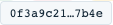

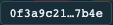

### Capture revision-chip-default

Supplied v5 revision primitive; no selector.

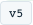

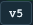

### Capture missing-reason-list-default

Supporting run-detail missing reasons, not a gallery component; producer/attempt links are absent.

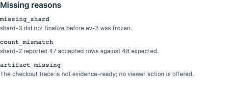

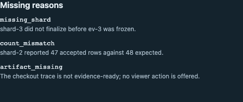

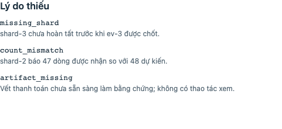

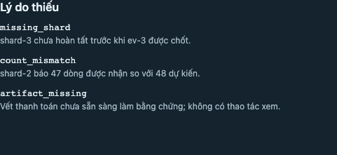

### Capture waiver-banner-default

Neutral historical-metadata banner proxy only; no waiver approver/expiry specimen exists here.

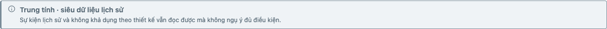

### Capture flaky-label-default

Supporting run-detail explanatory banner only; actual flaky-chip geometry remains open.

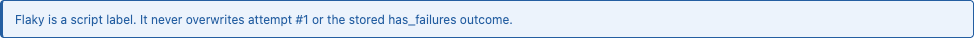

### Capture healed-label-default

Gallery chip-row primitives only (including unrelated source/filter examples); no healed composite or healing state is claimed.

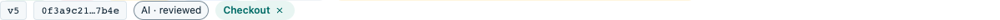

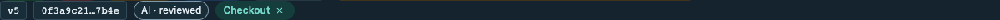

### Capture loading-pattern-loading

Authored gallery loading panel with text and info icon.

### Capture empty-pattern-empty

Authored empty panel and navigation action; no collection result is inferred.

### Capture error-pattern-error

Authored error panel and Retry button; no live retry is exercised.

### Capture forbidden-pattern-default

403 permission panel; no inferred access-request control.

### Capture not-found-pattern-default

404 panel shared by unknown/foreign identifiers.

### Capture conflict-dialog-default

Conflict comparison reference; both buttons merely close in the static gallery.

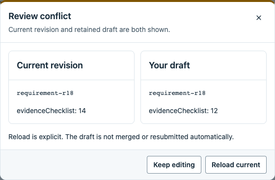

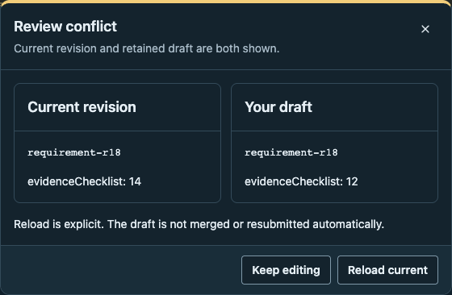

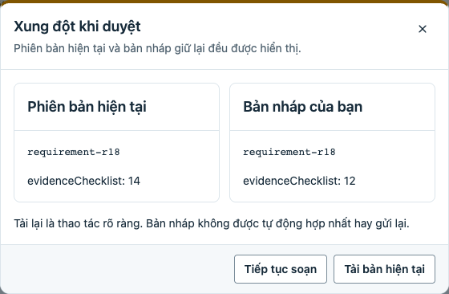

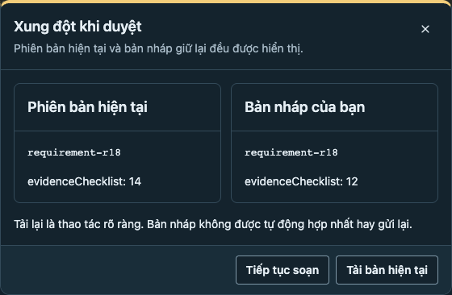

### Capture conflict-dialog-hover

Reload current hovered; no reload executed.

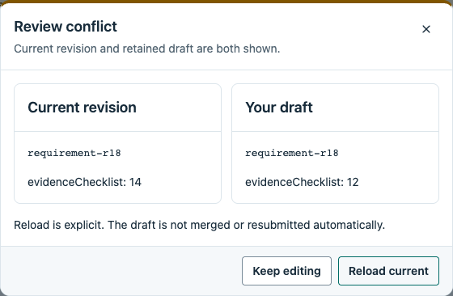

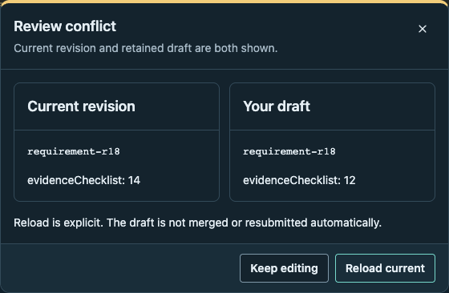

### Capture conflict-dialog-focus-visible

Reload current focused through keyboard Tab; ring visible.

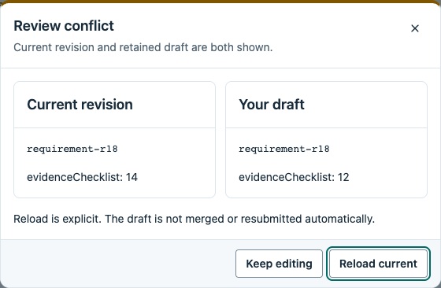

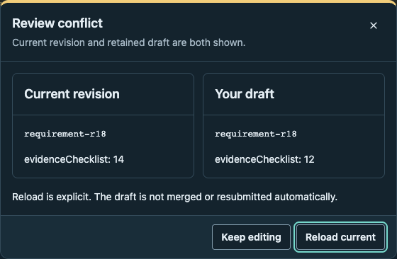

### Capture retry-after-default

429 explanatory panel; no fabricated numeric interval/countdown.

### Capture state-pattern-success

Generic supplied-server-result success panel G:521; not an evaluation verdict or T7 success inference.

## Component fg/bg pairs not yet in tokens.md

None. The pair the disabled-action recipe needs, `var(--eg-text-muted)` on `var(--eg-neutral-bg)`, was added to `contrast.py` by 09.1.1-T11.4 and is recorded in the [contrast table](tokens.md#contrast-table) (light 5.50, dark 6.07, both ≥ 4.5). A new pair introduced later goes through `contrast.py` first.

## Open questions and receiving tasks

These are source/implementation gaps, not permission to redesign the frozen mockup or declarations that Angular acceptance passed.

| Id               | Question and authoritative receiver                                                                                                                                                                            | Required evidence                                                                                                                                                                                  |
| ---------------- | -------------------------------------------------------------------------------------------------------------------------------------------------------------------------------------------------------------- | -------------------------------------------------------------------------------------------------------------------------------------------------------------------------------------------------- |
| O1               | **09.1.1-T7.1**, task §10 / FR-09-1/2: which exact SDK lifecycle/completeness values map to the generic B variants? What collection-complete copy replaces the gallery's unrelated Passed example?             | Explicit SDK mapping and specs preserving completeness/outcome/decision separation. AC8 already settles pending semantics; it is not an owner decision.                                            |
| O2               | **09.1.1-T7**, using tokens.md spacing and B: how is v2 badge vertical inset represented without a raw literal or a new unapproved token?                                                                      | Token-only component geometry and stated parity/adoption choice.                                                                                                                                   |
| O3               | **09.1.1-T7**, task §10 T7.1/2: what happens for absent/unknown badge/chip data and zero missing reasons?                                                                                                      | Explicit no-data rendering, never a fabricated complete/PASS/FAIL value.                                                                                                                           |
| O4               | **09.1.1-T7**, FR-09-5/6 and layout.md: what actual producer/attempt deep links and full identifier values are supplied, and how are unavailable/full hashes distinguished?                                    | Real SDK targets, accessible full-value behavior only where available, no invented tooltip recovery. R:112–114 lacks links; G:307 is already abbreviated.                                          |
| O5               | **09.1.1-T7.2**, FR-09-7: approved-waiver palette, final vi+en approver/expiry copy, expired/revoked rendering and leading-stripe token adoption are not specified by G:584.                                   | Actual waiver banner beside unchanged outcomes, with supplied approver/expiry and recorded contrast for any additional pair.                                                                       |
| O6               | **09.1.1-T7.2**, FR-09-3/4: exact flaky/healed chip palettes, vi+en wording and healed hash + shadow/official grouping are not assembled in the gallery.                                                       | Component specimens and specs keeping original failure visible and binding healed to the supplied hash.                                                                                            |
| O7               | **09.1.1-T8.1/T8.2**, task rows 181–182 and FR-09-13: actual retry disable/busy behavior, reload/diff destination, missing comparison/reload failure and focus restoration need implementation-specific specs. | Real conflict/retry dataflow and negative tests; no merge/resubmit on conflict. The gallery's current/draft ids are identical and Reload current only closes.                                      |
| O8               | **09.1.1-T7/T8**, tokens.md + layout.md: raw v2 dimensions/pressed movement not in the spacing/size inventory must not bypass style-tokens.                                                                    | Existing-token adoption or separately reviewed token extension, without silently copying raw component spacing. Reserved geometry, wrapping, keyboard focus and touch targets remain requirements. |
| O9               | **09.1.1-T8.2**, 00 §9.2 / G:520: numeric Retry-After presentation, invalid/missing interval copy and eligibility indication are not designed by the generic explanation.                                      | Server-supplied interval, no guessed countdown, bounded announcements, idempotent explicit retry tests.                                                                                            |
| Spec links       | **09.1.1-T7/T8**, T11.4 done-when: future component specs must link the anchors above.                                                                                                                         | Actual spec-header links once components exist; this sheet alone does not satisfy that future-file condition.                                                                                      |
| Dense-table demo | **09.1.1-T7**, re-handed from T11.4 (S62, D-S62-Q2); the receiving rows in [layout.md](layout.md#open-points--hand-overs) name T7. | Real token-styled CDK table checks for sticky header, numeric alignment, truncation/tooltip, mutation tagging and >200-row virtual scroll. This sheet does not claim that demo exists. |

## Evidence and limits

Graph tools used: list_projects, search_graph, get_file_outline and check_index_coverage. The assigned worktree is not indexed; coverage reported its absolute paths outside the main-project index and README outline had no nodes. Sources were therefore read from the assigned worktree through exact heading/range reads and literal searches, not assumed identical to main. No files under web-ui/output were changed.

One bounded design-interpretation judge batch supported render-only n/a handling, future-spec-link hand-over and explicit static conflict limitations: typesafe/jev-1.14.0, 3/3 done, 0 failed, cost $0.000044604. These classifications are not security/a11y certification. Captures are static visual evidence only; no Angular build, app integration, screen-reader, full responsive, API, reload or retry verification is claimed.
