# 13.1.1 — Feature tree and manual test cases

| Area plan | Milestone | Version | Size (area plan) | Re-estimate | Depends on (stories) | Blocks (stories) |
|---|---|---|---|---|---|---|
| `plans/13-product-phases.md` | G1 | V1 | 6.5 d (L + L + M + S + M) | 6.5 d — unchanged (one risk recorded, §10) | 01.4.1, 02.1.1, 02.2.1, 02.7.1, 03.1.1, 03.1.3 | 13.1.2, 13.2.1, 13.3.1, 13.4.1, 13.5.1, 13.9.1 |

> Contracts: 00 §2 (roles, permission strings), §3 (glossary: feature node, checklist item, manual test case, authoring version), §5.4 (tenancy rules 1–8), §5.5 (C1–C9), §5.7 (P1–P7, S1–S6), §7 (UUIDv7 ids, `sha256:` over RFC 8785, `Idempotency-Key`), §8.11 (authoring states), §9.1–§9.3 (envelope, codes, endpoints), §12 · `DECISIONS.md` §5 (safe healing), §7 (personal data) · rulings T2, T3, T11, T51, T52, T59, T94 · Area plan: `plans/13-product-phases.md` §2 FR-13-1/FR-13-2, §4.1 (`feature_node`, `checklist_item`, `manual_test_case`, `authoring_version`, `manual_case_link`), §4.2 flow 1, §5 (failure modes), §6 (permissions), §9 story 13.1.1 and tasks T1–T5, §13 CR-1/CR-2/CR-3.

## 1. Goal and non-goals

**Goal.** A project holds one authored requirement tree — module → feature → category → sub-category — with prioritised checklist items underneath and, under each item, manual test cases whose steps carry action / expected / data, each case with a project-prefixed `code`. Every mutation of a live entity appends exactly one immutable `authoring_version` row; the rows written by one command share one `batch_id`, which is the "authoring version" of 00 §3 in the timeline sense, and the timeline reads them newest-first with keyset pagination. Restore re-appends an old snapshot as a new version and never edits history. A manual test case can be linked to one or more `test_case` identities from the catalog (03.1.1) and the project can list the manual cases that no live catalog case covers. The whole tree round-trips through JSON, CSV and XLSX with the project's code prefix.

**Non-goals.** Batched review, pending changes, comment / merge / split (13.1.2 — it owns `authoring_change` and consumes the writer this story defines); project AI settings and templates (13.2.1); requirement → checklist → test case generation (13.3.1 writes `source = ai` versions and `ai_run_id` through this story's writer); any screen (13.4.1 renders these read models); `generated_script`, `element_profile`, script binding and stability (13.5, 13.6); the catalog itself — `test_case`, `test_revision`, suites and suites revisions (03) are read-only here; execution coverage, which 03.1.4 defines as declared-execution coverage and this story does not change (see §2 AC12); AI credit pricing (12.4.1-T4).

## 2. User stories and acceptance criteria

- As a QA lead, I model my product's requirements once (module → feature → category → checklist) and every test case hangs off that model with a readable project-prefixed code, so a ticket can name `SHOP-014` instead of a UUID.
- As a test maintainer, I review every edit after the fact: who changed what, in which batch, from which source, and I can put an older state back without losing the trail.
- As a QA engineer, I see which manual test cases have no automated case behind them, so the gap is visible before a release.

| # | Acceptance criterion (testable) | Refines |
|---|---|---|
| AC1 | `POST /v1/projects/{p}/authoring/nodes` creates a node whose `kind` and `parent_id` obey the depth ladder: `module` at the root (`parent_id` null), `feature` under `module`, `category` under `feature`, `sub_category` under `category`. Any other parent kind, a parent in another project, a parent that is soft-deleted, or a fifth level → `422 authoring_parent_invalid` with `details[].reason ∈ {parent_not_found, parent_kind_invalid, parent_deleted, depth_exceeded}` and no row. A `PATCH` that would make a node its own ancestor is refused with `details[].reason = cycle` — structurally unreachable while the kind ladder holds, kept as the defensive branch | plan 13 §9 story 13.1.1 ("module → feature → category → checklist item → manual test case"), FR-13-1 |
| AC2 | Sibling order is total and deterministic: `GET …/authoring/tree?parent_id=` returns live children ordered `(position, id)`; two **live** siblings can never share a `position` (`create unique index feature_node_sibling_position_uq … (org_id, project_id, parent_id, position) nulls not distinct where deleted_at is null` — partial, so a tombstone keeps its old number without blocking a new node, and `nulls not distinct` so two live **root** modules (NULL `parent_id`) cannot share a position either (0007:78 precedent; Postgres 18.6, `tests/Shared/ContainerImages.cs:11`)); `POST …/nodes/{n}/reorder` with the full ordered id list of the parent yields exactly those positions and one `authoring_version` row per moved node, and the renumber is **two-phased inside the one transaction** (shift every live sibling above `max(position)` for that parent, then assign the final positions) because a partial index cannot be deferred and would otherwise see a transient duplicate; `POST …/nodes` with an explicit `position` already taken by a live sibling → `422 request_invalid`, `details[].path = /position`, `reason = position_taken` (omitting `position` appends at `max + 1`) | plan 13 §4.1 (`position`) |
| AC3 | A checklist item attaches to a node of kind `category` or `sub_category` only (`422 authoring_parent_invalid`, reason `parent_kind_invalid`); `priority ∈ {critical, high, medium, low}` enforced by CHECK and by the request validator (422 `request_invalid`, `details[].path = /priority`); the item is created `active` when authored manually and `draft` when created with `source = ai` | plan 13 §4.1 (`checklist_item.priority`, `state`), §4.2 flow 1 |
| AC4 | A manual test case attaches to a live checklist item of the same project; the server allocates its `code` as `<PROJECT_PREFIX>-<n>` in the allocator's **own** short transaction (a second pooled connection, committed before the caller's transaction ends, so a rolled-back create burns the number and a project created in the caller's still-open transaction is invisible to it — Notes), unique per project (`unique (org_id, project_id, code)`), and the code is immutable afterwards (422 `request_invalid`, `details[].path = /code`). Two concurrent creates never share a code (counter row lock, §4) | plan 13 §4.1 (`code` with project prefix) |
| AC5 | Every mutating command of this story writes exactly one `authoring_version` row per changed entity, all rows of one command carrying one `batch_id`, with `change_kind ∈ {create, update, delete, restore, import}`, `source ∈ {manual, ai, import}`, `author_membership_id`, optional `reason`, the full `content` snapshot, and `content_hash = sha256:<hex>` over the RFC 8785 canonical form of `content`; a `no-op` PATCH (identical content) writes no version and returns `200 changed: false` | FR-13-1 |
| AC6 | `authoring_version` is append-only under the one rule every new append-only authoring table shares (13.2.1 §4 states it identically as `authoring_settings_immutable`): `UPDATE` is refused for **every** role, `evidgate_owner` included (`REVOKE` for `evidgate_app`, trigger `authoring_version_immutable` raising SQLSTATE 23514), and `DELETE` is refused for every role **except** `evidgate_owner`, the role an erasure purge must run as (`current_user = 'evidgate_owner'` inside a `security definer` function; precedent `evidgate.purge_expired_idempotency`, 0007:137-159; counter-precedent `audit_log`, 0015:124, which leaves the owner both). No such caller exists today: 06.4.4's `tenant.delete` does its per-target work as the app role (06.4.4:58) and its row purge (T1.2, 06.4.4:115) would be refused here, so 06.4.4-T1.2 and 11.2.1 reach this table only through an owner-owned `security definer` purge function (§7 hand-off). Per layer: an `UPDATE`/`DELETE` as `evidgate_app` fails at the ACL (42501) before any trigger, an owner `UPDATE` raises 23514, an owner `DELETE` succeeds — erasure is therefore a physical owner `DELETE`, never an `UPDATE` | FR-13-1, 00 §5.5 C6 |
| AC7 | Deleting a node that has live children, a node that still holds live checklist items, or an item that still holds live manual cases → `409 authoring_not_empty` with `details[].reason ∈ {node_has_children, node_has_items, item_has_cases}` and nothing changes. Deleting a leaf is a soft delete (`deleted_at` set, version bumped): the row stays, its history and its links stay, it disappears from every list and from the tree | plan 13 §4.1 (history), FR-13-1 |
| AC8 | `POST …/authoring/nodes/{n}/restore`, `…/checklist-items/{i}/restore` or `…/manual-cases/{m}/restore` on a soft-deleted entity appends a new `authoring_version` row (`change_kind = restore`) carrying the last live snapshot, clears `deleted_at` and returns `200` with the new `version` = previous + 1; when a live sibling already holds the restored entity's old `position`, restore re-appends it at `max + 1` and the new version's `content` records the new position — restore never fails on a position clash; `POST …/authoring/versions/{v}/restore` does the same for any non-deleted entity from `v`'s snapshot. History rows are never modified; restoring a version whose entity row is gone → `404`. Restoring an entity whose parent is still soft-deleted — a node under a deleted parent, an item under a deleted node, a case under a deleted item — is refused with `422 authoring_parent_invalid`, `details[].reason = parent_deleted` and nothing written: the parent is restored first, then the child. A restored checklist item is `active` again and a restored manual case `draft` again, whatever state they held before (§6, AC20/AC21; `AuthoringVersionWriter.cs:415-416`, `:584-586`) | FR-13-1 ("restore creates a new version") |
| AC9 | `GET …/authoring/versions` returns a keyset page (`limit` default 50, max 200, ordering `(created_at desc, id desc)`) with filters `entity_kind`, `entity_id`, `source`, `actor_membership_id`, `from`, `to`; the page carries `batch_id` per row so the UI groups one batch into one version; the handler issues a bounded number of SQL statements (P3) and every filter is served by a declared index (P4). `GET …/authoring/versions/{v}` returns the stored `content` and `content_hash` verbatim | FR-13-1, 00 §9.1 pagination |
| AC10 | Cross-tenant and cross-project addressing is indistinguishable from absence: another org's node / item / case / version id → `404`; a credential scoped to a sibling project → `403 project_scope_mismatch`; unset tenant GUC → zero rows, never all rows | 00 §5.4.7, T2 |
| AC11 | `POST …/authoring/manual-cases/{m}/links` with `{test_case_id}` creates one `manual_case_link` when the `test_case` is live (`status <> 'archived'`, 0020:41) and in the same project; a repeat returns `200 changed: false`; an unknown, archived or other-project case → `422 request_invalid` with `details[].path = /test_case_id`, `reason ∈ {case_not_found, case_archived}`, and no echo of catalog internals. `DELETE …/links/{c}` removes the link; links are many-to-many in both directions | FR-13-2 |
| AC12 | `GET …/authoring/manual-cases?covered=false` lists manual cases that **no** live `manual_case_link` reaches (`linked_live_count = 0`), `covered=true` the complement, and each item carries `linked_live_count` and `linked_case_ids`; the filter is index-served and statement-bounded. "Covered" here means *linked to at least one live catalog `test_case`*; it is **not** 03.1.4's execution coverage (declared case × variant executions with an accepted result, 03.1.4:11/27) and the two numbers must never be presented as one | FR-13-2; 03.1.4 (non-contradiction) |
| AC13 | `POST …/authoring/import?format=json\|csv\|xlsx` validates the whole file first and then applies it in **one** transaction with **one** `batch_id`: a valid file creates/updates nodes, items and cases and returns `200 {batch_id, counts, rows[]}`; any invalid row aborts everything (`422 request_invalid`, one `details[]` entry per offending row with `index`, `path`, `reason ∈ {unknown_parent, orphan_row, duplicate_key, code_conflict, unsupported_format, value_invalid, steps_invalid}`) and no row of any table changes. `dry_run=true` returns the same report and writes nothing | plan 13 §9 T5 |
| AC14 | Import and export round-trip: export writes every row with a deterministic `key` (and `parent_key` / `item_key`), and importing the file into an empty project reproduces the same tree, items and cases; equality is asserted on the **export-normalised projection** of `content` (the §4 field list, with every project-local uuid replaced by that row's export key), so JSON, CSV and XLSX produce identical projections for the same tree. Raw `content_hash` equality is asserted only for a re-import into the same project (AC15), because a cross-project import assigns new ids. Text is written NFC with a UTF-8 BOM in CSV/XLSX export and normalised to NFC on import | plan 13 §9 T5 ("round-trip tests") |
| AC15 | Re-importing an identical file changes nothing: every row reports `unchanged`, no `authoring_version` row is written, and the returned `batch_id` is null; a row whose `code` matches a live case but whose content differs is an `update`, and a row whose `code` matches a **soft-deleted** case restores it (`change_kind = restore`) | plan 13 §9 T5 ("idempotent"), FR-13-1 |
| AC16 | Hostile input is bounded and reported, never executed: CSV/XLSX cells beginning with `=`, `+`, `-`, `@`, tab or CR are stored as literal text (export prefixes them with `'` so a spreadsheet cannot evaluate them); a file over 5 MiB or over 5 000 data rows → `413 payload_too_large`; an XLSX archive whose expanded size exceeds 64 MiB, whose entry count exceeds 1 000, whose compression ratio exceeds 20:1, or which declares a DTD/external entity or a macro part → `422 request_invalid` with `details[].reason ∈ {zip_size_exceeded, zip_entries_exceeded, zip_ratio_exceeded, dtd_prohibited, macro_prohibited}` | 00 §5.7 S5; 06.3.1 |
| AC17 | Authorization is per route in the C2 pipeline: `authoring:read` on every GET, `authoring:write` on every other route; a principal without the code → `403 forbidden` before the body is read; `contracts/openapi.yaml` carries `x-permission` on all 26 operations and `Architecture.Tests` fails when a handler's declared permission differs (T51). The seed carries **all four** codes of plan 13 §6 and CR-2 with the 00 §2 role mapping: `authoring:read` — `viewer`, `qa_engineer`, `test_maintainer`, `release_approver`, `tenant_admin`; `authoring:write` and `authoring:generate` — `qa_engineer`, `test_maintainer`, `tenant_admin`; `script:generate` — `test_maintainer`, `tenant_admin`. Only `read` and `write` gate a route here; `authoring:generate` (13.3.1) and `script:generate` (13.5.1) are catalogue rows until their stories add the routes, and no role outside those lists may hold any of the four (the seed test asserts the exact mapping both ways). Service identities (`ci_producer`, `agent`) hold no `authoring:*` and no `script:generate` code | 00 §2:60, plan 13 §6:99, CR-2 (plan 13:264), T51, T59 |
| AC18 | Every successful mutating command appends exactly one `audit_log` row (the 02.7.1 `[AuditedAction]` + `IAuditTrail` pattern, action `authoring.*`), and an `Idempotency-Key` replay appends none (`IAuditTrail.Suppress`, `AuditTrail.cs:32`); a missing `Idempotency-Key` on a mutating route → `400 request_invalid`, `details[].path = /Idempotency-Key`, `reason = required` | 00 §9.1, 02.7.1 |
| AC19 | Every route whose §5 concurrency column says `If-Match` — `PATCH`/`DELETE`/`reorder` and `POST …/manual-cases/{m}/item` (AC22) — requires it; absent → `422 request_invalid` (`details[].path = /If-Match`, `reason = required`, the repo-wide precedent at `CatalogEndpoints.cs:382-402`), stale → `412 precondition_failed` with the current `version` in `error.details`, and **nothing** changes (no `authoring_version` row, no audit row) | 00 §9.1, plan 13 §5 ("Two editors change one item") |
| AC20 | `checklist_item` states follow §6 exactly: `draft → active` and `{draft, active} → retired` are accepted, `retired → active/draft` and any edit of a `retired` item are `409 invalid_transition`, and restore returns it to `active` as a new version. A transition into `retired` without a `reason` of 1..500 code points (a whitespace-only reason counts as a reason — one counting and whitespace rule for every authoring reason, Notes) → `422 request_invalid`, `details[].path = /reason`, `reason = required`, nothing written. The `draft → active` flip of an AI-created item belongs to 13.3.1's accept step (it calls this story's writer) or to an explicit `PATCH {state: active}` by an author; 13.1.2's apply never flips a state | 00 §8.11 (planned), plan 13 §4.2 flow 1 |
| AC21 | `manual_test_case` states follow §6 exactly: `draft → approved` (the `reason` is optional) and `{draft, approved} → retired` (a `reason` of 1..500 code points is required, absent → `422 request_invalid`, `details[].path = /reason`, `reason = required`) are accepted, `retired → draft/approved` is `409 invalid_transition`, restore sets `draft`; the approved-cases read service that 13.5.1 consumes returns `approved` cases only (never `draft` or `retired`) | 00 §8.11 (planned), plan 13:167 |
| AC22 | A live manual test case moves between checklist items of the same project: `POST …/authoring/manual-cases/{m}/item` with `{checklist_item_id, reason?}` re-parents it, keeps its `code`, bumps its `version` by 1 and appends exactly one `authoring_version` row (`change_kind = update`, the new `checklist_item_id` in `content`, `reason` ≤ 500 code points — longer → `422 request_invalid`, `details[].path = /reason`); a move onto the item it already sits under writes no version row and returns the unchanged `version` (the AC5 no-op rule). A missing, soft-deleted or other-project target item → `422 authoring_parent_invalid` with `details[].reason = parent_not_found` / `parent_deleted` (AC1's reasons); a `retired` target item or a `retired` case → `409 invalid_transition`; nothing changes on any refusal. Two concurrent moves of one case: exactly one applies, the loser gets `412 precondition_failed` on the stale `If-Match` | FR-13-1 (re-parenting is a new version); 13.1.2-T2 merge/split hand-over, OI-13-127 |

## 3. Contracts touched

Everything below is **planned** in this story; nothing here edits `contracts/` today.

- **00 §2 — permissions (CR-2, plan 13:264):** add `authoring:read`, `authoring:write`, `authoring:generate` and `script:generate` to `contracts/permissions.json` and to the seed of `migrations/NNNN_identity_authoring_permissions.sql`. The mapping is 00 §2:60, which is authoritative for `authoring:*` and `script:*` (`migrations/0010_identity_permission_catalogue.sql:298-302` shows the seeded role shape): `authoring:read` = every member role (`viewer`, `qa_engineer`, `test_maintainer`, `release_approver`, `tenant_admin`); `authoring:write` and `authoring:generate` = `qa_engineer`, `test_maintainer`, `tenant_admin`; `script:generate` = `test_maintainer`, `tenant_admin`. `release_approver` writes nothing here, matching its read-only cells in `plans/03-catalog-authoring.md` §4.5. 03 §4.5:136 ("`qa_engineer` reads and drafts, never writes a case") governs `case:write` only and is untouched by this story; 00 §2:60 deliberately maps `authoring:write` to `qa_engineer`, the G1 authoring persona. `authoring:generate` and `script:generate` are seeded catalogue rows in this story: no route of 13.1.1 declares them, 13.3.1 generates and 13.5.1 writes a repository pull request.
- **00 §3 — glossary (CR-13-1, planned wording change):** CR-1 (plan 13:263) already added `feature node`, `checklist item`, `manual test case`, `authoring version` (00:99-102). This story implements them. 00:102 defines an authoring version as a *project-wide* snapshot after a batched change while this story stores one row per changed entity: the rows sharing one `batch_id` **are** that snapshot, and the timeline groups by `batch_id`. 00:100 ("changed only through a batched pending change that applies as one version") and 00 §8.11:313 ("`applied` writes exactly one immutable authoring version") are refined the same way: every mutating route that touches a versioned entity writes versions directly — 2, 3, 4, 5, 6, 8, 9, 10, 11, 13, 15, 16, 17, 18, 19, 24 and the import route 25 (one `batch_id` per command) — while the two link routes 20/21 write no version, because a link is not a versioned entity; review actions — comment, merge, split, delete of an item — go through 13.1.2's pending changes, and one apply writes one `batch_id` group with one `authoring_version` row per affected entity, which is "one authoring version" in the 00 sense. The default is in force in this story and 13.1.2; OI-13-106 carries the TL ratification and the exact 00 §3/§8.11 wording.
- **00 §8.11 — states (CR-13-1, applied in this PR; OI-13-104 decided by the owner 2026-10-23 in chat):** adds `checklist_item` (`draft → active → retired`) and `manual_test_case` (`draft → approved → retired`), both with restore-as-a-new-version, as §6 specifies, and logs the change in 00 §15 in the same change. Plan 13 §4.1 names a `state` column for checklist items without values (plan 13:41) and none for manual cases (plan 13:42), while 13.5.1 (plan 13:167) generates only from an *approved* test case, so the values must exist before 13.5.1 is planned.
- **00 §9.2 — error codes:** two new codes, both prefixed by the domain and listed in `contracts/openapi.yaml` (T52: the OpenAPI document is the only source of the list). **Timing:** T1 adds the two `ApiErrorCode` constants to `src/BuildingBlocks/SharedKernel/Api/ErrorEnvelope.cs` because T1.3's aggregates and T1.4's writer raise them (`authoring_parent_invalid` 422 for the kind ladder, a missing/deleted/other-project parent and a restore under a deleted parent — AC1/AC3/AC8; `authoring_not_empty` 409 for a refused delete — AC7), while the 00 §9.2 list and `contracts/openapi.yaml` only carry them with **13.1.1-T2.4**, whose row in the 00 §15 change log is T2's (this story's §15 row is the §8.11 state lists only):
  - `authoring_parent_invalid` — 422, `retryable: false`, message key `error.authoring_parent_invalid` (vi "Cây chức năng không hợp lệ ở vị trí này" / en "Invalid position in the feature tree"), reasons `parent_not_found`, `parent_kind_invalid`, `parent_deleted`, `depth_exceeded`, `cycle`;
  - `authoring_not_empty` — 409, `retryable: false`, message key `error.authoring_not_empty` (vi "Mục này còn nội dung bên trong" / en "This entry still has content inside"), reasons `node_has_children`, `node_has_items`, `item_has_cases`.
  Everything else reuses the existing codes (`request_invalid` 422 / 400, `precondition_failed` 412, `invalid_transition` 409, `payload_too_large` 413, `not_found` 404, `forbidden` 403, `project_scope_mismatch` 403, `idempotency_conflict` 409 — `ErrorEnvelope.cs:44-53,95-104,129,144`).
- **00 §9.3 — endpoints:** add one block row for the authoring routes of §5 (the V1 table has no authoring row today).
- **00 §15 — change log:** this change adds its own row (2026-10-23, CR-13-1: the §8.11 `checklist_item`/`manual_test_case` states and the OI-13-104 decision); 13.1.1-T2 adds a second row when it lands, covering §2, §9.2 and §9.3.
- **`contracts/openapi.yaml`:** 26 operations (§5) each with `x-permission`, request/response schemas `$ref`-ing the contract files below, per-route body caps, and `If-Match`/`Idempotency-Key` header parameters. The case-move operation (route 19, AC22) is a flat `{checklist_item_id, reason?}` body and needs no schema file of its own.
- **`contracts/schemas/authoring-steps.v1.json`** (new): the manual test case `steps` document — `{steps: [{no, action, expected, data?}]}`, 1..100 steps, each field ≤ 2 000 characters, unknown members refused. It lives in `contracts/schemas/` because `ContractSchemaRegistryTests` discovers schemas recursively only under `contracts/{schemas,adapter/**,manifest}` and asserts every discovered key (`ContractSchemaRegistryTests.cs:11,48`); a new `contracts/authoring/` directory would be invisible to it.
- **`contracts/schemas/authoring-import.v1.json`** (new): the JSON import document (tree + items + cases with `code`), validated by Corvus at the edge before binding; CSV and XLSX are parsed into the same document shape and validated by the same schema.
- **`contracts/permissions.json`:** the four codes above plus their role mapping (planned; the seeded copy in migration 0010 is self-contained by design, `0010_identity_permission_catalogue.sql:3-5`, so the new codes land in a **new** migration that embeds the same JSON, not by editing 0010).
- **`contracts/rls-exceptions.txt`:** no entry. Every table of this story is org-scoped, carries `unique (org_id, id)` and a `FORCE ROW LEVEL SECURITY` policy — the exception list's three kinds (`platform`, `catalogue`, `mechanism`, `rls-exceptions.txt:1-20`) do not apply, and 02.6.1-T2's lint must see all six tables.
- **Generated SDK (`packages/sdk`):** regenerated after the OpenAPI change in the same task; the web feature data services (09/13.4.1) never hand-write DTOs (00 §5.6 W5).
- **`Evidgate.Modules.Authoring.Contracts`** (new project; the module pair itself is `Evidgate.Modules.Authoring` + `.Contracts`, 00 §5.5): three read interfaces other stories consume —
  - `IAuthoringProvenanceReader.ResolveAsync(projectId, entityKind, entityId)` → `AuthoringVersionRef(version_id, version_no, content_hash, batch_id)`, the authoring component of generation provenance (FR-13-3) for 13.3.1-T1 and of the cache key of 08.5.1-T1;
  - `IManualCaseReadService.ListApprovedAsync(projectId, ids?)` → `ApprovedManualCase(case_id, code, version_no, content_hash, steps, priority)`, consumed by 13.5.1-T1 and 13.3.1-T4;
  - `IAuthoringCoverageReader.CountUncoveredAsync(projectId)` → `(uncovered, total)`, consumed by 13.9.1-T1 (gate metric input) and the UI.
- **No** change to `contracts/events/`, `contracts/manifest/`, or any catalog contract: `test_case` is read, never written.

## 4. Data model and migrations

Two migrations, both forward-only with the `NNNN_<module>_<change>.sql` name contract (`migrations/README.md` file contract) and the next free number at build time (0039 today, assigned when the migration is written):

**`migrations/NNNN_authoring_tree.sql`** (T1):

```sql
-- 1. the code prefix source (project is 02.1.1's table, 0005:28-45 — additive column).
-- The value is stored, never recomputed from the slug, so a later grammar change (OI-02-01)
-- never rewrites an existing prefix and never invalidates an existing case code.
alter table public.project add column if not exists case_prefix text;

-- Two functions keep the backfill and every later INSERT in agreement: `case_prefix_stem` (below) builds the stem, and the delivered candidate search `evidgate.next_case_prefix_unlocked(org, slug)` pairs it with a free suffix; the backfill calls the core (the backfill call in `0039_authoring_tree.sql`) and the INSERT trigger calls the wrapper `evidgate.next_case_prefix` (the wrapper in the same migration), which adds the per-org `pg_advisory_xact_lock` (both functions and the trigger call in that migration).
-- `^[a-z0-9][a-z0-9-]{0,61}[a-z0-9]$` (0012_tenancy_slug_grammar.sql:25-29, which replaced
-- 0005:42; OI-02-01 / D-A1 may widen it and the derivation moves with it). Steps: drop every
-- non-alphanumeric, take the first four characters, upper-case, and prepend `P` when the
-- result does not start with a letter (`123-shop` → `123S` → `P123S`, `flashcards` → `FLAS`,
-- `shop-web` → `SHOP`, `ab` → `AB`). The `length(stem) < 2` branch is unreachable under this
-- grammar (a slug carries at least two alphanumerics) and stays as the guard for a widened
-- one. The result is 2–5 characters and always matches the format check below.
create or replace function evidgate.case_prefix_stem(slug text) returns text
  language sql immutable as $$
  select case when stem ~ '^[A-Z]' and length(stem) >= 2 then stem else 'P' || stem end
  from (select upper(substring(regexp_replace(slug, '[^a-z0-9]', '', 'g') from 1 for 4)) as stem) s
$$;
revoke all on function evidgate.case_prefix_stem(text) from public;
grant execute on function evidgate.case_prefix_stem(text) to evidgate_app;   -- 0001:104

-- The unique index is created **before** the backfill, on the still-nullable column (NULLs are
-- distinct, so the empty state passes): any duplicate the loop below would ever assign aborts
-- the migration with 23505 on project_org_case_prefix_uq instead of sharing a prefix.
create unique index project_org_case_prefix_uq on public.project (org_id, case_prefix);

-- Collision-free and deterministic, and provably so. The oldest project of one org keeps the
-- bare stem (created_at, id order); every other project takes the first candidate that **no
-- row of that org already holds** — the check runs against the whole org, not against the
-- stem's own partition, because two different stems can meet: `sho`, `sho` and `sho2` stem to
-- `SHO`, `SHO`, `SHO2`, and a per-stem counter would hand `SHO2` to the second `sho` project
-- and then `SHO2` again to `sho2` (same for `123`, `123` and `1232` → `P123`, `P1232`,
-- `P12322`). The candidate loop therefore advances until the value is unused in the org. The
-- suffix truncates the stem so the value stays inside the 8-character format check; candidates
-- are finite (n ≤ 9 999 999) and an org that exhausts them raises instead of writing a
-- duplicate. The assignment order is the one thing a rerun depends on, so it is total. Delivered: the inner candidate loop is `evidgate.next_case_prefix_unlocked(org, slug)` (in `0039_authoring_tree.sql`), which the backfill calls (the backfill call there) under the migration's ACCESS EXCLUSIVE lock, the INSERT path calls through the advisory-locked wrapper `evidgate.next_case_prefix` (the wrapper, called from the trigger), and the `do` block below is the sketch of that backfill.
do $$
declare
  r record;
  cand text;
  n integer;
begin
  for r in select p.id, p.org_id, evidgate.case_prefix_stem(p.slug) as stem
             from public.project p
            where p.case_prefix is null
            order by p.org_id, p.created_at, p.id
  loop
    n := 1;
    loop
      cand := case when n = 1 then r.stem
                   else left(r.stem, 8 - length(n::text)) || n::text end;
      exit when not exists (
        select 1 from public.project q
         where q.org_id = r.org_id and q.case_prefix = cand);
      n := n + 1;
      if n > 9999999 then
        raise exception 'case_prefix exhausted for org %', r.org_id using errcode = '23505';
      end if;
    end loop;
    update public.project set case_prefix = cand where id = r.id;
  end loop;
end
$$;
alter table public.project alter column case_prefix set not null;
alter table public.project add constraint project_case_prefix_format
  check (case_prefix ~ '^[A-Z][A-Z0-9]{1,7}$');

-- 2. the tree
create table public.feature_node (
  id uuid not null, org_id uuid not null, project_id uuid not null,
  parent_id uuid,
  kind text not null check (kind in ('module','feature','category','sub_category')),
  title text not null check (char_length(title) between 1 and 200),
  position integer not null check (position >= 0),
  deleted_at timestamptz,
  created_at timestamptz not null default now(), updated_at timestamptz not null default now(),
  version integer not null default 1,
  constraint feature_node_pkey primary key (id),
  constraint feature_node_org_id_key unique (org_id, id),                      -- T3
  constraint feature_node_project_id_key unique (org_id, project_id, id),       -- same-project FK target
  constraint feature_node_project_fk foreign key (org_id, project_id)
    references public.project (org_id, id),
  constraint feature_node_parent_fk foreign key (org_id, project_id, parent_id)
    references public.feature_node (org_id, project_id, id),                    -- parent in the same project
  constraint feature_node_parent_not_self check (parent_id is null or parent_id <> id)
);
-- Live siblings only: a tombstone keeps its old `position` and can never block a new node.
-- `nulls not distinct` (0007:78; Postgres 15+, the image is 18.6) makes the NULL parent of two
-- root modules compare equal, so roots obey the same uniqueness rule as children.
-- A partial index cannot be DEFERRABLE, so the reorder renumber is two-phased (AC2).
create unique index feature_node_sibling_position_uq
  on public.feature_node (org_id, project_id, parent_id, position) nulls not distinct
  where deleted_at is null;
create index feature_node_tree_idx on public.feature_node (org_id, project_id, parent_id, position, id)
  where deleted_at is null;                                                     -- P4: the only list order
```

- `checklist_item` (`org_id`, `project_id`, `id`, `feature_node_id`, `title` 1..500, `description` ≤ 4 000, `priority` in the four values of plan 13 §4.1, `state` in `draft|active|retired`, `source` in `manual|ai|import`, `position`, `deleted_at`, timestamps, `version`): `unique (org_id, id)`, `unique (org_id, project_id, id)`, composite FK `(org_id, project_id, feature_node_id)` → `feature_node`, `create index checklist_item_list_idx on checklist_item (org_id, project_id, feature_node_id, state, position, id) where deleted_at is null`.
- `manual_test_case` (`checklist_item_id`, `code`, `title` 1..500, `description`, `precondition` ≤ 4 000, `steps jsonb`, `priority`, `state` in `draft|approved|retired`, `source`, `deleted_at`, timestamps, `version`): `unique (org_id, id)`, `unique (org_id, project_id, id)` (the composite-FK target `manual_case_link_case_fk` references, §4:137-139), `unique (org_id, project_id, code)` (idempotent re-import, AC15), composite FK `(org_id, project_id, checklist_item_id)`, `check code ~ '^[A-Z][A-Z0-9]{1,7}-[0-9]{3,10}$'`, `check jsonb_typeof(steps) = 'object'`, index `(org_id, project_id, checklist_item_id, state, code)`.
- `authoring_code_counter` (`id`, `org_id`, `project_id`, `next_value bigint not null default 1 check (next_value between 1 and 1000000001)`, `primary key (org_id, project_id)`, `unique (org_id, id)` - the surrogate tenant key the convention scan demands (`SchemaConventionScan.cs:186-191`), so no `rls-exceptions.txt` entry is needed; `id` is a plain application UUIDv7 with no database default): allocation is `insert … on conflict do nothing` then `update … set next_value = next_value + 1 where org_id = @o and project_id = @p returning next_value - 1`, i.e. the row lock serialises allocators (the 08 T32 `UPDATE … RETURNING` pattern). The allocator opens its own connection and transaction and commits at once (Notes): the number is spent even when the caller's transaction rolls back, and a project created in a still-open caller transaction is not visible to it. The number is formatted with a minimum of three digits (`007`, `1000`), and the check caps one project at 10⁹ codes — beyond it the allocator returns `409 quota_exceeded` (an existing code, `ErrorEnvelope.cs:135`) instead of writing a code the format check would refuse. Codes are therefore unique but **not** gapless: a rolled-back create burns a number, which is recorded here rather than hidden.
- `authoring_version` (append-only): `id`, `org_id`, `project_id`, `entity_kind text check in ('feature_node','checklist_item','manual_test_case')`, `entity_id`, `version_no integer check >= 1`, `batch_id uuid not null`, `change_kind text check in ('create','update','delete','restore','import')`, `content jsonb not null`, `content_hash text check like 'sha256:%'`, `source text check in ('manual','ai','import')`, `author_membership_id uuid`, `reason text check (char_length(reason) between 1 and 500)` nullable, `ai_run_id uuid`, `created_at timestamptz not null default clock_timestamp()`; `unique (org_id, id)`, `unique (org_id, project_id, entity_kind, entity_id, version_no)`, composite FK `(org_id, author_membership_id)` → `membership` (as 0020:40 does); indexes `(org_id, project_id, created_at desc, id desc)` for the timeline and `(org_id, project_id, batch_id)`. `ai_run_id` is `healing_llm_call.id` — the run table owned by 08.5.1-T1 (`plans/08-healing-learning.md:76`, `unique (org_id, id)`) and written by 13.3.1 with `purpose = authoring_generation`. It is a plain `uuid` with **no** FK in this migration; the composite FK `(org_id, ai_run_id)` → `healing_llm_call (org_id, id)` is added when 08.5.1 lands (the 05.1.1 §3 ordering note precedent).
- **Immutability guard on `authoring_version`, one rule for every new append-only authoring table** (AC6; 13.2.1 §4 `authoring_settings_immutable` is the same rule, and so is 13.1.2's `checklist_item_lineage`): `UPDATE` raises for every role, `evidgate_owner` included; `DELETE` raises for every role except `evidgate_owner`. Two enforcement layers per C6 — the `REVOKE` speaks to `evidgate_app`, the trigger to everyone else:

```sql
create or replace function evidgate.authoring_version_immutable() returns trigger
  language plpgsql as $$
  begin
    if tg_op = 'UPDATE' then
      raise exception 'authoring_version_immutable: an authoring version is append-only (UPDATE)'
        using errcode = '23514';
    elsif current_user <> 'evidgate_owner' then
      raise exception 'authoring_version_immutable: only the owner erasure path deletes a version (DELETE)'
        using errcode = '23514';
    end if;
    return old;
  end
  $$;
revoke all on function evidgate.authoring_version_immutable() from public;
create trigger authoring_version_immutable
  before update or delete on public.authoring_version
  for each row execute function evidgate.authoring_version_immutable();
grant select, insert on public.authoring_version to evidgate_app;
revoke update, delete on public.authoring_version from evidgate_app;
revoke all on public.authoring_version from evidgate_worker_sched;
grant select on public.authoring_version to evidgate_operator;   -- 0021:72-75 role shape
```

  Why the owner keeps `DELETE`: an erasure must be able to remove a version row, and the only safe shape is a `security definer` function owned by `evidgate_owner` (`current_user = 'evidgate_owner'` inside it), exactly like `evidgate.purge_expired_idempotency` deletes expired rows (0007:137-159) under T80's definer hygiene (`set search_path = ''`, schema-qualified references, `EXECUTE` to a dedicated role — `plans/features/README.md:144`). That caller does not exist yet and is a **hand-off, not a fact**: 06.4.4's `tenant.delete` handler does all per-target work inside `ITenantScope` as the app role (06.4.4:58) and its row purge (06.4.4-T1.2, 06.4.4:115) would be refused by this table's `REVOKE` and trigger, so 06.4.4-T1.2 and 11.2.1 must reach `authoring_version` through such an owner function (§7 hand-off bullet) — otherwise a project or tenant delete of a project with authoring rows cannot complete. `audit_log` (0015:124) is the counter-precedent: it revokes both from `evidgate_app` only and leaves the owner free to `UPDATE`, which this rule does not copy, because a rewritten version row silently breaks `content_hash` and the timeline. `manual_case_link` is **not** append-only — route 21 unlinks, so the app deletes links — and therefore takes `revoke update` + `grant delete` with no trigger; `feature_node`, `checklist_item` and `manual_test_case` get `grant select, insert` and `revoke delete` (0005:96-98 precedent), so a physical delete stays an owner-path operation and the app only ever sets `deleted_at`.
- The `set_updated_at_and_version()` trigger is attached to `feature_node`, `checklist_item` and `manual_test_case` (function 0004:70-78; `project` already has it, 0005:50-54). `authoring_code_counter` and `authoring_version` deliberately carry no `version` column.
- **`content` snapshot, defined here for AC5/AC14.** `content` is the entity's mutable user-visible state and nothing else: `feature_node` → `{kind, title, position, parent_id}`; `checklist_item` → `{feature_node_id, title, description, priority, state, position}`; `manual_test_case` → `{checklist_item_id, code, title, description, precondition, steps, priority, state}`. Excluded: `id`, `org_id`, `project_id`, `created_at`, `updated_at`, `deleted_at`, `version` (and `source`/author/`reason`, which are columns of the version row). Parent and item references stay **id-valued** inside `content`, so re-parenting is a new version (AC22's case move and the `parent_id` change of route 3 both rely on this); therefore AC14 compares the export-normalised projection (project-local uuids replaced by export keys) across projects, while raw `content_hash` equality is asserted only inside one project (AC15).
- Restore follows the sibling rule of AC2: when a live sibling already occupies the restored row's `position`, the row re-appends at `max + 1` and the version snapshot records the new position — the partial unique index refuses a clash, so the command resolves it before writing rather than surfacing a 23505. A child never comes back under a tombstoned parent: restoring a node whose parent, an item whose node, or a case whose item is still soft-deleted is `422 authoring_parent_invalid` with `details[].reason = parent_deleted` and nothing written (AC8).
- RLS on the five tables of this migration: `enable` + `force row level security` (the `project` additions are one column and one index; `project` already carries its policy), tenant policy `for all to evidgate_app using (org_id = evidgate.current_org_id()) with check (org_id = evidgate.current_org_id())` (0020/0015 pattern, T2), **and** one permissive owner policy `<table>_owner_backfill for all to evidgate_owner using (true) with check (true)` on each of the five (0004:112-115, 0005:85-89, 0021:68-71 precedent) — `force row level security` binds the owner too, so without it the owner backfill and the 11.2.1 erasure sweep would update and delete zero rows without failing (0010:237-260 note). The owner policy is `for all` because the erasure sweep needs `DELETE` on `authoring_version`; it is the **trigger**, not the policy, that refuses an owner `UPDATE` (AC6) — a policy grants a capability, the guard is what narrows it, and `manual_case_link` gets the same pair when T4 creates it.
- Ids are **UUIDv7 generated by the application** (00 §7:241): `uuid` columns with no database default and no `gen_random_uuid()`, the same plain UUID string in JSON; this holds for the six tables and for `batch_id`.
- Schema-convention allow-list: `authoring_version` (append-only: `created_at` only), `authoring_code_counter` (counter: no timestamps at all) and `manual_case_link` (link: `created_at` only) carry no `updated_at`/`version`, so each gets a `SchemaExemption` entry in `tests/Persistence.IntegrationTests/SchemaConventionScan.cs` (`AuditColumns | VersionTrigger`, the `public.test_revision` precedent at `:58-61`) and the pinned `SchemaConventionAllowListTests` (`SchemaConventionTests.cs:505`) grows by the same three rows. Delivered, `authoring_code_counter` carries a surrogate `id uuid not null` with `unique (org_id, id)` (`authoring_code_counter`'s `create table` in `0039_authoring_tree.sql`, with the reason in that migration's `[DECISION] deviations` header bullet), which satisfies the scan's unique-key rule (`SchemaConventionScan.cs:186-191`) with no exception entry, so its exemption is `AuditColumns | VersionTrigger` only - `SchemaRule.TenantKey` is **not** added and the `public.task` precedent (`SchemaConventionScan.cs:44`) does not apply to this table. The counter has no timestamps at all, and its `org_id`, `RLS` policy and `evidgate_owner` policy stay **inside** the scan.

**`migrations/NNNN_authoring_manual_case_link.sql`** (T4):

```sql
create table public.manual_case_link (
  id uuid not null, org_id uuid not null, project_id uuid not null,
  manual_test_case_id uuid not null, test_case_id uuid not null,
  linked_by_membership_id uuid,
  created_at timestamptz not null default now(),
  constraint manual_case_link_pkey primary key (id),
  constraint manual_case_link_org_id_key unique (org_id, id),
  constraint manual_case_link_uq unique (org_id, project_id, manual_test_case_id, test_case_id),
  constraint manual_case_link_case_fk foreign key (org_id, project_id, manual_test_case_id)
    references public.manual_test_case (org_id, project_id, id),
  constraint manual_case_link_catalog_fk foreign key (org_id, test_case_id)          -- 0020:37
    references public.test_case (org_id, id),
  constraint manual_case_link_member_fk foreign key (org_id, linked_by_membership_id)
    references public.membership (org_id, id)
);
create index manual_case_link_case_idx
  on public.manual_case_link (org_id, project_id, manual_test_case_id) include (test_case_id);
create index manual_case_link_catalog_idx on public.manual_case_link (org_id, test_case_id);
```

- The `test_case` FK is org-scoped like every 00 §5.4.6 key, while the product rule is "same project too"; enforced by an insert trigger `manual_case_link_same_project` (the `manifest_same_project` precedent, 05.1.1 §8a finding 8) rather than by widening 03's table. A link row is insert-or-delete and never updated (a re-link is an insert under `manual_case_link_uq`), so the table takes `grant select, insert, delete` + `revoke update` for `evidgate_app` and **no** immutability trigger — it is not one of the append-only tables of AC6, because route 21 unlinks as the app (§4 guard bullet).
- **Uncovered read model, and why it is not a SQL view.** `GET …/manual-cases?covered=false` runs one Dapper statement (C5) over `manual_test_case m left join lateral (select count(*) …, array_agg(l.test_case_id) … from manual_case_link l join test_case c on c.org_id = l.org_id and c.id = l.test_case_id where l.manual_test_case_id = m.id and c.status <> 'archived')` with `linked_live_count = 0` as the predicate. A `create view … with (security_invoker = true)` is the alternative and was rejected: a view without `security_invoker` executes as its owner, and every table here is `FORCE`-RLS with a permissive owner policy (line above), so an owner-owned view would read **every** org's rows; with `security_invoker = true` the view adds nothing over the plain statement while costing a second planner layer and hiding the index choice. The plain query keeps one RLS posture and is covered by `manual_case_link_case_idx` + the `test_case` primary key.
- A dropped `deleted_at` case still keeps its links (AC7/AC8), so "uncovered" is computed over live cases only and a restore brings its coverage back with the same rows.

## 5. API shapes (commands, queries, endpoints)

All routes are under `/v1/projects/{p}/authoring`, are served by `Evidgate.Modules.Authoring` (module shape 00 §5.5: `Domain/`, `Application/Commands|Queries/`, `Infrastructure/`, `Endpoints/`; registration mirrors `ApiHost.cs:83,146` and `CatalogModule.cs:19-22`), and run through the C2 pipeline in its fixed order (00:199). Every mutating route is an `IIdempotentCommand` (§8 AC18 behaviour: missing key → `400 request_invalid`, `IdempotencyBehaviour.cs:56-61`).

| # | Method and route | Permission | Request → response | Concurrency |
|---|---|---|---|---|
| 1 | `GET /tree?parent_id=&node_id=&include=path,counts` | `authoring:read` | → `200 {items:[{node_id, parent_id, kind, title, position, version, child_count, item_count}], next_cursor}`; `node_id` returns one node with its ancestor path and its children | — |
| 2 | `POST /nodes` | `authoring:write` | `{parent_id?, kind, title, position?}` → `201 {node_id, version}`; a taken live `position` → `422 request_invalid`, `details[].path = /position`, `reason = position_taken`; a parent whose live sibling group already holds 1000 nodes → `422 request_invalid`, `details[].path = /parent_id`, `reason = children_limit_exceeded` | `Idempotency-Key` |
| 3 | `PATCH /nodes/{n}` | `authoring:write` | `{title?, parent_id?, position?}` → `200 {version, changed}`; `parent_id` change re-applies AC1 and the renumber of AC2, and a move into a full group answers the same `children_limit_exceeded` refusal as route 2 | `If-Match` + `Idempotency-Key` |
| 4 | `POST /nodes/{n}/reorder` | `authoring:write` | `{ordered_ids:[…]}` (every live sibling exactly once, at most 1000 — the create/move-in cap, over it `422 request_invalid` `details[].path = /ordered_ids`) → `200 {changed}` | `If-Match: "order:<sha256>"` over the sorted `(id, version)` pairs the caller read + `Idempotency-Key`; stale → 412. The renumber is two statements (offset above `max(position)`, then assign) in one transaction (AC2) |
| 5 | `DELETE /nodes/{n}` | `authoring:write` | `{reason?}` → `204`, the reason optional but 1..500 code points when present and accepted when whitespace-only (the manual case rule) — a longer one is `422 request_invalid` with `details[].path = /reason`; `409 authoring_not_empty` | `If-Match` + `Idempotency-Key` |
| 6 | `POST /nodes/{n}/restore` | `authoring:write` | → `200 {version}` | `If-Match` (a soft-deleted row keeps its version) + `Idempotency-Key` |
| 7 | `GET /checklist-items?node_id=&state=&priority=&cursor=&limit=` | `authoring:read` | → `200` keyset page, order `(position, id)` | — |
| 8 | `POST /checklist-items` | `authoring:write` | `{node_id, title, description?, priority, position?}` → `201 {item_id, version, state}` | `Idempotency-Key` |
| 9 | `PATCH /checklist-items/{i}` | `authoring:write` | `{title?, description?, priority?, position?, state?}` → `200 {version, changed}`; state moves per §6 | `If-Match` + `Idempotency-Key` |
| 10 | `DELETE /checklist-items/{i}` | `authoring:write` | `{reason?}` → `204`; `409 authoring_not_empty` | `If-Match` + `Idempotency-Key` |
| 11 | `POST /checklist-items/{i}/restore` | `authoring:write` | → `200 {version}` | `If-Match` + `Idempotency-Key` |
| 12 | `GET /manual-cases?node_id=&item_id=&state=&priority=&covered=&q=&cursor=&limit=` | `authoring:read` | → `200` keyset page, order `(code, id)`, items carry `linked_live_count` (AC12) | — |
| 13 | `POST /manual-cases` | `authoring:write` | `{checklist_item_id, title, description?, precondition?, steps[], priority}` → `201 {case_id, code, version}`; `steps` validated against `authoring-steps.v1.json`; code allocated per §4 | `Idempotency-Key` |
| 14 | `GET /manual-cases/{m}` | `authoring:read` | → `200` case + `steps` + `links:[{test_case_id, name, status}]` + `ETag` | — |
| 15 | `PATCH /manual-cases/{m}` | `authoring:write` | `{title?, description?, precondition?, steps?, priority?}` → `200 {version, changed}`; a `code` in the body is `422 request_invalid`, `details[].path = /code`, and a `checklist_item_id` in the body is `422 request_invalid`, `details[].path = /checklist_item_id` — moving is route 19 (AC22) | `If-Match` + `Idempotency-Key` |
| 16 | `DELETE /manual-cases/{m}` | `authoring:write` | `{reason?}` → `204` | `If-Match` + `Idempotency-Key` |
| 17 | `POST /manual-cases/{m}/state` | `authoring:write` | `{state, reason?}` → `200 {state, version}`; `reason` is required when the new state is `retired` (1..500 code points, absent → `422 request_invalid`, `details[].path = /reason`) and optional on `draft → approved` (AC21); refused moves `409 invalid_transition` | `If-Match` + `Idempotency-Key` |
| 18 | `POST /manual-cases/{m}/restore` | `authoring:write` | → `200 {version}` | `If-Match` + `Idempotency-Key` |
| 19 | `POST /manual-cases/{m}/item` | `authoring:write` | `{checklist_item_id, reason?}` → `200 {version, checklist_item_id}`; AC22 guards (other-project/deleted target → `422 authoring_parent_invalid`, retired target or case → `409 invalid_transition`); the `code` never changes | `If-Match` + `Idempotency-Key` |
| 20 | `POST /manual-cases/{m}/links` | `authoring:write` | `{test_case_id}` → `201 {link_id}` or `200 {changed:false}`; AC11 errors | `Idempotency-Key` |
| 21 | `DELETE /manual-cases/{m}/links/{c}` | `authoring:write` | → `204`; unknown link `404` | `Idempotency-Key` |
| 22 | `GET /versions?entity_kind=&entity_id=&source=&actor=&from=&to=&cursor=&limit=` | `authoring:read` | → `200` keyset page newest-first, each row `{version_id, entity_kind, entity_id, version_no, batch_id, change_kind, source, content_hash, author, reason, ai_run_id, created_at}` | — |
| 23 | `GET /versions/{v}` | `authoring:read` | → `200 {…, content}` | `ETag: "<content_hash>"` |
| 24 | `POST /versions/{v}/restore` | `authoring:write` | → `200 {version}` for the entity `v` describes | `Idempotency-Key` |
| 25 | `POST /import?format=json\|csv\|xlsx&dry_run=false` · `GET /export?format=json\|csv\|xlsx&node_id=&include=` | `authoring:write` / `authoring:read` | import: raw body ≤ 5 MiB (413 above) → `200 {batch_id, counts, rows[]}` or `422` with per-row `details[]`; export: `text/csv; charset=utf-8` (BOM) / `application/vnd.openxmlformats-officedocument.spreadsheetml.sheet` / `application/json` stream | import `Idempotency-Key` |

The table is 25 rows and 26 operations: row 25 pairs `POST /import` with `GET /export`, which are two operations on one path and two permissions (`authoring:write` / `authoring:read`).

Commands and queries: `CreateNodeCommand`, `UpdateNodeCommand`, `ReorderNodesCommand`, `DeleteNodeCommand`, `RestoreNodeCommand`, `CreateChecklistItemCommand`, `UpdateChecklistItemCommand`, `DeleteChecklistItemCommand`, `RestoreChecklistItemCommand`, `CreateManualCaseCommand`, `UpdateManualCaseCommand`, `MoveManualTestCaseCommand`, `DeleteManualCaseCommand`, `SetManualCaseStateCommand`, `RestoreManualCaseCommand`, `LinkManualCaseCommand`, `UnlinkManualCaseCommand`, `ImportAuthoringCommand`, `RestoreVersionCommand` (EF Core 10 write model, C4); `GetAuthoringTreeQuery`, `ListChecklistItemsQuery`, `ListManualCasesQuery`, `GetManualCaseQuery`, `ListAuthoringVersionsQuery`, `GetAuthoringVersionQuery`, `ExportAuthoringQuery` (Dapper, read-only transaction, C1/C5). Shared writer `AuthoringVersionWriter` (built in **T1.4**, before any route exists; every command of T2 and T3 calls it inside the command's own transaction, and `13.1.2-T1`'s apply calls it the same way):
  - `AppendAsync(orgId, projectId, batchId, actorMembershipId, IReadOnlyList<EntityChange>)` — the only code path that appends an `authoring_version` row. One `EntityChange` is `Create(kind, entityId, content)`, `Update(kind, entityId, content)` or `SoftDelete(kind, entityId, reason)`, so no caller assembles a version row by hand and the non-empty guards of AC7 live **inside** the writer: 13.1.2's delete, merge and split compose from exactly these three kinds and add no writer member. It computes `content_hash` with `CanonicalHash` (`CanonicalHash.cs:13`) and refuses an empty `batchId` or a duplicate `(entity_kind, entity_id, version_no)`.
  - `MoveManualTestCaseAsync(batchId, caseId, toItemId, reason)` — re-parents one manual case inside the caller's transaction, added for 13.1.2's merge and split (OI-13-127, AC22): it locks the **target item first and the case second** (the order 13.1.2's apply already holds when it calls in, 13.1.2-AC13, so a nested call cannot invert it into a 40P01), refuses a target that is unknown, soft-deleted or in another project (`422 authoring_parent_invalid`, reasons `parent_not_found` / `parent_deleted`), refuses a `retired` case or a `retired` target (`409 invalid_transition`), keeps `code`, bumps `version` and appends one `change_kind = update` row carrying the new `checklist_item_id` in `content` and the given `reason` (≤ 500 characters); a move onto the item the case already sits under writes no row. Route 19 is its only HTTP caller (route in T2.3); `13.1.2-T2.2` calls the member directly and never writes `manual_test_case` itself.
  - `RestoreAsync(batchId, entityKind, entityId, actorMembershipId, reason?)` — clears `deleted_at`, re-appends the last live snapshot as a `change_kind = restore` version, re-appends at `max + 1` when a live sibling holds the old `position` (AC2's rule applied to restore), and refuses a child whose parent is still soft-deleted (`422 authoring_parent_invalid`, `parent_deleted`) or an entity row that is gone (`404`). Routes 6, 11, 18 and 24 (T3.2) are its only callers.
- **Lock order and waits (delivered):** every path takes one global order — `feature_node` before `checklist_item` before `manual_test_case`, a parent before its child — a batch ranks the entities it mutates before its first change, the move (and 13.1.2's apply) take the target item before the case, and a restore peeks the parent without a lock, takes the parent's `for share` lock, then locks the entity, so no nested call can invert the order into a `40P01`. A parent probe is always a share lock: it blocks a concurrent soft delete of the parent, never serialises siblings. Every lock of a call is bounded by one 5 s `lock_timeout`, and a `55P03` or `40P01` answers the retryable `503 unavailable` of this section instead of a 500 (`AuthoringVersionWriter.cs:30-45`, `AuthoringSql.SetLockTimeout` used at `:133`, `:322` and `:491`).

Error codes by route: `request_invalid` 422/400 (body, `If-Match`, `Idempotency-Key`, import row errors, invalid link, a taken `position` with `reason = position_taken`), `authoring_parent_invalid` 422 (AC1/AC3, and the case-move target of AC22), `authoring_not_empty` 409 (AC7), `invalid_transition` 409 (AC20/AC21/AC22), `precondition_failed` 412 (AC19), `payload_too_large` 413 (AC16), `not_found` 404 (AC10), `forbidden`/`project_scope_mismatch` 403, `idempotency_conflict` 409, `unavailable` 503 with `Retry-After` on any lock timeout or deadlock of a route — the manual-case code counter, a sibling group's advisory lock, a row the command had to lock, or a `40P01` between them (a bounded `lock_timeout` of 5 s, `SuiteCommands.cs:161` — the catalog suite writer's `set_config('lock_timeout','5000')`; `PolicyActivationStore.cs:303` and `PolicyRevisionStore.cs:364` use the same value, while `CaseIdentityService.cs:28` uses 10 s and is not the precedent followed here), `quota_exceeded` 409 when a project exhausts its 10⁹ code numbers.

## 6. States and transitions

`feature_node`: no lifecycle column; existence + `deleted_at`. Delete is refused while a live child node or a live checklist item exists (AC7).

`checklist_item` (CR-13-1):

```mermaid
stateDiagram-v2
    [*] --> active: manual create
    [*] --> draft: source = ai (13.3.1) or import of a draft row
    draft --> active: accept of an AI-created item (13.3.1's accept step, or PATCH state by an author)
    active --> retired: retire (reason required)
    draft --> retired: discard (reason required)
    retired --> [*]: terminal for edits; restore appends a new version and sets active
```



13.1.2's apply never flips a state: a comment, delete, merge or split leaves every surviving item's `state` where it was, and the `draft → active` flip of an AI-created item is owned by 13.3.1's accept step (it calls `AuthoringVersionWriter.AppendAsync` with an `Update` whose `content` carries the new state) or by an author's explicit `PATCH {state: active}`.

`manual_test_case` (CR-13-1): `[*] → draft` (manual create and AI create alike; a manual author still reviews before 13.5.1 may use it) · `draft → approved` (`POST /state`, `authoring:write`, reason optional) · `{draft, approved} → retired` (reason required) · `retired → {draft, approved}` **refused** (`409 invalid_transition`) · any edit of a `retired` case is refused (`409 invalid_transition`); restore sets `draft`. A case moves between items through `POST …/manual-cases/{m}/item` (route 19, AC22): the move is an edit of the case, so it keeps `code`, appends one `update` version and is refused while the case **or** the target item is `retired`.

`authoring_version`, `authoring_code_counter`, `manual_case_link`: no state. `authoring_version` is insert-only for every role except the `evidgate_owner` erasure path and refuses `UPDATE` outright (AC6); `manual_case_link` is insert-or-delete (route 21 unlinks as the app) and refuses `UPDATE`; `authoring_code_counter` is the only row set that is updated in place.

Refusals (nothing is written) and the one no-op answer. The code in each row is the one the caller sees; only the first two and the two move rows are `409 invalid_transition`:

| From | To | Result |
|---|---|---|
| `retired` | `active` / `draft` (checklist item) | `409`: terminal; restore is the only path back and it is a new version |
| `retired` | `draft` / `approved` (manual case) | `409`: same |
| `draft` / `active` | `retired` **without** a reason | `422 request_invalid`, `details[].path = /reason`, `reason = required`; the reason is mandatory for every retire |
| any | same state | `200 changed:false`, no version row |
| `retired` case | moved to another item (route 19) | `409`: a retired case takes no edit (AC22) |
| any case | moved under a `retired` checklist item | `409`: a retired item takes no new content; restore it first (AC22) |
| any entity | restored under a still-soft-deleted parent | `422 authoring_parent_invalid`, `reason = parent_deleted`; restore the parent first (AC8) |

## 7. Jobs and integrations

- **Jobs: none.** Import runs synchronously inside the request (bounded by AC16 caps, one transaction); no outbox row, no task, no background scheduler is added by this story. A file over the caps is refused, not queued — a queue would need a progress read model the 13.4.1 import screen does not have.
- **Audit:** every mutating handler is `[AuditedAction("authoring.<entity>.<verb>")]` (`AuditedActionAttribute.cs:13`), the row lands in the same transaction through `IAuditTrail` (`AuditTrail.cs:14-32`), and a replayed `Idempotency-Key` suppresses it (AC18).
- **Integration points, with the receiving task:**
  - `13.1.2-T1` (batched review) consumes `AuthoringVersionWriter` (`AppendAsync` with its `Create` / `Update` / `SoftDelete` changes, plus the move and restore members of §5) and `batch_id`, and owns `authoring_change`; it must reuse the reorder `"order:<sha256>"` ETag scheme for its batch ETag (shared contract) — this story exposes the sibling-order hash helper in the module.
  - `13.1.2-T2` (apply) composes delete, merge and split out of the writer's three `EntityChange` kinds and never flips a `checklist_item.state`; the `draft → active` flip of an AI-created item is 13.3.1's accept step's (AC20). **Hand-over to `13.1.2-T2.2`:** merge and split re-parent cases only through `MoveManualTestCaseAsync` (AC22, route 19; OI-13-127) and never write `manual_test_case` themselves; the writer member ships in T1.4 and the route in T2.3, so `13.1.2-T2.2` depends on those two sub-tasks of this story (13.1.2 §3.1 H2 and H2b cite T1.4 and T2.3).
  - `13.2.1-T1` writes settings only; it depends on this story's route and permission patterns — the `/v1/projects/{p}/…` route group, the `authoring:read` / `authoring:write` pair, `If-Match` + `Idempotency-Key` on every mutation, `x-permission` on every operation and one isolation `ObjectCase` per route — and copies them for its settings routes. It reads `authoring:read` and this story's project scope; its own write permission is 13.2.1's decision (`project:write` is `tenant_admin` only per 00 §2:60), and no new interface is added here.
  - `13.3.1-T1` (generation entry) reads `IAuthoringProvenanceReader` and writes `source = ai` versions with `ai_run_id` through the writer; `13.3.1-T4` reads `IManualCaseReadService` when it re-uses an approved case.
  - `13.4.1-T2` renders the tree and item table from routes 1/7 and drags a case between items through route 19; `13.4.1-T5` renders the timeline (route 22), import and export (route 25) and the uncovered list (route 12).
  - `13.5.1-T1` consumes `IManualCaseReadService.ListApprovedAsync` — an `approved` case with steps and a settings version is its input; the platform's seed-test question (plan 13 Q3, line 240) stays open and is not needed here.
  - **Hand-over to `06.4.4-T1.2` (row purge) and `11.2.1` (erasure):** `authoring_version` accepts `DELETE` only from `evidgate_owner` (AC6), and 06.4.4's `tenant.delete` handler runs its per-target work inside `ITenantScope` as the app role (06.4.4:58, C3), so its row purge (06.4.4:115) cannot remove a version row as written. The purge must reach the versioned tables through an owner-owned `security definer` function — the `evidgate.purge_expired_idempotency` shape (0007:137-159) under T80's definer hygiene (`plans/features/README.md:144`) — and it must run **before** the `project` row is deleted, because `feature_node_project_fk` is `NO ACTION` and the three entity tables also accept `DELETE` only from `evidgate_owner` (`revoke delete` from `evidgate_app`); `manual_case_link` rows go with their cases, and that table alone still deletes as the app role (route 21). Nothing in 13.1.1 depends on that function existing; the project-delete path does.
  - `13.9.1-T1` reads `IAuthoringCoverageReader` for the G1 gate metric ("teams export or use the test cases", plan 13 §4.3).
- **No outbound network call anywhere in this story**: no `IHttpClientFactory` usage, `environment_url` is not even stored here (13.2.1 owns it).

## 8. Security, privacy and performance

| Rule | How this story meets it | Proven by |
|---|---|---|
| 00 §5.4 rules 1/6, T3 | `org_id` NOT NULL on all six tables, `unique (org_id, id)`, `unique (org_id, project_id, id)` where a same-project FK needs it, composite FKs only | `AuthoringSchemaTests.TenancyKeys_And_CompositeForeignKeys` + the 02.6.1-T2 lint (no `rls-exceptions.txt` entry) |
| 00 §5.4 rule 7, T2, C3 | the app policy is `org_id = evidgate.current_org_id()` and the only other policy is the permissive `evidgate_owner` one on each table; all access inside `ITenantScope` (`ITenantDb.cs:13`), never a second connection | `AuthoringSchemaTests.ForceRls_AndOwnerPolicyOnEveryTable`, `AuthoringRlsTests.TenantGuc_Unset_ReturnsZeroRows` |
| C2, S2, T51 | permission in the handler attribute, never the endpoint; `x-permission` on all 26 operations and asserted equal by `Architecture.Tests` | `AuthoringApiTests.EveryRoute_RequiresItsPermission` (`viewer` POST → 403); architecture test |
| C1/C5/P3 | queries run `BEGIN READ ONLY` first and issue a bounded statement count (per-query assertion) | `AuthoringCommandCounterTests.QueriesAndCommands_StayWithinBudget` |
| C4/C6 | EF write model with `IsConcurrencyToken` on `version` (DB-owned increment, 0004:70-78); the version table has no setters + `REVOKE` + trigger (AC6: `UPDATE` refused for every role, `DELETE` only as `evidgate_owner`) | `AuthoringVersionImmutabilityTests.AppUpdateAndDelete_Refused_OwnerDeletePathWorks`, `AuthoringConcurrencyTests.NodePatch_TwoWriters_SecondGets412` |
| C8 | domain/application failures are `Result` values; the endpoint filter maps them once | response-shape assertions on 409/412/422 |
| P2 | reorder writes two set-based statements in one transaction (offset, then `UPDATE … FROM unnest(@ids)`); import writes one batched insert per entity kind — never a per-row loop | `AuthoringTreeTests.ReorderNodes_TwoStatements`, `AuthoringImportTests.Import_StatementCount` |
| P4 | every list order and filter has a declared index (`feature_node_tree_idx`, `checklist_item_list_idx`, manual-case index, timeline index, `manual_case_link_case_idx`) | EXPLAIN assertion in `AuthoringTimelineTests`, `AuthoringCoverageTests` |
| P5 | no network call in any transaction; no dependency on a remote service at all | code review + architecture test (Authoring has no `IHttpClientFactory`) |
| P1, P6, P7 | P1/P6 untouched: no route of this story is on the 00 §11 hot list (events / finalize / upload-url / complete / claim / heartbeat / decision), the module has no `HttpClient`, so no resilience handler exists to configure. **P7 corrected:** the hosts do run `InvariantGlobalization=true` (`Directory.Build.props:13-14`, Api/Worker only), and in that mode `string.Normalize(FormC)` returns its input unchanged, which would silently drop the NFC rule (AC14) instead of failing. This story ships `AuthoringText.EnsureNfcSupported()` (fails fast; `AuthoringUnitTests.TextNormalisation_IsNfc`) and **13.1.1-T2.1** must call it from `AddAuthoringModule` and either keep ICU available for Api/Worker (drop or narrow `InvariantGlobalization`) or record that change (OI-13-109) | stated here; the fail-fast unit test and `Architecture.Tests` module-reference check |
| C7, C9 | no outbox row and no integration event: in G1 nothing else must react to an authoring change (13.1.2 reads the version rows directly, 13.3.1 reads the provenance reader), and immutable version rows + `audit_log` cover the audit need, so no event sourcing is introduced | `Architecture.Tests` module-reference check; `AuthoringAuditTests.AuditRowPerMutation_SuppressedOnReplay` |
| S4 | no outbound request exists in this story, so no allow-listed client is needed and no user-supplied URL is ever fetched (13.2.1 stores `environment_url`; G1 never fetches it) | `Architecture.Tests` module-reference check |
| 00 §9.3 body caps | per-route limits: nodes/items/cases 64 KiB, import 5 MiB, a body-size limit declared on each route group (00 §9.3 "request body size limits set per route"), gzip ratio cap inherited from Kestrel | `AuthoringImportTests.Import_BodyOver5MiB_413` |
| S1 | Dapper parameters / EF LINQ only, `set_config` via `ITenantScope` | code review; no string-built SQL in the module |
| S3 | error details never echo a cell value, a step text or a catalog name; only `row`, `column`, `reason` | `AuthoringImportHardeningTests.HostileRows_NoEcho` |
| S5 | XLSX is a zip of XML: parsed under the 06.3.1 profile — DTD/external entities off, entry count/size/ratio caps, no filesystem or network access, cooperative wall-time cap (06.3.1:11,23,117) — and CSV is parsed by a bounded RFC 4180 reader (S6), never by a shell or a script engine | `AuthoringImportHardeningTests.Xlsx_ZipBombEntryFloodDtdAndMacroRefused` (`dtd_prohibited`, `zip_ratio_exceeded`, `macro_prohibited`) and `AuthoringImportHardeningTests.Csv_FormulaCellsStoredLiterally` |
| S6 | **no new package is added (coordinator decision D-S84-Q1, `[DECISION]`):** the CSV reader is a hand-written bounded RFC 4180 byte scanner and the XLSX reader/writer a minimal SpreadsheetML implementation, because `DocumentFormat.OpenXml` reads through `System.IO.Packaging`, which opens its own zip reader and bypasses the 06.3.1 archive and XML profile (S5); the archive bytes are read by the Evidence module's `IParsing.ReadArchiveEntries` and every XML part by `IParsing.ParseXmlReport`, so `Directory.Packages.props` and the licence scan are unchanged | `scripts/licence-scan.sh` and `scripts/audit-deps.sh` unchanged and green; `tests/Architecture.Tests` `ParserConstructionTests` |
| T11/T94 | every mutating route is an `IIdempotentCommand`; `idempotency_record` is the only arbiter, 24 h retention, `nulls not distinct` key (0007:72,78) | `AuthoringIdempotencyTests.Replay_ReturnsStoredResponse_ConflictsOnDifferentBody` (replay, conflict, no second audit row) |
| DECISIONS §7 (personal data) | titles, descriptions, precondition and steps are free text and may carry personal data; the story stores no reporter content, no screenshots and no secrets, and the export stream is generated, never persisted | retention note below; `AuthoringImportHardeningTests.HostileRows_NoEcho` |

DoR review answers (00 §12, `plans/features/README.md` §6) for this story:

- **Authorization:** route table in §5 — `authoring:read` on the seven GET routes, `authoring:write` on the nineteen mutating routes, enforced by the C2 authorization behaviour and never by an endpoint (`AuthoringApiTests`: `viewer` POST → 403, no `authoring:write` → 403 before the body is read). The tenant comes from the principal; another org's ids are `404`, a sibling-project credential is `403 project_scope_mismatch`, and no service identity holds an `authoring:*` code (T59 ceiling). Import and export take the same permission as the CRUD routes they mirror; export additionally filters by the same project scope as the list.
- **Retention/deletion:** the six tables hold requirement text, checklist statements, test case steps and version snapshots — business data with possible personal data (DECISIONS §7), no secrets, no artifacts. Rows live and die with the project or the tenant (plan 11, operator deletion path T16); nothing in this story is time-expired. Because no role may `UPDATE` a version row and the app role may not `DELETE` one (AC6), a real erasure is a physical `DELETE` by the `evidgate_owner` path — 11.2.1, and 06.4.4-T1.2 only through an owner-owned `security definer` function (§7 hand-off), the `evidgate.purge_expired_idempotency` shape (0007:137-159) — stated here, tested there; anonymising a version by `UPDATE` is not available by design. Import never stores the uploaded file: bytes are parsed and discarded, so no second copy exists to expire.
- **Telemetry:** module spans `ModuleName.Authoring` on every handler and query (request id + `traceparent` from the host), counters `evidgate_authoring_versions_total{change_kind}` and `evidgate_authoring_import_rows_total{outcome}` and `evidgate_authoring_import_rejected_total{reason}`, plus one `audit_log` row per successful mutation (AC18). No cell text, step text or title is ever a metric label or a log field; the import report is returned to the caller and not logged.
- **Failure path:** a caller sees the 00 §9.2 envelope with `request_invalid` (422/400, field- or row-indexed), `authoring_parent_invalid` (422), `authoring_not_empty` (409), `invalid_transition` (409), `precondition_failed` (412, current `version` in `details`), `payload_too_large` (413), `not_found` (404), `idempotency_conflict` (409) or `unavailable` (503 + `Retry-After` on any lock timeout or deadlock of the route: the code counter, a sibling group's advisory lock, a row lock). Import is all-or-nothing per file, so a partial tree is impossible; retrying is safe because the `Idempotency-Key` replays the stored response and a re-import is idempotent by `code` (AC15). An operator sees nothing to run: no job, no dead-letter, no runbook step beyond the migration order in §11.

## 9. Test plan

All tests run on real PostgreSQL through `Testcontainers.PostgreSQL` in `tests/Tenancy.IntegrationTests` (the 03.1.1/03.1.3 suite convention: `AuthoringTreeTests`, `AuthoringChecklistTests`, …); pure validator / state-machine / hash checks go in `AuthoringUnitTests` under the same project (the `CatalogUnitTests` precedent); isolation cases go in `tests/Isolation.Tests`; the schema-convention scan and its allow-list stay in `tests/Persistence.IntegrationTests`. No new test project is introduced by this story. Every test below is named `Class.Method` and each name appears in exactly one §10 done-when.

| Behaviour / boundary / failure | Test | Proves |
|---|---|---|
| Depth ladder accepted at four levels, refused at five and across kinds (no database) | `AuthoringUnitTests.KindLadder_AcceptsAndRefuses` (table-driven, every kind pair) | AC1 |
| Parent in another project / soft-deleted parent / self-parent / depth via HTTP | `AuthoringTreeTests.ParentRules_RefuseWithReason` | AC1 |
| Root and child siblings: two live rows with one `position` are refused, including both NULL-parented roots | `AuthoringSchemaTests.SiblingPosition_UniqueForRootAndChild` | AC2 |
| Sibling order total through a two-phase renumber, tombstone does not block a new node, explicit taken `position` is `position_taken` | `AuthoringTreeTests.SiblingPositions_AreUnique_AfterReorder`, `AuthoringTreeTests.Create_WithTakenPosition_422` | AC2 |
| Reorder renumber is exactly two statements in one transaction | `AuthoringTreeTests.ReorderNodes_TwoStatements` | AC2, P2 |
| Reorder with a stale order ETag changes nothing | `AuthoringTreeTests.Reorder_StaleOrderEtags_412` | AC2, AC19 |
| Priority enum and item parent kinds | `AuthoringChecklistTests.PriorityAndParentKinds` | AC3 |
| Code allocation: format, per-project uniqueness, immutability, 8 parallel creates get 8 codes | `AuthoringManualCaseTests.Code_AllocatedUnique_AndImmutable` | AC4 |
| Code value object parses and formats `<PREFIX>-<n>` (`007`, `1000`) | `AuthoringUnitTests.AuthoringCode_FormatAndParse` | AC4 |
| Writer appends one row per changed entity with one `batch_id`, refuses an empty `batchId` and a duplicate `(entity, version_no)` | `AuthoringVersionTests.Append_WritesOneRowPerChangedEntity_OneBatchId`, `AuthoringVersionTests.Append_RefusesEmptyBatchAndDuplicateVersionNo` | AC5 |
| A `SoftDelete` change runs the non-empty guard inside the writer | `AuthoringVersionTests.SoftDeleteChange_RunsNonEmptyGuard` | AC5, AC7 |
| `content` snapshot field list and RFC 8785 hash vectors | `AuthoringUnitTests.ContentSnapshot_ExcludesServerFields`, `AuthoringUnitTests.ContentHash_Rfc8785Vectors` | AC5, AC14 |
| A PATCH that changes nothing writes no version (`200 changed:false`) | `AuthoringVersionTests.NoOpPatch_WritesNoVersion` | AC5 |
| Node / item / case PATCH each append exactly one version through their route | `AuthoringVersionTests.NodePatch_WritesOneVersion`, `AuthoringVersionTests.ItemPatch_WritesOneVersion`, `AuthoringVersionTests.CasePatch_WritesOneVersion` | AC5 |
| Append-only under the one rule, per layer: an `UPDATE` or `DELETE` as `evidgate_app` fails at the ACL with **42501** (the privilege check precedes any `BEFORE ROW` trigger); an `UPDATE` as `evidgate_owner` reaches the trigger and raises **23514**; a `DELETE` as `evidgate_owner` succeeds (the erasure path). `manual_case_link` accepts an app `DELETE` and refuses an app `UPDATE` (42501) | `AuthoringVersionImmutabilityTests.AppUpdateAndDelete_Refused_OwnerDeletePathWorks` (both layers, plus one link row) | AC6 |
| Delete guards, soft delete hides from every list and from the tree | `AuthoringTreeTests.Delete_Guards_AndSoftDelete` | AC7 |
| Restore of a node, an item, a case and an arbitrary version appends a new version; position clash re-appends at `max + 1` | `AuthoringVersionTests.Restore_AppendsNewVersion` (4 cases), `AuthoringTreeTests.Restore_TakenPosition_Reappends` | AC8 |
| Restore under a soft-deleted parent is refused; restore of a gone entity is `404`; two restores → one `412` | `AuthoringVersionTests.Restore_ChildUnderDeletedParent_422`, `AuthoringVersionTests.Restore_UnknownEntityOrVersion_404`, `AuthoringVersionTests.Restore_StalePrecondition_412` | AC8 |
| Timeline keyset paging, every filter, both declared orders, and the plan uses the declared index | `AuthoringTimelineTests.Pagination_Filters_Ordering` (EXPLAIN assertions) | AC9, P4 |
| Statement budget per list query and per command | `AuthoringCommandCounterTests.QueriesAndCommands_StayWithinBudget` | AC9, C1/C5/P3 |
| Tenant GUC unset returns zero rows | `AuthoringRlsTests.TenantGuc_Unset_ReturnsZeroRows` | AC10 |
| Cross-tenant and cross-project addressing: `ObjectCase` per object route, `ListWalk` per list route, org B sees nothing of org A | `IsolationRouteCases.AuthoringRoutes_ObjectCaseAndListWalk` | AC10 |
| Link lifecycle, duplicate link idempotent, archived/other-project case refused | `AuthoringLinkTests.LinkLifecycle_AndRefusals` | AC11 |
| Covered/uncovered counts, two-way complement, index served | `AuthoringCoverageTests.Uncovered_CountsExcludeArchivedCatalogCases` (EXPLAIN on `manual_case_link_case_idx`) | AC12 |
| Import of a valid file is one batch in one transaction; one invalid row writes nothing of any table; `dry_run` writes nothing | `AuthoringImportTests.AtomicApply_OneBatchId`, `AuthoringImportTests.InvalidRow_WritesNothing`, `AuthoringImportTests.DryRun_ReturnsReportWritesNothing` | AC13 |
| Import writes one batched insert per entity kind, never a per-row loop | `AuthoringImportTests.Import_StatementCount` | AC13, P2 |
| Body over 5 MiB → `413` before parsing | `AuthoringImportTests.Import_BodyOver5MiB_413` | AC16 |
| Round-trip projection equality for JSON, CSV and XLSX; NFC and BOM | `AuthoringImportExportTests.RoundTrip_ProjectionEqual_JsonAndCsv`, `AuthoringImportExportTests.RoundTrip_ProjectionEqual_Xlsx` | AC14 |
| Raw `content_hash` equality only on a same-project re-import | `AuthoringImportTests.Reimport_SameContentHashes` | AC14, AC15 |
| Re-import identical file → all `unchanged`, zero versions; changed row updates; deleted-code row restores | `AuthoringImportTests.Reimport_IdempotentByCode` | AC15 |
| CSV formula cells stored literally and prefixed on export | `AuthoringImportHardeningTests.Csv_FormulaCellsStoredLiterally` | AC16 |
| XLSX zip bomb, entry flood, DTD, macro part → named reasons | `AuthoringImportHardeningTests.Xlsx_ZipBombEntryFloodDtdAndMacroRefused` (fixtures under `fixtures/hostile/authoring/`) | AC16 |
| Error details never echo a cell value, a step text or a catalog name | `AuthoringImportHardeningTests.HostileRows_NoEcho` | S3 |
| Every route requires its permission, denied before the body is read; the seed maps all four codes per 00 §2 | `AuthoringApiTests.EveryRoute_RequiresItsPermission`, `AuthoringPermissionSeedTests.SeedFourCodes_MappedPer00S2` | AC17 |
| `If-Match` absent → 422 with reason `required`; stale → 412 and no rows | `AuthoringApiTests.IfMatch_Required_And_Stale` | AC19 |
| Two concurrent writers on one node's version: one lands, the loser is `412` | `AuthoringConcurrencyTests.NodePatch_TwoWriters_SecondGets412` | AC19, C4 |
| Audit row per mutation, none on an idempotent replay | `AuthoringAuditTests.AuditRowPerMutation_SuppressedOnReplay` | AC18 |
| Idempotent replay returns the stored response; a different body on the same key is `409` | `AuthoringIdempotencyTests.Replay_ReturnsStoredResponse_ConflictsOnDifferentBody` | AC18, T11 |
| State matrices: every allowed and refused pair, per entity; retire without a reason is `422` | `AuthoringChecklistTests.StateMatrix`, `AuthoringManualCaseTests.StateMatrix`, `AuthoringManualCaseTests.RetireWithoutReason_422` | AC20, AC21 |
| Both state machines of §6 at the aggregate level, without a database: every pair of `{draft, active, retired}` / `{draft, approved, retired}`, the retire-reason rule and the restore target state, driven from one table so the aggregate and §6 cannot drift | `AuthoringUnitTests.StateMachines_MatchSection6` | §6, AC20, AC21 |
| Case moves: `code` unchanged, one `update` version with the new `checklist_item_id` and the reason, same-item move writes nothing, unknown / soft-deleted / other-project target is `422 authoring_parent_invalid`, retired case or target is `409`, two concurrent moves leave one winner and one `412` | `AuthoringManualCaseTests.MoveBetweenItems_ReparentsWithOneUpdateVersion`, `AuthoringManualCaseTests.MoveBetweenItems_Refusals_WriteNothing`, `AuthoringManualCaseTests.MoveBetweenItems_Concurrent_412` | AC22 |
| Writer-level move and restore: one `update` row, snapshot re-appended at `max + 1` | `AuthoringVersionTests.MoveManualCase_AppendsOneUpdateRow`, `AuthoringVersionTests.Restore_ReappendsSnapshot_AtMaxPlusOne` | AC22, AC8 |
| Schema conventions: `unique (org_id, id)`, composite FKs, FORCE RLS, owner policy, declared indexes; `case_prefix` backfill is unique and well formed | `AuthoringSchemaTests.TenancyKeys_And_CompositeForeignKeys`, `AuthoringSchemaTests.ForceRls_AndOwnerPolicyOnEveryTable`, `AuthoringSchemaTests.CasePrefix_Backfill_IsUniqueAndWellFormed` | §8 rows 1–2 |
| The backfill dedupes against every prefix already assigned in the org, not against the stem's own partition: fixtures `sho`, `sho`, `sho2` (stems `SHO`, `SHO`, `SHO2`) and `123`, `123`, `1232` (stems `P123`, `P123`, `P1232`) in one org, seeded before the migration runs; after it all six values are distinct and format-valid (`SHO`, `SHO2`, `SHO22`; `P123`, `P1232`, `P12322` in `created_at, id` order): the oldest project that stems to a value keeps the bare stem **where it is still free** (the first `sho` → `SHO`) and every later row takes the first candidate unused in the org — so `sho2` gets `SHO22`, not its bare `SHO2`, because the second `sho` already holds it — and `project_org_case_prefix_uq` accepts the result | `AuthoringSchemaTests.CasePrefix_Backfill_DedupesAcrossStems` | AC4, §4 |
| Allow-list of tables without `updated_at`/`version` names the three new exempt tables | `SchemaConventionAllowListTests.AllowList_Is_Exactly_The_Documented_Exemptions` | §8 row 1 |
| OpenAPI: every operation has `x-permission`, request/response schemas resolve, served document diff clean | `OpenApiRouteInventory.EveryOperationDeclaresXPermission`, `DtoContractTests` | AC17, §3 |
| The steps and import documents are discovered and validated by Corvus | `ContractSchemaRegistryTests.AuthoringStepsSchema_IsDiscovered`, `ContractSchemaRegistryTests.AuthoringImportSchema_IsDiscovered` | §3 |
| `authoring-steps.v1.json` refuses an unknown member in the document and inside a step, a `data` that is not a string, 0 and 101 steps, and a 2 001-character `action` / `expected` / `data`; a valid 100-step document passes (no database) | `AuthoringManualCaseTests.StepsSchema_RejectsUnknownMembers` | §3 (`authoring-steps.v1.json`), routes 13/15 |
| NFC normalisation is applied on write and preserved on export | `AuthoringUnitTests.TextNormalisation_IsNfc` | AC14 |
| Sibling-order hash helper is stable across permutations of the same set | `AuthoringUnitTests.OrderHash_IsStable` | AC2, §7 |

No test asserts wiring, an echo of a default, or an incidental ordering the contract does not state.

## 10. Tasks, sub-tasks and re-estimate

Depends on tasks (plan 13 §9): T1 ← `02.1.1-T1`, `01.4.1-T1`, `03.1.1-T1`; T2 ← `13.1.1-T1`, `02.2.1-T2`, `02.7.1-T2`; T3 ← `13.1.1-T2`; T4 ← `13.1.1-T2`, `03.1.3-T1`; T5 ← `13.1.1-T2`. Plan 13's `T3 ← T2` edge is kept as written; inside this story the only hard edge is T3.2 ← T1.4 (the restore members) plus T2.2's route group, and no sub-task of T2 depends on T3, so the sub-task order is acyclic.

### 13.1.1-T1 — `feature_node`, `checklist_item`, `manual_test_case`, `authoring_version` schema + migrations + shared version writer (L)

| Sub-task | Work | Size | Done when |
|---|---|---|---|
| 13.1.1-T1.1 | The module projects `Evidgate.Modules.Authoring` (+ `Domain/`, `Application/`, `Infrastructure/` folders and its `AuthoringDbContext`, the shape of `src/Modules/Evidgate.Modules.Catalog`) and `Evidgate.Modules.Authoring.Contracts` with their solution entries, so T1.3's aggregates and T1.4's writer have somewhere to compile; `migrations/NNNN_authoring_tree.sql`: the five tables; the `project.case_prefix` column with `evidgate.case_prefix_stem()`, the dedupe backfill loop (each candidate tested against every prefix already assigned in the org, unique index created before the backfill so a duplicate aborts at 23505), the format check and the per-org unique index; the `nulls not distinct` partial sibling-position index; composite FKs; FORCE RLS with the tenant policy **and** the permissive `evidgate_owner` policy on every new table; `set_updated_at_and_version` triggers; `revoke update, delete` from `evidgate_app` + the `authoring_version_immutable` trigger (UPDATE raises 23514 for every role, DELETE only passes as `evidgate_owner`, AC6) and `revoke delete` on the three entity tables; the three `SchemaExemption` entries and the pinned allow-list; every index of §4 | S | `AuthoringSchemaTests.TenancyKeys_And_CompositeForeignKeys`, `AuthoringSchemaTests.SiblingPosition_UniqueForRootAndChild`, `AuthoringSchemaTests.ForceRls_AndOwnerPolicyOnEveryTable`, `AuthoringSchemaTests.CasePrefix_Backfill_IsUniqueAndWellFormed`, `AuthoringSchemaTests.CasePrefix_Backfill_DedupesAcrossStems` (the `sho`/`sho2` and `123`/`1232` fixtures), `AuthoringVersionImmutabilityTests.AppUpdateAndDelete_Refused_OwnerDeletePathWorks`, `AuthoringRlsTests.TenantGuc_Unset_ReturnsZeroRows` and `SchemaConventionAllowListTests.AllowList_Is_Exactly_The_Documented_Exemptions` green on Testcontainers; the 02.6.1-T2 lint passes with no new `rls-exceptions.txt` entry |
| 13.1.1-T1.2 | `contracts/schemas/authoring-steps.v1.json` + Corvus wiring; `ManualCaseStepsValidator` as the one steps entry — `ValidateSteps` wraps a request array into the stored `{"steps":…}` document and `ValidateDocument` checks a stored value, both through `ContractSchemaSet`. Enforcement lives in the writer, so no caller can skip it: `AuthoringVersionWriter.CheckSteps` validates every `manual_test_case` snapshot on append and on the restore re-append, answers `422 request_invalid` with one detail per schema violation rebased under `/content/steps` (`AuthoringVersionWriter.cs:1658-1668`; call sites `:539`, `:708`, `:911`), and `AuthoringContent` NFC-normalises every string leaf before hashing (`AuthoringContent.cs:376-427`), so the validated bytes are the stored bytes. proved by the two writer-level tests T1.4 names. T2.3's routes and the T5 import surface that refusal instead of re-validating | S | `ContractSchemaRegistryTests.AuthoringStepsSchema_IsDiscovered`, `AuthoringManualCaseTests.StepsSchema_RejectsUnknownMembers`, `AuthoringManualCaseTests.StepsSchema_ParityCorpus`, `AuthoringUnitTests.TextNormalisation_IsNfc` green |
| 13.1.1-T1.3 | Domain aggregates: `FeatureNode` (kind ladder, parent/self guards, position rules), `ChecklistItem` and `ManualTestCase` state machines (§6), `AuthoringCode` value object, `content` snapshot + `CanonicalHash` hashing, the sibling-order hash helper, and the `authoring_code_counter` allocator (insert-on-conflict + `UPDATE … RETURNING`, ≥ 3-digit formatting, 10⁹ cap) whose end-to-end behaviour T2.3's code test proves | S | `AuthoringUnitTests.KindLadder_AcceptsAndRefuses`, `AuthoringUnitTests.StateMachines_MatchSection6`, `AuthoringUnitTests.ContentSnapshot_ExcludesServerFields`, `AuthoringUnitTests.ContentHash_Rfc8785Vectors`, `AuthoringUnitTests.OrderHash_IsStable`, `AuthoringUnitTests.AuthoringCode_FormatAndParse` green (no database) |
| 13.1.1-T1.4 | **`AuthoringVersionWriter`** built before any route exists: `AppendAsync` over the three `EntityChange` kinds (`Create` / `Update` / `SoftDelete`, with the AC7 non-empty guards inside the writer), `MoveManualTestCaseAsync` (target-item-then-case lock order, one `update` row) and `RestoreAsync` (snapshot re-append, `max + 1` on a position clash, parent-deleted and gone-entity refusals, restored item `active` / case `draft` per §6); `content_hash` via `CanonicalHash`, `clock_timestamp()` stamp | S | `AuthoringVersionTests.Append_WritesOneRowPerChangedEntity_OneBatchId`, `AuthoringVersionTests.Append_RefusesEmptyBatchAndDuplicateVersionNo`, `AuthoringVersionTests.SoftDeleteChange_RunsNonEmptyGuard`, `AuthoringVersionTests.MoveManualCase_AppendsOneUpdateRow`, `AuthoringVersionTests.Restore_ReappendsSnapshot_AtMaxPlusOne`, `AuthoringVersionTests.Steps_AreValidatedAgainstAuthoringStepsV1_ForEveryCaller`, `AuthoringVersionTests.Steps_Leaves_AreStoredNfcComposed` green |

### 13.1.1-T2 — CRUD API + `authoring:*` permissions + OpenAPI + audit + isolation route cases (L)

| Sub-task | Work | Size | Done when |
|---|---|---|---|
| 13.1.1-T2.1 | `AddAuthoringModule`/`MapAuthoringEndpoints` registration and the permission attribute plumbing; the **four** codes `authoring:read`, `authoring:write`, `authoring:generate`, `script:generate` in `contracts/permissions.json` + `migrations/NNNN_identity_authoring_permissions.sql`, mapped per 00 §2:60 (only read/write are declared by a route of this story); the same four cells in `fixtures/identity/role-permission-matrix/input.json` and its README grant tables (`SeedMatrixTests` compares the seed cell-by-cell and the fixture README requires both files in one change); and both route-less codes in `PendingV1Consumers` (`tests/Architecture.Tests/CatalogueTests.cs:73-103`) citing `13.3.1`/`13.5.1` — `reserved: true` is not an option, the catalogue defines it for V2/V3 consumers only — which requires `plans/features/…/13.3.1-*.md` and `13.5.1-*.md` to exist by then (their DoR lands before this task; the entry asserts the story file exists, `:209-216`) | S | `AuthoringPermissionSeedTests.SeedFourCodes_MappedPer00S2`, `SeedMatrixTests.Every_Role_Permission_Cell_Matches_The_Overview_Fixture`, `CatalogueTests.UnreferencedMustBeReserved` and `Architecture.Tests` permission-declaration check green; `GET /v1/permissions` lists the four with the exact role sets; a body whose member name carries a lone surrogate (`{"\ud800":1}`) answers `422`, never `500` (OI-13-116, e.g. `AuthoringRequestValidationTests.MemberNameWithLoneSurrogate_Is422`) |
| 13.1.1-T2.2 | Node routes 1–5 (tree/detail, create, patch, reorder, delete) with the `If-Match` and `"order:<sha256>"` preconditions and the soft-delete guards, every write through `AuthoringVersionWriter`; the restore route 6 is **not** here — routes 6, 11, 18 and 24 are T3.2's (§5) | S | `AuthoringTreeTests.ParentRules_RefuseWithReason`, `AuthoringTreeTests.SiblingPositions_AreUnique_AfterReorder`, `AuthoringTreeTests.Create_WithTakenPosition_422`, `AuthoringTreeTests.ReorderNodes_TwoStatements`, `AuthoringTreeTests.Reorder_StaleOrderEtags_412`, `AuthoringTreeTests.Delete_Guards_AndSoftDelete`, `AuthoringVersionTests.NodePatch_WritesOneVersion`, `AuthoringVersionTests.NoOpPatch_WritesNoVersion`, `AuthoringConcurrencyTests.NodePatch_TwoWriters_SecondGets412` green |
| 13.1.1-T2.3 | Checklist item routes 7–10 and manual case routes 12–17 and 19 (create, detail, patch, delete, state, move) with the state machine, code allocation, `authoring-steps.v1.json` validation, the move route's target guards (deleted / other-project / retired, AC22) and one `[AuditedAction]` per handler; the move handler calls `AuthoringVersionWriter.MoveManualTestCaseAsync` from T1.4. Routes 11 and 18 are T3.2's, route 19 here is what `13.1.2-T2.2` takes from this task (OI-13-127) | S | `AuthoringChecklistTests.PriorityAndParentKinds`, `AuthoringChecklistTests.StateMatrix`, `AuthoringManualCaseTests.Code_AllocatedUnique_AndImmutable`, `AuthoringManualCaseTests.StateMatrix`, `AuthoringManualCaseTests.RetireWithoutReason_422`, `AuthoringManualCaseTests.MoveBetweenItems_ReparentsWithOneUpdateVersion`, `AuthoringManualCaseTests.MoveBetweenItems_Refusals_WriteNothing`, `AuthoringManualCaseTests.MoveBetweenItems_Concurrent_412`, `AuthoringVersionTests.ItemPatch_WritesOneVersion`, `AuthoringVersionTests.CasePatch_WritesOneVersion`, `AuthoringAuditTests.AuditRowPerMutation_SuppressedOnReplay`, `AuthoringIdempotencyTests.Replay_ReturnsStoredResponse_ConflictsOnDifferentBody` green |
| 13.1.1-T2.4 | `contracts/openapi.yaml`: all 26 operations with `x-permission`, body caps and header parameters; regenerate `packages/sdk`; extend `IsolationRouteCases` (one `ObjectCase` per object route, one `ListWalk` per list route, seed authoring ids in the isolation world) and the `OpenApiRouteInventory` coverage; add the cross-route `If-Match` sweep | S | `OpenApiRouteInventory.EveryOperationDeclaresXPermission` reports zero uncovered operations; `DtoContractTests`, `AuthoringApiTests.EveryRoute_RequiresItsPermission`, `AuthoringApiTests.IfMatch_Required_And_Stale` and `IsolationRouteCases.AuthoringRoutes_ObjectCaseAndListWalk` green |

### 13.1.1-T3 — Version and timeline read model; restore creates a new version (M)

| Sub-task | Work | Size | Done when |
|---|---|---|---|
| 13.1.1-T3.1 | `ListAuthoringVersionsQuery` / `GetAuthoringVersionQuery`: keyset paging on `(created_at desc, id desc)`, the six filters, the batch grouping field, the two index-backed orders and the `content`/`content_hash` passthrough for route 23. No write path: every append is T1.4's writer | S | `AuthoringTimelineTests.Pagination_Filters_Ordering` and `AuthoringCommandCounterTests.QueriesAndCommands_StayWithinBudget` green (P3/P4) |
| 13.1.1-T3.2 | Restore endpoints: entity restore (routes 6/11/18) and `POST /versions/{v}/restore` (route 24) as thin handlers over `AuthoringVersionWriter.RestoreAsync`, including restore of a soft-deleted entity, restore under a soft-deleted parent (`422`), restore of an entity whose entity row is gone (`404`) and the stale-precondition conflict | S | `AuthoringVersionTests.Restore_AppendsNewVersion`, `AuthoringVersionTests.Restore_ChildUnderDeletedParent_422`, `AuthoringVersionTests.Restore_UnknownEntityOrVersion_404`, `AuthoringVersionTests.Restore_StalePrecondition_412` and `AuthoringTreeTests.Restore_TakenPosition_Reappends` green; every restore appends and no `authoring_version` row is updated (§9, AC6) |

### 13.1.1-T4 — `manual_case_link` to `test_case`; uncovered-case view (S)

| Sub-task | Work | Size | Done when |
|---|---|---|---|
| 13.1.1-T4.1 | `migrations/NNNN_authoring_manual_case_link.sql` (table, same-project trigger, two indexes), link/unlink commands (routes 20/21), the covered/uncovered filter and counts on route 12, and the note in §4 that this is not 03.1.4's execution coverage | S | `AuthoringLinkTests.LinkLifecycle_AndRefusals` and `AuthoringCoverageTests.Uncovered_CountsExcludeArchivedCatalogCases` green; EXPLAIN shows `manual_case_link_case_idx` |

### 13.1.1-T5 — Import / export CSV, XLSX, JSON with project code prefix; round-trip tests (M)

| Sub-task | Work | Size | Done when |
|---|---|---|---|
| 13.1.1-T5.1 | `contracts/schemas/authoring-import.v1.json`; JSON and CSV readers/writers (RFC 4180, UTF-8 BOM on export, NFC on both sides, formula-injection neutralisation and `'` prefixing on export), the row report shape with the AC13 reason enum, `dry_run`, the body cap and the atomic single-batch apply | S | `ContractSchemaRegistryTests.AuthoringImportSchema_IsDiscovered`, `AuthoringImportTests.AtomicApply_OneBatchId`, `AuthoringImportTests.InvalidRow_WritesNothing`, `AuthoringImportTests.DryRun_ReturnsReportWritesNothing`, `AuthoringImportTests.Import_StatementCount`, `AuthoringImportTests.Import_BodyOver5MiB_413`, `AuthoringImportTests.Reimport_IdempotentByCode`, `AuthoringImportTests.Reimport_SameContentHashes`, `AuthoringImportExportTests.RoundTrip_ProjectionEqual_JsonAndCsv`, `AuthoringImportHardeningTests.Csv_FormulaCellsStoredLiterally` green |
| 13.1.1-T5.2 | XLSX reader/writer under the 06.3.1 zip/XML profile (entry count, expanded size, ratio, DTD and macro parts refused) on the same report and apply path, plus the hostile fixtures | S | `AuthoringImportExportTests.RoundTrip_ProjectionEqual_Xlsx`, `AuthoringImportHardeningTests.Xlsx_ZipBombEntryFloodDtdAndMacroRefused` and `AuthoringImportHardeningTests.HostileRows_NoEcho` green with fixtures in `fixtures/hostile/authoring/` |

**Delivered (13.1.1-T5, S84).** Routes 25 (import + export): `Application/Import/{ImportValidator,ImportPlanner,ImportApplySql,ImportSql,AuthoringImporter,AuthoringExporter,ExportSql,ImportCommands,ExportQueries}.cs`, readers/writers in `Application/Import/Formats/`, `Endpoints/AuthoringImportEndpoints.cs`, `contracts/schemas/authoring-import.v1.json` (`ContractSchemaKeys.AuthoringImport`), additive `IParsing.ReadArchiveEntries` in the Evidence module (existing callers keep today's caps), `AuthoringCodeAllocator.AllocateManyAsync`/`ReserveAtLeastAsync`, hostile fixtures `fixtures/hostile/authoring/`. Every Done-when test named in T5.1 and T5.2 exists under the same name in `tests/Tenancy.IntegrationTests/` (`AuthoringImportTests`, `AuthoringImportExportTests`, `AuthoringImportHardeningTests`) and `ContractSchemaRegistryTests.AuthoringImportSchema_IsDiscovered`; the S6 package question is answered in §8 (no new package).

**Re-estimate.** T1 4×S = 2.0 · T2 4×S = 2.0 · T3 2×S = 1.0 · T4 1×S = 0.5 · T5 2×S = 1.0 → **6.5 d = the area-plan sum (L + L + M + S + M)**, which equals plan 13 §9's 6.5 and keeps epic 13.1 at 8.0 (plan 13:132, 246). No change to 00 §14. Sizes are unchanged by the sub-task re-split: the shared writer is T1.4, so T1's fourth S is the writer (the migration work of the old T1.4 folded into T1.1), and T3's two S are the timeline read model and the restore endpoints. T2's routes are built on a writer that already exists, which is what removes the T2↔T3 cycle.

Recorded estimate risk (not changed here, plan 13 is authoritative): **T5 is the thin one.** One 1.0 d task carries three formats, two of which (XLSX zip/XML hardening and CSV injection/encoding) are their own test surface, plus atomic apply and re-import idempotency; the ≥ 0.5 cap forces two coarse sub-tasks. `[INFERENCE]` a realistic size is 1.5 d, which would move the story to 7.0 and epic 13.1 to 8.5. Recommendation: the DoR review either accepts the risk for G1 or raises T5 to L and re-runs `scripts/regen_docs.py`; this plan does neither. T2 is close behind it: 26 operations in 2.0 d is feasible only because node/item/case handlers share one writer and one validator; the move route (19, AC22) is folded into T2.3 at no extra size, which widens that margin a little further.

## 11. Rollout

- **Gate and flag:** G1 "Author" (plan 13 §4.3). No feature flag: the tables and routes are new and nothing else calls them; 13.1.2, 13.3.1 and 13.4.1 are the first consumers, and each is behind its own dependency edge in plan 13 §9.
- **Migration order:** `NNNN_authoring_tree.sql` (0039, T1) → `NNNN_identity_authoring_permissions.sql` (0040, T2; next free number 0041) → `NNNN_authoring_manual_case_link.sql` (T4). All three are additive; `project.case_prefix` is added with the unique index, the dedupe backfill loop, the `before insert` default trigger (`project_case_prefix_default` → `evidgate.next_case_prefix`, OI-13-101) and a `set not null` in the same migration — a safe one-shot while `project` is small (one row per project); above ~10⁵ projects the backfill becomes a lock-heavy rewrite and must be split into add-nullable → backfill → set-not-null steps, with the loop kept as is (it reads only `org_id`/`created_at`/`slug` and writes one row per iteration, so a batched rerun resumes on the rows that still have a null prefix).
- **Backwards compatibility:** no existing table changes shape except the additive `project.case_prefix`; no existing route changes; no event or manifest contract changes. An old API process keeps serving while the new one starts writing versions, because nothing reads `authoring_version` except the new read model.
- **Kill switch:** none required — the story has no external side effect, no provider call and no apply path. The import caps are constants in code, not configuration; if a hostile-file incident appears, the import route can be disabled per deployment by removing its route group, which is an operational decision recorded in the runbook, not a product switch.
- **vi + en strings shipped** (one catalogue key per string, web catalogue). `[OPEN]` the word for "checklist" is undecided (OI-13-105): this plan writes "danh mục kiểm tra", no repo source records that as an owner choice, and the delivered UI prompts say "danh sách kiểm tra" (`docs/design/web-ui/prompts-crd2/B2-43-generation-flow.md:35`, `B2-41-test-case-editor.md:33`, `B1-03-onboarding.md:35`) — the only row below that carries the term is `reason.authoring.node_has_items`, and it flips with OI-13-105. The other four terms are sourced from the same prompts: "test case" = "ca kiểm thử" (`B2-43-generation-flow.md:35`), "manual test case" = "ca kiểm thử thủ công" (`B3-25-test-catalog.md:37`), "pending changes" = "Thay đổi chờ áp dụng" (`B2-42-pending-changes.md:34`), "validation" = "Kiểm tra tính hợp lệ" (`B2-40-feature-tree.md:29`). `reason` keys are `reason.authoring.<reason>`; `required` reuses the existing repo-wide key:

| Key | vi | en |
|---|---|---|
| `error.authoring_parent_invalid` (422) | Cây chức năng không hợp lệ ở vị trí này | Invalid position in the feature tree |
| `error.authoring_not_empty` (409) | Mục này còn nội dung bên trong | This entry still has content inside |
| `error.case_prefix_taken` (409) | Mã tiền tố đã được dùng trong tổ chức | This case prefix is already used in the organization |
| `reason.authoring.parent_not_found` | Không tìm thấy mục cha | Parent not found |
| `reason.authoring.parent_kind_invalid` | Mục cha không đúng cấp trong cây | Parent is the wrong level in the tree |
| `reason.authoring.parent_deleted` | Mục cha đang bị xoá | Parent is deleted |
| `reason.authoring.depth_exceeded` | Cây chỉ có bốn cấp | The tree has four levels only |
| `reason.authoring.cycle` | Không thể đặt một mục dưới chính nó | A node cannot be placed under itself |
| `reason.authoring.position_taken` | Vị trí này đã có mục khác | That position is already taken |
| `reason.authoring.node_has_children` | Mục này còn mục con | This node still has child nodes |
| `reason.authoring.node_has_items` | Mục này còn danh mục kiểm tra | This node still has checklist items |
| `reason.authoring.item_has_cases` | Mục này còn ca kiểm thử thủ công | This item still has manual test cases |
| `reason.authoring.case_not_found` | Không tìm thấy ca kiểm thử trong danh mục | Catalog test case not found |
| `reason.authoring.case_archived` | Ca kiểm thử trong danh mục đã được lưu trữ | Catalog test case is archived |
| `reason.authoring.unknown_parent` | Khoá cha không có trong tệp | The parent key is not in the file |
| `reason.authoring.orphan_row` | Dòng không gắn được vào cây | The row cannot be attached to the tree |
| `reason.authoring.duplicate_key` | Khoá xuất hiện nhiều lần trong tệp | The key appears more than once in the file |
| `reason.authoring.code_conflict` | Mã ca kiểm thử đã dùng cho nội dung khác | The case code is already used for different content |
| `reason.authoring.unsupported_format` | Định dạng tệp không được hỗ trợ | Unsupported file format |
| `reason.authoring.value_invalid` | Giá trị không hợp lệ | Invalid value |
| `reason.authoring.steps_invalid` | Các bước không đúng cấu trúc | Steps do not match the schema |
| `reason.authoring.zip_size_exceeded` | Tệp nén giải nén vượt quá dung lượng cho phép | The archive expands beyond the allowed size |
| `reason.authoring.zip_entries_exceeded` | Tệp nén có quá nhiều thành phần | The archive has too many entries |
| `reason.authoring.zip_ratio_exceeded` | Tỷ lệ nén vượt quá giới hạn | The compression ratio exceeds the limit |
| `reason.authoring.dtd_prohibited` | Tệp không được chứa DTD hoặc thực thể ngoài | The file must not contain a DTD or an external entity |
| `reason.authoring.macro_prohibited` | Tệp không được chứa macro | The file must not contain a macro |

- **Rollback:** revert the PR series; the migrations are additive, so a revert leaves orphaned readable rows and no data loss. Roll the API back before the migrations when reverting past T2 (the permission rows are inert once no handler declares the codes).

## Notes, decisions and open items

**Decisions taken here, with the ground they rest on:**

- `[DECISION]` Entities are soft-deleted, never physically deleted by the app role, and every change appends an `authoring_version` row (FR-13-1, plan 13:19). `update, delete` are revoked from `evidgate_app` on `authoring_version` (0021:73 precedent) and `delete` is revoked on the entity tables as well, so a physical delete is an owner-path operation only. One immutability rule holds for every new append-only authoring table — this one and 13.2.1's settings versions (`authoring_settings_immutable`) and 13.1.2's `checklist_item_lineage`: `UPDATE` refused for every role including `evidgate_owner` (23514), `DELETE` refused for every role except `evidgate_owner`, whose erasure purge must be an owner-owned `security definer` function (`current_user = 'evidgate_owner'`; 11.2.1, and 06.4.4-T1.2 only through such a function — §7 hand-off — since 06.4.4's job runs as the app role). Precedent `evidgate.purge_expired_idempotency` (0007:137-159) under T80's definer hygiene (`plans/features/README.md:144`); counter-precedent `audit_log` (0015:124), which leaves the owner both and whose `UPDATE` freedom this rule deliberately does not copy. `manual_case_link` is not append-only (route 21 unlinks as the app) and carries no trigger. Design decision, not an owner approval; 13.2.1 states the same rule.
- `[DECISION]` Cycle-freedom is structural, not detected: the parent-kind ladder (AC1) makes an ancestor chain strictly decreasing in kind, so a cycle would require a kind violation. The ladder lives in one validator that every write path calls (routes 2, 3, 19 and the import), the database keeps `parent_id <> id` as a CHECK and the composite FK that pins the parent to the same project, and no recursive ancestor trigger is added — it would cost a query on every write and the only writer is this module. `details[].reason = cycle` stays as the defensive branch for the day the ladder changes.
- `[DECISION]` Sibling ordering uses integer `position` with a **partial** unique index over live rows (`where deleted_at is null`, `nulls not distinct` so the NULL parent of two roots compares equal) and an explicit two-phase renumber (AC2) rather than fractional keys: a tombstone keeps its old number without blocking a new node, a DEFERRABLE constraint is rejected because it fires at COMMIT as an unmapped 23505/500, sibling counts are small (authoring trees are human-authored), and a `numeric` midpoint scheme exhausts precision and hides the failure in the data instead of in a 412.
- `[DECISION]` Codes are unique but not gapless (§4), are formatted with at least three digits (`SHOP-007`) and are bounded by the counter's `next_value between 1 and 1000000001` check — exhaustion is `409 quota_exceeded`, never a code the format check would refuse. A burned number after a rollback is acceptable and is stated rather than papered over with a sequence that would leak numbers across projects anyway.
- `[DECISION]` The four `If-Match` answers follow the repo precedent, not RFC 9110: missing → `422 request_invalid` with `details[].path = /If-Match`, `reason = required` (`CatalogEndpoints.cs:382-402`); stale → `412 precondition_failed` with the current `version` in `details`. No 428 is introduced anywhere (`ApiErrorCode` has no such code, `ErrorEnvelope.cs:42-280`).
- `[DECISION]` The reorder `If-Match` is `"order:<sha256>"` over the sorted `(id, version)` pairs of the siblings the caller read — the same shape 13.1.2's batch ETag must use, so one helper serves both.
- `[DECISION]` **OI-13-101, decided by the owner on 2026-10-23 in chat (approved as recommended):** `project.case_prefix` is a stored, never-recomputed prefix derived from the slug by `evidgate.case_prefix_stem(slug)`, unique per org (`project_org_case_prefix_uq`), checked against `^[A-Z][A-Z0-9]{1,7}$` (`project_case_prefix_format`) and editable by `tenant_admin`; a prefix change never rewrites an existing `code`. The column is filled for **every** INSERT that omits it by the `before insert` trigger `project_case_prefix_default` (`when new.case_prefix is null`), which calls `evidgate.next_case_prefix(org_id, slug)` — the same stem + per-org dedupe candidate loop the backfill uses, under `pg_advisory_xact_lock` on the org so two concurrent creates cannot pick one candidate — so no existing project insert site changes (`src/Evidgate.Migrator/DevSeed.cs`, the ~15 test fixtures that insert a project).
- `[DECISION]` **OI-13-104, decided by the owner on 2026-10-23 in chat:** the two §6 state lists (`checklist_item`: `draft | active | retired`; `manual_test_case`: `draft | approved | retired`) are ratified and written into 00 §8.11 in this change, with their 00 §15 row. 13.1.2 never flips either state; the `draft → active` flip of an AI-created item belongs to 13.3.1's accept step.
- **Hand-over:** exposing `case_prefix` through `PATCH /v1/projects/{p}` (`project:write`, `tenant_admin`-editable per the owner decision above), the `contracts/openapi.yaml` + `packages/sdk/gen` change and the 02.1.1 project write path are **13.1.1-T2**'s — the first task that edits `contracts/openapi.yaml`. **Closed by 13.1.1-T2:** the PATCH member ships as `UpdateProjectRequest.CasePrefix` / `ProjectDto.CasePrefix` (`TenancyRequests.cs:38-43`, `ProjectDto.cs:23-26`) as an EF shadow property written in the same statement as the version token (`UpdateProject.cs:101,165`), with `422 /case_prefix` (`:66-70`), `409 case_prefix_taken` (`:185-188`) and `ProjectCasePrefixTests`. This story ships the column, the functions, the trigger and the backfill only; no route, permission or DTO of this story carries the prefix.
- `[INFERENCE]` XLSX/CSV package candidates in §8 (S6 row) are not chosen by this plan; the licence and vulnerability scan decides, and no package is pinned in the plan.
- `[DECISION]` **Code allocation runs in its own transaction, not the caller's** (AC4 and §4 corrected to match): `AuthoringCodeAllocator` opens a second pooled connection, applies the tenant setting and a 5 s `lock_timeout`, bumps the counter and **commits before returning**, so a rolled-back create burns a number — the "unique but not gapless" rule of the code bullet above — and a project created inside the caller's still-open transaction is invisible to it. Consequences: **13.1.1-T5** must add a batch allocation (N numbers per round trip) before the 5 000-row import ships (OI-13-107); ~~**13.1.1-T2.1** must keep the pool limit above peak concurrent creates~~ **not done in 13.1.1-T2.1:** the module is registered in `Evidgate.Api` (`ApiHost.cs`) and nothing resized the pool, so each case create still holds two connections of the configured default; the acquire is bounded by `AcquireTimeout` and answers `503 unavailable` (`AuthoringCodeAllocator.cs:75-90`), so exhaustion is a retryable refusal, not a stall. The sizing moves with the batch allocation to **13.1.1-T5** (OI-13-108); it blocks no route of 13.1.1-T2.
- `[DECISION]` **P7 corrected — NFC needs ICU and the hosts turn it off**: `Directory.Build.props:13-14` sets `InvariantGlobalization=true` for `Evidgate.Api`/`Evidgate.Worker`, where `string.Normalize(FormC)` returns its input unchanged. T1 ships `AuthoringText.EnsureNfcSupported()` and **already calls it from `AddAuthoringModule`** (`AuthoringModule.cs:29`), so any host that composes the module fails fast at start-up instead of storing whatever spelling the caller sent. **13.1.1-T2.1** therefore registers the module in Api/Worker and thereby inherits the guard; **closed by 13.1.1-T2 (D-S55-Q1, OI-13-109):** `InvariantGlobalization` is Worker-only, `Evidgate.Api` runs non-invariant on the digest-pinned `-extra` chiseled base that ships ICU (`Directory.Build.props`, `infra/docker/Dockerfile.api`), and `scripts/build-images.sh` asserts the setting per image.
- `[DECISION]` **The writer enforces `steps` for every caller (closes OI-13-115):** `AuthoringVersionWriter.CheckSteps` validates each `manual_test_case` snapshot — on `AppendAsync` create and update and on the `RestoreAsync` re-append — through `ManualCaseStepsValidator.ValidateDocument`, and refuses with `422 request_invalid`, one detail per violation rebased under `/content/steps` (path prefix `/changes/{i}/content` or `/content/`; `AuthoringVersionWriter.cs:1658-1668`, call sites `:539`, `:708`, `:911`). `AuthoringContent` NFC-normalises every string leaf of the document before hashing (`AuthoringContent.cs:376-427`; `NormaliseLeaves` at `:395-427`), so one spelling is one stored document, one `content_hash` and one version (AC14). Because the guard sits in the writer, 13.1.1-T2.3's routes and the T5 import inherit it: T2.3 only maps the writer's refusal into its route error shape and the import reports it as row reason `steps_invalid` (AC13). No writer-level follow-up remains; the schema and validator wiring stay T1.2's.
- **Closed by 13.1.1-T2 (latent hand-over resolved; T5 applies it per import row):** the T1 guard gap was that a member **name** carrying a lone surrogate (`{"\ud800":1}`, at any depth, including inside `steps`) was not covered by the guards of T1 — `AuthoringContent.Parse` read `property.Name` in its unknown-member loop without a try (`AuthoringContent.cs:196-200`), and its duplicate-member probe calls `JsonDocument.Parse(..., AllowDuplicateProperties = false)` but caught only `JsonException` (`:431-441`), so the transcoder's `InvalidOperationException` surfaced as a 500. String **values** are already handled (`:325-329`, `:400-404`, `:463-472` catch `ArgumentException`/`InvalidOperationException`/`JsonException`) and member names are only not NFC-normalised (irrelevant while `authoring-steps.v1` is `additionalProperties: false` and every entity member is a fixed ASCII list). Nothing reaches `Parse` in T1 — no route or import calls it — so the fix belonged to the first callers: the plan was that **13.1.1-T2.1** applies the Orchestrator precedent (`JsonBody.HasUnstorableText`, `src/Modules/Evidgate.Modules.Orchestrator/Domain/JsonBody.cs:20`, which itself catches `InvalidOperationException`) to the whole body before `Parse`, or catches `InvalidOperationException` at the two sites and maps it to `invalid_text`/`invalid_json`, with a test posting `{"\ud800":1}` that expects `422` and never `500`. The echo matters too: the loop builds the detail path as `"/content/" + property.Name` (`:199-201`), so the raw name would land in `details[].path` and can throw again when the response serialises — refuse with a fixed path (`/content`) or an escaped name, never the raw member name — **closed by 13.1.1-T2** with the fixed placeholder `/content/<invalid-member-name>` (`AuthoringContent.InvalidMemberNamePath`, `:76`; the name scan runs before any comparison and `TryName` catches the transcode, `:194-215`, `:365-380`; the `steps` raw-text, duplicate-member and node probes answer `invalid_text` at `:479`, `:500`, `:517`; `AuthoringContentSurrogateTests` proves 422, never 500); **13.1.1-T5** applies the same per import row (OI-13-116).
- `[DECISION]` **One global lock order, every lock bounded (closes OI-13-113):** `feature_node` → `checklist_item` → `manual_test_case` — a parent before its child, a batch ranking its entities before the first change, the move and 13.1.2's apply taking the target item before the case, and a restore peeking the parent then taking the parent's `for share` lock before the entity's. A parent probe is always a share lock, so it blocks a concurrent parent soft delete without serialising siblings. Every lock of a call is bounded by one 5 s `lock_timeout`, and `55P03`/`40P01` answer the retryable `503 unavailable` (`AuthoringVersionWriter.cs:30-45`); **13.1.1-T2.3 delivered the route edge:** every authoring route surfaces that retryable `503` unchanged (`AuthoringEndpointSupport.ToError`, `:298-310`) and the host attaches `Retry-After` (`src/Evidgate.Api/Endpoints/ResultEndpointFilter.cs:36,68`).
- `[DECISION]` **The reorder must satisfy the out-of-step guard**: the writer refuses with `409 invalid_transition` unless the entity row's `version` equals the last `authoring_version.version_no + 1`, and `set_updated_at_and_version` bumps `version` on every `UPDATE`, so T2.2's two-phase renumber must append one `authoring_version` row per renumber `UPDATE` or run without the guarded path — **decided and delivered in 13.1.1-T2.2 (OI-13-110):** the renumber lives in `AuthoringVersionWriter.ReorderNodesAsync` (`:1142`) as AC2's two statements (park above the group's maximum, then assign, `:1276-1291`), appends **one** `authoring_version` row per moved node at the version the renumber left behind and refuses with `409 invalid_transition` unless the delta is exactly two (`:1298-1324`), so `version_no` stays equal to the row's `version` without the out-of-step guard of `UpdateAsync`.
- **Hand-over:** `authoring_version.ai_run_id` is a plain `uuid` in 0039 with no FK and no tenant check; the composite FK `(org_id, ai_run_id)` → `healing_llm_call (org_id, id)` lands with **08.5.1-T1** (§4:178), and until then **13.3.1-T1** must resolve the run under RLS before trusting the column (OI-13-111).
- **Hand-over (performance, to T2's SQL), probe half closed by 13.1.1-T2:** before T2 the position probes read `parent_id is not distinct from @parent_id` (`AuthoringSql.cs:240,247`) and scanned the `(org, project)` prefix — **done in 13.1.1-T2:** the probes are branched into two statements, `parent_id is null` / `parent_id = @parent_id` (`AuthoringSql.NodeSiblingPosition` / `NodeNextPosition` / `LockNodeSiblings`, `AuthoringSql.cs:245`, `:282`, `:308`); `feature_node_tree_idx` and the unique sibling index are both kept on purpose (the read order covers `id`); the content hash is computed once per change; add `(org_id, author_membership_id)` on `authoring_version` when 06.4.4/11.2.1 erasure sweeps appear — that half is still open (OI-13-112).
- **Grants (delivered shape):** 0039 narrows `UPDATE` to named columns, with 0027:159 (`waiver`) and 0033:94/110 (`policy_activation`, `policy_revision`) as the precedent — `feature_node` `update (parent_id, kind, title, position, deleted_at)`, `checklist_item` `update (feature_node_id, title, description, priority, state, position, deleted_at)`, `manual_test_case` `update (checklist_item_id, code, title, description, precondition, steps, priority, state, deleted_at)`, `authoring_code_counter` `update (next_value)`, while `authoring_version` stays `select, insert` only - all in the migration's Part 10 grants block (`-- Part 10: grants`), one block per table, so read the symbol, not a line number, since 0039 is still being edited; the comment above that block explains why these columns and nothing else. `updated_at`/`version` are trigger-owned and granted to nobody, so the app cannot forge them. `manual_test_case.code` is granted because `AuthoringSql.UpdateEntity` writes the whole row back (`AuthoringSql.cs:142`); its value stays immutable because the route guard refuses a change with `422` (`details[].path = /code`, AC4), and `code` is inside the `content` snapshot (§4:207), so a change would move `content_hash`. This closes OI-13-114: no follow-up migration is needed.
- `[DECISION]` **OI-13-114 closed by 0039:** the migration already grants column-scoped `UPDATE` (Part 10 of `0039_authoring_tree.sql`) and `authoring_version` stays insert-only, so the review-round hand-over needs no follow-up migration; the grants bullet above records the delivered lists. **Hand-over (comments, to T4.1, found by the S53 close-out review):** two comments in the merged `0039` header are inaccurate: the `content_hash` precedent list names `0020` although only 0021/0023 pin the full `sha256:` form, and the `steps` bullet mentions a stored `{"steps": []}` although `authoring-steps.v1` requires 1..100 steps and the writer refuses an empty array. An applied migration is checksum-locked (`migrations/README.md:62,129`), so `0039` is not edited; this note is the correction. T4.1 adds the next authoring migration (`NNNN_authoring_manual_case_link.sql`) and must not copy either statement into its header; recorded in `docs/phase-review.md` D-S53-D1.
- `[DECISION]` **D-S55-Q1 — the Api needs ICU, the Worker stays invariant (closes OI-13-109):** `Evidgate.Api` builds with `InvariantGlobalization=false` (`Directory.Build.props:26-28`) and runs on the digest-pinned `mcr.microsoft.com/dotnet/aspnet:10.0.12-noble-chiseled-extra@sha256:00e0ad6a7ef8c0c1391b87f05c7ac757a15740455688f2bfcd146a3f4b987efd` (`infra/docker/Dockerfile.api:100`); `Evidgate.Worker` keeps `InvariantGlobalization=true` (`Directory.Build.props:29-31`) and both Worker and Migrator keep the plain `10.0.12-noble-chiseled` base, so the invariant stays exactly where nothing composes authoring text and `AuthoringText.EnsureNfcSupported()` (`AuthoringModule.cs:29-32`) still fails a future host fast. The setting is asserted per image, not globally: `scripts/build-images.sh` `check_p7` (`:426`) compares `System.Globalization.Invariant` with `invariant_of` (`:424`) and refuses a base image whose environment forces `DOTNET_SYSTEM_GLOBALIZATION_INVARIANT`, and `check-pins` refuses an Api runtime that is not the `-extra` sibling of the Worker base. Decided A by the coordinator (owner rule 2026-10-23, recommended option); recorded for owner phase review as D-S55-Q1, non-blocking.
- `[DECISION]` **D-S55-Q2 — route 1's `include` (orchestrator-recorded gap in §5):** what ships is `include` accepting exactly `path` and `counts` (`AuthoringNodeEndpoints.cs:39`, `ReadInclude` at `:335-357`). `child_count` and `item_count` are **always** returned — the DTO carries them, computed by one counts statement per page (`NodeTreeQueries.cs:148-165`, `NodeDto` at `:252-255`) — so `include=counts` is accepted and changes nothing. `include=path` adds `path` (ancestors root→parent, `NodeTreeQueries.cs:223-250`) and is honoured with `node_id` and with `parent_id`, where the chain includes the parent itself (`:243-247`). `node_id` is **not** an include token: it is the query parameter that turns the page into "that node + its live children" (`:92-106`, `node` at `:167-179`), it takes precedence over `parent_id`, and sending both is `422 /node_id` `conflict` (`AuthoringNodeEndpoints.cs:109-116`); an unknown token such as `include=node_id` is `422 request_invalid` with `details[].path = /include`, reason `invalid` (`:346-351`), never silently ignored.
- `[DECISION]` **The 22-of-26 gap (was 16 before 13.1.1-T3, #176):** T2.4's text asks `contracts/openapi.yaml` for all 26 operations; T2 declared the **16** it implements (routes 1–5, 7–10, 12–17 and 19), one path block per route with one `x-permission` each, and **13.1.1-T3 declares the six it serves**: 22/23 (`GET …/authoring/versions`, `GET …/versions/{v}`, `authoring:read`) and 6/11/18/24 (`POST …/nodes/{n}/restore`, `…/checklist-items/{i}/restore`, `…/manual-cases/{m}/restore`, `…/versions/{v}/restore`, `authoring:write`), so the file now declares **22 of the 26** and the conventions check (`scripts/check-contract-conventions.mjs`), the §9.3 inventory and the generated SDK list the same 22. The conventions check and the route inventory compare the declared set with the served set, so a declared-but-unserved operation would fail the gate; each remaining route is therefore declared by the task that serves it: 20/21 (links, plus the `covered` filter and the `linked_live_count`/`links` fields routes 12 and 14 ship without) → **13.1.1-T4.1**, 25/26 (import/export) → **13.1.1-T5.1**. 00 §9.3's block row is amended to 22 in the same change (`plans/00-overview.md:394`). **Update (13.1.1-T5, S84):** route 25 declares **two** operations (`POST …/authoring/import`, `authoring:write`, and `GET …/authoring/export`, `authoring:read`), so `contracts/openapi.yaml` now declares **24 of the 26** (only 20/21, the link routes, remain for 13.1.1-T4.1); 00 §9.3's row and §15 carry the change.
- `[DECISION]` **New 409 `case_prefix_taken`:** a `PATCH /v1/projects/{p}` that hands a prefix another project of the same organization holds answers `409 case_prefix_taken` (message key `error.case_prefix_taken`, retryable false) instead of a 23505 turned into a 500. The code is `ApiErrorCode.CasePrefixTaken` (`src/BuildingBlocks/SharedKernel/Api/ErrorEnvelope.cs:288`), the refusal `TenancyErrors.CasePrefixTaken` (`TenancyRules.cs:94-96`), the trigger `TenancyErrors.IsCasePrefixConflict` on the unique key `project_org_case_prefix_uq` (`:143-147`) caught on the EF write (`UpdateProject.cs:185-188`); the grammar is `TenancyRules.CasePrefixPattern` (`:28`, `\z` and not `$`, so a trailing newline cannot pass the app check and fail the column CHECK) answered as `422 /case_prefix` `value_invalid` (`UpdateProject.cs:66-70`). 00 §9.2 and the vi/en string table carry the code; no other route can emit it, and a prefix change rewrites no existing `manual_test_case.code`.
- `[DECISION]` **Project-scope gate on every authoring route:** each authoring handler starts with `AuthoringRules.Project(projectId, principals, tenant)` (`AuthoringRules.cs:40-53`; first statement of `GetAuthoringTreeQueryHandler.Handle`, `NodeTreeQueries.cs:72-75`), which answers `403 project_scope_mismatch` when the credential's `ProjectScope` (`:45-48`) or the request's own project (`:50-52`) disagrees with `{p}`. RLS scopes the four authoring tables by organization only (`0039:461-465`), so without this a project-scoped credential could address a sibling project of the same org; both branches answer the same error on purpose, because a token must not learn which project a route names (`:31-36`). A project the tenant cannot see stays the handler's own `404` (`AuthoringRules.ProjectNotFound`, `:56`), never a 403.
- `[DECISION]` **The reorder renumber (closes OI-13-110):** `AuthoringVersionWriter.ReorderNodesAsync` (`AuthoringVersionWriter.cs:1142`, core `:1174`) peeks the anchor unlocked, locks the whole sibling group `for update` in ascending id (`AuthoringSql.LockNodeSiblings`, `AuthoringSql.cs:308`), checks the order ETag over the sorted `(id, version)` pairs (`:1251-1255`; stale → `412` with the current tag in `details`) and only then runs AC2's two statements — park the moved rows above the group's maximum (`:1276-1279`), assign the final positions (`:1281-1291`). Every `UPDATE` fires `set_updated_at_and_version`, so a moved node's `version` advances by exactly two; the writer therefore appends **one** `authoring_version` row per moved node at the version the renumber left behind and refuses with `409 invalid_transition` when the delta is anything else (`:1298-1324`), which keeps `authoring_version.version_no == entity.version` without the out-of-step guard of `UpdateAsync`. Consequence stated for 13.1.2: a reorder's version numbers are not dense — `version` is a monotone token and 13.1.2's batch ETag compares `(id, version)` pairs. The order ETag the client hands back is issued by route 1: `GET /tree` answers `ETag: "order:sha256:<hex>"` over the listed group (`NodeTreeQueries.cs:183-194`, header set at `AuthoringNodeEndpoints.cs:139`). Positions are bounded by `MaximumSiblingPosition = 1_000_000_000` (`AuthoringVersionWriter.cs:75`; `422 /position` `out_of_range` at `:1576-1579`, repeated at the route edge in `NodeCommands.cs:114` and `:281`) so the park offset cannot overflow.
- **Hand-overs closed by 13.1.1-T2, with the delivered line:** **OI-13-101** — `case_prefix` is editable through `PATCH /v1/projects/{p}` as an EF shadow property written in the same statement as the version token (`UpdateProject.cs:101,165`, wire members `TenancyRequests.cs:38-43` / `ProjectDto.cs:23-26`), `422 /case_prefix` (`:66-70`), `409 case_prefix_taken` (`:185-188`), covered by `ProjectCasePrefixTests`; **OI-13-109** — closed by D-S55-Q1 above; **OI-13-110** — closed by the reorder bullet above; **OI-13-112** — the position probes are branched into two statements, `parent_id is null` / `parent_id = @parent_id` (`AuthoringSql.cs:245`, `:282`, `:308`), so each half is served by `feature_node_tree_idx` and the create's default position is one read instead of a prefix scan; the erasure-sweep index (`(org_id, author_membership_id)`) stays open and moves with 06.4.4/11.2.1; **OI-13-116** — `AuthoringContent.Parse` scans member names first and refuses an unstorable name with `422 /content/<invalid-member-name>` `invalid_text` (`AuthoringContent.cs:76`, name scan `:194-215`, `TryName` `:365-380`), and the `steps` raw-text, duplicate-member and node probes answer the same reason (`:479`, `:500`, `:517`), covered by `AuthoringContentSurrogateTests`; **OI-13-113/114/115** — the writer's retryable `503 unavailable` is surfaced unchanged at every authoring route (`AuthoringEndpointSupport.ToError`, `:298-310`) with the host's `Retry-After` (`src/Evidgate.Api/Endpoints/ResultEndpointFilter.cs:36,68`), the node/item/case `422` refusals go through the same helper, and the routes inherit the writer's `steps` validation and NFC storage without re-implementing either.
- **Hand-over still open (OI-13-108, allocator pool sizing):** 13.1.1-T2.1 registered the module in `Evidgate.Api` (`ApiHost.cs:88`) and sized nothing — the allocator still opens a second pooled connection per manual-case create (`AuthoringCodeAllocator.cs`), and **no `Maximum Pool Size` is configured in Api or Worker**: the pool is Npgsql's default of 100 connections per data source (`AuthoringCodeAllocator.cs:28-31`, `:41-47`). Its second connection waits at most 5 s for a free one and then answers the retryable `503 unavailable` (`AcquireTimeout`, `:47`, `:74-78`), so pool exhaustion is a refusal, not a stall. **OI-13-108 stays open** with its sizing receiver **10.6.1-T3** (`plans/10-operations.md:207`: the capacity model adds Npgsql pool sizes/connection counts); the batch allocation (OI-13-107 → 13.1.1-T5) rewrites this path and does not size the pool. It blocks no route of this task.
- `[DECISION]` **One counting unit and one whitespace rule for every authoring text (13.1.1-T2 QA and review round):** every length bound of a title, a reason, the case `q` and a content leaf is counted in **Unicode code points**, never UTF-16 units, by `AuthoringText.CodePointLength` (`AuthoringText.cs:108-135`; `Fits` at `:195-196`), the unit PostgreSQL `char_length` and JSON Schema `maxLength` count, applied after NFC (`Normalize`, `:71-93`). A node title is therefore 1..200, an item title 1..500, a case `q` at most 200 and **every reason 1..500 code points**; a **whitespace-only** reason is accepted wherever a reason is optional or required (it is a non-empty string, not a non-blank one) — `DeleteNodeCommandValidator` (`NodeCommands.cs:576`, `:592`) and `ManualCaseBody.OptionalReason` share that rule, so the node and case families refuse exactly the same reasons. §5 routes 5 and 17 and AC20/AC21/AC22 say "code points" in this change.
- `[DECISION]` **The 1000-node sibling cap (routes 2, 3 and 4):** `NodeLimits.MaximumSiblingsPerGroup = 1000` (`NodeCommands.cs:703`) refuses a create or a move-in whose parent group already holds 1000 live siblings with `422 request_invalid`, `details[].path = /parent_id`, `reason = children_limit_exceeded` and the message "a sibling group holds at most 1000 nodes; renumber or move some of them first" (`NodeLimits.Refusal()`, `:705-712`; create `:153`, move-in `:364`), and the reorder's `ordered_ids` cap is that same constant (`ReorderNodesCommandValidator.MaxOrderedIds`, `:448-451`; over it `422 /ordered_ids` `too_many`), so a group a caller can build is exactly a group they can renumber. Declared in `contracts/openapi.yaml` (`createAuthoringNode`, `updateAuthoringNode`, `reorderAuthoringNodes`) with the SDK regenerated.
- `[DECISION]` **U+0000 is `invalid_text` everywhere, never a 500:** `AuthoringText.ContainsNul` (`AuthoringText.cs:190`) is checked for every string member of a body, every `steps` leaf and every reason, and the refusal is `422 request_invalid`, reason `invalid_text`, `details[].path` = the member pointer (`AuthoringEndpointSupport.cs:511-517`); `q` answers `/q` (`ManualCaseQueries.cs:106`) and a cursor carrying NUL answers the existing cursor-invalid `422` — no new code, nothing written, no version row and no audit row.
- `[DECISION]` **Sibling groups serialise on one advisory lock, locks stay bounded, no-op writes take no audit row:** create, move-into-group (`PATCH` `parent_id`) and the reorder take the transaction-scoped advisory lock `authoring_group:<project>:<parent|root>` (`AuthoringLockGuard.LockSiblingGroupAsync`, `AuthoringLockGuard.cs:68`, key `:83-90`; statement `AuthoringSql.LockSiblingGroup`, `AuthoringSql.cs:310`), so an omitted position always appends at the group's `max + 1` and reorder-vs-create no longer collides. Handler-level row locks stay bounded by the writer's 5 s `lock_timeout`, and `55P03`/`40P01` answer the retryable `503 unavailable`. A no-op `PATCH` node and a no-op reorder write **no** audit row (`audit.Suppress()`; AC18 counts effective mutations only). The item and case id routes answer `404 not_found` for a soft-deleted project because the liveness probe runs before the row read (`ManualCaseCommands.cs:368`), and `AuthoringManualCaseReadSql.ProjectExists` carries the `org_id` predicate (`:40-49`); a case create probes the target checklist item **before** the code allocation (`:120-131`), so a bogus item burns no number. The 1000-sibling cap of the previous bullet is checked for every move into another group, with or without an explicit `position` (`UpdateNodeCommandHandler`). A position-only `PATCH` of the same group takes no group lock, so it can commit the number a create or move-in just read as `max + 1`; that loser answers the retryable `503 unavailable` (it never sent the position), while an explicit taken position stays `422 position_taken` (delta review NEW-2).
- `[DECISION]` **D-S55-Q3 — the authoring edge reads `If-Match` and the JSON body before the permission stage:** the endpoint delegate reads both before the mediator `[Permission]` stage runs, per the Catalog precedent, so a caller without `authoring:write` can receive `422`/`413`/`400` for a malformed request before the `403`. AC17's "before the body is read" is therefore read as **"before any state is read or written"** — no data leaks — and the checks split as: answered at the delegate — `limit`, `node_id`, `item_id`, `covered`, `If-Match`, body shape; answered inside the handler — state, priority, `q`, cursor, project scope. Decided A by the coordinator (owner rule 2026-10-23, recommended option); recorded for owner phase review as D-S55-Q3, non-blocking.
- `[DECISION]` **D-S55-Q4 — O-1: `403 project_scope_mismatch` is unreachable over HTTP for authoring:** no service role holds an `authoring:*` permission, so the permission stage answers `403 forbidden` for a sibling-project credential before any handler runs; `AuthoringRules.Project` stays in every handler as defence in depth (the same shape as `GET /runs`, 00 §9.3), and AC10 is read that way. Decided A by the coordinator (owner rule 2026-10-23, recommended option); recorded for owner phase review as D-S55-Q4, non-blocking.
- **Hand-over (a) — closed by 13.1.1-T3 (#176):** `RestoreCoreAsync` takes `AuthoringLockGuard.LockSiblingGroupAsync` as the **first** lock of the call, before the parent's share lock and before the entity lock, so the advisory lock is the outermost lock of every path that takes it (feature-node create, move-into-group, reorder and restore) and cannot sit in a cycle with them (`RestoreCoreAsync` → `AuthoringLockGuard.LockSiblingGroupAsync :617`, key per kind `AuthoringLockGuard.cs:119-127`, the feature-node key is shared with node create, move-into-group and reorder; the item and case keys are taken by restore only today, because item and case create read their position without a group lock); `ResolveRestorePositionAsync` (:1783) therefore reads `max + 1` under it. The `23505` → `503` mapping stays as defence in depth for the 13.1.2 batch path (hand-over (b), OI-13-129). Covered by `AuthoringVersionTests.Restore_GroupLockHeld_Retryable503` (the deterministic proof: it holds the group key from a second connection and the restore answers the retryable 503) and `AuthoringVersionTests.Restore_RacingCreate_SameGroup_NoDuplicatePosition` (a race that observes no duplicate position; since review F6 it no longer claims to prove the lock itself); the plan's receiver reference was 13.1.1-T3.2, delivered in T3 (OI-13-128 closed).
- **Hand-over (b) — the 13.1.2 batch positions:** the batch `AppendAsync` path resolves sibling positions without the group lock by design and degrades to a retryable `503` when it loses the race; receiver **13.1.2-T2.2** re-checks its new-item positions under the shipped lock and records the outcome (OI-13-129).
- **Hand-over (c) — closed by 13.1.1-T3 (#176):** `AuthoringRequestScope.Stale` now answers `[("/If-Match","stale"),("/version","<n>")]` — both members rooted JSON pointers (`AuthoringRequestScope.cs:62-71`, the `/version` detail at `:70`) — and the duplicated private helper is gone: every manual-case route calls the shared one (`ManualCaseCommands.cs:248,385,480,619`), as does the writer's restore `412` (`StaleRestore`, `AuthoringVersionWriter.cs:1917-1925`). The reorder's own `412` is not an entity-version answer and carries the `/order` pointer (`AuthoringVersionWriter.cs:1469`). One wire shape for every authoring `412`; covered by `AuthoringVersionTests.Restore_StalePrecondition_412` and the T2 route cases (OI-13-130 closed).
- **Hand-over (d, performance):** `GET /tree` reads the whole live sibling group per page to compute the order ETag (`NodeTreeQueries.cs:197`; O(group) per page, now bounded by the 1000-node cap), and `GET /checklist-items` without `node_id` has no covering index for its `(position, id)` order — `checklist_item_list_idx` is `(org_id, project_id, feature_node_id, state, position, id)` (`migrations/0039_authoring_tree.sql:279-281`). Receiver **10.6.1-T3**, the capacity-model task already named for OI-13-108 (`plans/10-operations.md:207`) (OI-13-131).
- **Hand-over (e) — Evidence idempotency pointer:** the completion endpoint emits **the one** `Idempotency-Key` detail path without the leading slash — `new ErrorDetail("Idempotency-Key", …)` (`EvidenceEndpoints.cs:312`), whose only caller is `IdempotencyKeyError` at `:78` — while AC18 and `IdempotencyBehaviour` answer `/Idempotency-Key`. The route is `POST /v1/artifacts/{a}/complete`, owned by **06.1.2-T2** (`plans/features/06-evidence-artifacts/06.1.2-presigned-upload-and-completion.md:125`), so that task is the receiver (OI-13-132); there is no second detail site in the module.
- **Hand-over (f) — the image P7 check:** `scripts/build-images.sh`'s P7 check already matches both spellings (`=1` and `=true`, `:449-451`) and fails the build when the base forces invariant mode; the residual gap is that nothing asserts libicu is **present** in the Api image — only the runtimeconfig flag, that environment check and the pinned `-extra` base (`check-pins`) stand behind `Normalize(FormC)`. Receiver **10.2.1-T1**, the image-build task (OI-13-133).
- `[DECISION]` **13.1.1-T5 (S84): import row model and identity (coordinator Q3 = A, recorded here).** One flat 13-column row table (`kind,key,parent_key,item_key,node_kind,title,description,precondition,steps,priority,state,code,position`) carries the tree in all three formats; export keys are `n#`/`i#`/`c#` in depth-first order (a node row, its item rows, each item's case rows, then child nodes). Re-import identity: a case by `code`; a node by (parent, `node_kind`, NFC title); an item by (node, NFC title). `position` applies to **new** rows only, a taken position is `value_invalid` at `/position`, and an import never reorders existing siblings. A file may list children before parents.
- `[DECISION]` **13.1.1-T5 (S84): code rules.** A code with another project's prefix is `code_conflict`; an explicit number above 999 999 is `code_conflict` (`ImportValidator.MaximumExplicitCodeNumber`, so a write-only caller cannot push the project counter to its 10⁹ limit; a project whose allocator went past 999 999 cannot re-import those codes — unreachable below a million cases, `[INFERENCE]`); an unknown number with the right prefix is created with that code and the counter is raised past it (`AuthoringCodeAllocator.ReserveAtLeastAsync`); an empty code takes one `AllocateManyAsync` block per file (closes OI-13-107); a soft-deleted code is restored (always `draft`). Allocation commits in its own transaction before the apply, so numbers burned by a later refusal are accepted.
- `[DECISION]` **13.1.1-T5 (S84): state semantics.** An empty `state` cell keeps an existing row's stored state (new rows: `draft` case, `active` item); a **new** row with a non-empty `state` takes it as written (an export of an approved case or a retired item must re-import into an empty project as the same tree; same `authoring:write` permission as the state route, so no privilege is gained); a non-empty one on an **existing** row must be a move the §6 state machine allows, else `value_invalid` at `/state` with nothing written (a move into retired is therefore always refused here — it carries no reason; use the state route); a case under a retired item and an update of a retired row are refused. The importer applies the writer's rules because it writes through set-based SQL, not `AuthoringVersionWriter.AppendAsync` (review round: Security F2/F3, Code F1/F4).
- `[DECISION]` **13.1.1-T5 (S84): locking.** The import takes the sibling-group advisory locks in ordinal key order from a materialised CTE, then row locks node → item → case by ascending id, then re-reads each touched group's live count and maximum position and every locked parent's `deleted_at`; any mismatch with the plan is the retryable `503 unavailable` (this closes hand-over (b) for the import path; the 13.1.1-T2/T3 routes are unchanged). Only the sibling-position and code unique constraints and the catalogue foreign keys map to that 503; other 23505/23503 are 422 `/rows`.
- `[DECISION]` **13.1.1-T5 (S84): caps and refusals.** Body over 5 MiB → `413 payload_too_large` before the permission stage (the D-S55-Q3 precedent above); over 5 000 data rows → 413; the export serves at most 5 000 data rows and 5 MiB of emitted text, otherwise `413` with detail `/node_id` reason `body_too_large` (so every export re-imports; an `include=` subset is counted on emitted rows only). XLSX file-level reasons at `/file`: `zip_size_exceeded`, `zip_entries_exceeded`, `zip_ratio_exceeded` (1 000 entries / 64 MiB expanded / 20:1), `dtd_prohibited`, `macro_prohibited`, `unsupported_format`; a cell over 64 KiB, a record over 13 columns and an empty-row flood are refused before they are materialised. Spreadsheet formula cells: the export writes one leading `'` before `= + - @` TAB CR LF, the import strips one `'` only before those characters, JSON is never neutralised.
- `[DECISION]` **13.1.1-T5 (S84): audit and idempotency.** `dry_run=true` and an all-unchanged file write no audit row and no version row and answer `batch_id: null`; every other import writes one `authoring_import` audit row and version rows with source `import`. The Architecture parser rule treats `new ZipArchive(…, ZipArchiveMode.Create)` (the export writer) as not a parse; the exemption reads the constructor's own last argument (`ParserConstructionRules.ContainsParse`).
- **Hand-over (g) — T5 review items not fixed here (none blocks; coordinator queue rows F30–F32 added 2026-10-26, `STATUS.md:549-551`):** (1) the shared `IdempotencyBehaviour` hashes a command by serialising it, so a 5 MiB import body is base64-expanded (~7×, transient; `src/BuildingBlocks/Pipeline/Behaviours/IdempotencyBehaviour.cs`) — queue **F31**, perf lane with **10.6.1-T3** (`plans/10-operations.md:207`); (2) XLSX parsing runs synchronously inside the request (≤ 64 MiB inflated, 1–3 s estimated, `[INFERENCE]`) and the CSV, JSON and XLSX readers repeat the per-cell guard code — queue **F32**, next 13.1.1 authoring lane; (3) the two concurrent orderings (a sibling committed, or a parent retired, between plan and apply) and the non-retryable constraint-mapping branch have no end-to-end test, and a file that writes an item and one of its cases can lock-cycle with a concurrent case PATCH (retryable 503, not a regression) — the comparison and state tables are unit-tested (`AuthoringImportCoreStateTests`) — queue **F30**, next 13.1.1 authoring lane. OI-13-108 (allocator pool sizing) is unchanged and still owned by **10.6.1-T3** (hand-over above, this section).

**Open items (each blocks the receiving task named; a row marked DECIDED was answered by the owner and no longer blocks):**

| ID | Question | Recommended default | Information needed | Must not start before |
|---|---|---|---|---|
| OI-13-101 | Is the case-code prefix settable per project, and is `^[A-Z][A-Z0-9]{1,7}$` its grammar? `project` (0005:28-45) has no prefix column, so this story adds `case_prefix`: stored and never recomputed, derived once by `evidgate.case_prefix_stem(slug)` with the collision-free dedupe loop of §4, against the slug grammar `^[a-z0-9][a-z0-9-]{0,61}[a-z0-9]$` (0012_tenancy_slug_grammar.sql:25-29, superseding 0005:42). OI-02-01 / D-A1 may widen that grammar: the derivation moves with it, a stored prefix never does | **DECIDED 2026-10-23 by the owner in chat — approved as recommended:** settable through `PATCH /v1/projects/{p}` (`project:write`, `tenant_admin`-editable), derived value as the default, grammar `^[A-Z][A-Z0-9]{1,7}$`, and a change never rewrites an existing `code`. The column is filled for every INSERT that omits it by the `before insert` trigger `project_case_prefix_default` (same stem + dedupe function as the backfill, OI-13-101 Notes bullet), so no existing project insert site changes; the route, OpenAPI and SDK exposure is 13.1.1-T2's — **delivered in 13.1.1-T2** (`UpdateProject.cs:165`, `422 /case_prefix` `:66-70`, `409 case_prefix_taken` `:185-188`, Notes `:536`) | None outstanding — recorded in the Notes decision bullets, 00 §15 and `plans/open-items/05-product-phases-g1.md:11` | Resolved — delivered in 13.1.1-T1 (column, functions, trigger, backfill) and 13.1.1-T2 (route, OpenAPI, SDK) |
| OI-13-103 | Import atomicity: refuse the whole file on one bad row (default) or apply the good rows and report the bad ones? | Atomic. One file = one `authoring_version` batch, no half-imported tree, and the repair loop is `dry_run` → fix → import | Pilot feedback from 09/13.4.1-T5; a best-effort mode would need a per-row commit and a batch-per-row model | 13.1.1-T5 |
| OI-13-104 | Ratify the two state lists added to 00 §8.11 (`checklist_item`, `manual_test_case`, §6) — CR-13-1 | **DECIDED 2026-10-23 by the owner in chat:** the two state lists stand as written in §6; both are refinements of plan 13 §4.1's `state` column and of 13.5.1's "approved test case" (plan 13:167) | None outstanding — 00 §8.11 and its 00 §15 row are written in this change | Resolved — delivered in 13.1.1-T1 |
| OI-13-105 | Copy divergence: the plans' §11 vocabulary says "checklist" = "danh mục kiểm tra", while the delivered UI prompts say "danh sách kiểm tra" (`docs/design/web-ui/prompts-crd2/B2-43-generation-flow.md:35`, `B2-41-test-case-editor.md:33`, `B1-03-onboarding.md:35`). `[OPEN]` no repo source records an owner choice for either wording — not `DECISIONS.md`, not plans/00, not `plans/13-product-phases.md`, not `prompts-crd2/00-delta-brief.md` — so "danh mục kiểm tra" is this plan's own usage and must not be quoted as an owner decision | One term, chosen by the owner; the API and the plans carry the string key, not the word | Owner copy decision; then 13.4.1's prompts and the web catalogue are aligned | none (13.4.1 copy only) |
| OI-13-106 | Do direct edits write a version outside a pending change? 00 §3:100 says a checklist item is "changed only through a batched pending change that applies as one version" and 00 §8.11:313 says an apply writes "exactly one immutable authoring version", while this story's direct writes (routes 2, 3, 4, 5, 6, 8, 9, 10, 11, 13, 15, 16, 17, 18, 19, 24 and the import route 25 — every mutating route except the two link routes 20/21, which write no version) write versions straight through | As planned and as 13.1.2 assumes: field edits are direct versioned writes (one `batch_id` per command), review actions — comment, merge, split, delete of an item — are pending changes, and one apply writes one `batch_id` group with one version row per affected entity, which is "one authoring version" in the 00 sense (CR-13-1, §3) | Tech Lead write-through of CR-13-1 in 00 §3:100 and §8.11:313; the default is in force until then and blocks nothing | 13.1.2-T1 (the pending-change task, 13.1.2:489; the CR-13-1 wording is listed in §3) |
| OI-13-107 | ~~The code allocator commits one number per round trip, so T5's 5 000-row import would need one round trip per row~~ **Closed by 13.1.1-T5 (S84):** `AuthoringCodeAllocator.AllocateManyAsync` takes one block per file in one bounded statement (`AuthoringAllocateManyTests`) and `ReserveAtLeastAsync` raises the counter past an explicit code | Batch allocation (`AllocateMany`, N numbers per call) before T5 ships; one batch per imported file | None — decided in T1 (Notes `:520`), no owner input | ~~13.1.1-T5~~ done |
| OI-13-108 | The allocator holds a second pooled connection while the request holds its own, so peak concurrent creates can starve the pool — ~~T2.1 keeps the pool limit above peak concurrent creates~~ **13.1.1-T2.1 registered the module and sized nothing**, so the two-connections-per-create cost stays and the bounded acquire is the whole mitigation | Keep the pool limit above peak concurrent creates, or size a separate small data source for the allocator; the acquire stays bounded by the 5 s `lock_timeout` | None — decided in T1 (Notes `:520`); the sizing moves with the batch allocation (Notes `:537`) | 10.6.1-T3 (`plans/10-operations.md:207`: the capacity model adds Npgsql pool sizes/connection counts; no production config sets `Maximum Pool Size` today) |
| OI-13-109 | ~~NFC needs ICU while `Evidgate.Api`/`Evidgate.Worker` run `InvariantGlobalization=true` (`Directory.Build.props:13-14`), where `Normalize(FormC)` is a no-op. `AddAuthoringModule` already calls `AuthoringText.EnsureNfcSupported()` (`AuthoringModule.cs:29`), so composition fails fast~~ **Closed by 13.1.1-T2 (D-S55-Q1):** `InvariantGlobalization` is Worker-only and `Evidgate.Api` runs non-invariant on the `-extra` chiseled base that ships ICU (`Directory.Build.props:26-31`, `infra/docker/Dockerfile.api:100`), asserted per image in `scripts/build-images.sh` (`:424`, `:426`; Notes `:530`) | No follow-up: the ICU decision is recorded as D-S55-Q1 | None — resolved in code and image (Notes `:521`, `:530`) | Resolved — delivered in 13.1.1-T2 |
| OI-13-110 | ~~T2.2's two-phase reorder must satisfy the writer's out-of-step guard (row `version` == last `version_no` + 1, else `409 invalid_transition`) while `set_updated_at_and_version` bumps `version` on every `UPDATE`~~ **Closed by 13.1.1-T2:** the reorder is the writer's own member and appends one `authoring_version` row per moved node at the version the renumber left behind, refusing any delta but two (`AuthoringVersionWriter.cs:1142`, `:1298-1324`; Notes `:535`) | No follow-up: no caller renumbers outside `ReorderNodesAsync` | None — resolved in code (Notes `:525`, `:535`) | Resolved — delivered in 13.1.1-T2.2 |
| OI-13-111 | `authoring_version.ai_run_id` is a plain `uuid` with no FK and no tenant check in 0039 | Add the composite FK `(org_id, ai_run_id)` → `healing_llm_call (org_id, id)` when the run table lands (08.5.1-T1); until then resolve the run under RLS before trusting the column | The run table's shape, owned by 08.5.1-T1 | 08.5.1-T1 (13.3.1-T1 reads the column first) |
| OI-13-112 | Position probes use `parent_id is not distinct from @parent_id` and scan the `(org, project)` prefix (`AuthoringSql.cs:240,247`) — **branched in 13.1.1-T2:** `NodeSiblingPosition`, `NodeNextPosition` and `LockNodeSiblings` each carry a `parent_id is null` and a `parent_id = @parent_id` variant (`AuthoringSql.cs:245`, `:282`, `:308`; Notes `:536`) | Branch the probes to `=` / `is null`; keep both `feature_node_tree_idx` and the unique sibling index (the read order covers `id`); hash once per change; add `(org_id, author_membership_id)` on `authoring_version` when the erasure sweeps of 06.4.4/11.2.1 appear | None — decided in T1 (Notes `:527`) | Resolved — the probe half shipped in 13.1.1-T2; the erasure-sweep index waits for 06.4.4/11.2.1 |
| OI-13-113 | ~~Do the entity locks wait without a bound?~~ **Closed by T1:** every lock of a call is bounded by one 5 s `lock_timeout` and `55P03`/`40P01` answer `503 unavailable` (`AuthoringVersionWriter.cs:30-45`, `SetLockTimeout` at `:133`, `:322`, `:491`) | No follow-up in the writer; the plan records the delivered mapping (Notes `:524`) | None — resolved in code | Resolved — the route edge shipped in 13.1.1-T2 (Notes `:536`) |
| OI-13-114 | ~~Do the grants narrow `UPDATE` to named columns?~~ **Closed by 0039:** `feature_node`/`checklist_item`/`manual_test_case` carry `grant update (…)` on their mutable columns and `authoring_code_counter` only `next_value` (Part 10 of `0039_authoring_tree.sql`), `authoring_version` stays `select, insert`; `updated_at`/`version` stay trigger-owned | No follow-up migration; the plan records the delivered lists (Notes `:528`) | None — resolved in code | Resolved — the T2.1 grants review ran with 13.1.1-T2 (Notes `:536`) |
| OI-13-115 | ~~Are `steps` leaves validated and NFC-normalised?~~ **Closed by T1:** the writer validates every `manual_test_case` snapshot (`AuthoringVersionWriter.CheckSteps`, `422` rebased under `/content/steps`) and `AuthoringContent` NFC-normalises every string leaf before hashing (`AuthoringContent.cs:376-427`) | No follow-up; the routes that inherit it shipped in 13.1.1-T2 and the import (T5) inherits it too | None — resolved in code | Resolved — routes delivered in 13.1.1-T2.3 (Notes `:536`) |
| OI-13-116 | ~~A member **name** with a lone surrogate (`{"\ud800":1}`, including inside `steps`) reaches `AuthoringContent.Parse` as `InvalidOperationException` (500): the unknown-member loop reads `property.Name` untried (`AuthoringContent.cs:196-200`) and the duplicate-member probe catches only `JsonException` (`:431-441`); string values are handled (`:325-329`, `:400-404`, `:463-472`)~~ **Closed by 13.1.1-T2:** the name scan runs first and answers `422 /content/<invalid-member-name>` `invalid_text` (`AuthoringContent.cs:76`, `:194-215`, `TryName` at `:365-380`), the `steps` raw-text, duplicate-member and node probes answer the same reason (`:479`, `:500`, `:517`), and `AuthoringContentSurrogateTests` proves 422, never 500 (Notes `:536`) | No follow-up in the authoring routes; **13.1.1-T5** applies the same guard per import row | None — resolved in code (Notes `:523`) | Resolved — delivered in 13.1.1-T2 (T5 applies it per import row) |

**13.1.1-T3 delivery (S80) — decisions and the closed hand-overs, with the ground they rest on:**

- `[DECISION]` **Route 22's author filter is `actor`, not `actor_membership_id` (#176):** §5's table names the six query parameters `entity_kind`, `entity_id`, `source`, `actor`, `from`, `to` (plus `cursor`/`limit`), while AC9 spells the author filter `actor_membership_id`. This is an AC9 spelling gap, not a second parameter: the route binds `actor` and the gap is recorded here rather than met by publishing a name §5 does not carry (`AuthoringVersionEndpoints.cs:75-80`; the wire member of a row stays `author` — the `author_membership_id` column projected as `author`, `AuthoringVersionReadSql.cs:64`).
- `[DECISION]` **The half-open window, the cursor and the two index-backed orders (#176):** `from` is inclusive and `to` exclusive, so `from > to` is a caller error — `422 request_invalid` with `details[].path = /from`, reason `invalid_range` (`AuthoringVersionQueries.cs:126-133`) — never a silently empty page. The cursor is the Base64URL (no padding) of exactly `v1␤<unix microseconds>␤<uuid>`, and only the canonical output of `Encode` decodes (a re-padded, re-spelled or byte-appended cursor is refused as `422 /cursor` `malformed`, `:401-552`; decode at `:440`, canonical re-encode compare at `:487`). A first page passes the sentinel pair `<9999-12-31T23:59:59Z, ffffffff-…>` instead of omitting the seek (`:421-425`), so first and later pages are the same statement and the seek stays one searchable row comparison. Order is always `(created_at desc, id desc)`, served by `authoring_version_timeline_idx` (`0039:391-392`) for the timeline order, while the per-entity page is an `authoring_version_entity_key` lookup (`0039:372-373`) that sorts the rows it found - its key ends in `version_no`, not `created_at` (`AuthoringTimelineTests.cs:767-772`); the statement is picked in C# over three complete constants (`AuthoringVersionStatement.Pick`, `:332`), never assembled from the request.
- `[DECISION]` **Rows carry a nullable `author` and no `content`; route 23's `ETag` is the quoted `content_hash` (#176):** a list item is the twelve §5 members only (`AuthoringVersionListItemDto`, `:248-260`; `AuthoringVersionReadSql.cs:62-65` projects twelve columns and no `content`), `author` is the nullable authoring-membership id (a service credential writes none, AC5) and route 23 adds the stored document verbatim (`AuthoringVersionDetailDto`, `:285-298`). Its `ETag` is `"sha256:<hex>"` — the stored `content_hash` in quotes, not one re-derived here (`AuthoringVersionEndpoints.cs:110,122-128`), which is comparable because a version is immutable.
- `[DECISION]` **Restore semantics (#176):** `expectedVersion` is the route's `If-Match` and is compared against the **locked** row inside the writer, before a column is written (`AuthoringVersionWriter.cs:632`), so a second restore presenting the tag the first one consumed answers `412` — and it wins over the `409` "not soft-deleted": the peek-time check picks the refusal for an already-live row (`:579`), the authoritative one runs under the lock. Route 24 carries **no** `If-Match` (§5 declares none) and its handler passes no `expectedVersion` (`AuthoringRestoreCommands.cs:337-346`, `fromVersionId` only), so no stale-tag `412` can arise — the endpoint no longer declares one and `contracts/openapi.yaml` route 24 no longer does either, because AC19's `412` is routes 6, 11 and 18 — and its only re-entry is the idempotent replay of the same `Idempotency-Key` (`AuthoringRestoreEndpoints.cs:126-135`). It **does** answer `409 invalid_transition`, through the parent guard every restore runs before it writes: `CheckRestoreParentAsync` (`AuthoringVersionWriter.cs:1765`, called at `:669` on the `fromVersionId` path too) hands a manual-case snapshot to `CheckCaseParentAsync`, whose `retired` branch (`:1760`) refuses a snapshot whose parent checklist item is `retired` — route 18 meets the same guard, and a retired item takes no new content, so it has to be restored first. The `409` is declared on the endpoint (`AuthoringRestoreEndpoints.cs:66`) and in the route's contract (S80 review round, finding F8; the earlier "neither `412` nor `409`" claim and the mirrored `412` over-declaration are withdrawn), and `AuthoringVersionTests.Restore_Version_RetiredItemParent_409` is its repro (create item → case → PATCH the item to `retired` → restore C v1). A second 409 sits on the same append path and is reachable only if an invariant breaks: a stored history out of step with the row (`AuthoringVersionWriter.cs:722`, which the entity row lock normally makes unreachable). The sibling-group advisory lock is the **first** lock of a restore — before the parent's share lock and the entity lock (`RestoreCoreAsync` → `AuthoringLockGuard.LockSiblingGroupAsync :617`) — because the node create, move-into-group and reorder take it before their first row lock (the item and case keys serialise only concurrent restores, review F5), so it is the outermost lock of every path and no cycle can include it; keys are per kind (`authoring_group:`, `authoring_group_item:`, `authoring_group_case:`, `AuthoringLockGuard.cs:119-127`), so an item group under node `X` never serialises against the child-node group of the same `X`. A restore whose parent is still soft-deleted keeps the `422 authoring_parent_invalid` detail pointer `/content/parent_id` (`:1774`), i.e. the pointer names the snapshot member the caller must change.
- `[DECISION]` **AC9's "every filter is index-served" clause is handed over for `source` and `actor` by COORDINATOR-DECISION D-S80-Q1 to 10.6.1-T3 (#176):** the filter behaviour and the 200-row page cap are met (`AuthoringTimelineTests.Pagination_Filters_Ordering`); only the index-serving clause moves, because `source` and `actor` are residual filters. `from` and `to` are index conditions on `authoring_version_timeline_idx` and `entity_kind`/`entity_id` a lookup on `authoring_version_entity_key` (which then sorts), proven by `AuthoringTimelineTests.Timeline_UsesDeclaredIndexes`; `@source` and `@actor` filter after the index read (`AuthoringVersionReadSql.cs:85,108,129`), which the page cap of 200 bounds (`AuthoringEndpointSupport.cs:83`) but does not index. The dedicated index is not added here: the migration lane belonged to S78 and a second index on an append-only table is a capacity decision. Recorded as a §6 row with receiver **10.6.1-T3** under OI-13-112 (the `(org_id, author_membership_id)` index), not left open in prose.
- `[DECISION]` **COORDINATOR-DECISION S80 Q1 A — no migration for the timeline filters, the residual `source`/`actor` half moves with OI-13-112 (#176):** decided A by the coordinator (owner rule 2026-10-23, recommended option) on the panel's recommendation: 13.1.1-T3 ships routes 22/23 and restore 6/11/18/24 without a migration, the `entity_kind`/`entity_id`/`from`/`to` conditions stay index-served as above, and the residual `source`/`actor` filters stay a capacity-model item with receiver **10.6.1-T3** (`plans/10-operations.md:207`), recorded as a §6 row; recorded for owner phase review, non-blocking.
- `[DECISION]` **`entity_id` requires `entity_kind` on route 22 (#176, review F2):** `GET …/authoring/versions?entity_id=<uuid>` without `entity_kind` is `422 request_invalid` with `details[].path = /entity_kind` and `reason = required_with_entity_id` (`AuthoringVersionQueries.cs:103-104`), checked right after the `entity_kind` vocabulary so a bogus kind sent with an id still answers `value_invalid` on the same path (`:89-93`). The ground is the one index there is: `authoring_version_entity_key` starts `(org_id, project_id, entity_kind, entity_id, version_no)`, so a lone id can only be a residual predicate and an unknown or other-project id would walk the project's whole timeline; the statements are picked only for the pair (`AuthoringVersionStatement.Pick`, `:332`). `entity_kind` alone stays valid. No new reason code was needed (`required` alone would lose the pairing). Documented in `contracts/openapi.yaml` (route 22 description plus the `entity_kind` and `entity_id` parameter descriptions) and asserted in `AuthoringTimelineTests` (`:442`, `entity_id` alone → `/entity_kind` `required_with_entity_id`, with the 200 controls for `entity_kind` alone and for the pair).
- `[DECISION]` **A node restore enforces the 1000-live-sibling cap (#176, review F3):** the restore re-appends its row as a live member, so it grows its target group exactly like a create or a move-into-group; unchecked a group could reach 1001 live siblings and then never be renumbered again, because the reorder refuses more than `NodeLimits.MaximumSiblingsPerGroup` ids. The check runs after the group's advisory lock and before the position resolution (the `AuthoringSql.NodeGroupSummary` compare, refusing with `NodeLimits.Refusal()`), for a feature node whose write adds a member to the group — a tombstone coming back, or a live row whose snapshot names a different parent (`AddsGroupMember`, `:1940`) — and refuses with the same `422 request_invalid`, `details[].path = /parent_id`, `reason = children_limit_exceeded` as create and move-in (`NodeLimits.Refusal()`, `NodeCommands.cs:726,729-734`), writing nothing. No route gains a status for it (6/11/18/24 already declare `422`); the reason is now named on routes 6 and 24 in `contracts/openapi.yaml`, and `AuthoringVersionTests.Restore_NodeGroupFull_422` proves both (the 999th live sibling lands, the 1000th is the refusal, nothing written). A live row restored inside its own group is not checked: it changes no count.
- `[DECISION]` **`from`/`to` accept any RFC 3339 offset and bind the instant in UTC (#176, review F1):** the reader parses the caller's offset and normalises it (`AuthoringVersionQueries.cs:594`, `parsed.ToUniversalTime()`), because Npgsql 10 refuses to send a `DateTimeOffset` with a non-zero offset as a `timestamptz` parameter (the review's route-22 500), so `+07:00`, `-05:30` and `Z` name the same window and the contract says so on both parameters. The reader accepts any RFC 3339 fraction (`MaximumLength = 40` characters, `AuthoringVersionQueries.cs:570`), binds four to six digits exactly and rounds a seventh digit or more twice (100 ns by `TryParse`, 1 µs by `timestamptz`), so the boundary can move by under 1 µs (recorded as a §6 row with receiver **10.6.1-T3**, the task that already owns this route's filter surface under OI-13-112).
