# 13.1.1 — Feature tree and manual test cases

| Area plan | Milestone | Version | Size (area plan) | Re-estimate | Depends on (stories) | Blocks (stories) |
|---|---|---|---|---|---|---|
| `plans/13-product-phases.md` | G1 | V1 | 6.5 d (L + L + M + S + M) | 6.5 d — unchanged (one risk recorded, §10) | 01.4.1, 02.1.1, 02.2.1, 02.7.1, 03.1.1, 03.1.3 | 13.1.2, 13.2.1, 13.3.1, 13.4.1, 13.5.1, 13.9.1 |

> Contracts: 00 §2 (roles, permission strings), §3 (glossary: feature node, checklist item, manual test case, authoring version), §5.4 (tenancy rules 1–8), §5.5 (C1–C9), §5.7 (P1–P7, S1–S6), §7 (UUIDv7 ids, `sha256:` over RFC 8785, `Idempotency-Key`), §8.11 (authoring states), §9.1–§9.3 (envelope, codes, endpoints), §12 · `DECISIONS.md` §5 (safe healing), §7 (personal data) · rulings T2, T3, T11, T51, T52, T59, T94 · Area plan: `plans/13-product-phases.md` §2 FR-13-1/FR-13-2, §4.1 (`feature_node`, `checklist_item`, `manual_test_case`, `authoring_version`, `manual_case_link`), §4.2 flow 1, §5 (failure modes), §6 (permissions), §9 story 13.1.1 and tasks T1–T5, §13 CR-1/CR-2/CR-3.

## 1. Goal and non-goals

**Goal.** A project holds one authored requirement tree — module → feature → category → sub-category — with prioritised checklist items underneath and, under each item, manual test cases whose steps carry action / expected / data, each case with a project-prefixed `code`. Every mutation of a live entity appends exactly one immutable `authoring_version` row; the rows written by one command share one `batch_id`, which is the "authoring version" of 00 §3 in the timeline sense, and the timeline reads them newest-first with keyset pagination. Restore re-appends an old snapshot as a new version and never edits history. A manual test case can be linked to one or more `test_case` identities from the catalog (03.1.1) and the project can list the manual cases that no live catalog case covers. The whole tree round-trips through JSON, CSV and XLSX with the project's code prefix.

**Non-goals.** Batched review, pending changes, comment / merge / split (13.1.2 — it owns `authoring_change` and consumes the writer this story defines); project AI settings and templates (13.2.1); requirement → checklist → test case generation (13.3.1 writes `source = ai` versions and `ai_run_id` through this story's writer); any screen (13.4.1 renders these read models); `generated_script`, `element_profile`, script binding and stability (13.5, 13.6); the catalog itself — `test_case`, `test_revision`, suites and suites revisions (03) are read-only here; execution coverage, which 03.1.4 defines as declared-execution coverage and this story does not change (see §2 AC12); AI credit pricing (12.4.1-T4).

## 2. User stories and acceptance criteria

- As a QA lead, I model my product's requirements once (module → feature → category → checklist) and every test case hangs off that model with a readable project-prefixed code, so a ticket can name `SHOP-014` instead of a UUID.
- As a test maintainer, I review every edit after the fact: who changed what, in which batch, from which source, and I can put an older state back without losing the trail.
- As a QA engineer, I see which manual test cases have no automated case behind them, so the gap is visible before a release.

| # | Acceptance criterion (testable) | Refines |
|---|---|---|
| AC1 | `POST /v1/projects/{p}/authoring/nodes` creates a node whose `kind` and `parent_id` obey the depth ladder: `module` at the root (`parent_id` null), `feature` under `module`, `category` under `feature`, `sub_category` under `category`. Any other parent kind, a parent in another project, a parent that is soft-deleted, or a fifth level → `422 authoring_parent_invalid` with `details[].reason ∈ {parent_not_found, parent_kind_invalid, parent_deleted, depth_exceeded}` and no row. A `PATCH` that would make a node its own ancestor is refused with `details[].reason = cycle` — structurally unreachable while the kind ladder holds, kept as the defensive branch | plan 13 §9 story 13.1.1 ("module → feature → category → checklist item → manual test case"), FR-13-1 |
| AC2 | Sibling order is total and deterministic: `GET …/authoring/tree?parent_id=` returns live children ordered `(position, id)`; two **live** siblings can never share a `position` (`create unique index feature_node_sibling_position_uq … (org_id, project_id, parent_id, position) where deleted_at is null` — partial, so a tombstone keeps its old number without blocking a new node); `POST …/nodes/{n}/reorder` with the full ordered id list of the parent yields exactly those positions and one `authoring_version` row per moved node, and the renumber is **two-phased inside the one transaction** (shift every live sibling above `max(position)` for that parent, then assign the final positions) because a partial index cannot be deferred and would otherwise see a transient duplicate; `POST …/nodes` with an explicit `position` already taken by a live sibling → `422 request_invalid`, `details[].path = /position`, `reason = position_taken` (omitting `position` appends at `max + 1`) | plan 13 §4.1 (`position`) |
| AC3 | A checklist item attaches to a node of kind `category` or `sub_category` only (`422 authoring_parent_invalid`, reason `parent_kind_invalid`); `priority ∈ {critical, high, medium, low}` enforced by CHECK and by the request validator (422 `request_invalid`, `details[].path = /priority`); the item is created `active` when authored manually and `draft` when created with `source = ai` | plan 13 §4.1 (`checklist_item.priority`, `state`), §4.2 flow 1 |
| AC4 | A manual test case attaches to a live checklist item of the same project; the server allocates its `code` as `<PROJECT_PREFIX>-<n>` inside the creating transaction, unique per project (`unique (org_id, project_id, code)`), and the code is immutable afterwards (422 `request_invalid`, `details[].path = /code`). Two concurrent creates never share a code (counter row lock, §4) | plan 13 §4.1 (`code` with project prefix) |
| AC5 | Every mutating command of this story writes exactly one `authoring_version` row per changed entity, all rows of one command carrying one `batch_id`, with `change_kind ∈ {create, update, delete, restore, import}`, `source ∈ {manual, ai, import}`, `author_membership_id`, optional `reason`, the full `content` snapshot, and `content_hash = sha256:<hex>` over the RFC 8785 canonical form of `content`; a `no-op` PATCH (identical content) writes no version and returns `200 changed: false` | FR-13-1 |
| AC6 | `authoring_version` is append-only for every caller: `UPDATE` and `DELETE` as `evidgate_app` are denied by `REVOKE` and, for the owner path, refused by trigger `authoring_version_immutable` | FR-13-1, 00 §5.5 C6 |
| AC7 | Deleting a node that has live children, a node that still holds live checklist items, or an item that still holds live manual cases → `409 authoring_not_empty` with `details[].reason ∈ {node_has_children, node_has_items, item_has_cases}` and nothing changes. Deleting a leaf is a soft delete (`deleted_at` set, version bumped): the row stays, its history and its links stay, it disappears from every list and from the tree | plan 13 §4.1 (history), FR-13-1 |
| AC8 | `POST …/authoring/nodes/{n}/restore`, `…/checklist-items/{i}/restore` or `…/manual-cases/{m}/restore` on a soft-deleted entity appends a new `authoring_version` row (`change_kind = restore`) carrying the last live snapshot, clears `deleted_at` and returns `200` with the new `version` = previous + 1; when a live sibling already holds the restored entity's old `position`, restore re-appends it at `max + 1` and the new version's `content` records the new position — restore never fails on a position clash; `POST …/authoring/versions/{v}/restore` does the same for any non-deleted entity from `v`'s snapshot. History rows are never modified; restoring a version whose entity row is gone → `404` | FR-13-1 ("restore creates a new version") |
| AC9 | `GET …/authoring/versions` returns a keyset page (`limit` default 50, max 200, ordering `(created_at desc, id desc)`) with filters `entity_kind`, `entity_id`, `source`, `actor_membership_id`, `from`, `to`; the page carries `batch_id` per row so the UI groups one batch into one version; the handler issues a bounded number of SQL statements (P3) and every filter is served by a declared index (P4). `GET …/authoring/versions/{v}` returns the stored `content` and `content_hash` verbatim | FR-13-1, 00 §9.1 pagination |
| AC10 | Cross-tenant and cross-project addressing is indistinguishable from absence: another org's node / item / case / version id → `404`; a credential scoped to a sibling project → `403 project_scope_mismatch`; unset tenant GUC → zero rows, never all rows | 00 §5.4.7, T2 |
| AC11 | `POST …/authoring/manual-cases/{m}/links` with `{test_case_id}` creates one `manual_case_link` when the `test_case` is live (`status <> 'archived'`, 0020:41) and in the same project; a repeat returns `200 changed: false`; an unknown, archived or other-project case → `422 request_invalid` with `details[].path = /test_case_id`, `reason ∈ {case_not_found, case_archived}`, and no echo of catalog internals. `DELETE …/links/{c}` removes the link; links are many-to-many in both directions | FR-13-2 |
| AC12 | `GET …/authoring/manual-cases?covered=false` lists manual cases that **no** live `manual_case_link` reaches (`linked_live_count = 0`), `covered=true` the complement, and each item carries `linked_live_count` and `linked_case_ids`; the filter is index-served and statement-bounded. "Covered" here means *linked to at least one live catalog `test_case`*; it is **not** 03.1.4's execution coverage (declared case × variant executions with an accepted result, 03.1.4:11/27) and the two numbers must never be presented as one | FR-13-2; 03.1.4 (non-contradiction) |
| AC13 | `POST …/authoring/import?format=json\|csv\|xlsx` validates the whole file first and then applies it in **one** transaction with **one** `batch_id`: a valid file creates/updates nodes, items and cases and returns `200 {batch_id, counts, rows[]}`; any invalid row aborts everything (`422 request_invalid`, one `details[]` entry per offending row with `index`, `path`, `reason`) and no row of any table changes. `dry_run=true` returns the same report and writes nothing | plan 13 §9 T5 |
| AC14 | Import and export round-trip: export writes every row with a deterministic `key` (and `parent_key` / `item_key`), and importing the file into an empty project reproduces the same tree, items and cases; equality is asserted on the **export-normalised projection** of `content` (the §4 field list, with every project-local uuid replaced by that row's export key), so JSON, CSV and XLSX produce identical projections for the same tree. Raw `content_hash` equality is asserted only for a re-import into the same project (AC15), because a cross-project import assigns new ids. Text is written NFC with a UTF-8 BOM in CSV/XLSX export and normalised to NFC on import | plan 13 §9 T5 ("round-trip tests") |
| AC15 | Re-importing an identical file changes nothing: every row reports `unchanged`, no `authoring_version` row is written, and the returned `batch_id` is null; a row whose `code` matches a live case but whose content differs is an `update`, and a row whose `code` matches a **soft-deleted** case restores it (`change_kind = restore`) | plan 13 §9 T5 ("idempotent"), FR-13-1 |
| AC16 | Hostile input is bounded and reported, never executed: CSV/XLSX cells beginning with `=`, `+`, `-`, `@`, tab or CR are stored as literal text (export prefixes them with `'` so a spreadsheet cannot evaluate them); a file over 5 MiB or over 5 000 data rows → `413 payload_too_large`; an XLSX archive whose expanded size exceeds 64 MiB, whose entry count exceeds 1 000, whose compression ratio exceeds 20:1, or which declares a DTD/external entity or a macro part → `422 request_invalid` with `details[].reason ∈ {zip_size_exceeded, zip_entries_exceeded, zip_ratio_exceeded, dtd_prohibited, macro_prohibited}` | 00 §5.7 S5; 06.3.1 |
| AC17 | Authorization is per route in the C2 pipeline: `authoring:read` on every GET, `authoring:write` on every other route; a principal without the code → `403 forbidden` before the body is read; `contracts/openapi.yaml` carries `x-permission` on all 26 operations and `Architecture.Tests` fails when a handler's declared permission differs (T51). Service identities (`ci_producer`, `agent`) hold no `authoring:*` code | 00 §2, T51, T59 |
| AC18 | Every successful mutating command appends exactly one `audit_log` row (the 02.7.1 `[AuditedAction]` + `IAuditTrail` pattern, action `authoring.*`), and an `Idempotency-Key` replay appends none (`IAuditTrail.Suppress`, `AuditTrail.cs:32`); a missing `Idempotency-Key` on a mutating route → `400 request_invalid`, `details[].path = /Idempotency-Key`, `reason = required` | 00 §9.1, 02.7.1 |
| AC19 | Every route whose §5 concurrency column says `If-Match` — `PATCH`/`DELETE`/`reorder` and `POST …/manual-cases/{m}/item` (AC22) — requires it; absent → `422 request_invalid` (`details[].path = /If-Match`, `reason = required`, the repo-wide precedent at `CatalogEndpoints.cs:382-402`), stale → `412 precondition_failed` with the current `version` in `error.details`, and **nothing** changes (no `authoring_version` row, no audit row) | 00 §9.1, plan 13 §5 ("Two editors change one item") |
| AC20 | `checklist_item` states follow §6 exactly: `draft → active` and `{draft, active} → retired` are accepted, `retired → active/draft` and any edit of a `retired` item are `409 invalid_transition`, and restore returns it to `active` as a new version | 00 §8.11 (planned), plan 13 §4.2 flow 1 |
| AC21 | `manual_test_case` states follow §6 exactly: `draft → approved` and `{draft, approved} → retired` are accepted, `retired → draft/approved` is `409 invalid_transition`, restore sets `draft`; the approved-cases read service that 13.5.1 consumes returns `approved` cases only (never `draft` or `retired`) | 00 §8.11 (planned), plan 13:167 |
| AC22 | A live manual test case moves between checklist items of the same project: `POST …/authoring/manual-cases/{m}/item` with `{checklist_item_id, reason?}` re-parents it, keeps its `code`, bumps its `version` by 1 and appends exactly one `authoring_version` row (`change_kind = update`, the new `checklist_item_id` in `content`, `reason` ≤ 500 characters — longer → `422 request_invalid`, `details[].path = /reason`); a move onto the item it already sits under writes no version row and returns the unchanged `version` (the AC5 no-op rule). A missing, soft-deleted or other-project target item → `422 authoring_parent_invalid` with `details[].reason = parent_not_found` / `parent_deleted` (AC1's reasons); a `retired` target item or a `retired` case → `409 invalid_transition`; nothing changes on any refusal. Two concurrent moves of one case: exactly one applies, the loser gets `412 precondition_failed` on the stale `If-Match` | FR-13-1 (re-parenting is a new version); 13.1.2-T2 merge/split hand-over, OI-13-127 |

## 3. Contracts touched

Everything below is **planned** in this story; nothing here edits `contracts/` today.

- **00 §2 — permissions (CR-2, plan 13:264):** add `authoring:read` and `authoring:write` to `contracts/permissions.json` and to the seed of `migrations/NNNN_identity_authoring_permissions.sql`. Mapping (grounded in `migrations/0010_identity_permission_catalogue.sql:298-302` and the deliberate role ruling of `plans/03-catalog-authoring.md` §4.5:136): `authoring:read` = every role that holds `case:read` (`viewer`, `qa_engineer`, `test_maintainer`, `release_approver`, `tenant_admin`); `authoring:write` **mirrors** `case:write` = `test_maintainer`, `tenant_admin` — 03 §4.5:136 states that `qa_engineer` reads and drafts but cannot write a case, and this story does not overrule that: whether `qa_engineer` should get `authoring:write` (it is the G1 authoring persona) is `[OPEN]` OI-13-102 and would be a CR against 00 §2 / `contracts/permissions.json` / 03 §4.5, not a silent default here.
- **00 §3 — glossary:** CR-1 (plan 13:263) already added `feature node`, `checklist item`, `manual test case`, `authoring version` (00:99-102). This story implements them; the states this story introduces land in §8.11 (next row). 00:102 defines an authoring version as a *project-wide* snapshot after a batched change, while this story stores one row per changed entity — the refinement is that the rows sharing one `batch_id` are that snapshot, and the timeline groups by `batch_id`; no glossary text change, one sentence added there by the 00 §8.11 change request (CR-13-1). Line 100 ("changed only through a batched pending change that applies as one version") also stays true under one reading, which §3 states explicitly: **in 13.1.1 one command is its own single-change batch** — one `batch_id`, one version per changed entity — and 13.1.2 adds the multi-change pending batch whose apply goes through the same writer, so no direct-PATCH-without-version path exists; the CR-13-1 body carries this sentence so the TL can decide whether 00:100 needs the word "batched" relaxed.
- **00 §8.11 — states (CR-13-1, new request):** add `checklist_item` (`draft → active → retired`) and `manual_test_case` (`draft → approved → retired`), both with restore-as-a-new-version, as §6 specifies. Plan 13 §4.1 names a `state` column for checklist items without values (plan 13:41) and none for manual cases (plan 13:42), while 13.5.1 (plan 13:167) generates only from an *approved* test case, so the values must exist before 13.5.1 is planned.
- **00 §9.2 — error codes:** two new codes, both prefixed by the domain and listed in `contracts/openapi.yaml` (T52: the OpenAPI document is the only source of the list):
  - `authoring_parent_invalid` — 422, `retryable: false`, message key `error.authoring_parent_invalid` (vi "Cây chức năng không hợp lệ ở vị trí này" / en "Invalid position in the feature tree"), reasons `parent_not_found`, `parent_kind_invalid`, `parent_deleted`, `depth_exceeded`, `cycle`;
  - `authoring_not_empty` — 409, `retryable: false`, message key `error.authoring_not_empty` (vi "Mục này còn nội dung bên trong" / en "This entry still has content inside"), reasons `node_has_children`, `node_has_items`, `item_has_cases`.
  Everything else reuses the existing codes (`request_invalid` 422 / 400, `precondition_failed` 412, `invalid_transition` 409, `payload_too_large` 413, `not_found` 404, `forbidden` 403, `project_scope_mismatch` 403, `idempotency_conflict` 409 — `ErrorEnvelope.cs:44-53,95-104,129,144`).
- **00 §9.3 — endpoints:** add one block row for the authoring routes of §5 (the V1 table has no authoring row today).
- **00 §15 — change log:** one row for CR-D-2/13.1.1 covering §2, §8.11, §9.2 and §9.3.
- **`contracts/openapi.yaml`:** 26 operations (§5) each with `x-permission`, request/response schemas `$ref`-ing the contract files below, per-route body caps, and `If-Match`/`Idempotency-Key` header parameters. The case-move operation (route 19, AC22) is a flat `{checklist_item_id, reason?}` body and needs no schema file of its own.
- **`contracts/schemas/authoring-steps.v1.json`** (new): the manual test case `steps` document — `{steps: [{no, action, expected, data?}]}`, 1..100 steps, each field ≤ 2 000 characters, unknown members refused. It lives in `contracts/schemas/` because `ContractSchemaRegistryTests` discovers schemas recursively only under `contracts/{schemas,adapter/**,manifest}` and asserts every discovered key (`ContractSchemaRegistryTests.cs:11,48`); a new `contracts/authoring/` directory would be invisible to it.
- **`contracts/schemas/authoring-import.v1.json`** (new): the JSON import document (tree + items + cases with `code`), validated by Corvus at the edge before binding; CSV and XLSX are parsed into the same document shape and validated by the same schema.
- **`contracts/permissions.json`:** the two codes above plus their role mapping (planned; the seeded copy in migration 0010 is self-contained by design, `0010_identity_permission_catalogue.sql:3-5`, so the new codes land in a **new** migration that embeds the same JSON, not by editing 0010).
- **`contracts/rls-exceptions.txt`:** no entry. Every table of this story is org-scoped, carries `unique (org_id, id)` and a `FORCE ROW LEVEL SECURITY` policy — the exception list's three kinds (`platform`, `catalogue`, `mechanism`, `rls-exceptions.txt:1-20`) do not apply, and 02.6.1-T2's lint must see all six tables.
- **Generated SDK (`packages/sdk`):** regenerated after the OpenAPI change in the same task; the web feature data services (09/13.4.1) never hand-write DTOs (00 §5.6 W5).
- **`Evidgate.Modules.Authoring.Contracts`** (new project; the module pair itself is `Evidgate.Modules.Authoring` + `.Contracts`, 00 §5.5): three read interfaces other stories consume —
  - `IAuthoringProvenanceReader.ResolveAsync(projectId, entityKind, entityId)` → `AuthoringVersionRef(version_id, version_no, content_hash, batch_id)`, the authoring component of generation provenance (FR-13-3) for 13.3.1-T1 and of the cache key of 08.5.1-T1;
  - `IManualCaseReadService.ListApprovedAsync(projectId, ids?)` → `ApprovedManualCase(case_id, code, version_no, content_hash, steps, priority)`, consumed by 13.5.1-T1 and 13.3.1-T4;
  - `IAuthoringCoverageReader.CountUncoveredAsync(projectId)` → `(uncovered, total)`, consumed by 13.9.1-T1 (gate metric input) and the UI.
- **No** change to `contracts/events/`, `contracts/manifest/`, or any catalog contract: `test_case` is read, never written.

## 4. Data model and migrations

Two migrations, both forward-only with the `NNNN_<module>_<change>.sql` name contract (`migrations/README.md` file contract) and the next free number at build time (0039 today, assigned when the migration is written):

**`migrations/NNNN_authoring_tree.sql`** (T1):

```sql
-- 1. the code prefix source (project is 02.1.1's table, 0005:28-45 — additive column)
alter table public.project add column if not exists case_prefix text;
-- default for existing rows: first four alphanumerics of the slug, upper-cased (slug grammar 0005:42)
update public.project set case_prefix =
  upper(substring(regexp_replace(slug, '[^a-z0-9]', '', 'g') from 1 for 4)) where case_prefix is null;
alter table public.project alter column case_prefix set not null;
alter table public.project add constraint project_case_prefix_format
  check (case_prefix ~ '^[A-Z][A-Z0-9]{1,7}$');
create unique index project_org_case_prefix_uq on public.project (org_id, case_prefix);

-- 2. the tree
create table public.feature_node (
  id uuid not null, org_id uuid not null, project_id uuid not null,
  parent_id uuid,
  kind text not null check (kind in ('module','feature','category','sub_category')),
  title text not null check (char_length(title) between 1 and 200),
  position integer not null check (position >= 0),
  deleted_at timestamptz,
  created_at timestamptz not null default now(), updated_at timestamptz not null default now(),
  version integer not null default 1,
  constraint feature_node_pkey primary key (id),
  constraint feature_node_org_id_key unique (org_id, id),                      -- T3
  constraint feature_node_project_id_key unique (org_id, project_id, id),       -- same-project FK target
  constraint feature_node_project_fk foreign key (org_id, project_id)
    references public.project (org_id, id),
  constraint feature_node_parent_fk foreign key (org_id, project_id, parent_id)
    references public.feature_node (org_id, project_id, id),                    -- parent in the same project
  constraint feature_node_parent_not_self check (parent_id is null or parent_id <> id)
);
-- Live siblings only: a tombstone keeps its old `position` and can never block a new node.
-- A partial index cannot be DEFERRABLE, so the reorder renumber is two-phased (AC2).
create unique index feature_node_sibling_position_uq
  on public.feature_node (org_id, project_id, parent_id, position) where deleted_at is null;
create index feature_node_tree_idx on public.feature_node (org_id, project_id, parent_id, position, id)
  where deleted_at is null;                                                     -- P4: the only list order
```

- `checklist_item` (`org_id`, `project_id`, `id`, `feature_node_id`, `title` 1..500, `description` ≤ 4 000, `priority` in the four values of plan 13 §4.1, `state` in `draft|active|retired`, `source` in `manual|ai|import`, `position`, `deleted_at`, timestamps, `version`): `unique (org_id, id)`, `unique (org_id, project_id, id)`, composite FK `(org_id, project_id, feature_node_id)` → `feature_node`, `create index checklist_item_list_idx on checklist_item (org_id, project_id, feature_node_id, state, position, id) where deleted_at is null`.
- `manual_test_case` (`checklist_item_id`, `code`, `title` 1..500, `description`, `precondition` ≤ 4 000, `steps jsonb`, `priority`, `state` in `draft|approved|retired`, `source`, `deleted_at`, timestamps, `version`): `unique (org_id, project_id, code)` (idempotent re-import, AC15), composite FK `(org_id, project_id, checklist_item_id)`, `check code ~ '^[A-Z][A-Z0-9]{1,7}-[0-9]{3,6}$'`, `check jsonb_typeof(steps) = 'object'`, index `(org_id, project_id, checklist_item_id, state, code)`.
- `authoring_code_counter` (`org_id`, `project_id`, `next_value bigint not null default 1`, `primary key (org_id, project_id)`): allocation is `insert … on conflict do nothing` then `update … set next_value = next_value + 1 where org_id = @o and project_id = @p returning next_value - 1`, i.e. the row lock serialises allocators (the 08 T32 `UPDATE … RETURNING` pattern). Codes are therefore unique but **not** gapless: a rolled-back create burns a number, which is recorded here rather than hidden.
- `authoring_version` (append-only): `id`, `org_id`, `project_id`, `entity_kind text check in ('feature_node','checklist_item','manual_test_case')`, `entity_id`, `version_no integer check >= 1`, `batch_id uuid not null`, `change_kind text check in ('create','update','delete','restore','import')`, `content jsonb not null`, `content_hash text check like 'sha256:%'`, `source text check in ('manual','ai','import')`, `author_membership_id uuid`, `reason text check (char_length(reason) between 1 and 500)` nullable, `ai_run_id uuid`, `created_at timestamptz not null default clock_timestamp()`; `unique (org_id, id)`, `unique (org_id, project_id, entity_kind, entity_id, version_no)`, composite FK `(org_id, author_membership_id)` → `membership` (as 0020:40 does); indexes `(org_id, project_id, created_at desc, id desc)` for the timeline and `(org_id, project_id, batch_id)`. `ai_run_id` is a plain `uuid` with **no** FK: 13.3.1 owns the run table and adds the composite FK when it lands (the 05.1.1 §3 ordering note precedent).
- `revoke update, delete on public.authoring_version from evidgate_app` + trigger raising `authoring_version_immutable` (0021:47,55,73 precedent, two enforcement layers per C6).
- The `set_updated_at_and_version()` trigger is attached to `feature_node`, `checklist_item` and `manual_test_case` (function 0004:70-78; `project` already has it, 0005:50-54). `authoring_code_counter` and `authoring_version` deliberately carry no `version` column.
- **`content` snapshot, defined here for AC5/AC14.** `content` is the entity's mutable user-visible state and nothing else: `feature_node` → `{kind, title, position, parent_id}`; `checklist_item` → `{feature_node_id, title, description, priority, state, position}`; `manual_test_case` → `{checklist_item_id, code, title, description, precondition, steps, priority, state}`. Excluded: `id`, `org_id`, `project_id`, `created_at`, `updated_at`, `deleted_at`, `version` (and `source`/author/`reason`, which are columns of the version row). Parent and item references stay **id-valued** inside `content`, so re-parenting is a new version (AC22's case move and the `parent_id` change of route 3 both rely on this); therefore AC14 compares the export-normalised projection (project-local uuids replaced by export keys) across projects, while raw `content_hash` equality is asserted only inside one project (AC15).
- Restore follows the sibling rule of AC2: when a live sibling already occupies the restored row's `position`, the row re-appends at `max + 1` and the version snapshot records the new position — the partial unique index refuses a clash, so the command resolves it before writing rather than surfacing a 23505.
- RLS on the five tables of this migration: `enable` + `force row level security` (the `project` additions are one column and one index; `project` already carries its policy), policy `for all to evidgate_app using (org_id = evidgate.current_org_id()) with check (org_id = evidgate.current_org_id())` (0020/0015 pattern, T2), and **no** `evidgate_owner` permissive policy (this story has no owner backfill; a future one adds its own policy explicitly, the 00 §15 2026-09-26 note).

**`migrations/NNNN_authoring_manual_case_link.sql`** (T4):

```sql
create table public.manual_case_link (
  id uuid not null, org_id uuid not null, project_id uuid not null,
  manual_test_case_id uuid not null, test_case_id uuid not null,
  linked_by_membership_id uuid,
  created_at timestamptz not null default now(),
  constraint manual_case_link_pkey primary key (id),
  constraint manual_case_link_org_id_key unique (org_id, id),
  constraint manual_case_link_uq unique (org_id, project_id, manual_test_case_id, test_case_id),
  constraint manual_case_link_case_fk foreign key (org_id, project_id, manual_test_case_id)
    references public.manual_test_case (org_id, project_id, id),
  constraint manual_case_link_catalog_fk foreign key (org_id, test_case_id)          -- 0020:37
    references public.test_case (org_id, id),
  constraint manual_case_link_member_fk foreign key (org_id, linked_by_membership_id)
    references public.membership (org_id, id)
);
create index manual_case_link_case_idx
  on public.manual_case_link (org_id, project_id, manual_test_case_id) include (test_case_id);
create index manual_case_link_catalog_idx on public.manual_case_link (org_id, test_case_id);
```

- The `test_case` FK is org-scoped like every 00 §5.4.6 key, while the product rule is "same project too"; enforced by an insert trigger `manual_case_link_same_project` (the `manifest_same_project` precedent, 05.1.1 §8a finding 8) rather than by widening 03's table.
- **Uncovered read model, and why it is not a SQL view.** `GET …/manual-cases?covered=false` runs one Dapper statement (C5) over `manual_test_case m left join lateral (select count(*) …, array_agg(l.test_case_id) … from manual_case_link l join test_case c on c.org_id = l.org_id and c.id = l.test_case_id where l.manual_test_case_id = m.id and c.status <> 'archived')` with `linked_live_count = 0` as the predicate. A `create view … with (security_invoker = true)` is the alternative and was rejected: a view without `security_invoker` executes as its owner, and every table here is `FORCE`-RLS with no owner policy, so an owner-owned view would silently return zero rows; the plain query keeps one RLS posture and is covered by `manual_case_link_case_idx` + the `test_case` primary key.
- A dropped `deleted_at` case still keeps its links (AC7/AC8), so "uncovered" is computed over live cases only and a restore brings its coverage back with the same rows.

## 5. API shapes (commands, queries, endpoints)

All routes are under `/v1/projects/{p}/authoring`, are served by `Evidgate.Modules.Authoring` (module shape 00 §5.5: `Domain/`, `Application/Commands|Queries/`, `Infrastructure/`, `Endpoints/`; registration mirrors `ApiHost.cs:83,146` and `CatalogModule.cs:19-22`), and run through the C2 pipeline in its fixed order (00:199). Every mutating route is an `IIdempotentCommand` (§8 AC18 behaviour: missing key → `400 request_invalid`, `IdempotencyBehaviour.cs:56-61`).

| # | Method and route | Permission | Request → response | Concurrency |
|---|---|---|---|---|
| 1 | `GET /tree?parent_id=&node_id=&include=path,counts` | `authoring:read` | → `200 {items:[{node_id, parent_id, kind, title, position, version, child_count, item_count}], next_cursor}`; `node_id` returns one node with its ancestor path and its children | — |
| 2 | `POST /nodes` | `authoring:write` | `{parent_id?, kind, title, position?}` → `201 {node_id, version}`; a taken live `position` → `422 request_invalid`, `details[].path = /position`, `reason = position_taken` | `Idempotency-Key` |
| 3 | `PATCH /nodes/{n}` | `authoring:write` | `{title?, parent_id?, position?}` → `200 {version, changed}`; `parent_id` change re-applies AC1 and the renumber of AC2 | `If-Match` + `Idempotency-Key` |
| 4 | `POST /nodes/{n}/reorder` | `authoring:write` | `{ordered_ids:[…]}` (every live sibling exactly once) → `200 {changed}` | `If-Match: "order:<sha256>"` over the sorted `(id, version)` pairs the caller read + `Idempotency-Key`; stale → 412. The renumber is two statements (offset above `max(position)`, then assign) in one transaction (AC2) |
| 5 | `DELETE /nodes/{n}` | `authoring:write` | `{reason?}` → `204`; `409 authoring_not_empty` | `If-Match` + `Idempotency-Key` |
| 6 | `POST /nodes/{n}/restore` | `authoring:write` | → `200 {version}` | `If-Match` (a soft-deleted row keeps its version) + `Idempotency-Key` |
| 7 | `GET /checklist-items?node_id=&state=&priority=&cursor=&limit=` | `authoring:read` | → `200` keyset page, order `(position, id)` | — |
| 8 | `POST /checklist-items` | `authoring:write` | `{node_id, title, description?, priority, position?}` → `201 {item_id, version, state}` | `Idempotency-Key` |
| 9 | `PATCH /checklist-items/{i}` | `authoring:write` | `{title?, description?, priority?, position?, state?}` → `200 {version, changed}`; state moves per §6 | `If-Match` + `Idempotency-Key` |
| 10 | `DELETE /checklist-items/{i}` | `authoring:write` | `{reason?}` → `204`; `409 authoring_not_empty` | `If-Match` + `Idempotency-Key` |
| 11 | `POST /checklist-items/{i}/restore` | `authoring:write` | → `200 {version}` | `If-Match` + `Idempotency-Key` |
| 12 | `GET /manual-cases?node_id=&item_id=&state=&priority=&covered=&q=&cursor=&limit=` | `authoring:read` | → `200` keyset page, order `(code, id)`, items carry `linked_live_count` (AC12) | — |
| 13 | `POST /manual-cases` | `authoring:write` | `{checklist_item_id, title, description?, precondition?, steps[], priority}` → `201 {case_id, code, version}`; `steps` validated against `authoring-steps.v1.json`; code allocated per §4 | `Idempotency-Key` |
| 14 | `GET /manual-cases/{m}` | `authoring:read` | → `200` case + `steps` + `links:[{test_case_id, name, status}]` + `ETag` | — |
| 15 | `PATCH /manual-cases/{m}` | `authoring:write` | `{title?, description?, precondition?, steps?, priority?}` → `200 {version, changed}`; a `code` in the body is `422 request_invalid`, `details[].path = /code`, and a `checklist_item_id` in the body is `422 request_invalid`, `details[].path = /checklist_item_id` — moving is route 19 (AC22) | `If-Match` + `Idempotency-Key` |
| 16 | `DELETE /manual-cases/{m}` | `authoring:write` | `{reason?}` → `204` | `If-Match` + `Idempotency-Key` |
| 17 | `POST /manual-cases/{m}/state` | `authoring:write` | `{state, reason}` → `200 {state, version}`; refused moves `409 invalid_transition` | `If-Match` + `Idempotency-Key` |
| 18 | `POST /manual-cases/{m}/restore` | `authoring:write` | → `200 {version}` | `If-Match` + `Idempotency-Key` |
| 19 | `POST /manual-cases/{m}/item` | `authoring:write` | `{checklist_item_id, reason?}` → `200 {version, checklist_item_id}`; AC22 guards (other-project/deleted target → `422 authoring_parent_invalid`, retired target or case → `409 invalid_transition`); the `code` never changes | `If-Match` + `Idempotency-Key` |
| 20 | `POST /manual-cases/{m}/links` | `authoring:write` | `{test_case_id}` → `201 {link_id}` or `200 {changed:false}`; AC11 errors | `Idempotency-Key` |
| 21 | `DELETE /manual-cases/{m}/links/{c}` | `authoring:write` | → `204`; unknown link `404` | `Idempotency-Key` |
| 22 | `GET /versions?entity_kind=&entity_id=&source=&actor=&from=&to=&cursor=&limit=` | `authoring:read` | → `200` keyset page newest-first, each row `{version_id, entity_kind, entity_id, version_no, batch_id, change_kind, source, content_hash, author, reason, ai_run_id, created_at}` | — |
| 23 | `GET /versions/{v}` | `authoring:read` | → `200 {…, content}` | `ETag: "<content_hash>"` |
| 24 | `POST /versions/{v}/restore` | `authoring:write` | → `200 {version}` for the entity `v` describes | `Idempotency-Key` |
| 25 | `POST /import?format=json\|csv\|xlsx&dry_run=false` · `GET /export?format=json\|csv\|xlsx&node_id=&include=` | `authoring:write` / `authoring:read` | import: raw body ≤ 5 MiB (413 above) → `200 {batch_id, counts, rows[]}` or `422` with per-row `details[]`; export: `text/csv; charset=utf-8` (BOM) / `application/vnd.openxmlformats-officedocument.spreadsheetml.sheet` / `application/json` stream | import `Idempotency-Key` |

Commands and queries: `CreateNodeCommand`, `UpdateNodeCommand`, `ReorderNodesCommand`, `DeleteNodeCommand`, `RestoreNodeCommand`, `CreateChecklistItemCommand`, `UpdateChecklistItemCommand`, `DeleteChecklistItemCommand`, `RestoreChecklistItemCommand`, `CreateManualCaseCommand`, `UpdateManualCaseCommand`, `MoveManualTestCaseCommand`, `DeleteManualCaseCommand`, `SetManualCaseStateCommand`, `RestoreManualCaseCommand`, `LinkManualCaseCommand`, `UnlinkManualCaseCommand`, `ImportAuthoringCommand`, `RestoreVersionCommand` (EF Core 10 write model, C4); `GetAuthoringTreeQuery`, `ListChecklistItemsQuery`, `ListManualCasesQuery`, `GetManualCaseQuery`, `ListAuthoringVersionsQuery`, `GetAuthoringVersionQuery`, `ExportAuthoringQuery` (Dapper, read-only transaction, C1/C5). Shared writer: `AuthoringVersionWriter.AppendAsync(orgId, projectId, batchId, IReadOnlyList<EntityChange>)` inside the command's transaction — every command and, later, 13.1.2-T1's apply call it; it computes `content_hash` with `CanonicalHash` (`CanonicalHash.cs:13`) and refuses an empty `batchId` or a duplicate `(entity_kind, entity_id, version_no)`. Second member, added for 13.1.2's merge and split (OI-13-127, AC22): `MoveManualTestCaseAsync(batchId, caseId, toItemId, reason)` re-parents one manual case inside the caller's transaction — it locks the **target item first and the case second** (the order 13.1.2's apply already holds when it calls in, 13.1.2-AC13, so a nested call cannot invert it into a 40P01), refuses a target that is unknown, soft-deleted or in another project (`422 authoring_parent_invalid`, reasons `parent_not_found` / `parent_deleted`), refuses a `retired` case or a `retired` target (`409 invalid_transition`), keeps `code`, bumps `version` and appends one `change_kind = update` row carrying the new `checklist_item_id` in `content` and a `reason` of at most 500 characters; a move onto the item the case already sits under writes no row. Route 19 is the only HTTP caller of it: the route ships in T2.3 and the member in T3.1; `13.1.2-T2.2` calls it directly and never writes `manual_test_case` itself.

Error codes by route: `request_invalid` 422/400 (body, `If-Match`, `Idempotency-Key`, import row errors, invalid link, a taken `position` with `reason = position_taken`), `authoring_parent_invalid` 422 (AC1/AC3, and the case-move target of AC22), `authoring_not_empty` 409 (AC7), `invalid_transition` 409 (AC20/AC21/AC22), `precondition_failed` 412 (AC19), `payload_too_large` 413 (AC16), `not_found` 404 (AC10), `forbidden`/`project_scope_mismatch` 403, `idempotency_conflict` 409, `unavailable` 503 with `Retry-After` on a lock timeout of the counter or the reorder renumber (a bounded `lock_timeout` of 5 s, the 03.1.3 revision finding-8 precedent).

## 6. States and transitions

`feature_node`: no lifecycle column; existence + `deleted_at`. Delete is refused while a live child node or a live checklist item exists (AC7).

`checklist_item` (CR-13-1):

```mermaid
stateDiagram-v2
    [*] --> active: manual create
    [*] --> draft: source = ai (13.3.1) or import of a draft row
    draft --> active: approval (13.1.2 apply, or PATCH state by an author)
    active --> retired: retire (reason required)
    draft --> retired: discard (reason required)
    retired --> [*]: terminal for edits; restore appends a new version and sets active
```



`manual_test_case` (CR-13-1): `[*] → draft` (manual create and AI create alike; a manual author still reviews before 13.5.1 may use it) · `draft → approved` (`POST /state`, `authoring:write`, reason optional) · `{draft, approved} → retired` (reason required) · `retired → {draft, approved}` **refused** (`409 invalid_transition`) · any edit of a `retired` case is refused (`409 invalid_transition`); restore sets `draft`. A case moves between items through `POST …/manual-cases/{m}/item` (route 19, AC22): the move is an edit of the case, so it keeps `code`, appends one `update` version and is refused while the case **or** the target item is `retired`.

`authoring_version`, `authoring_code_counter`, `manual_case_link`: no state. Insert and delete only; the version table is append-only (AC6), and a link has no lifecycle beyond existence.

Refused transitions table (all `409 invalid_transition`, nothing written):

| From | To | Why refused |
|---|---|---|
| `retired` | `active` / `draft` (checklist item) | terminal; restore is the only path back and it is a new version |
| `retired` | `draft` / `approved` (manual case) | same |
| `draft` | `retired` **without** a reason | reason is mandatory for every retire |
| any | same state | `200 changed:false`, no version row |
| `retired` case | moved to another item (route 19) | a retired case takes no edit (AC22) |
| any case | moved under a `retired` checklist item | a retired item takes no new content; restore it first (AC22) |

## 7. Jobs and integrations

- **Jobs: none.** Import runs synchronously inside the request (bounded by AC16 caps, one transaction); no outbox row, no task, no background scheduler is added by this story. A file over the caps is refused, not queued — a queue would need a progress read model the 13.4.1 import screen does not have.
- **Audit:** every mutating handler is `[AuditedAction("authoring.<entity>.<verb>")]` (`AuditedActionAttribute.cs:13`), the row lands in the same transaction through `IAuditTrail` (`AuditTrail.cs:14-32`), and a replayed `Idempotency-Key` suppresses it (AC18).
- **Integration points, with the receiving task:**
  - `13.1.2-T1` (batched review) consumes `AuthoringVersionWriter` (`AppendAsync` and the move member below) and `batch_id`, and owns `authoring_change`; it must reuse the reorder `"order:<sha256>"` ETag scheme for its batch ETag (shared contract) — this story exposes the sibling-order hash helper in the module.
  - `13.1.2-T2` (apply) flips `draft → active` for AI-created checklist items through the same writer. **Hand-over to `13.1.2-T2.2`:** merge and split re-parent cases only through `MoveManualTestCaseAsync` (AC22, route 19; OI-13-127) and never write `manual_test_case` themselves; the route ships in T2.3 and the member in T3.1, so `13.1.2-T2.2` depends on those two sub-tasks of this story.
  - `13.2.1-T1` writes settings only; it depends on this story's route and permission patterns — the `/v1/projects/{p}/…` route group, the `authoring:*` code pair, `If-Match` + `Idempotency-Key` on every mutation, `x-permission` on every operation and one isolation `ObjectCase` per route — and copies them for its settings routes. It reads `authoring:read` and this story's project scope; no new interface.
  - `13.3.1-T1` (generation entry) reads `IAuthoringProvenanceReader` and writes `source = ai` versions with `ai_run_id` through the writer; `13.3.1-T4` reads `IManualCaseReadService` when it re-uses an approved case.
  - `13.4.1-T2` renders the tree and item table from routes 1/7 and drags a case between items through route 19; `13.4.1-T5` renders the timeline (route 22), import and export (route 25) and the uncovered list (route 12).
  - `13.5.1-T1` consumes `IManualCaseReadService.ListApprovedAsync` — an `approved` case with steps and a settings version is its input; the platform's seed-test question (plan 13 Q3, line 240) stays open and is not needed here.
  - `13.9.1-T1` reads `IAuthoringCoverageReader` for the G1 gate metric ("teams export or use the test cases", plan 13 §4.3).
- **No outbound network call anywhere in this story**: no `IHttpClientFactory` usage, `environment_url` is not even stored here (13.2.1 owns it).

## 8. Security, privacy and performance

| Rule | How this story meets it | Proven by |
|---|---|---|
| 00 §5.4 rules 1/6, T3 | `org_id` NOT NULL on all six tables, `unique (org_id, id)`, `unique (org_id, project_id, id)` where a same-project FK needs it, composite FKs only | `AuthoringSchemaTests` + the 02.6.1-T2 lint (no `rls-exceptions.txt` entry) |
| 00 §5.4 rule 7, T2, C3 | every policy is `org_id = evidgate.current_org_id()`; all access inside `ITenantScope` (`ITenantDb.cs:13`), never a second connection | `AuthoringRlsTests` (`TenantGuc_Unset_ReturnsZeroRows`) |
| C2, S2, T51 | permission in the handler attribute, never the endpoint; `x-permission` on all 26 operations and asserted equal by `Architecture.Tests` | `AuthoringApiTests` deny paths (`viewer` POST → 403); architecture test |
| C1/C5/P3 | queries run `BEGIN READ ONLY` first and issue a bounded statement count (per-query assertion) | `AuthoringCommandCounterTests` |
| C4/C6 | EF write model with `IsConcurrencyToken` on `version` (DB-owned increment, 0004:70-78); the version table has no setters + `REVOKE` + trigger | `AuthoringVersionImmutabilityTests`, `AuthoringConcurrencyTests` |
| C8 | domain/application failures are `Result` values; the endpoint filter maps them once | response-shape assertions on 409/412/422 |
| P2 | reorder writes two set-based statements in one transaction (offset, then `UPDATE … FROM unnest(@ids)`); import writes one batched insert per entity kind — never a per-row loop | `ReorderNodes_TwoStatements`, `Import_StatementCount` |
| P4 | every list order and filter has a declared index (`feature_node_tree_idx`, `checklist_item_list_idx`, manual-case index, timeline index, `manual_case_link_case_idx`) | EXPLAIN assertion in `AuthoringTimelineTests`, `AuthoringCoverageTests` |
| P5 | no network call in any transaction; no dependency on a remote service at all | code review + architecture test (Authoring has no `IHttpClientFactory`) |
| P1, P6, P7 | not touched: no route of this story is on the 00 §11 hot list (events / finalize / upload-url / complete / claim / heartbeat / decision), the module has no `HttpClient` so there is no resilience handler to configure, and GC / ReadyToRun / `InvariantGlobalization` are host-wide settings this story does not change | stated here; `Architecture.Tests` module-reference check |
| C7, C9 | no outbox row and no integration event: in G1 nothing else must react to an authoring change (13.1.2 reads the version rows directly, 13.3.1 reads the provenance reader), and immutable version rows + `audit_log` cover the audit need, so no event sourcing is introduced | `Architecture.Tests` module-reference check; `AuthoringAuditTests` |
| S4 | no outbound request exists in this story, so no allow-listed client is needed and no user-supplied URL is ever fetched (13.2.1 stores `environment_url`; G1 never fetches it) | `Architecture.Tests` module-reference check |
| 00 §9.3 body caps | per-route limits: nodes/items/cases 64 KiB, import 5 MiB, a body-size limit declared on each route group (00 §9.3 "request body size limits set per route"), gzip ratio cap inherited from Kestrel | `Import_BodyOver5MiB_413` |
| S1 | Dapper parameters / EF LINQ only, `set_config` via `ITenantScope` | code review; no string-built SQL in the module |
| S3 | error details never echo a cell value, a step text or a catalog name; only `row`, `column`, `reason` | `Import_HostileRows_NoEcho` |
| S5 | XLSX is a zip of XML: parsed under the 06.3.1 profile — DTD/external entities off, entry count/size/ratio caps, no filesystem or network access, cooperative wall-time cap (06.3.1:11,23,117) — and CSV is parsed by a bounded RFC 4180 reader (S6), never by a shell or a script engine | `AuthoringImportHardeningTests` (`dtd_prohibited`, `zip_ratio_exceeded`, `macro_prohibited`, formula cells stored literally) |
| S6 | the XLSX and CSV reader packages are added through `Directory.Packages.props` with a licence and vulnerability check before merge (01.9.1/11 tooling); `[INFERENCE]` candidates: `DocumentFormat.OpenXml` (MIT) and `CsvHelper` (Apache-2.0/MS-PL dual) | licence scan in CI; recorded in the PR |
| T11/T94 | every mutating route is an `IIdempotentCommand`; `idempotency_record` is the only arbiter, 24 h retention, `nulls not distinct` key (0007:72,78) | `AuthoringIdempotencyTests` (replay, conflict, no second audit row) |
| DECISIONS §7 (personal data) | titles, descriptions, precondition and steps are free text and may carry personal data; the story stores no reporter content, no screenshots and no secrets, and the export stream is generated, never persisted | retention note below; `Import_HostileRows_NoEcho` |

DoR review answers (00 §12, `plans/features/README.md` §6) for this story:

- **Authorization:** route table in §5 — `authoring:read` on the seven GET routes, `authoring:write` on the nineteen mutating routes, enforced by the C2 authorization behaviour and never by an endpoint (`AuthoringApiTests`: `viewer` POST → 403, no `authoring:write` → 403 before the body is read). The tenant comes from the principal; another org's ids are `404`, a sibling-project credential is `403 project_scope_mismatch`, and no service identity holds an `authoring:*` code (T59 ceiling). Import and export take the same permission as the CRUD routes they mirror; export additionally filters by the same project scope as the list.
- **Retention/deletion:** the six tables hold requirement text, checklist statements, test case steps and version snapshots — business data with possible personal data (DECISIONS §7), no secrets, no artifacts. Rows live and die with the project or the tenant (plan 11, operator deletion path T16); nothing in this story is time-expired. Because the app role only ever soft-deletes entity rows and never deletes a version row, a real erasure needs the owner path of 11.2.1 — stated here, tested there. Import never stores the uploaded file: bytes are parsed and discarded, so no second copy exists to expire.
- **Telemetry:** module spans `ModuleName.Authoring` on every handler and query (request id + `traceparent` from the host), counters `evidgate_authoring_versions_total{change_kind}` and `evidgate_authoring_import_rows_total{outcome}` and `evidgate_authoring_import_rejected_total{reason}`, plus one `audit_log` row per successful mutation (AC18). No cell text, step text or title is ever a metric label or a log field; the import report is returned to the caller and not logged.
- **Failure path:** a caller sees the 00 §9.2 envelope with `request_invalid` (422/400, field- or row-indexed), `authoring_parent_invalid` (422), `authoring_not_empty` (409), `invalid_transition` (409), `precondition_failed` (412, current `version` in `details`), `payload_too_large` (413), `not_found` (404), `idempotency_conflict` (409) or `unavailable` (503 + `Retry-After` on a counter/reorder lock timeout). Import is all-or-nothing per file, so a partial tree is impossible; retrying is safe because the `Idempotency-Key` replays the stored response and a re-import is idempotent by `code` (AC15). An operator sees nothing to run: no job, no dead-letter, no runbook step beyond the migration order in §11.

## 9. Test plan

All tests run on real PostgreSQL through `Testcontainers.PostgreSQL` in `tests/Tenancy.IntegrationTests` (the 03.1.1/03.1.3 suite convention: `AuthoringTreeTests`, `AuthoringChecklistTests`, …); pure validator/ETag-hash checks go in `AuthoringUnitTests` under the same project (the `CatalogUnitTests` precedent); isolation cases go in `tests/Isolation.Tests`. No new test project is introduced by this story.

| Behaviour / boundary / failure | Test | Proves |
|---|---|---|
| Depth ladder accepted at four levels, refused at five and across kinds | `AuthoringTreeTests.KindLadder_AcceptsAndRefuses` (table-driven, every kind pair) | AC1 |
| Parent in another project / soft-deleted parent / self-parent | `AuthoringTreeTests.ParentRules_RefuseWithReason` | AC1 |
| Sibling order total: the partial unique index holds through a two-phase renumber, a tombstone never blocks a new node, an explicit taken `position` is `position_taken`, restore re-appends | `AuthoringTreeTests.SiblingPositions_AreUnique_AfterReorder`, `.Create_WithTakenPosition_422`, `.Restore_TakenPosition_Reappends` | AC2, AC8 |
| Reorder with a stale order ETag changes nothing | `AuthoringTreeTests.Reorder_StaleOrderEtags_412` | AC2, AC19 |
| Priority enum and item parent kinds | `AuthoringChecklistTests.PriorityAndParentKinds` | AC3 |
| Code allocation: format, uniqueness, immutability, 8 parallel creates | `AuthoringManualCaseTests.Code_AllocatedUnique_AndImmutable` (concurrency: 8 tasks, distinct codes) | AC4 |
| One version row per changed entity, one `batch_id` per command, hash = RFC 8785 vector | `AuthoringVersionTests.OneVersionPerEntity_OneBatchId` + `AuthoringVersionTests.ContentHash_Rfc8785Vectors` | AC5 |
| Identical PATCH writes nothing | `AuthoringVersionTests.NoOpPatch_WritesNoVersion` | AC5 |
| Append-only: `UPDATE`/`DELETE` denied for the app role and raised for the owner | `AuthoringVersionImmutabilityTests` (two layers) | AC6 |
| Delete guards, soft delete hides from every list | `AuthoringTreeTests.Delete_Guards_AndSoftDelete` | AC7 |
| Restore of a node, an item, a case and an arbitrary version | `AuthoringVersionTests.Restore_AppendsNewVersion` (4 cases) | AC8 |
| Timeline keyset paging, filters, ordering, statement budget | `AuthoringTimelineTests.Pagination_Filters_Ordering` + `StatementCount` | AC9 |
| Cross-tenant and cross-project addressing | `AuthoringRlsTests`, `IsolationRouteCases` | AC10 |
| Link lifecycle, duplicate link idempotent, archived/other-project case refused | `AuthoringLinkTests.LinkLifecycle_AndRefusals` | AC11 |
| Covered/uncovered counts and the two-way complement | `AuthoringCoverageTests.Uncovered_CountsExcludeArchivedCatalogCases` | AC12 |
| Import valid file → one batch; invalid row → nothing written | `AuthoringImportTests.AtomicApply_OneBatchId` + `InvalidRow_WritesNothing` | AC13 |
| Round-trip JSON→JSON, CSV→JSON, XLSX→JSON equality of content hashes; NFC and BOM | `AuthoringImportExportTests.RoundTrip_ContentHashesEqual` | AC14 |
| Re-import identical file → all `unchanged`, zero versions; changed row updates; deleted-code row restores | `AuthoringImportTests.Reimport_IdempotentByCode` | AC15 |
| Hostile CSV/XLSX: formula cells, DTD, zip bomb, entry flood, macro part, oversize | `AuthoringImportHardeningTests` (fixtures under `fixtures/hostile/authoring/`) | AC16 |
| Permission per route, deny before body read | `AuthoringApiTests.EveryRoute_RequiresItsPermission` | AC17 |
| Audit row per mutation, none on replay | `AuthoringAuditTests` | AC18 |
| `If-Match` absent → 422 with reason `required`; stale → 412 and no rows | `AuthoringApiTests.IfMatch_Required_And_Stale` | AC19 |
| State machine matrix: every allowed and refused pair, per entity | `AuthoringChecklistTests.StateMatrix` (`draft→active→retired`), `AuthoringManualCaseTests.StateMatrix` (`draft→approved→retired`) | AC20, AC21 |
| Case moves between items: `code` unchanged, one `update` version carrying the new `checklist_item_id` and the given reason, a move onto the current item writes nothing, unknown / soft-deleted / other-project target is `422 authoring_parent_invalid`, a retired case or retired target is `409 invalid_transition`, two concurrent moves leave one winner and one `412` | `AuthoringManualCaseTests.MoveBetweenItems_ReparentsWithOneUpdateVersion` + `.MoveBetweenItems_Refusals_WriteNothing` + `.MoveBetweenItems_Concurrent_412`; `IsolationRouteCases` `ObjectCase` for `POST …/manual-cases/{m}/item` | AC22 |
| Schema conventions: `unique (org_id, id)`, composite FKs, FORCE RLS, declared indexes | `AuthoringSchemaTests` + 02.6.1-T2 lint | §8 row 1 |
| OpenAPI: every operation has `x-permission`, request/response schemas resolve, served document diff clean | `OpenApiRouteInventory` + `DtoContractTests` | AC17, §3 |
| Steps and import schemas discovered and validated by Corvus | `ContractSchemaRegistryTests` (key `authoring-steps.v1`, `authoring-import.v1`) | §3 |
| Isolation: one `ObjectCase` per object route and one `ListWalk` per list route, org B cannot read or write org A's authoring rows | `IsolationRouteCases` extension | AC10 |

No test asserts wiring, an echo of a default, or an incidental ordering the contract does not state.

## 10. Tasks, sub-tasks and re-estimate

Depends on tasks (plan 13 §9): T1 ← `02.1.1-T1`, `01.4.1-T1`, `03.1.1-T1`; T2 ← `13.1.1-T1`, `02.2.1-T2`, `02.7.1-T2`; T3 ← `13.1.1-T2`; T4 ← `13.1.1-T2`, `03.1.3-T1`; T5 ← `13.1.1-T2`.

### 13.1.1-T1 — `feature_node`, `checklist_item`, `manual_test_case`, `authoring_version` schema + migrations (L)

| Sub-task | Work | Size | Done when |
|---|---|---|---|
| 13.1.1-T1.1 | `migrations/NNNN_authoring_tree.sql`: the five tables, the `project.case_prefix` column + format check + per-org unique index, deferred sibling-position unique, composite FKs, FORCE RLS policies, `set_updated_at_and_version` triggers, `REVOKE`/trigger on `authoring_version`, every index of §4 | S | `AuthoringSchemaTests` green on Testcontainers; the 02.6.1-T2 lint passes with no new `rls-exceptions.txt` entry |
| 13.1.1-T1.2 | `contracts/schemas/authoring-steps.v1.json` + Corvus wiring on the create/update case path; NFC normalisation helper for all text columns | S | `ContractSchemaRegistryTests` discovers `authoring-steps.v1`; `AuthoringManualCaseTests.StepsSchema_RejectsUnknownMembers` green |
| 13.1.1-T1.3 | Domain aggregates: `FeatureNode` (kind ladder, parent/self guards, position rules), `ChecklistItem` and `ManualTestCase` state machines (§6), `AuthoringCode` value object, `content` snapshot + `CanonicalHash` hashing | S | `AuthoringTreeUnitTests`, `AuthoringVersionUnitTests` green (no database) |
| 13.1.1-T1.4 | `authoring_code_counter` allocator (insert-on-conflict + `UPDATE … RETURNING`) and the prefix derivation/default documented in the migration comment; migration naming and ordering checked against `migrations/README.md` | S | `AuthoringManualCaseTests.Code_AllocatedUnique_AndImmutable` (8 concurrent creates, distinct codes); `dotnet test --filter Authoring` green |

### 13.1.1-T2 — CRUD API + `authoring:*` permissions + OpenAPI + audit + isolation route cases (L)

| Sub-task | Work | Size | Done when |
|---|---|---|---|
| 13.1.1-T2.1 | `Evidgate.Modules.Authoring` + `.Contracts` projects, `AddAuthoringModule`/`MapAuthoringEndpoints` registration, the permission attribute plumbing, and the `authoring:read`/`authoring:write` codes in `contracts/permissions.json` + `migrations/NNNN_identity_authoring_permissions.sql` | S | `AuthoringApiTests.EveryRoute_RequiresItsPermission` green; `GET /v1/permissions` lists both codes; `Architecture.Tests` green |
| 13.1.1-T2.2 | Node routes 1–6 (tree/detail, create, patch, reorder, delete, restore) with the `If-Match` and `"order:<sha256>"` preconditions and the soft-delete guards | S | AC1, AC2, AC7, AC8(node), AC19 tests green |
| 13.1.1-T2.3 | Checklist item routes 7–11 and manual case routes 12–19 with the state machine, code allocation, `authoring-steps.v1.json` validation, the move route's target guards (deleted / other-project / retired, AC22) and one `[AuditedAction]` per handler; the handler calls `AuthoringVersionWriter.MoveManualTestCaseAsync` (the member itself is T3.1's). Route 19 here is what `13.1.2-T2.2` takes from this task (OI-13-127) | S | AC3, AC4, AC20, AC22, AC18 tests green |
| 13.1.1-T2.4 | `contracts/openapi.yaml`: all 26 operations with `x-permission`, body caps and header parameters; regenerate `packages/sdk`; extend `IsolationRouteCases` (one `ObjectCase` per object route, one `ListWalk` per list route, seed authoring ids in the isolation world) and `OpenApiRouteInventory` coverage | S | `OpenApiRouteInventory` reports zero uncovered operations; `DtoContractTests` green; isolation suite green for org A/B authoring rows |

### 13.1.1-T3 — Version and timeline read model; restore creates a new version (M)

| Sub-task | Work | Size | Done when |
|---|---|---|---|
| 13.1.1-T3.1 | `AuthoringVersionWriter` (one row per changed entity, one `batch_id` per command, `content_hash` via `CanonicalHash`, `clock_timestamp()` stamp) plus its `MoveManualTestCaseAsync` member (AC22, OI-13-127: target-item-then-case lock order, one `update` row, the seam 13.1.2-T2.2 consumes), wired into every command of T2; `ListAuthoringVersionsQuery` / `GetAuthoringVersionQuery` with keyset paging, filters and the two index-backed orders | S | `AuthoringVersionTests.OneVersionPerEntity_OneBatchId`, `AuthoringTimelineTests.Pagination_Filters_Ordering` + `StatementCount` (P3/P4), `AuthoringManualCaseTests.MoveBetweenItems_ReparentsWithOneUpdateVersion` green |
| 13.1.1-T3.2 | Restore paths: entity restore (routes 6/11/18) and `POST /versions/{v}/restore` (route 24), including restore of a soft-deleted entity, restore of an entity whose entity row is gone (`404`), and the concurrency conflict (two restores, second gets 412) | S | AC8 + `AuthoringVersionTests.Restore_StalePrecondition_412` green; no `authoring_version` row is ever updated (`AuthoringVersionImmutabilityTests`) |

### 13.1.1-T4 — `manual_case_link` to `test_case`; uncovered-case view (S)

| Sub-task | Work | Size | Done when |
|---|---|---|---|
| 13.1.1-T4.1 | `migrations/NNNN_authoring_manual_case_link.sql` (table, same-project trigger, two indexes), link/unlink commands (routes 20/21), the covered/uncovered filter and counts on route 12, and the note in §4 that this is not 03.1.4's execution coverage | S | `AuthoringLinkTests.LinkLifecycle_AndRefusals` and `AuthoringCoverageTests.Uncovered_CountsExcludeArchivedCatalogCases` green; EXPLAIN shows `manual_case_link_case_idx` |

### 13.1.1-T5 — Import / export CSV, XLSX, JSON with project code prefix; round-trip tests (M)

| Sub-task | Work | Size | Done when |
|---|---|---|---|
| 13.1.1-T5.1 | `contracts/schemas/authoring-import.v1.json`; JSON and CSV readers/writers (RFC 4180, UTF-8 BOM on export, NFC on both sides, formula-injection neutralisation and `'` prefixing on export), the row report shape and `dry_run` | S | AC13, AC14(JSON+CSV), AC16(CSV), AC15 tests green; `AuthoringImportTests.InvalidRow_WritesNothing` green |
| 13.1.1-T5.2 | XLSX reader/writer under the 06.3.1 zip/XML profile (entry count, expanded size, ratio, DTD and macro parts refused), hostile fixtures, the atomic single-batch apply, and re-import idempotency by `code` | S | AC16(XLSX) + AC13 + AC15 + AC14(XLSX) green; `AuthoringImportHardeningTests` green with fixtures in `fixtures/hostile/authoring/` |

**Re-estimate.** T1 4×S = 2.0 · T2 4×S = 2.0 · T3 2×S = 1.0 · T4 1×S = 0.5 · T5 2×S = 1.0 → **6.5 d = the area-plan sum (L + L + M + S + M)**, which equals plan 13 §9's 6.5 and keeps epic 13.1 at 8.0 (plan 13:132, 246). No change to 00 §14.

Recorded estimate risk (not changed here, plan 13 is authoritative): **T5 is the thin one.** One 1.0 d task carries three formats, two of which (XLSX zip/XML hardening and CSV injection/encoding) are their own test surface, plus atomic apply and re-import idempotency; the ≥ 0.5 cap forces two coarse sub-tasks. `[INFERENCE]` a realistic size is 1.5 d, which would move the story to 7.0 and epic 13.1 to 8.5. Recommendation: the DoR review either accepts the risk for G1 or raises T5 to L and re-runs `scripts/regen_docs.py`; this plan does neither. T2 is close behind it: 26 operations in 2.0 d is feasible only because node/item/case handlers share one writer and one validator; the move route (19, AC22) is folded into T2.3 at no extra size, which widens that margin a little further.

## 11. Rollout

- **Gate and flag:** G1 "Author" (plan 13 §4.3). No feature flag: the tables and routes are new and nothing else calls them; 13.1.2, 13.3.1 and 13.4.1 are the first consumers, and each is behind its own dependency edge in plan 13 §9.
- **Migration order:** `NNNN_authoring_tree.sql` → `NNNN_identity_authoring_permissions.sql` (T2) → `NNNN_authoring_manual_case_link.sql` (T4). All three are additive; `project.case_prefix` is added with a backfill `UPDATE` and a `set not null` in the same migration — a safe one-shot while `project` is small (one row per project); above ~10⁵ projects the backfill becomes a lock-heavy rewrite and must be split into add-nullable → backfill → set-not-null steps.
- **Backwards compatibility:** no existing table changes shape except the additive `project.case_prefix`; no existing route changes; no event or manifest contract changes. An old API process keeps serving while the new one starts writing versions, because nothing reads `authoring_version` except the new read model.
- **Kill switch:** none required — the story has no external side effect, no provider call and no apply path. The import caps are constants in code, not configuration; if a hostile-file incident appears, the import route can be disabled per deployment by removing its route group, which is an operational decision recorded in the runbook, not a product switch.
- **vi + en strings shipped:** `error.authoring_parent_invalid` ("Cây chức năng không hợp lệ ở vị trí này" / "Invalid position in the feature tree"), `error.authoring_not_empty` ("Mục này còn nội dung bên trong" / "This entry still has content inside"), and the import report reasons (`row_invalid`, `code_taken`, `unknown_parent`, `orphan_row`, `unsupported_format`, `zip_ratio_exceeded`, `macro_prohibited`) — English + Vietnamese keys in the web catalogue under the owner's vocabulary: "checklist" = "danh mục kiểm tra", "test case" = "ca kiểm thử", "manual test case" = "ca kiểm thử thủ công", "pending changes" = "Thay đổi chờ áp dụng", "validation" = "Kiểm tra tính hợp lệ".
- **Rollback:** revert the PR series; the migrations are additive, so a revert leaves orphaned readable rows and no data loss. Roll the API back before the migrations when reverting past T2 (the permission rows are inert once no handler declares the codes).

## Notes, decisions and open items

**Decisions taken here, with the ground they rest on:**

- `[DECISION]` Entities are soft-deleted, never physically deleted by the app role, and every change appends an `authoring_version` row (FR-13-1, plan 13:19). `update, delete` are revoked from `evidgate_app` on `authoring_version` (0021:73 precedent) and `delete` is revoked on the entity tables as well, so a physical delete is an owner-path operation only.
- `[DECISION]` Cycle-freedom is structural, not detected: the parent-kind ladder (AC1) makes an ancestor chain strictly decreasing in kind, so a cycle requires a kind violation, which the same trigger refuses; `parent_id <> id` is a CHECK. `details[].reason = cycle` stays as the defensive branch when the ladder changes later.
- `[DECISION]` Sibling ordering uses integer `position` with a **partial** unique index over live rows (`where deleted_at is null`) and an explicit two-phase renumber (AC2) rather than fractional keys: a tombstone keeps its old number without blocking a new node, a DEFERRABLE constraint is rejected because it fires at COMMIT as an unmapped 23505/500, sibling counts are small (authoring trees are human-authored), and a `numeric` midpoint scheme exhausts precision and hides the failure in the data instead of in a 412.
- `[DECISION]` Codes are unique but not gapless (§4); a burned number after a rollback is acceptable and is stated rather than papered over with a sequence that would leak numbers across projects anyway.
- `[DECISION]` The four `If-Match` answers follow the repo precedent, not RFC 9110: missing → `422 request_invalid` with `details[].path = /If-Match`, `reason = required` (`CatalogEndpoints.cs:382-402`); stale → `412 precondition_failed` with the current `version` in `details`. No 428 is introduced anywhere (`ApiErrorCode` has no such code, `ErrorEnvelope.cs:42-280`).
- `[DECISION]` The reorder `If-Match` is `"order:<sha256>"` over the sorted `(id, version)` pairs of the siblings the caller read — the same shape 13.1.2's batch ETag must use, so one helper serves both.
- `[INFERENCE]` XLSX/CSV package candidates in §8 (S6 row) are not chosen by this plan; the licence and vulnerability scan decides, and no package is pinned in the plan.

**Open items (each blocks the receiving task named):**

| ID | Question | Recommended default | Information needed | Must not start before |
|---|---|---|---|---|
| OI-13-101 | Is the case-code prefix settable per project, and is `^[A-Z][A-Z0-9]{1,7}$` its grammar? `project` (0005:28-45) has no prefix column today, so this story adds `case_prefix` derived from the slug | Keep it settable through `PATCH /v1/projects/{p}` (`project:write`) with the derived value as the default and the grammar above | Owner/TL confirmation that changing a prefix does not rewrite existing codes (default: it never does — codes are immutable) | 13.1.1-T1 |
| OI-13-102 | Does `qa_engineer` hold `authoring:write`? Seeded default **mirrors** the deliberate `case:write` ruling (0010:300, 302; `plans/03-catalog-authoring.md` §4.5:136 — `qa_engineer` reads and drafts, never writes a case), which would leave the G1 authoring persona unable to author | **Default, final for this story: mirror seed (`test_maintainer` + `tenant_admin`); recommend a CR adding `qa_engineer` to `authoring:write` only** — never to `case:write`. This story seeds the mirror and ships; the CR amends 00 §2 + `contracts/permissions.json` + 03 §4.5's sentence, and until it lands `qa_engineer` authoring is a 403, not a story defect | Owner/TL decision on the CR (00 §2, permissions.json, 03 §4.5) | 13.1.1-T2 (the seed migration is written last in T2.1); the CR, if taken, is a follow-up and does not reopen this story |
| OI-13-103 | Import atomicity: refuse the whole file on one bad row (default) or apply the good rows and report the bad ones? | Atomic. One file = one `authoring_version` batch, no half-imported tree, and the repair loop is `dry_run` → fix → import | Pilot feedback from 09/13.4.1-T5; a best-effort mode would need a per-row commit and a batch-per-row model | 13.1.1-T5 |
| OI-13-104 | Ratify the two state lists added to 00 §8.11 (`checklist_item`, `manual_test_case`, §6) — CR-13-1 | As written in §6; both are refinements of plan 13 §4.1's `state` column and of 13.5.1's "approved test case" (plan 13:167) | Tech Lead write-through of the 00 §8.11 change (the CR is listed in §3) | 13.1.1-T1 |
| OI-13-105 | Copy divergence: this brief's owner decision says "checklist" = "danh mục kiểm tra", while the delivered UI prompts say "danh sách kiểm tra" (`docs/design/web-ui/prompts-crd2/B2-43-generation-flow.md:35`) | One term, chosen by the owner; the API and the plans carry the string key, not the word | Owner copy decision; then 13.4.1's prompts and the web catalogue are aligned | none (13.4.1 copy only) |
