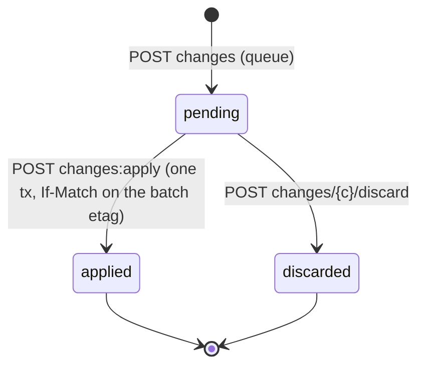

# 13.1.2 — Batched review

| Area plan | Milestone | Version | Size (area plan) | Re-estimate | Depends on (stories) | Blocks (stories) |
|---|---|---|---|---|---|---|
| `plans/13-product-phases.md` | G1 | V1 | 1.5 d (M + S) | 1.5 d — unchanged | 13.1.1 | 13.4.1, 13.8.1 |

> Contracts: 00 §3 (`checklist item`, `authoring version`), §5.4 (tenancy rules 1–8), §5.5 (C1–C9), §5.7 (P2–P5, S1–S5), §7 (`sha256:` over RFC 8785, idempotency keys), §8.11 (`authoring_change` states), §9.1–§9.2 · rulings T2, T3, T11, T51, T94, T95 · DECISIONS §7 (personal data) · Area plan: `plans/13-product-phases.md` §2 FR-13-1, §4.1 (`authoring_change`, `checklist_item`, `authoring_version`), §4.2 flow 1, §5 (row "Two editors change one item"), §6, §9 (story 13.1.2) · Shared contract with 13.1.1 in §3.1.

> **Status: planned, not built.** Sizes are person-days for one senior full-stack .NET + Angular developer (CR-D-1). Every existing-schema fact below is cited `file:line` against `origin/develop` `20794c2` (the worktree `13-g1-feature-plans` holds the identical sources); everything consumed from 13.1.1 is cited by section, AC or route number, so it stays valid across edits to that plan. `[INFERENCE]` marks reasoning; `[OPEN]` marks an owner decision (ids `OI-13-122`–`OI-13-127` are collected in `## Decisions and open items`).

## 1. Goal and non-goals

**Goal.** A reviewer never edits authored content directly. Comments, deletes, merges and splits of checklist items are **queued** as pending `authoring_change` rows, reviewed together, and then **applied in one transaction** as one authoring version — the `authoring_version` rows that share one `batch_id`, one per affected entity (CR-13-1 clause (a), OI-13-125) — guarded by `If-Match` (the batch etag over every affected item) and `Idempotency-Key`. A stale apply changes nothing at all: no item row, no `authoring_version` row, no state flip, no audit row (plan 13 §9, story 13.1.2 acceptance; 00 §8.11 line 313, refined as CR-13-1).

**Non-goals.**

- The authoring tree, checklist items, manual test cases and the immutable `authoring_version` stream — 13.1.1 (13.1.1-T1 schema, 13.1.1-T3 version/timeline read model and write contract). This story consumes them and adds no column to any of those tables.
- The UI: the pending-changes panel and the timeline rendering are 13.4.1 (13.4.1-T3). This plan defines only the read shapes that panel consumes.
- AI generation: 13.3.1 writes `source = ai` versions with `ai_run_id`. This plan keeps the seam columns (`source`, `ai_run_id`) and the `comment` change type they may use; it designs no generation, no gateway, no credit.
- Restore (13.1.1), import/export (13.1.1-T5), CSV/XLSX (13.1.1-T5), the repair pipeline (13.8.1).
- No payment, no AI credit, no model choice: plan 13 questions Q1/Q2/Q3 are untouched and this story depends on none of them.

## 2. User stories and acceptance criteria

- As a QA engineer, I add a review comment to a checklist item and it waits in the pending list instead of silently changing the item.
- As a test maintainer, I merge three duplicate checklist items into one and delete the empty one, then apply the whole set as a single version — or abandon it without a trace.
- As a reviewer working in two tabs, my apply either lands completely or is refused as stale; it never half-lands.

| # | Acceptance criterion (testable) | Refines / covers |
|---|---|---|
| 13.1.2-AC1 | `POST /v1/projects/{p}/authoring/changes` queues a `comment`, `delete`, `merge` or `split` change on a checklist item and returns 201 `{change_id, state: "pending", base_version, created_at}`. `target_id` is the item itself for `comment`/`delete`, the survivor for `merge` (equal to `payload.survivor_item_id`) and the item being split for `split` (AC14). No affected item's `version`, `updated_at` or content changes and no `authoring_version` row exists for any of them after queueing (row-count + content probe). | story acceptance ("queue as pending changes"); FR-13-1 (nothing is versioned until it is applied) |
| 13.1.2-AC2 | `GET /v1/projects/{p}/authoring/changes?state=pending` lists queued changes ordered `(created_at, id)` with cursor pagination and filters `state`, `change_type`, `target_id`; `GET …/changes/{c}` returns one change or 404 for another tenant's change. With `?ids=` (1–200) the list response carries `ETag: "<batch-etag>"` — computed over every affected item of the selection (targets **and** merge sources, AC14) — and each item a computed `stale` flag. | FR-13-1 (a pending change is visible with author, source and reason before it is versioned); plan 13 §9 line 127; 00 §9.1 pagination/ETag |
| 13.1.2-AC3 | `POST …/changes/{c}/discard` moves a pending change to `discarded`; discarding an `applied` or already `discarded` change returns 409 `invalid_transition` with `details[0].reason = "change_not_pending"` and changes nothing. | FR-13-1 (nothing discarded is ever versioned); 00 §8.11 (`pending → applied \| discarded`) |
| 13.1.2-AC4 | `POST …/changes:apply` with `If-Match: "<batch-etag>"` and `Idempotency-Key` applies the named selection in **one** transaction: one `batch_id` (the rows sharing it **are** the one authoring version of 00 §3 line 102), exactly one `authoring_version` row per **changed** entity (H2; AC9's count governs a merge — the survivor is affected but unedited and gets none), every selected `authoring_change` row flipped to `applied` with that `batch_id`, one `audit_log` entry `authoring.change.apply` for the command. A comment-only batch returns `versions: []` and still records one `batch_id` (AC1/§6 effect matrix, CR-13-1 clause (b), OI-13-125). | FR-13-1 (one immutable version per applied change, with author, source and reason); story acceptance; 00 §8.11; 00 §3 line 102 |
| 13.1.2-AC5 | **A stale apply changes nothing.** When any affected item's `version` moved after the selection was read (or the `If-Match` value differs from the one the server recomputes), apply returns 412 `precondition_failed` with `details[].reason ∈ {batch_stale, target_changed, target_deleted}` and, in the same transaction, writes: 0 `checklist_item` updates, 0 `manual_test_case` updates, 0 `authoring_version` rows, 0 `authoring_change` state flips, 0 `audit_log` rows. Proven by before/after `count(*)` per table plus a `select count(*) from audit_log where action = 'authoring.change.apply'` delta of 0. | FR-13-1 (no version is written by a refused apply); story acceptance ("a stale apply changes nothing"); plan 13 §5 row 1 |
| 13.1.2-AC6 | **Idempotent replay.** Re-sending the same `Idempotency-Key` with the byte-identical body (any JSON key order/whitespace) returns the stored 200 body and status, creates no second `batch_id`, appends no second set of versions, flips no additional rows, and records no second `audit_log` entry (`IAuditTrail.Suppress` contract `src/BuildingBlocks/Persistence/Audit/AuditTrail.cs:31-32`, implementation `:105`). A different body with the same key returns 409 `idempotency_conflict`. | FR-13-1 (one version, not two, for one applied batch); 00 §9.1 line 324, §9.2; T11; 00 §7 |
| 13.1.2-AC7 | **Concurrency.** Two applies of the same `change_id` set: exactly one commits; the loser is refused 409 `invalid_transition` (`change_not_pending`) or, when a competing writer moved an affected item in between, 412 `precondition_failed` (`batch_stale` / `target_changed`) — and writes nothing either way. No `40P01` deadlock; both requests finish inside the test timeout. Two applies with disjoint affected-item sets both commit (the batch etag covers only the affected items of the selection, AC14). Proven by two `Task`s on the same project and assertions on `authoring_version` per `batch_id`. | FR-13-1 (two concurrent applies never interleave into one version); plan 13 §5 row 1 ("two editors change one item"); P5; shared contract lock order |
| 13.1.2-AC8 | Applying a change whose target **or payload item** was deleted or merged meanwhile returns 412 `precondition_failed` (`reason = "target_deleted"` / `"target_changed"`, `details[].path` = that item id) for the **whole** batch — no unaffected change in the same selection is applied either. | FR-13-1 (a version is written wholly or not at all); plan 13 §5 row 1; all-or-nothing |
| 13.1.2-AC9 | **Merge N → 1** (`merge`): `payload.source_item_ids` holds 2–50 items **and includes the survivor**; `payload.survivor_item_id ∈ source_item_ids` and `target_id = survivor_item_id` (else 422 `payload_invalid`), which makes the merge's affected set exactly `source_item_ids`. On apply: every manual test case of every source except the survivor is re-parented to the survivor and gets its own `update` version with `reason = "merged from <source id>"`; each source except the survivor is soft-deleted with `change_kind = "delete"` and `reason = "merged into <survivor id>"` (13.1.1's enum is closed, H3/D5); one `checklist_item_lineage` row per source except the survivor with `relation = "merged_into"`. The survivor itself is not edited and gets no version row. Case moves happen **before** the soft delete, so 13.1.1's non-empty guard never fires mid-batch. Refused with 422 `request_invalid` (`reason ∈ {merge_sources_min, merge_sources_max, survivor_not_in_sources, payload_invalid, target_deleted}`) and nothing written. | FR-13-1 (every moved case and every merged item is versioned with a reason); FR-13-2 (a case never loses its checklist parent); story acceptance ("merges … apply as one version"); 13.1.2-T2 |
| 13.1.2-AC10 | **Split 1 → N** (`split`): `target_id` is the item being split and its affected set is that item alone; `payload.new_items` 2–20 entries. On apply: N new checklist items are created (each `change_kind = "create"`, `version_no = 1`), one `checklist_item_lineage` row per new item with `relation = "split_from"`, existing manual test cases move to the **first** new item unless `payload.case_assignments` names another (each move is an `update` version through H2b), and the original is soft-deleted with `change_kind = "delete"` and a **bounded** reason `split into <first_new_id> (+N more)` — never an enumeration of all ids, because 13.1.1 §4 caps `authoring_version.reason` at 500 characters and 20 UUIDs would exceed it; the lineage rows carry the full mapping. | FR-13-1 (creates and moves are versioned); FR-13-2 (a case stays linked to a checklist item across a split); 13.1.2-T2; 00 §3 `checklist item` |
| 13.1.2-AC11 | **Limits.** Queueing past 500 pending changes in one project returns 429 `quota_exceeded` with `Retry-After`; `change_ids` > 200 on apply, `source_item_ids` > 50 on merge, `new_items` > 20 on split, or a pending `delete`/`merge`/`split` that already covers any item of the new change's affected set returns 422 `request_invalid` (reasons `too_many_changes`, `merge_sources_max`, `split_items_max`) / 409 `invalid_transition` (`change_already_pending`) with that named `details[].reason`, and writes nothing (AC14). | FR-13-1 (a bounded apply keeps the version transaction short); plan 13 §4.1 `authoring_change`; P5, P8 |
| 13.1.2-AC12 | **Authorization and isolation.** Queue/discard/apply need `authoring:write` (`qa_engineer`, `test_maintainer`, `tenant_admin`) and list/get need `authoring:read` (every member role) — 00 §2 line 60, seeded by 13.1.1-T2; a `viewer` gets 403 `forbidden`; a token scoped to another project gets 403 `project_scope_mismatch`; another tenant's change id answers 404 `not_found` with the same body as a random id. Each new route has an isolation case in `tests/Isolation.Tests/Api/IsolationRouteCases.cs` (its `RouteCase` contract: "one `RouteCase` per served `/v1` route", `tests/Isolation.Tests/Api/IsolationRouteCases.cs:152-153`). | FR-13-1 (only an authorized member writes a version); plan 13 §6 line 99; 00 §5.4, §9.1; T2/T3; 02.9.1 |
| 13.1.2-AC13 | **The non-empty guard is enforced again inside the apply transaction.** A manual case created under the target *after* its `delete` change was queued does not bump the item's `version` (13.1.1 §5 route 13 creates the case on its own row), so the batch etag cannot see it. Apply therefore re-checks every `delete`/`merge`/`split` soft-delete target for live cases after locking the items and before any write; a hit fails the **whole** batch with 409 `authoring_not_empty` (`details[].reason = "item_has_cases"`, `details[].path = <item id>`), and no item, case, `authoring_change`, `authoring_version` or audit row changes. | FR-13-1 (a batch is applied wholly or not at all); 00 §5.7 P5; 13.1.1 AC7; D7 |
| 13.1.2-AC14 | **Every affected item is guarded, locked and hashed.** A change's affected set is `{target_id}` for `comment`/`delete`/`split` and `payload.source_item_ids` for `merge`; the server stamps it with each item's version in `affected_versions` at queue time. (a) **Queue:** with `merge(A,B → S)` pending, queueing a `delete` on `A`, a `merge` on `A` or a `split` on `S` each returns 409 `invalid_transition` (`reason = change_already_pending`) and writes nothing. The trigger's check is serialised per project by `pg_advisory_xact_lock(hashtextextended('authoring_change:' || org_id || ':' || project_id, 0))` taken before its `exists`, because an `exists` alone cannot see another transaction's uncommitted row under READ COMMITTED (the handler runs the same select first, unlocked, for a clean 409); with that lock two overlapping structural changes cannot both commit, even when their `target_id`s differ. (b) **Apply:** the batch etag and the `for update` lock set both cover the union of affected items in one statement sorted by `id` (`affected_versions` keys, not targets only), so a 13.1.1 `PATCH` on a merge **source** after queueing yields 412 `target_changed` naming that source and nothing is written. (c) **Concurrency:** because (a) removes every overlapping pending structural pair, two applies cannot share a survivor or a source item; the sorted single-statement lock makes `40P01` unreachable for residual overlap, and the concurrent-apply test asserts the 409/412 refusal rather than a deadlock, while a two-session queue test asserts the advisory lock (second session waits, then gets the trigger's 409). | plan 13 §5 row 1; 00 §5.7 P5; H6; D2; D3 |

## 3. Contracts touched

**Planned changes (none made by this plan):**

- 00 §3: one glossary row `authoring change (pending change)` — vi "thay đổi chờ duyệt/áp dụng", en "pending authoring change" — and a note on `authoring version` that the `batch_id` group **is** one version (00 §3 line 102). Requested through the §15 log row below.
- 00 §8.11 line 313 and 00 §3 lines 100/102 — **planned wording change, part of CR-13-1** (the 00 §3/§8.11 change request raised in 13.1.1 §3), with two clauses: **(a)** an applied batch *is* one authoring version — 00 §3 line 102 describes a version as the snapshot of the whole tree after a batched change, while 13.1.1's `authoring_version` stores one row per entity, so the wording adds that the versions sharing one `batch_id` together *are* that snapshot (one row per affected entity); **(b)** a **comment-only** batch writes no `authoring_version` row, and 00 §3 line 100's "changed only through a batched pending change" becomes "changed through a versioned write — a direct field edit (13.1.1 §5 routes 3, 9, 15, 17) or a batched pending change (13.1.2)". Owner confirmation: OI-13-125. Until the wording lands, 00 §8.11 line 313 holds for every batch that changes content, and 00 §3 line 100 is read as "content changes are versioned".
- `plans/13-product-phases.md` §4.1 — **no edit requested, not a contract file**: §4.1's "Refinements from the G1 feature plans" paragraph already records `checklist_item_lineage` (`plans/13-product-phases.md:50`, the S52 sentence naming this story's merge/split lineage table), so nothing here needs to be added to it; `authoring_change`'s own §4.1 row (`:44`) keeps its high-level shape, and this story's extra columns (`affected_versions`, the applied/discarded pairs) stay inside that row's latitude.
- 00 §9.3: five endpoint rows (`POST/GET /v1/projects/{p}/authoring/changes`, `GET …/changes/{c}`, `POST …/changes/{c}/discard`, `POST …/changes:apply`).
- 00 §15: one row, 2026-10-23, "13.1.2 endpoints, glossary row and §8.11 clarification; no new permission code, no new error code".
- 00 §2 and 00 §9.2: **read-only here.** `authoring:read`/`authoring:write` are seeded by 13.1.1-T2, and this story adds no error code — it reuses the envelope's codes plus 13.1.1's new `authoring_not_empty` (409, `item_has_cases`) on the queue route.
- `contracts/openapi.yaml`: the five operations above, each with `x-permission` (T51) and a request/response schema; 200/201/403/404/409/412/422/429 responses per §5.
- `contracts/schemas/authoring-change.v1.json` (JSON Schema 2020-12, same folder convention as `contracts/schemas/policy-revision.v1.json`): the queue body per `change_type`, including the `merge` and `split` payload subschemas — `source_item_ids` 2–50 including `survivor_item_id`, `target_id = survivor_item_id` for a merge, `new_items` 2–20 and the optional `case_assignments` for a split. Registered from `openapi.yaml` so spec and schema cannot drift (`contracts/README.md`).
- `contracts/permissions.json`: **no new code**. `authoring:read` (every member role: `viewer`, `qa_engineer`, `test_maintainer`, `release_approver`, `tenant_admin`) and `authoring:write` (`qa_engineer`, `test_maintainer`, `tenant_admin`) are seeded by 13.1.1-T2 exactly as 00 §2 line 60 makes them normative (plan 13 §6, CR-2); this story consumes both and refuses a `viewer` on write (AC12).
- `contracts/rls-exceptions.txt`: **no entry**. Both tables carry `org_id`, `unique (org_id, id)`, FORCE RLS, the `evidgate.current_org_id()` policy and an `evidgate_owner` policy, so none of the three exception kinds (`platform`, `catalogue`, `mechanism`) applies; `idempotency_record` is the cited precedent for a new org-scoped table deliberately left off the list (`contracts/rls-exceptions.txt:14-37`).
- `Evidgate.Modules.Authoring.Contracts` (module assumed to be created by 13.1.1-T1, assumption H0): read contract `IAuthoringChanges.QueuedVersionsAsync` is **not** needed; the only cross-module contract is the write contract this story consumes from 13.1.1 (§3.1, H2).
- Generated SDK (`packages/sdk`, `npm run codegen`) and the `Contract.Tests` served-document diff.

### 3.1 Consumed from 13.1.1 — contract assumptions

These are the only things this plan relies on, and each row names the 13.1.1 task, AC or route that delivers it (`13.1.1-feature-tree-and-manual-test-cases.md` §3–§7 is authoritative for the member shapes; this table adds nothing to it).

| # | Assumption | Needed by | Owning task (13.1.1) |
|---|---|---|---|
| H0 | The module is `Evidgate.Modules.Authoring` + `.Contracts` (00 §5.5 module shape; 13.1.1 §3). | all | 13.1.1-T1/T2 |
| H1 | Soft delete is `deleted_at` set + `version` bumped; `checklist_item.state` stays in `draft \| active \| retired` (13.1.1 AC7, §4 `checklist_item`) and a dropped row keeps its rows and links. A delete of an item that still has live manual cases is already refused by 13.1.1 with 409 `authoring_not_empty` / `details[].reason = "item_has_cases"`. | AC9, AC10, delete | 13.1.1-T1/T2 |
| H2 | The shared writer `AuthoringVersionWriter` (`13.1.1-T1.4`) is callable **inside this story's transaction** with three members: `AppendAsync(orgId, projectId, batchId, IReadOnlyList<EntityChange>)`, where one `EntityChange` describes a create, an update or a soft delete of one entity (`feature_node`, `checklist_item` or `manual_test_case`) and the writer owns the rules — one `authoring_version` row per changed entity under the caller's `batch_id`, `content_hash` through `CanonicalHash`, the `clock_timestamp()` stamp, and the non-empty guard for a `checklist_item` / `feature_node` soft delete; `MoveManualTestCaseAsync(batchId, caseId, toItemId, reason)` (H2b); and `RestoreAsync(batchId, entityKind, entityId, actorMembershipId, reason?)`, which this story never calls — restore belongs to 13.1.1-T3.2. This story composes every item, case and version write of an apply from `AppendAsync` and `MoveManualTestCaseAsync` and never writes `checklist_item`, `manual_test_case` or `authoring_version` itself. | AC4, AC9, AC10 | 13.1.1-T1.4 |
| H2b | **Planned in 13.1.1 under AC22, not an existing capability:** a manual test case cannot be moved between checklist items today — its `PATCH` body is `{title?, description?, precondition?, steps?, priority?}` with no `checklist_item_id` (13.1.1 §5 route 15), and the command list has no move. Merge and split need one: `AuthoringVersionWriter.MoveManualTestCaseAsync(batchId, caseId, toItemId, reason)` plus the route `POST /v1/projects/{p}/authoring/manual-cases/{m}/item` (route 19) — owned by 13.1.1, bumping the case's `version` and appending one `change_kind = "update"` version row with the given reason, callable in this story's transaction. The member ships in `13.1.1-T1.4`, the route in `13.1.1-T2.3`; T2 uses it rather than a cross-module table write, which 00 §5.5 forbids. | AC9, AC10 | 13.1.1-T1.4 (member) + 13.1.1-T2.3 (route 19), AC22 |
| H3 | `authoring_version` accepts a caller-supplied `batch_id` (uuid, NOT NULL) and `change_kind ∈ {create, update, delete, restore, import}` (13.1.1 AC5, §4 `authoring_version`) with `unique (org_id, project_id, entity_kind, entity_id, version_no)` and `reason` ≤ 500 characters. There is **no** `comment`, `merge` or `split` kind — that is why CR-13-1 clause (b) keeps comments out of the version stream and D5 moves merge/split structure into `checklist_item_lineage`. | AC4, AC9, AC10 | 13.1.1-T1/T3 |
| H4 | `checklist_item.version` and `manual_test_case.version` are the optimistic-concurrency counters, bumped by `public.set_updated_at_and_version()` (`migrations/0004_identity_organization.sql:70-78`); the entity `ETag` is `"<version>"`. Read inside the apply transaction, never from cache. | AC5, AC7, AC8 | 13.1.1-T1/T2 |
| H5 | The timeline read model (13.1.1-T3) shows versions only. Comments are rendered by 13.4.1-T3 from `GET …/authoring/changes?change_type=comment&target_id=` — no change requested of 13.1.1. | AC4 | 13.1.1-T3 (none) |
| H6 | The batch etag uses the **same scheme and helper** as 13.1.1's reorder precondition: `"order:<sha256-hex>"` over the sorted `(id, version)` pairs the caller read (13.1.1 §5 route 4 and its §Decisions row). 13.1.1 exposes the helper; this story feeds it one pair per **affected item** (the target of every selected change plus every merge source), not one per change (AC14). | AC2, AC4, AC5, AC7 | 13.1.1-T2/T3 |

## 4. Data model and migrations

One migration per table, additive; the number is assigned at build time from the next free slot after 0038 (files today end at `migrations/0038_run_project_ref_idx.sql`). Repo conventions followed from `migrations/0020_catalog_case_identity.sql:29-47` (column style, `unique (org_id, id)`, composite tenant FK, CHECK-per-limit) and `migrations/0021_catalog_test_revision.sql:12-36,59-75` (append-only guard, FORCE RLS, grants).

`migrations/NNNN_authoring_authoring_change.sql`:

```sql
create table if not exists public.authoring_change (
  id uuid not null,
  org_id uuid not null,
  project_id uuid not null,
  target_kind text not null default 'checklist_item',
  target_id uuid not null,
  change_type text not null,
  payload jsonb not null,
  base_version integer not null,              -- target.version seen when queued (H4)
  affected_versions jsonb not null,           -- {item id: version} for the target and every payload item, stamped at queue time (AC14)
  state text not null default 'pending',
  source text not null default 'manual',
  ai_run_id uuid,                             -- 13.3.1 seam; null for manual changes
  author_membership_id uuid not null,
  reason text,
  applied_at timestamptz,
  applied_batch_id uuid,
  applied_by_membership_id uuid,
  discarded_at timestamptz,
  discarded_by_membership_id uuid,
  created_at timestamptz not null default now(),
  updated_at timestamptz not null default now(),
  version integer not null default 1,
  constraint authoring_change_pkey primary key (id),
  constraint authoring_change_org_id_key unique (org_id, id),
  constraint authoring_change_project_id_key unique (org_id, project_id, id),   -- the lineage FK target
  constraint authoring_change_project_fk foreign key (org_id, project_id)
    references public.project (org_id, id),
  constraint authoring_change_target_fk
    foreign key (org_id, project_id, target_id)
    references public.checklist_item (org_id, project_id, id),                 -- same-project target, enforced by the FK
  constraint authoring_change_author_fk foreign key (org_id, author_membership_id)
    references public.membership (org_id, id),
  constraint authoring_change_applied_by_fk foreign key (org_id, applied_by_membership_id)
    references public.membership (org_id, id),
  constraint authoring_change_target_kind_check check (target_kind in ('checklist_item')),
  constraint authoring_change_type_check check (change_type in ('comment', 'delete', 'merge', 'split')),
  constraint authoring_change_state_check check (state in ('pending', 'applied', 'discarded')),
  constraint authoring_change_source_check check (source in ('manual', 'ai', 'import')),
  constraint authoring_change_ai_pairing_check check ((source = 'ai') = (ai_run_id is not null)),
  constraint authoring_change_base_version_check check (base_version >= 1),
  constraint authoring_change_affected_versions_check
    check (jsonb_typeof(affected_versions) = 'object' and affected_versions <> '{}'::jsonb
           and octet_length(affected_versions::text) <= 8192),
  constraint authoring_change_payload_size_check
    check (jsonb_typeof(payload) = 'object' and octet_length(payload::text) <= 32768),
  constraint authoring_change_comment_body_check
    check (change_type <> 'comment'
           or (payload ? 'body' and char_length(payload ->> 'body') between 1 and 2000)),
  constraint authoring_change_reason_length_check check (reason is null or char_length(reason) <= 500),
  constraint authoring_change_applied_consistent_check
    check (state <> 'applied' or (applied_at is not null and applied_batch_id is not null
                                  and applied_by_membership_id is not null)),
  constraint authoring_change_discarded_consistent_check
    check (state <> 'discarded' or (discarded_at is not null and discarded_by_membership_id is not null))
);
```

Defaults, triggers, indexes and grants in the same file:

```sql
-- P4: the pending list (state filter first, then keyset order).
create index if not exists authoring_change_list_idx
  on public.authoring_change (org_id, project_id, state, created_at, id);
-- P4: an item's change history and the comment panel (13.4.1-T3).
create index if not exists authoring_change_target_idx
  on public.authoring_change (org_id, project_id, target_id, change_type, created_at, id);
-- The 500-pending-limit count is one index-only scan.
create index if not exists authoring_change_pending_idx
  on public.authoring_change (org_id, project_id) where state = 'pending';
-- One pending delete/merge/split per target; comments may repeat.
create unique index if not exists authoring_change_pending_structural_uq
  on public.authoring_change (org_id, target_id, change_type)
  where state = 'pending' and change_type in ('delete', 'merge', 'split');
-- OI-13-123: the purge scan.
create index if not exists authoring_change_discarded_idx
  on public.authoring_change (org_id, discarded_at)
  where state = 'discarded';

-- AC14: no two pending structural changes may cover the same item. The partial unique index above
-- settles the same `target_id`; this guard also covers a merge's payload items (a `delete` on a merge
-- source, a `split` on the survivor, a `merge` on a source) by intersecting the key sets of
-- `affected_versions`. An EXISTS alone cannot see another transaction's uncommitted row (READ
-- COMMITTED), so the trigger first takes a transaction-scoped advisory lock on the project: two
-- concurrent queue requests serialise and the second sees the first's committed row. The handler runs
-- the same select first so the caller gets a clean 409 without waiting on a lock.
create or replace function evidgate.authoring_change_affected_guard() returns trigger
  language plpgsql
  as $$
  begin
    if new.state = 'pending' and new.change_type in ('delete', 'merge', 'split') then
      perform pg_advisory_xact_lock(
        hashtextextended('authoring_change:' || new.org_id::text || ':' || new.project_id::text, 0));
      if exists (
           select 1
             from public.authoring_change c
            where c.org_id = new.org_id
              and c.project_id = new.project_id
              and c.id <> new.id
              and c.state = 'pending'
              and c.change_type in ('delete', 'merge', 'split')
              and (c.affected_versions ?| (select array_agg(k) from jsonb_object_keys(new.affected_versions) k)
                   or new.affected_versions ?| (select array_agg(k) from jsonb_object_keys(c.affected_versions) k))
         ) then
        raise exception 'authoring_change_affected: a pending structural change already covers one of these items'
          using errcode = '23514';
      end if;
    end if;
    return new;
  end
  $$;

revoke all on function evidgate.authoring_change_affected_guard() from public;

drop trigger if exists authoring_change_affected_guard on public.authoring_change;
create trigger authoring_change_affected_guard
  before insert or update on public.authoring_change
  for each row execute function evidgate.authoring_change_affected_guard();

drop trigger if exists authoring_change_set_updated_at_and_version on public.authoring_change;
create trigger authoring_change_set_updated_at_and_version
  before update on public.authoring_change
  for each row execute function public.set_updated_at_and_version();

alter table public.authoring_change enable row level security;
alter table public.authoring_change force row level security;

drop policy if exists authoring_change_app_tenant on public.authoring_change;
create policy authoring_change_app_tenant on public.authoring_change
  for all to evidgate_app
  using (org_id = evidgate.current_org_id())
  with check (org_id = evidgate.current_org_id());

drop policy if exists authoring_change_owner_backfill on public.authoring_change;
create policy authoring_change_owner_backfill on public.authoring_change
  for all to evidgate_owner using (true) with check (true);

grant select, insert, update on public.authoring_change to evidgate_app;
revoke delete, truncate on public.authoring_change from evidgate_app;  -- the retention purge is owner-side (T80)
grant select on public.authoring_change to evidgate_operator;
revoke all on public.authoring_change from evidgate_worker_sched;
```

`migrations/NNNN_authoring_checklist_item_lineage.sql` (13.1.2-T2.1) — the lineage of merges and splits. **Recorded in plan 13 §4.1 already** (`plans/13-product-phases.md:50`, "Refinements from the G1 feature plans (S52, 2026-10-23)": "13.1.2 adds `checklist_item_lineage` (merge and split lineage)"): `checklist_item_lineage` is this plan's table and plan 13 needs no further edit for it. It is a table rather than jsonb columns on `authoring_change` or `authoring_version` ([DECISION] D5): one `split` change creates N relations and one `merge` creates N−1, `authoring_change` is a queue row that becomes history, and the UI asks "what was merged into this item / what did this item come from" per item, which needs its own index.

```sql
create table if not exists public.checklist_item_lineage (
  id uuid not null,
  org_id uuid not null,
  project_id uuid not null,
  from_item_id uuid not null,
  to_item_id uuid not null,
  relation text not null,
  change_id uuid not null,
  batch_id uuid not null,
  created_at timestamptz not null default now(),
  constraint checklist_item_lineage_pkey primary key (id),
  constraint checklist_item_lineage_org_id_key unique (org_id, id),
  constraint checklist_item_lineage_pair_key
    unique (org_id, project_id, from_item_id, to_item_id, relation),
  constraint checklist_item_lineage_project_fk foreign key (org_id, project_id)
    references public.project (org_id, id),
  constraint checklist_item_lineage_from_fk
    foreign key (org_id, project_id, from_item_id)
    references public.checklist_item (org_id, project_id, id),
  constraint checklist_item_lineage_to_fk
    foreign key (org_id, project_id, to_item_id)
    references public.checklist_item (org_id, project_id, id),
  constraint checklist_item_lineage_change_fk
    foreign key (org_id, project_id, change_id)
    references public.authoring_change (org_id, project_id, id),
  constraint checklist_item_lineage_relation_check check (relation in ('merged_into', 'split_from')),
  constraint checklist_item_lineage_self_check check (from_item_id <> to_item_id)
);
create index if not exists checklist_item_lineage_from_idx
  on public.checklist_item_lineage (org_id, project_id, from_item_id);
create index if not exists checklist_item_lineage_to_idx
  on public.checklist_item_lineage (org_id, project_id, to_item_id);
```

Append-only, under **one rule for every new immutable authoring table** (this plan's `checklist_item_lineage`; 13.1.1 AC6/§4 state the same rule for `authoring_version` as `authoring_version_immutable`, and 13.2.1 AC2/§4 for the `project_ai_settings` chain as `authoring_settings_immutable`): `REVOKE UPDATE, DELETE` from `evidgate_app`, **and** a guard trigger `evidgate.authoring_lineage_immutable()` that raises `23514` on every `UPDATE` — the owner's included — and on every `DELETE` whose `current_user` is not `evidgate_owner`. The single DELETE exception exists because FORCE RLS plus the grants leave the owner role as the only legitimate remover: the tenant-erasure and retention sweeps of 06.4.4 / 11.2.1 must run as `evidgate_owner` (a hand-over to those stories, not a fact about them today) through their `SECURITY DEFINER` functions (T80), and a blanket refusal would make erasure delete zero rows without failing. The raise is copied from `evidgate.catalog_revision_immutable()` (`migrations/0021_catalog_test_revision.sql:43-57`); the owner-only DELETE branch is the owner-sweep path of `evidgate.purge_expired_idempotency` (`migrations/0007_platform_idempotency_record.sql:137-159`). `audit_log` is deliberately **not** the model: it carries no raise trigger at all, only revoked grants (`migrations/0015_identity_audit_log.sql:119-126`). Row level security, policies and grants, in the same file:

```sql
create or replace function evidgate.authoring_lineage_immutable() returns trigger
  language plpgsql
  set search_path = ''
  as $$
  begin
    -- UPDATE is refused for every role, `evidgate_owner` included: a lineage row is never rewritten.
    -- DELETE is refused for every role except the owner, whose SECURITY DEFINER sweeps
    -- (06.4.4 / 11.2.1 erasure and retention, T80) are the only legitimate remover.
    if tg_op = 'DELETE' and current_user = 'evidgate_owner' then
      return old;
    end if;
    raise exception 'authoring_lineage_immutable: checklist item lineage is append-only (%)', tg_op
      using errcode = '23514';
  end
  $$;

revoke all on function evidgate.authoring_lineage_immutable() from public;

drop trigger if exists checklist_item_lineage_immutable on public.checklist_item_lineage;
create trigger checklist_item_lineage_immutable
  before update or delete on public.checklist_item_lineage
  for each row execute function evidgate.authoring_lineage_immutable();
```

Policies and grants, in the same file:

```sql
alter table public.checklist_item_lineage enable row level security;
alter table public.checklist_item_lineage force row level security;

create policy checklist_item_lineage_app_tenant on public.checklist_item_lineage
  for all to evidgate_app
  using (org_id = evidgate.current_org_id())
  with check (org_id = evidgate.current_org_id());

-- `force row level security` binds the owner too: without this policy the tenant-erasure path
-- (06.4.4 / 11.2.1) and any owner-side sweep would delete zero rows without failing
-- (`migrations/0010_identity_permission_catalogue.sql:237-242`; the 0021 pattern at :68-71).
create policy checklist_item_lineage_owner_backfill on public.checklist_item_lineage
  for all to evidgate_owner using (true) with check (true);

grant select, insert on public.checklist_item_lineage to evidgate_app;
-- Two enforcement layers per 00 §5.5 C6: the grant and the guard trigger. The owner's privileges come
-- from table ownership (the migration runs as `evidgate_owner`), not from 0001's default privileges,
-- which grant DML to `evidgate_app` and SELECT to `evidgate_operator` only
-- (`migrations/0001_foundation_roles.sql:90-95`). So the owner's DELETE passes the grant and is the
-- guard's single exception (the 0007 sweep shape), while its UPDATE is still refused; no role but the
-- owner can remove a lineage row.
revoke update, delete, truncate on public.checklist_item_lineage from evidgate_app;
grant select on public.checklist_item_lineage to evidgate_operator;
revoke all on public.checklist_item_lineage from evidgate_worker_sched;
```

Notes that belong to the schema review:

- `authoring_change` is **mutable by column set** (only the lifecycle columns), not append-only: `state`, `applied_*`/`discarded_*`, `updated_at`, `version`. No trigger is needed beyond `set_updated_at_and_version`; the CHECK constraints above make a half-applied row impossible (`authoring_change_applied_consistent_check`).
- Same-project scoping is **enforced by the foreign keys**, not inferred: `authoring_change_target_fk` and both lineage item FKs are composite `(org_id, project_id, <item id>)` against `checklist_item (org_id, project_id, id)` (13.1.1 §4 gives that table its `unique (org_id, project_id, id)`), and `checklist_item_lineage_change_fk` is `(org_id, project_id, change_id)` against `authoring_change (org_id, project_id, id)`. A cross-project target or source therefore fails at `23503` whatever the handler does; the apply path still re-reads every affected item under RLS, and the queue route answers 404 before insert (AC12). Proven by `AuthoringChangeSchemaTests.CrossProjectTarget_IsRejectedByTheFk` and `AuthoringLineageSchemaTests.CrossProjectItem_IsRejectedByTheFk`.
- `checklist_item_lineage` is append-only and carries `created_at` only, so the `02.6.1-T2` schema convention scan would flag its missing `updated_at`/`version` and version trigger (`SchemaConventionScan.cs:346-366` requires all three unless exempted). It gets an exemption entry `("public.checklist_item_lineage", SchemaRule.AuditColumns | SchemaRule.VersionTrigger, "<reason: append-only lineage, never updated>")` in `SchemaConventionScan.Exemptions` (`tests/Persistence.IntegrationTests/SchemaConventionScan.cs:32`; the `public.test_revision` entry at `:58-61` is the precedent) and its row in the pinned allow list `SchemaConventionAllowListTests.AllowList_Is_Exactly_The_Documented_Exemptions` (`tests/Persistence.IntegrationTests/SchemaConventionTests.cs:507-537`). `authoring_change` keeps `created_at`, `updated_at`, `version` and the trigger, so it needs no exemption.
- `affected_versions` is server-computed at queue time, never taken from the client body: the handler derives the affected set from `change_type` + `payload` (AC14) and reads each item's `version` under RLS. The CHECK enforces an object of 1–50 entries and a size cap; the writer validates that every value is an integer ≥ 1 and that the keys are live items of the same project (the composite target FK covers `target_id`, the queue read covers the payload items).
- UUIDv7 ids are generated by the application (00 §7 line 241); `authoring_change.version` is store-owned via the trigger (00 §5.5 C4; 00 §15 row 2026-09-26).

## 5. API shapes (commands, queries, endpoints)

All routes live under the project path and are owned by the authoring module's route group. Pipeline C2 applies (`telemetry → validation → tenant tx → authorization → idempotency → handler → outbox flush → commit`, 00 §5.5 line 199).

| Shape | Endpoint / caller | Permission | Rule |
|---|---|---|---|
| `QueueAuthoringChangeCommand : ICommand<QueuedChange>` | `POST /v1/projects/{p}/authoring/changes` | `authoring:write` | Body `{target_kind: "checklist_item", target_id, change_type, payload, reason?}` validated against `contracts/schemas/authoring-change.v1.json` (S5 depth/size caps; body ≤ 32 KiB → 413 `payload_too_large`, `ErrorEnvelope.cs:144`). `target_id` is the item itself for `comment`/`delete`, the **survivor** for `merge` (and must equal `payload.survivor_item_id`, else 422 `payload_invalid`) and the item being split for `split` (AC9, AC10). Requires `Idempotency-Key` (00 §9.1 line 324, T92). Reads the target and every payload item under RLS to stamp `base_version = checklist_item.version` and `affected_versions = {item id: version}` for the whole affected set; never writes an item. 201 `{change_id, state, base_version, created_at}` + `ETag: "<version>"`. 404 `not_found` for unknown/other-tenant/other-project target; 422 `request_invalid` (`reason ∈ {target_deleted, payload_invalid, merge_sources_min, merge_sources_max, survivor_not_in_sources, split_items_min, split_items_max, comment_body_invalid}`); 409 `invalid_transition` (`reason = change_already_pending`) when **any** item of the affected set already has a pending `delete`/`merge`/`split` (AC14) — from the handler's pre-check **and** from the `23514` the `authoring_change_affected_guard` trigger raises for a racing insert, caught as `PostgresException` and mapped to the same 409 body (`Result.Conflict`, the 06.1.3-T1.1 precedent: `plans/features/06-evidence-artifacts/06.1.3-state-machine-guards.md:71` and `:123`); 409 `authoring_not_empty` (`reason = item_has_cases`) when a `delete` targets an item that still holds live manual cases (D7 — 13.1.1's code, not a new one); 429 `quota_exceeded` + `Retry-After` at 500 pending (AC11). |
| `ListAuthoringChangesQuery : IQuery<Page<AuthoringChangeListItem>>` | `GET /v1/projects/{p}/authoring/changes?state=&change_type=&target_id=&ids=&cursor=&limit=` | `authoring:read` | Dapper in a read-only transaction (C1/C5, 00 §5.5 lines 198,202); `(created_at, id)` keyset order, `limit` 1–200 default 50; served by `authoring_change_list_idx` / `authoring_change_target_idx`. When `ids` is present (1–200) the response carries `ETag: "<batch-etag>"` (§6) and each item a `stale` boolean (AC2). `ids` + any other filter is 422 `request_invalid` (`reason = ids_with_filters`). |
| `GetAuthoringChangeQuery` | `GET /v1/projects/{p}/authoring/changes/{c}` | `authoring:read` | 200 with the payload echoed (truncated to 32 KiB by the schema) and `ETag: "<version>"`; 404 `not_found` (other tenant indistinguishable). |
| `DiscardAuthoringChangeCommand : ICommand<DiscardedChange>` | `POST /v1/projects/{p}/authoring/changes/{c}/discard` | `authoring:write` | `Idempotency-Key` required. **No `If-Match`** ([DECISION] D4): the state is the precondition, and a stale read can only produce `change_not_pending` (409 `invalid_transition`, `details[0].reason = "change_not_pending"`) — nothing to guard against. 200 `{change_id, state: "discarded", discarded_at}`. |
| `ApplyAuthoringChangesCommand : ICommand<ApplyAuthoringChangesResult>` | `POST /v1/projects/{p}/authoring/changes:apply` | `authoring:write` | Body `{change_ids: [1..200]}`. **`If-Match: "<batch-etag>"` required** — missing → 422 `request_invalid` with `details[{path: "If-Match", reason: "required"}]`, the repo's existing convention (`IfMatchError`, `src/Modules/Evidgate.Modules.Catalog/Endpoints/CatalogEndpoints.cs:382-403`; test `CatalogIdentityTests.Patch_StaleIfMatch_Is412_WithTheCurrentVersion_AndMissingIfMatchIs422`, `tests/Tenancy.IntegrationTests/CatalogIdentityTests.cs:718-738`) — never 428. Requires `Idempotency-Key`. One transaction; the lock order and the affected-item rule are in §6 and AC14. 200 `{batch_id, applied_change_ids, versions: [{entity_kind, entity_id, version_no}], lineage: [{from_item_id, to_item_id, relation}], committed_at}`. 412 `precondition_failed` (`details[].reason ∈ {batch_stale, target_changed, target_deleted}`, `details[].path` = the affected item id whose version moved); 409 `invalid_transition` (`change_not_pending`); 404 `not_found` when a `change_ids` entry is not the tenant's. |

No new error codes ([DECISION] D8). This story adds **no** `PUT`/`PATCH`/`DELETE` route: editing an item, a case or a node stays 13.1.1's `PATCH` with its own `ETag`/`If-Match`, and the only stale guard here is the apply's batch etag. The reused error codes, with the vi + en keys the web app ships (00 §5.6 W8; the envelope's `message` stays a secret-free English summary, the UI localises by `error.code` + `details[].reason`):

| Code (existing, `ErrorEnvelope.cs`) | HTTP | Retryable | i18n key | vi | en |
|---|---|---|---|---|---|
| `precondition_failed` (`:53`) | 412 | no | `authoring.changes.stale` | "Danh sách thay đổi đã thay đổi. Tải lại rồi áp dụng lại." | "The pending changes moved. Reload and apply again." |
| `request_invalid` (`:44`) | 422 | no | `authoring.changes.invalid` | "Yêu cầu không hợp lệ: {reason}." | "Invalid request: {reason}." |
| `quota_exceeded` (`:135`) | 429 | yes (`Retry-After`) | `authoring.changes.tooManyPending` | "Dự án đã có 500 thay đổi chờ áp dụng. Hãy áp dụng hoặc bỏ bớt." | "The project already has 500 pending changes. Apply or discard some first." |
| `invalid_transition` (`:129`) | 409 | no | `authoring.changes.notPending` | "Thay đổi này đã được áp dụng hoặc đã bị bỏ." | "This change was already applied or discarded." |
| `idempotency_conflict` (`:104`) | 409 | no | `authoring.changes.keyReused` | "Khoá yêu cầu này đã được dùng cho một yêu cầu khác." | "This request key was already used for a different request." |
| `not_found` (`:50`) | 404 | no | `authoring.changes.notFound` | "Không tìm thấy thay đổi chờ áp dụng." | "Pending change not found." |
| `forbidden` (`:95`) | 403 | no | `authoring.changes.forbidden` | "Bạn không có quyền thực hiện thao tác này." | "You do not have permission for this action." |
| `authoring_not_empty` (**introduced by 13.1.1** AC7, not by this story) | 409 | no | `error.authoring_not_empty` (13.1.1's key) | "Mục này còn nội dung bên trong" | "This entry still has content inside" |

Reason keys, one vi + en line each, `authoring.reason.<reason>` (00 §5.6 W8). Under 422 `request_invalid`: `payload_invalid` — "nội dung thay đổi không hợp lệ" / "the change payload is invalid"; `target_deleted` — "mục đã bị xoá" / "the item was deleted"; `merge_sources_min` — "cần ít nhất 2 mục để gộp" / "at least 2 items are needed to merge"; `merge_sources_max` — "tối đa 50 mục mỗi lần gộp" / "at most 50 items can be merged at once"; `survivor_not_in_sources` — "mục giữ lại phải nằm trong danh sách gộp" / "the surviving item must be one of the merged items"; `split_items_min` / `split_items_max` — "cần 2–20 mục khi tách" / "2–20 items are needed to split"; `comment_body_invalid` — "bình luận phải có 1–2000 ký tự" / "a comment needs 1–2000 characters"; `too_many_changes` — "tối đa 200 thay đổi mỗi lần áp dụng" / "at most 200 changes per apply"; `ids_with_filters` — "không kết hợp `ids` với bộ lọc khác" / "`ids` cannot be combined with other filters"; `required` — "thiếu điều kiện phiên bản" / "the version precondition is missing". Under 409 `invalid_transition`: `change_already_pending` — "mục này đã có một thay đổi cấu trúc đang chờ" / "this item already has a structural change pending"; `change_not_pending` — "thay đổi này không còn ở trạng thái chờ" / "this change is no longer pending". Under 409 `authoring_not_empty`: `item_has_cases`, rendered with 13.1.1's `error.authoring_not_empty` copy. Under 412 `precondition_failed`: `batch_stale` — "danh sách đã cũ" / "the selection is stale"; `target_changed` — "mục đã thay đổi" / "the item changed"; `target_deleted` reuses the queue-time key (one condition, one text; the code differs by phase — a queue onto a deleted item is a bad request, an apply whose item went away is a failed precondition). That is **16** `authoring.reason.*` keys: 11 under 422, 2 under 409 `invalid_transition`, 1 under 409 `authoring_not_empty` and 2 more under 412. The vi terms reuse 13.1.1 §11's catalogue ("ca kiểm thử" for test case, "Thay đổi chờ áp dụng" for pending changes, "Kiểm tra tính hợp lệ" for validation). The **"danh mục kiểm tra" (checklist) wording is `[INFERENCE]`, not a recorded owner decision**: no line of `DECISIONS.md`, `plans/00-overview.md`, plan 13 or `plans/features/README.md`'s rulings states it, and the delivered UI prompts say "danh sách kiểm tra" (`docs/design/web-ui/prompts-crd2/B2-43-generation-flow.md:35`) — the divergence is tracked open as **OI-13-105** (13.1.1 §Open items), and whatever the owner decides there applies to this story's strings unchanged (no string here uses the word).

## 6. States and transitions

`authoring_change.state` — canonical in 00 §8.11 line 313, CR-3:



| From | To | Allowed | Refused |
|---|---|---|---|
| — | `pending` | queue a `comment`/`delete`/`merge`/`split` on a **live** affected set of the same project (AC1, AC14) | a target or payload item soft-deleted (`target_deleted`, 422), `delete` of an item that still holds live cases (`authoring_not_empty` 409 `item_has_cases`, D7), a pending `delete`/`merge`/`split` that already covers **any** item of this change's affected set (`change_already_pending`, 409, AC14), over the pending limit (429) |
| `pending` | `applied` | apply with a matching batch etag and every entry of `affected_versions` equal to the locked item's current `version` (AC4, AC14) | stale etag / an affected item moved or deleted (412, nothing written — AC5, AC8); a selected row no longer `pending` (409 `change_not_pending`) |
| `pending` | `discarded` | discard (AC3) | — |
| `applied` | anything | **never** | re-apply, discard (409 `invalid_transition`) |
| `discarded` | anything | **never** | re-apply, discard (409 `invalid_transition`); a discarded row is purged by the `authoring.change.purge` schedule after the retention window (§7, [INFERENCE] D9 / OI-13-123), and re-queueing the same intent creates a **new** row |

Effect matrix on apply (this is what AC4/AC9/AC10 assert):

| `change_type` | `checklist_item` | `manual_test_case` | `authoring_version` rows | `checklist_item_lineage` |
|---|---|---|---|---|
| `comment` | untouched — no `UPDATE`, no `version` bump, so a reviewer's note never invalidates an editor's `If-Match` (CR-13-1 clause (b), OI-13-125) | untouched | **none** (CR-13-1 clause (b)) | none |
| `delete` (no live manual case) | soft-deleted (`deleted_at` set, `version` bumped), `change_kind = "delete"` | — | 1 | none |
| `delete` (live manual cases) | untouched | untouched | none — refused **at queue time** by 13.1.1's own guard shape: 409 `authoring_not_empty` with `details[].reason = "item_has_cases"` (D7; the code exists because 13.1.1 AC7 introduces it, so this story adds no error code), and **re-checked inside the apply transaction** because a case added after queueing does not bump the item's `version` and is invisible to the batch etag → same 409, whole batch, nothing written (AC13) | none |
| `merge` | `target_id` is the survivor and stays untouched (no `UPDATE`, no version row — a merge re-parents cases and drops the other sources, it does not edit the survivor's content); every source except the survivor is soft-deleted after its cases moved, `change_kind = "delete"`, `reason = "merged into <survivor id>"` | every child of every source except the survivor re-parented to the survivor, one `update` version each, `reason = "merged from <id>"` | 1 per source except the survivor + 1 per moved case | one `merged_into` row per source except the survivor |
| `split` | original soft-deleted after its cases moved, `change_kind = "delete"`, bounded `reason = "split into <first_new_id> (+N more)"` (≤ 500 chars, AC10); N new items `change_kind = "create"`, `version_no = 1` | existing cases moved to the first new item (or `case_assignments`) through H2b, one `update` version each | 1 + N + 1 per moved case | one `split_from` row per new item |

Transaction and lock discipline (shared contract, AC7):

1. One transaction (C2 already opens the tenant transaction; the handler stays inside it).
2. `select … from authoring_change where org_id = evidgate.current_org_id() and id = any(@ids) order by target_id, id for update` — the single statement locks in the sorted `(target_id, id)` order (`LockRows` above `Sort`), so two overlapping applies take the same locks in the same order and cannot deadlock.
3. `select id, version from checklist_item where org_id = … and id = any(@affectedIds) order by id for update` — **one** statement over the union of the `affected_versions` keys of every selected change: each change's `target_id` *and* every merge source, not the targets alone. Sorted by `id`, after step 2, never before. Two applies therefore take the same item locks in the same order, and the affected-set guard (AC14) means two overlapping pending structural changes cannot exist in the first place. The case moves of step 5 come last through `MoveManualTestCaseAsync`, which locks the target item (already held) then the case — 13.1.1's item-then-case order, which cannot invert against this item-first order.
4. Recompute the batch etag over that same union and compare with `If-Match`; then compare every entry of `affected_versions` with the locked item's `version`. Both are pure reads; the first mismatch returns 412 with the item id in `details[].path`, without any write.
4b. Re-run 13.1.1's non-empty guard for every soft-delete target (`select count(*) … from manual_test_case where checklist_item_id = any(@deleteTargets) and deleted_at is null`, one statement): any hit → 409 `authoring_not_empty` `item_has_cases` and the whole batch is refused (AC13). This is the only way to catch a case created after queueing, since that write bumps the case's version, not the item's.
5. Writes: one batched `insert … select from unnest(@rows)` for `authoring_version` (P2, 00 §5.7 line 226), one `update … where id = any(@ids) and state = 'pending'` for the flips, one batched insert for `checklist_item_lineage`. No network call anywhere in the transaction (P5).

**Batch etag** ([DECISION] D2, shared contract + H6): `pairs = distinct (id, current checklist_item.version)` over the **union of every affected item** in the selection — the `target_id` of each selected change plus every merge source — sorted by `id`; `batch_etag = "<13.1.1 order helper>(pairs)"`, i.e. the literal string `order:` followed by the 64 lowercase hex digits of `sha256` over the RFC 8785 canonical JSON of `[{"id": "<uuid>", "version": <int>}, …]` — the **same helper and the same envelope shape** as 13.1.1's reorder precondition (13.1.1 §5 route 4), so one implementation serves both (`src/BuildingBlocks/Canonicalization/CanonicalHash.cs:16-33`; 00 §7 line 245). Served as `ETag: "<batch_etag>"` on the `?ids=` list read and expected verbatim in `If-Match`.

## 7. Jobs and integrations

- **Outbox: none.** Apply triggers no downstream work in G1; 13.4.1 refetches the read models. Recorded so that no consumer waits for an event that does not exist (A10/C7 apply only where work must cross a transaction).
- **Scheduled purge** (T1.4, OI-13-123): schedule `authoring.change.purge` calls an owner `SECURITY DEFINER` function `evidgate.purge_expired_authoring_changes(p_limit integer)` (`set search_path = ''`, schema-qualified, `EXECUTE` to `evidgate_worker_sched` only — T80; the shape to copy is `evidgate.purge_expired_idempotency`, `migrations/0007_platform_idempotency_record.sql:137-159`, including its bounded `limit least(greatest(p_limit, 0), 10000)` and `for update skip locked` batch) deleting `discarded` rows older than the retention window. Applied rows are never purged (they are review evidence, §8). It runs as the owner, which is why `authoring_change_owner_backfill` is load-bearing (§4).
- **Consumed from 13.1.1:** `AuthoringVersionWriter` (the capabilities in H2), `checklist_item.version`/`manual_test_case.version` (H4), the soft-delete shape and the non-empty guard (H1), and the order-hash helper for the batch etag (H6).
- **Hand-overs:**
  - 13.3.1-T2/T3 (generation) may queue AI-proposed changes as `source = "ai"` with `ai_run_id`; the CHECK `(source = 'ai') = (ai_run_id is not null)` is the only coupling, and generation itself is not designed here. **Activation is not part of apply:** `ApplyAuthoringChangesCommand` never changes `checklist_item.state` — the effect matrix of §6 is closed over the four change types — because the story is the batched review of comments, deletes, merges and splits. The `draft → active` flip of an AI-created item is 13.3.1's accept step (one `AppendAsync` call through the 13.1.1 writer), and a human activates an item through 13.1.1 §5 route 9 (`PATCH /checklist-items/{i}` with `state`). OI-13-126 records the confirmation of that split of ownership and adds nothing to T1.3.
  - **Case-move contract to 13.1.1:** the case-move contract H2b (`AuthoringVersionWriter.MoveManualTestCaseAsync` plus the route `POST /v1/projects/{p}/authoring/manual-cases/{m}/item`, OI-13-127) is planned by 13.1.1 under its new AC22 — the member in `13.1.1-T1.4`, route 19 in `13.1.1-T2.3`; `13.1.2-T2.2` consumes it and depends on those sub-tasks.
  - 13.4.1-T3 (pending-changes panel) consumes `GET …/changes?state=pending` (with `ETag`) and `POST …/changes:apply`; 13.4.1-T2 (tree/table) shows an item's `stale` flag and its comment list from `GET …/changes?change_type=comment&target_id=`.
  - 13.8.1 (drift → test case review proposal) will queue proposals through this same table later; no column is added for it now beyond `source`/`reason`.
  - 13.9.1 (gate metrics) reads `authoring_change` and `authoring_version` counts directly; no endpoint is added for it.

## 8. Security, privacy and performance

| Rule | How this story meets it | Proven by |
|---|---|---|
| 00 §5.4 rules 1–8, T2, T3 | `org_id` NOT NULL on both tables, `unique (org_id, id)`, composite tenant FKs to `project`/`checklist_item`/`membership`, FORCE RLS with `evidgate.current_org_id()`; the unset-GUC case yields zero rows | `AuthoringChangeTests.ForeignTenant_404`; 02.6.1-T2 lint; `RlsPolicies_EveryBusinessTable_HasForcedRls` |
| C1 | list/get run `BEGIN READ ONLY` before `set_config` (T95); a query that tries to write fails 25006 | `AuthoringChangeTests.List_OpensReadOnly` (statement probe) |
| C2, S2, T51 | permission declared on the command/query class, `x-permission` in `contracts/openapi.yaml`, enforced in the pipeline — never in the endpoint | `AuthoringChangeTests.NoPermission_403`; `Architecture.Tests` permission/operation match |
| C4, H3 | `version` is store-owned (`set_updated_at_and_version`, `migrations/0004_identity_organization.sql:70-78`); apply reads the locked row, never a cached ETag | AC5, AC7 |
| C6 | `checklist_item_lineage` is append-only under the **same uniform rule as every new immutable authoring table** (§4): `UPDATE` is refused for every role (the app role at the grant, `42501`; the owner by the guard, `23514`); `DELETE` raises for every role except `evidgate_owner` (`current_user = 'evidgate_owner'`) — the 06.4.4 / 11.2.1 erasure and retention sweeps. The raise shape is copied from `evidgate.catalog_revision_immutable()` (`migrations/0021_catalog_test_revision.sql:43-57`), which has **no** owner exception — it refuses `DELETE` for the owner too — so the DELETE branch takes the 13.2.1 settings-guard shape (§4 there) with `evidgate.purge_expired_idempotency` as the owner-sweep precedent (`migrations/0007_platform_idempotency_record.sql:137-159`); `migrations/0015_identity_audit_log.sql:119-126` is the counter-example (grants only, no raise trigger). `REVOKE UPDATE, DELETE` from `evidgate_app` is the second layer (`:72-75`) | `AuthoringLineage_UpdateRevoked` (app role cannot rewrite or remove a row); `AuthoringLineageSchemaTests.OwnerPathWorks_OwnerDeleteSucceeds_OwnerUpdateRaises_AppDeleteRaises` (owner `DELETE` succeeds, owner `UPDATE` still raises) |
| 00 §5.4, owner policies | a permissive `evidgate_owner` policy on **both** new tables: `force row level security` binds the owner too, so without one the `authoring.change.purge` `SECURITY DEFINER` function and the 06.4.4 / 11.2.1 erasure and retention sweep — the path that also removes `checklist_item_lineage` rows, its only permitted `DELETE` (§4) — would delete zero rows without failing (`migrations/0010_identity_permission_catalogue.sql:237-242`; pattern `migrations/0021_catalog_test_revision.sql:68-71`) | `AuthoringChangeTests.Purge_DeletesDiscardedRows_AsOwner`; `AuthoringLineageSchemaTests.OwnerPathWorks_OwnerDeleteSucceeds_OwnerUpdateRaises_AppDeleteRaises`; `RlsPolicyCoverageTests.RlsPolicies_EveryBusinessTable_HasForcedRls` |
| C8 | domain failures are `Result` values mapped once to the 00 §9.2 envelope; no `ProblemDetails` on `/v1` | every 4xx assertion in §9 |
| P2 | one batched insert for versions and one for lineage (`unnest`), one batched state flip — never a per-row loop | `AuthoringApplyTests.Apply_CommandCounter_Bounded` |
| P3 | bounded statements: 2 lock selects (one per table, each over the whole selection) + ≤ 1 update per affected entity class + 3 batched writes + 1 audit flush; asserted ≤ 12 for a 200-change selection, whatever the number of merge sources the lock covers | same test (counter around the handler) |
| P4 | every filter/sort of both list queries is covered by `authoring_change_list_idx` / `authoring_change_target_idx`; the pending count by `authoring_change_pending_idx` | `explain` assertion in `AuthoringChangeTests.List_UsesIndexes` |
| P5 | one transaction, no network, selection caps 200/50/20 keep it short | `Apply_CommandCounter_Bounded`; AC11 |
| P1 | not one of the 00 §11 hot endpoints (events, finalize, upload-url, complete, claim, heartbeat, decision), so no latency budget or 10 load-test row is claimed; the bounded statement count of P3 is the budget this story is held to | `Apply_CommandCounter_Bounded` |
| P8 | the queue route sets `MaxRequestBodySize` = 32 KiB before binding and the payload cap is re-checked by the JSON Schema and the table CHECK; no gzip body is accepted on this route | `Queue_RejectsOversizedPayload_413` (413 `payload_too_large`, `ErrorEnvelope.cs:144`) |
| P6, P7 | not touched by this story — no `HttpClient` and no call outside the process (P6); P7 is a host-wide runtime setting (Server GC, ReadyToRun, `InvariantGlobalization`) that this story changes no part of | — (stated, not tested) |
| S1 | Dapper/EF parameters only, including `set_config` | code review; `Architecture.Tests` SQL-literal rule |
| S3 | the payload (comment body, item titles) never appears in a metric label, log line or exception message; only ids and counts | `AuthoringChangeTests.Telemetry_CarriesIdsOnly` |
| S5 | the queue body is schema-validated with depth/size caps before binding; `payload` ≤ 32 KiB enforced twice (schema + CHECK) | AC11; `Queue_RejectsOversizedPayload_413` |
| S4, S6, S7, S8 | not touched: no outbound request, no new dependency, no header/middleware change, no data-protection key use | — (stated, not tested) |
| Privacy (DECISIONS §7) | a comment may contain personal data a reviewer typed; it stays tenant-scoped, is never sent to any provider by this story, and is purged with the projection (§ retention) | `ForeignTenant_404`; retention note |

DoR review answers (00 §12, `plans/features/README.md` §6):

- **Authorization:** `authoring:write` on queue, discard and apply — `qa_engineer`, `test_maintainer`, `tenant_admin` — and `authoring:read` on list and get — every member role (00 §2 line 60; seeded by 13.1.1-T2, no code added here). Both are enforced in the C2 pipeline and declared as `x-permission` (T51). No route of this story is reachable by `ci_producer`, `agent` or `platform_operator` (no policy grants them, and RLS returns nothing without a tenant scope). Another tenant's change id answers 404, a foreign project scope 403.
- **Retention/deletion:** `authoring_change` applied rows are kept for the life of the project — they are the review evidence of the version they carry, kept "with the version" (00 §3 line 102); `discarded` rows are kept 180 days ([INFERENCE] D9 — a recommended default, not an owner decision; open as OI-13-123) and then deleted by the `authoring.change.purge` schedule through the owner `SECURITY DEFINER` function `evidgate.purge_expired_authoring_changes` (both tables carry an `evidgate_owner` policy, §4); `checklist_item_lineage` is append-only and kept for the life of the project, with exactly one exception: the 06.4.4 / 11.2.1 erasure and retention sweep, running as `evidgate_owner`, removes its rows (the guard's single DELETE exception, §4) — no other role can. Project or tenant deletion removes everything (operator path T16). No row of this story is ever rewritten: only the lifecycle columns of `authoring_change` move, once.
- **Telemetry:** `evidgate_authoring_change_queued_total{change_type}`, `evidgate_authoring_apply_total{outcome}` where `outcome ∈ {applied, stale, conflict}`, `evidgate_authoring_apply_batch_size` histogram, plus `request_id`/`trace_id` on the request; `audit_log` actions `authoring.change.queue`, `authoring.change.discard`, `authoring.change.apply` (the `authoring.<entity>.<verb>` shape of the existing `policy.activate` / `role.update` rows) via `[AuditedAction]` (`src/BuildingBlocks/SharedKernel/Authorization/AuditedActionAttribute.cs:12-33`), suppressed on an idempotent replay. No payload text, title or comment body in any label or log line.
- **Failure path:** 412 `precondition_failed` with the affected item ids in `details[]` — the caller reloads and re-applies, never a retry loop (non-retryable); 429 carries `Retry-After` and the caller waits; 422 names the reason so the UI can point at the field; 409 means the change already left `pending` or that another pending structural change covers one of the items. A 5xx inside apply rolls the transaction back, so no partial version exists; there is no dead-letter path because nothing is queued asynchronously. Operator note: a project stuck over the pending limit is unblocked by applying or discarding, both tenant-facing — no operator route.

## 9. Test plan

Unit (`tests/Canonicalization.UnitTests` for the pure `CanonicalHash` vectors; `AuthoringUnitTests` under `tests/Tenancy.IntegrationTests` for the rest — the catalogue unit-test class precedent living in that same project, and no new test project per 13.1.1 §10):

| What | Test |
|---|---|
| Batch etag: the affected set in any order → same hash; one affected item's version change → different hash; a merge's sources are part of the set; golden vector shared with the TS side (`packages/sdk` reimplementation is not done in G1 — the vector fixes the format) | `AuthoringBatchEtagTests.Etag_IsOrderIndependent_AndVersionSensitive` |
| Queue payload validation per `change_type` (comment 1–2000 chars; merge 2–50 sources including the survivor, `target_id = survivor_item_id`; split 2–20 items; whole payload ≤ 32 KiB) and the affected-set derivation (`{target_id}` vs `source_item_ids`) | `AuthoringChangePayloadTests.*` (one case per reason), `AuthoringChangePayloadTests.AffectedSet_MatchesTheChangeType` |
| State machine: pending→applied, pending→discarded only; applied/discarded are terminal | `AuthoringChangeStateTests.Terminal_States_Are_Terminal` |

Integration on real PostgreSQL (Testcontainers; `tests/Tenancy.IntegrationTests`, the pattern of `AuthoringChangeTests : IClassFixture<PostgresFixture>`):

| Behaviour / boundary / failure | Test | AC |
|---|---|---|
| Queue each type; item row and version stream untouched afterwards | `AuthoringChangeTests.Queue_Comment_Delete_Merge_Split_LeaveTheTargetUntouched` | AC1 |
| List filters, cursor walk to exhaustion, `?ids=` ETag present, `stale` flag true after a competing edit; the list/get queries run inside the `BEGIN READ ONLY` scope | `AuthoringChangeTests.List_FiltersPagination_AndSelectionEtag`, `AuthoringChangeTests.List_OpensReadOnly` | AC2, C1 |
| Discard pending; discard applied → 409; discard twice → 409 the second time | `AuthoringChangeTests.Discard_Pending_Then_RefusesAppliedAndDiscarded` | AC3 |
| Apply: one `batch_id`, one version per affected entity, all flips, one audit row | `AuthoringApplyTests.Apply_WritesOneBatch_OneVersionPerEntity` | AC4 |
| **Stale apply changes nothing**: after a competing edit, 412 and deltas of 0 on `checklist_item` (updated rows), `manual_test_case`, `authoring_version`, `authoring_change` (state flips) and `audit_log` | `AuthoringApplyTests.Apply_Stale_ChangesNothing_NoRowsAtAll` | AC5 |
| **Idempotent replay**: same key + reordered JSON → identical stored body, one `batch_id`, no second version set, audit delta 0; different body → 409 | `AuthoringApplyTests.Apply_Replay_ReturnsStoredResult_WithoutSecondBatch` | AC6 |
| Two applies of the same selection in parallel: exactly one 200, the loser 409 `change_not_pending` (or 412 when a competing writer moved an item), no `40P01`, both finish < 10 s; disjoint affected sets both 200 | `AuthoringApplyTests.Apply_Concurrent_SameSelection_AndDisjoint` | AC7 |
| Target or payload item deleted/merged between queue and apply → 412 naming that item, whole batch refused | `AuthoringApplyTests.Apply_TargetDeletedMeanwhile_RefusesWholeBatch` | AC8 |
| Merge: cases of every source except the survivor re-parented with versions, those sources soft-deleted, lineage rows, `target_id = survivor_item_id`, survivor unedited; refusals (`merge_sources_min`, `merge_sources_max`, `survivor_not_in_sources`, `payload_invalid`) | `AuthoringMergeSplitTests.Merge_ReparentsCases_WritesLineage_AndRefusals` | AC9 |
| Split: N items created, `split_from` rows, cases on the first new item, `case_assignments` override | `AuthoringMergeSplitTests.Split_CreatesItems_AssignsCases_AndLineage` | AC10 |
| Limits: 501st pending → 429 + `Retry-After`; 201 ids → 422; 51 sources → 422; 21 new items → 422; second pending delete → 409 | `AuthoringChangeTests.Limits_QuotaAndPayload` | AC11 |
| Delete of an item with live manual cases refused at queue time and nothing written | `AuthoringMergeSplitTests.Delete_WithLiveCases_Is409NotApplied` | AC1, D7 |
| Race: a case is created under the item after the `delete` was queued; the batch etag still matches, apply refuses with 409 `authoring_not_empty` `item_has_cases`, and item/case/change/version/audit row counts are unchanged | `AuthoringApplyTests.Delete_CaseAddedAfterQueue_409NothingWritten` | AC13 |
| **Affected set**: with `merge(A,B → S)` pending, queueing a `delete` on `A`, a `merge` on `A` and a `split` on `S` each return 409 `change_already_pending` (trigger fires when the handler check is bypassed too); two sessions queueing over the same item serialise on the trigger's `pg_advisory_xact_lock` and the second answers 409 (the mapped trigger `23514`, same body as the pre-check — not a 500), never both committed (`AuthoringChangeTests.AffectedSetGuard_TwoSessions_SecondIs409`); a 13.1.1 `PATCH` on source `A` after queueing makes the apply 412 `target_changed` with `details[].path = A`, deltas 0; the lock statement covers the `affected_versions` union in one `order by id` (`pg_locks` / statement probe) | `AuthoringApplyTests.AffectedSet_Guard_RefusesOverlap_AndLocksTheUnion` | AC14 |
| Purge as the owner deletes a `discarded` row past the window, keeps a `pending`/`applied` row, and is executable only by `evidgate_worker_sched` | `AuthoringChangeTests.Purge_DeletesDiscardedRows_AsOwner` | OI-13-123, [INFERENCE] D9 |
| Split with 20 new items: the soft-delete reason is `split into <first id> (+19 more)` and fits 13.1.1's 500-char CHECK; the full mapping is in `checklist_item_lineage` | `AuthoringMergeSplitTests.Split_ReasonBounded_LineageComplete` | AC10, D6 |
| Authz + isolation: 403 for read-only member, 403 project-scope mismatch, 404 cross-tenant; both new tables carry FORCE RLS and the `evidgate_owner` policy | `AuthoringChangeTests.Authorization_And_CrossTenant`, `AuthoringChangeTests.NoPermission_403`, `AuthoringChangeTests.ForeignTenant_404`, `RlsPolicyCoverageTests.RlsPolicies_EveryBusinessTable_HasForcedRls` | AC12 |
| Perf: statement counter around apply ≤ 12 with 200 changes; `explain` shows the named indexes on both list queries | `AuthoringApplyTests.Apply_CommandCounter_Bounded`, `AuthoringChangeTests.List_UsesIndexes` | P3, P4 |
| Payload over the 32 KiB cap → 413 `payload_too_large` before binding; no comment body, item title or node title in any metric label or log line | `AuthoringChangeTests.Queue_RejectsOversizedPayload_413`, `AuthoringChangeTests.Telemetry_CarriesIdsOnly` | P8, S3 |

Isolation and contract:

| What | Test |
|---|---|
| Every new route has an isolation case (member and service probes, 404/403 with the same body shape for foreign and random ids) | new `RouteCase` entries in `tests/Isolation.Tests/Api/IsolationRouteCases.cs`; `RouteCoverageTests` fails while one is missing |
| OpenAPI: served document equals `contracts/openapi.yaml`; `x-permission` present and equal to the handler's attribute; SDK types compile against the spec | `Contract.Tests` served-document diff; `Architecture.Tests` |
| Schema parity: the queue body schema in `contracts/schemas/authoring-change.v1.json` accepted by the server validator and by the fixtures corpus | `AuthoringChangeContractTests.Schema_Fixtures_Accepted` (T42-style accept/reject corpus) |
| Schema invariants: the cross-project target FK and the two lineage item FKs raise `23503`, and the lineage exemption is in the pinned allow list | `AuthoringChangeSchemaTests.CrossProjectTarget_IsRejectedByTheFk`, `AuthoringLineageSchemaTests.CrossProjectItem_IsRejectedByTheFk`, `SchemaConventionAllowListTests.AllowList_Is_Exactly_The_Documented_Exemptions` |
| Lineage immutability on `tests/Persistence.IntegrationTests` (the schema suite, `--filter AuthoringLineageSchemaTests`): an `evidgate_app` `UPDATE` and `DELETE` raise `42501` (no grant); an `evidgate_owner` `UPDATE` still raises; an `evidgate_owner` `DELETE` removes exactly one lineage row — the erasure/retention sweep path the guard must not block | `AuthoringLineage_UpdateRevoked` (app role revoked), `AuthoringLineageSchemaTests.OwnerPathWorks_OwnerDeleteSucceeds_OwnerUpdateRaises_AppDeleteRaises` (owner path) |

No test of wiring, echo of defaults or incidental response fields.

## 10. Tasks, sub-tasks and re-estimate

### 13.1.2-T1 — `authoring_change` model; apply-as-one-version with `If-Match` and idempotency key (M)

Depends on tasks: 13.1.1-T3 (and 13.1.1-T1 for the tables it reads and for the `AuthoringVersionWriter` of `13.1.1-T1.4`).

| Sub-task | Work | Size | Done when |
|---|---|---|---|
| 13.1.2-T1.1 | Migration `migrations/NNNN_authoring_authoring_change.sql` (table, CHECKs incl. the `affected_versions` shape, composite tenant FKs incl. the same-project target FK, `unique (org_id, id)` and `unique (org_id, project_id, id)`, the **five** indexes — list, target, pending, the pending-structural unique and the purge scan — the `authoring_change_affected_guard` function + trigger (per-project `pg_advisory_xact_lock` before its `exists`, AC14a) `set_updated_at_and_version` trigger, FORCE RLS + tenant/owner policies, grants) and `contracts/schemas/authoring-change.v1.json` with the merge/split payload subschemas (`source_item_ids` 2–50 including `survivor_item_id`, `new_items` 2–20, `case_assignments`) | XS | `dotnet test tests/Persistence.IntegrationTests --filter AuthoringChangeSchemaTests` green (table shape, both triggers attached, RLS + owner policy, constraint list, `CrossProjectTarget_IsRejectedByTheFk`); the 02.6.1-T2 lint reports no finding for `public.authoring_change` (it carries `created_at`/`updated_at`/`version`, so it needs **no** `SchemaConventionScan.Exemptions` entry and `SchemaConventionAllowListTests.AllowList_Is_Exactly_The_Documented_Exemptions` stays as it is); the schema file validates the three fixtures in `contracts/examples/authoring-change/` |
| 13.1.2-T1.2 | `QueueAuthoringChangeCommand` (stamps `base_version` and `affected_versions`, computes the affected set from `change_type` + payload, runs the pending-structural overlap select before insert, and maps the guard trigger's `23514` to the same 409 `invalid_transition` / `change_already_pending`), `ListAuthoringChangesQuery` (filters + `?ids=` ETag + `stale`), `GetAuthoringChangeQuery`, payload validation, 500-pending limit | XS | `dotnet test tests/Tenancy.IntegrationTests --filter AuthoringChangeTests` green for AC1–AC3, AC11, AC12 and the queue half of AC14; `dotnet test tests/Tenancy.IntegrationTests --filter AuthoringUnitTests` green for `AuthoringChangePayloadTests` (one case per refusal reason plus `AffectedSet_MatchesTheChangeType`) |
| 13.1.2-T1.3 | Batch-etag computation; `ApplyAuthoringChangesCommand` (one transaction, lock order by `(target_id, id)` then one `order by id` statement over the `affected_versions` union, `If-Match` + per-item `affected_versions` checks, the apply-time non-empty re-check of step 4b, version writes through `AuthoringVersionWriter.AppendAsync`, batched state flips, audit); `DiscardAuthoringChangeCommand` | XS | `dotnet test tests/Tenancy.IntegrationTests --filter AuthoringApplyTests` green for AC4–AC8, AC13, AC14 and `Apply_CommandCounter_Bounded`; `dotnet test tests/Tenancy.IntegrationTests --filter AuthoringUnitTests` green for `AuthoringBatchEtagTests.Etag_IsOrderIndependent_AndVersionSensitive` and `AuthoringChangeStateTests.Terminal_States_Are_Terminal` |
| 13.1.2-T1.4 | `contracts/openapi.yaml` five operations with `x-permission`, generated SDK, isolation route cases, telemetry counters, **sixteen** `authoring.reason.*` keys in the web message catalogue (vi + en), `authoring.change.purge` schedule + `evidgate.purge_expired_authoring_changes` owner `SECURITY DEFINER` function | XS | `dotnet test tests/Contract.Tests` and `dotnet test tests/Isolation.Tests` green (`RouteCoverageTests` complete over the five new routes); `explain`/counter assertions from §9 pass; `select * from task where schedule_name = 'authoring.change.purge'` returns one row after a manual fire in `Tasks.IntegrationTests`, and `AuthoringChangeTests.Purge_DeletesDiscardedRows_AsOwner` is green; `dotnet test tests/Contract.Tests --filter AuthoringChangeContractTests` green (`Schema_Fixtures_Accepted` against the served validator) |

### 13.1.2-T2 — Merge and split of checklist items with lineage (S)

Depends on tasks: 13.1.2-T1; T2.2 additionally depends on `13.1.1-T1.4` (`MoveManualTestCaseAsync`, AC22) and route 19 in `13.1.1-T2.3`.

| Sub-task | Work | Size | Done when |
|---|---|---|---|
| 13.1.2-T2.1 | Migration `migrations/NNNN_authoring_checklist_item_lineage.sql` (table, uniqueness, composite FKs (org_id, project_id, …) to `checklist_item` and `authoring_change`, two indexes, the guard trigger under the uniform immutability rule (`evidgate.authoring_lineage_immutable()`: `UPDATE` refused for every role, `DELETE` refused for every role except `evidgate_owner`) plus `REVOKE UPDATE, DELETE` from `evidgate_app`, FORCE RLS + tenant/owner policies, grants) **plus** the `SchemaConventionScan.Exemptions` entry for `public.checklist_item_lineage` (`AuditColumns \| VersionTrigger`, with its reason) and the matching row in the pinned allow list | XS | `dotnet test tests/Persistence.IntegrationTests --filter AuthoringLineageSchemaTests` green (incl. `CrossProjectItem_IsRejectedByTheFk`, the owner policy, `AuthoringLineage_UpdateRevoked` — the app role cannot rewrite or remove a row — and `OwnerPathWorks_OwnerDeleteSucceeds_OwnerUpdateRaises_AppDeleteRaises`, the same owner-path shape 13.2.1 §9 records for its own guard: app `UPDATE` and `DELETE` raise `42501` (no grant), owner `UPDATE` raises `23514`, owner `DELETE` removes one row); `RlsPolicyCoverageTests.RlsPolicies_EveryBusinessTable_HasForcedRls` green for both new tables; `SchemaConventionAllowListTests.AllowList_Is_Exactly_The_Documented_Exemptions` green with the new entry; the 02.6.1-T2 lint passes the table |
| 13.1.2-T2.2 | Merge and split execution inside the apply transaction: `target_id` rule per AC9/AC10, source soft-delete **after** the cases move and only for sources other than the survivor, case re-parenting through the H2b contract (one `update` version each), new items with `create` versions, bounded reasons, lineage rows, caps (50 sources / 20 items), refusal reasons, response `lineage` block. **Depends on `13.1.1-T1.4`'s `MoveManualTestCaseAsync` and route 19 in `13.1.1-T2.3`** (H2b, AC22, OI-13-127). | XS | `dotnet test tests/Tenancy.IntegrationTests --filter AuthoringMergeSplitTests` green for AC9, AC10, the bounded-reason case (`Split_ReasonBounded_LineageComplete`) and the non-empty refusal case |


**Re-estimate.** T1 = XS 0.25 + XS 0.25 + XS 0.25 + XS 0.25 = **1.0 d** = area plan M. T2 = XS 0.25 + XS 0.25 = **0.5 d** = area plan S. Story sum **1.5 d** = plan 13 §9 story size 1.5 d; no change to 00 §14 or to `plans/13-product-phases.md`. The affected-set guard, the composite target FK, the lineage immutability guard (with its single owner DELETE branch), the lineage exemption and the owner policies are two trigger functions, one constraint change and two policy lines inside T1.1/T2.1, which is why no sub-task changes size; if the DoR review disagrees, T1 closes at L (2.0 d) — which would change plan 13 §9 — rather than silently absorbing the work.

## 11. Rollout

- **Phase:** G1 (plan 13 §4.3/§4.4). Ships after 13.1.1 (13.1.1-T3) is in `develop`; nothing here is usable before the tree, checklist and version stream exist.
- **Migration order:** `authoring_change` → `checklist_item_lineage`. Both are additive (`create table if not exists`, new indexes, new trigger), so an older API process keeps working against the newer schema; no backfill, no column change on any existing table.
- **Compatibility:** new routes only; no existing route, permission code or error code changes. The SDK addition is additive (generated types), so CLI/web builds are unaffected until 13.4.1 uses them.
- **Feature flag:** none needed — the routes are inert until 13.4.1 calls them, and apply has no external effect (no outbound call, no repository write, A5). G1's gate (plan 13 §4.3) governs the release, not a flag.
- **Kill switch / rollback:** revert the PR series. Queued changes stay readable and, once the release code is gone, simply stop being applicable; applied `authoring_version` rows are untouched (append-only). If apply misbehaves in production, the tenant-facing remedy is discard (pending rows) and 13.1.1's restore (applied rows).
- **Monitoring:** `evidgate_authoring_apply_total{outcome}` for the stale rate (a high `stale` share means the UI holds an old selection), pending-depth gauge per project against the 500 cap, and the purge task's dead-letter depth.
- **vi + en strings shipped:** the eight error keys (§5 table — seven `authoring.changes.*` plus 13.1.1's reused `error.authoring_not_empty`) and **sixteen** `authoring.reason.*` keys: eleven under 422 (`payload_invalid`, `target_deleted`, `merge_sources_min`, `merge_sources_max`, `survivor_not_in_sources`, `split_items_min`, `split_items_max`, `comment_body_invalid`, `too_many_changes`, `ids_with_filters`, `required`), two under 409 `invalid_transition` (`change_already_pending`, `change_not_pending`), one under 409 `authoring_not_empty` (`item_has_cases`) and two more under 412 (`batch_stale`, `target_changed`; `target_deleted` reuses its 422 key) — used by 13.4.1's panel; the server keeps the envelope's English summary as the fallback.

## Decisions and open items

Decisions (each derived from a cited ruling, no new owner decision):

- **D1 — a comment is a review annotation, not a content change — planned change request, *not* a decision (CR-13-1 clause (b), OI-13-125).** The design stands: a comment lives in `authoring_change` (durable, applied rows kept for the project's life) and in `audit_log`; it writes no `authoring_version` row and does not bump the item's `version`. Why: FR-13-1's version stream carries authoring **content**, 13.1.1's `change_kind` enum has no `comment` member (H3) — forcing one would mean two DDL changes to a table 13.1.1 owns (`change_kind` + a partial unique on `(entity, version_no)`) — and a note that bumps the item's ETag would invalidate a colleague's `If-Match` for no content reason. Because 00 §8.11 line 313 says an applied change writes exactly one version, this needs the 00 §3/§8.11 wording change recorded in §3 before the DoR is signed off; it is ratified there, not here.
- **[DECISION] D2 — batch etag** = `order:` + the 64 hex digits of `sha256` over the RFC 8785 canonical JSON of the sorted distinct `(affected item id, current version)` pairs — the union of the selected changes' affected sets, not the targets alone (AC14) — produced by the **same helper as 13.1.1's reorder precondition** (H6, 13.1.1 §5 route 4 and its §Decisions row), so one implementation and one envelope shape serve both preconditions (`CanonicalHash`, `src/BuildingBlocks/Canonicalization/CanonicalHash.cs:16-33`; 00 §7 line 245).
- **[DECISION] D3 — lock order** `authoring_change` by `(target_id, id)` then **one** `checklist_item` statement by `id` over the affected-set union, one statement per table (shared contract; P5; AC7, AC14).
- **[DECISION] D4 — discard needs no `If-Match`**: the row state is the precondition and the only possible conflict is `change_not_pending` (409). `If-Match` is required where content could silently overwrite content (00 §9.1 line 325 names drafts, policies, candidates).
- **[DECISION] D5 — lineage is its own table** `checklist_item_lineage` (1→N and N→1 relations, several per change row, queried per item by 13.4.1-T2; one merge writes N−1 rows for N items including the survivor, one split writes N rows).
- **[DECISION] D6 — merge** keeps the named survivor (`target_id = payload.survivor_item_id`, the survivor included in `source_item_ids`) and re-parents every manual test case of the other sources onto it (through the H2b move contract, never a cross-module table write); the survivor's own content is **not** edited, so a merge produces no version row for it. **split** puts existing cases on the first new item unless `case_assignments` says otherwise, and the response states the assignment (AC9, AC10). Version-row reasons stay **bounded** (`merged into <survivor id>`, `split into <first_new_id> (+N more)`) because 13.1.1 §4 caps `authoring_version.reason` at 500 characters; the complete mapping lives in `checklist_item_lineage`.
- **[DECISION] D7 — deleting an item that still has live manual test cases is refused at queue time and again inside the apply transaction** with **13.1.1's own** 409 `authoring_not_empty` (`details[].reason = "item_has_cases"`, 13.1.1 AC7). The apply-time re-check is required because a case created after queueing bumps the case's `version`, not the item's, so the batch etag cannot see it (AC13). This story adds no error code and no `cascade` escape hatch: cascading would let a reviewer delete cases it never saw in the batch, and 13.1.1 owns that invariant, so the reviewer must move or delete the cases first (each through 13.1.1's own routes). Merge and split do not hit the guard because they move the cases **before** they soft-delete (AC9/AC10).
- **[DECISION] D8 — no new error codes**; the reused set is in §5.
- **[INFERENCE] D9 — retention (a recommended default, not an owner decision; open as OI-13-123)**: applied changes permanent with the version; discarded changes 180 days, then purged. Nothing in `DECISIONS.md`, `plans/00-overview.md`, plan 13 or the rulings records the window, and OI-13-123 (this file's open-items table) still asks the owner/DPO; the purge ships with this default and the owner may change it before `13.1.2-T1.4` starts.

Open items (owner; each with a recommended default):

| id | Question | Recommended default | Information needed | Task that must not start before it is resolved |
|---|---|---|---|---|
| OI-13-122 | Cap of 500 pending changes per project (429 beyond). | 500; measured against the G1 pilot's real queue depth. | Pilot data, if the owner wants a different number. | blocks no task; receiving task 13.1.2-T1.2 (the number is one constant there). |
| OI-13-123 | Retention of `discarded` changes: 180 days, then purge. Comments can carry personal data typed by a reviewer (DECISIONS §7). | 180 days, purge by schedule, owner `SECURITY DEFINER` function (T80). | Owner/DPO view on how long an abandoned review must be provable. | 13.1.2-T1.4 ships the purge with this default; the owner may change the window before that sub-task starts. |
| OI-13-124 | Comment body cap and whether comments need redaction before they are stored. | 2000 characters, stored as typed, tenant-scoped, never sent to a provider in G1; the compose field shows the privacy hint (13.4.1). | Owner: is a free-text reviewer note in scope for the PDPL review of G1 inputs? | none blocking; 13.4.1-T3 shows the hint. |
| OI-13-125 | Is a comment part of the authoring version (D1), and is the `batch_id` group the "one version" of 00 §3 line 102 / §8.11 line 313 while a comment-only batch writes none? Needs the 00 §3/§8.11 wording change of §3 (CR-13-1 clauses (a) and (b)). | As designed: the `authoring_version` rows sharing one `batch_id` are one version, one row per affected entity, and a comment-only batch writes none. | Tech Lead sign-off on the 00 §3/§8.11 wording, then the 00 §15 row of §3. | 13.1.2-T1.3 implements it under this default; the 00 §8.11 wording must land before this story's DoR is signed off. |
| OI-13-126 | Does **apply** flip AI-created checklist items `draft → active`, or does 13.3.1's accept step own it? | 13.3.1's accept step owns the flip through the 13.1.1 writer; this story's apply never changes `checklist_item.state`, and a human activates through 13.1.1 §5 route 9 (`[INFERENCE]`, keeps generation out of scope; §7 hand-overs). | Tech Lead confirmation that 13.1.1 §3/§7 no longer assign the flip to 13.1.2-T2. | 13.1.2-T1.3 (apply handler) — with this default it needs no addition; the other choice is a one-line change if the owner decides otherwise. |
| OI-13-127 | Case move between checklist items (H2b): 13.1.1's `PATCH` on a manual test case has no item field, and merge and split need a move. **Planned in 13.1.1 under AC22:** `AuthoringVersionWriter.MoveManualTestCaseAsync(batchId, caseId, toItemId, reason)` in `13.1.1-T1.4` and the route `POST /v1/projects/{p}/authoring/manual-cases/{m}/item` (route 19) in `13.1.1-T2.3`. | Keep the planned shape (writer member + route, bumping the case's `version` and appending one `change_kind = "update"` version row with the given reason); this plan consumes it and never writes the case table. | None outstanding — the contract is planned in 13.1.1 under AC22. | `13.1.2-T2.2` depends on `13.1.1-T1.4` and `13.1.1-T2.3` (route 19); no separate request is pending. |
