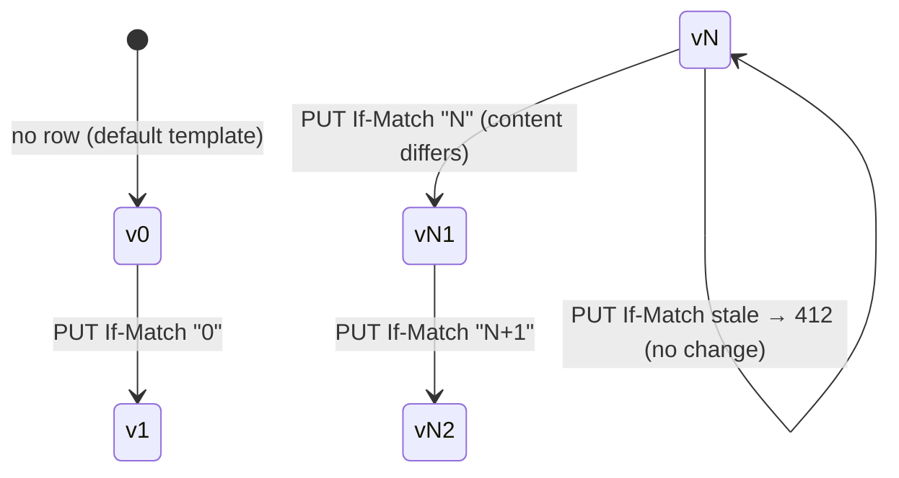

# 13.2.1 — Versioned project AI settings

| Area plan | Milestone | Version | Size (area plan) | Re-estimate | Depends on (stories) | Blocks (stories) |
|---|---|---|---|---|---|---|
| `plans/13-product-phases.md` | G1 | V1 | 1.5 d (M + S) | 1.5 d — unchanged | 08.5.1, 13.1.1 | 13.3.1, 13.4.1 |

> Contracts: 00 §2 (permissions, roles), §3 (glossary), §5.4 (tenancy/RLS), §5.5 C1–C8 (CQRS), §5.7 P3/P4/P5/P7/P8 · S1/S3/S4/S5, §7 (UUIDv7, hashes, DB naming), §8.11 (authoring states), §9.1 (idempotency, ETag/If-Match), §9.2 (error envelope), §9.3 (endpoints), §15 (contract change log) · rulings T2, T3, T11, T21, T46, T51, T92, T94, T95 · DECISIONS §5 (safe-healing rules), §7 (personal data), §10 · Area plan: `plans/13-product-phases.md` §2 FR-13-1/FR-13-3, §4.1 (`project_ai_settings`, `ai_settings_template`), §6 (untrusted AI input), §9 story 13.2.1 (`:135`), §11 Q1/Q3 (not depended on).
>
> Siblings: 13.1.1 (authoring model, `authoring:read`/`authoring:write` seeded by its T2), 13.1.2 (batched review), 13.3.1 (generation pipeline — the first consumer), 08.5.1 (gateway — the call the provenance names), 13.4.1-T5 (settings screen).

## 1. Goal and non-goals

**Goal.** A project stores the eight pieces of AI guidance the generation pipeline needs — description, environment URL, languages, writing style (≤ 250 chars), coverage strategy (≤ 1 500), four priority criteria, exclusion rules (≤ 1 500), step detail (≤ 200) — as an **append-only chain of immutable versions** (`project_ai_settings`), seeded from built-in, read-only, bilingual templates (`ai_settings_template`), read with `ETag` and written with `If-Match` + `Idempotency-Key`, and resolvable by every generation as a **pinned reference** `AiSettingsRef(settings_id, version_no, content_hash)` that is part of that generation's provenance and of its cache identity (`FR-13-3`, `plans/13-product-phases.md:21`, `:135`).

**Non-goals.** The settings screen and its counters (13.4.1-T5); generation, schema-validated AI output, credits and cost (13.3.1, 08.5.5); the gateway call, provider, redaction and tenant opt-in (08.5.1, 08.5.2, 08.5.3); model choice and the small/large pair (plan 13 Q1 — this story names no model and reads no model setting); the seed test (Q3); tenant/project deletion mechanics (06.4.4-T1, consumed here as a requirement); per-org settings or inheritance from an org default (OI-13-226).

## 2. User stories and acceptance criteria

- As a QA lead, I write the guidance my team's checklists and test cases should follow, once per project, in vi or en, and every later edit is a new reviewable version — nothing I typed is ever silently overwritten.
- As a release approver, I can tell exactly which guidance version produced a given piece of AI output, and a later edit cannot change what that output was generated from.
- As the platform, the guidance is untrusted user text that reaches a model only as delimited data, never as instructions, and it never carries a credential into the prompt, the log or a hash.

Every criterion below refines the plan-13 story acceptance (`plans/13-product-phases.md:135`) and names the test that proves it in §9.

| # | Acceptance criterion (testable) | Covers |
|---|---|---|
| 13.2.1-AC1 | Limits are counted in **Unicode code points after NFC normalisation and end-trimming** (`char_length` in SQL, code points in the counter): writing style 250 accepted / 251 refused, coverage strategy 1 500 / 1 501, exclusion rules 1 500 / 1 501, step detail 200 / 201. A refusal is 422 `request_invalid` with `details[] = [{path: "/settings/<field>", reason: "too_long"}]` and writes no row. An emoji outside the BMP counts 1; a decomposed Vietnamese sequence (`a` + U+0301) counts 1 after NFC and is stored composed. | plan 13 §9 limits |
| 13.2.1-AC2 | Every successful save appends **exactly one** immutable `project_ai_settings` row: `version_no` = previous head + 1 (1 for the first), `author_membership_id`, optional `reason`, `content_hash` = `sha256:` over RFC 8785 canonical settings JSON. `UPDATE` and `DELETE` are refused for every role (trigger + revoked grants). | FR-13-1 |
| 13.2.1-AC3 | `PUT` requires `If-Match`: absent or unparsable → 422 `request_invalid` (`details` path `If-Match`, reason `required`/`invalid`, the repo's existing behaviour); a head that moved → 412 `precondition_failed` with `details[] = [{path: "version", reason: "<current version_no>"}]`, and **no row of any table changes** — the `If-Match` comparison happens **before** any no-op or insert decision, so a stale tag whose content happens to match an older version is still 412. The ETag is `"<version_no>"` and its domain is `0..N`: the parser accepts `version >= 0`, a deliberate deviation from `CatalogEndpoints.cs:400-403` (which requires `>= 1`), because `"0"` is the valid tag before the first save. | 00 §9.1 |
| 13.2.1-AC4 | A save whose canonical content equals the **effective current** document is a **no-op**: 200 with the existing `version_no`, `content_hash` and the same `ETag`, and **no new version row**. The save takes a per-project transaction advisory lock (`pg_advisory_xact_lock`, the `CaseIdentityService.cs:30` pattern) and inserts with `on conflict (org_id, project_id, version_no) do nothing`, so two concurrent identical saves cannot both append; a content equal to an *older* but not the current version is **not** a no-op — it appends a new version (the revert case of AC8), because there is deliberately no unique constraint on `content_hash`. | — |
| 13.2.1-AC5 | Before the first save, `GET` returns the platform default template's values with `version_no = 0`, `source = "default_template"`, `settings_id = null` and `ETag: "0"`; the first `PUT` with `If-Match: "0"` creates version 1. Version 0 never exists as a row (`version_no >= 1`). | — |
| 13.2.1-AC6 | `ai_settings_template` holds built-in, versioned, **read-only** templates in vi and en (at least one per locale, exactly one `is_default` per locale). There is no write route and the app role holds `select` only; applying a template **copies** its values into a new settings version and records `template_code` + `template_version`, so a later template revision or settings edit cannot change either side. | plan 13 §4.1 templates, `B2-44:19` |
| 13.2.1-AC7 | `IAiSettingsReader.ResolveCurrentAsync` returns `AiSettingsRef(settings_id, version_no, content_hash, source)`; a generation records that reference **exactly once per `ai_run_id`** in `ai_settings_use` (idempotent on `(org_id, ai_run_id)`), readable afterwards by joining `authoring_version.ai_run_id` → `healing_llm_call.id` → `ai_settings_use.ai_run_id`. No saved settings → `source = "default_template"`, `version_no = 0`, `settings_id` null, `content_hash` = the default template's hash. | FR-13-3 |
| 13.2.1-AC8 | The settings component of the generation cache key is the **`content_hash`**, never `version_no`: two versions with identical canonical content (a revert) produce the same component and the same cache key; a single changed code point produces a different one. | FR-13-3, 13.3.1-T4 |
| 13.2.1-AC9 | A generation that pinned ref *X* keeps *X* after version *N+1* lands: `ResolveExactAsync(X)` still returns X's document byte-identically (`content_hash` recomputed equals the stored one) and the settings row is unreachable for edit. | FR-13-1, FR-13-3 |
| 13.2.1-AC10 | Settings text is treated as a **secret** and **injection** surface: any text field matching the shared `SecretShape.ValueLooksSecret` (`src/BuildingBlocks/SharedKernel/Security/SecretShape.cs:13`, `:91-143`: token prefix, JWT, PEM, `Bearer …`, `password=`, a 32+ hex run, a high-entropy run) is refused 422 `request_invalid` with reason `secret_value_detected` and nothing is stored; `environment_url` is validated by the **same rule as `environment_revision.base_urls`** (`EnvironmentRevisionRules.UrlProblem`, `src/Modules/Evidgate.Modules.Orchestrator/Domain/EnvironmentRevisionRules.cs:117-161`: absolute `http(s)` URL, no userinfo, and no secret-shaped host label, path segment, query name/value or fragment) → reasons `secret_value_detected` / `invalid_url`, plus ≤ 2 048 chars; no extra scheme restriction, so AI settings and environment revisions cannot drift. Ordinary prose in vi or en with digits and an email is accepted. | DECISIONS §5, 00 §5.7 S3, 05.1.2 AC3 |
| 13.2.1-AC11 | Tenancy and authorization: all five routes need a tenant member's permission (`authoring:read` to read, `project:write` to write — OI-13-221); another org's or another project's settings/version number is 404 (never 403), and every route appears in `IsolationRouteCases` with the member/foreign-org/service callers. | 00 §5.4, 02.9 |
| 13.2.1-AC12 | Every user-visible message the screen renders from this story — including each `details[].reason` — has a vi **and** en key, and the i18n completeness gate passes; the server never returns localised prose, only `code` + `details[].reason`. | T37, 00 §5.6 W8 |
| 13.2.1-AC13 | Each successful save writes exactly one audit entry `authoring.ai_settings.update` carrying ids, `version_no`, the before/after `content_hash` and the reason — **never** the field text; a replayed `Idempotency-Key` audits nothing. | 00 §9.1, 02.7.1 |

`[OPEN]` OI-13-222 (the maxima of description, `environment_url` and each priority criterion) does not block any AC: the story enforces a server cap and only the four plan-13 limits are contractual.

## 3. Contracts touched

All of this is **planned for 13.2.1-T1/T2 and not made by this plan**; the DoR requires it in `00`/`contracts/` before build.

- **00 §2** — no new permission string. Reads use `authoring:read` and the save uses `project:write` (`tenant_admin` only, `contracts/permissions.json`), as the shared contract fixes: the guidance decides what is sent to a model and what it costs, and `project:write` already owns "project settings such as retention and the artifact kind policy" (00 §2, `:60`). `authoring:read` / `authoring:write` arrive with 13.1.1-T2 (CR-2, `plans/13-product-phases.md:264`); this story **consumes** `authoring:read` and must not seed it. Role map to ground: `authoring:read` = the roles holding `case:read` (`viewer`, `qa_engineer`, `test_maintainer`, `release_approver`, `tenant_admin` — `contracts/permissions.json`).
- **00 §3 glossary** — add `project AI settings` (immutable versioned guidance per project, the input to every generation) and `AI settings version` (one immutable `project_ai_settings` row, `content_hash`-addressed, part of generation provenance). Canonical English for code/API; UI copy is vi + en per AC12 and the owner's terms ("Cài đặt AI của dự án", `docs/design/web-ui/prompts-crd2/B2-44-ai-settings.md:34`).
- **00 §8** — **no new state machine.** The settings chain is append-only with no lifecycle column (like `environment_revision`, `migrations/0024`); 00 §8.11 (`:313`) stays unchanged. This is stated here so the reviewer does not look for one.
- **00 §9.2** — **no new error code.** Reuse `request_invalid` (422, `details[]`), `precondition_failed` (412, current `version_no` in `details[]`), `not_found` (404), `forbidden` (403), `idempotency_conflict` (409), `payload_too_large` (413) — all present in `src/BuildingBlocks/SharedKernel/Api/ErrorEnvelope.cs:41-280` (`:44`, `:50`, `:53`, `:95`, `:104`, `:144`).
- **00 §9.3** — five endpoint rows (see §5). **00 §9.1 note:** this resource's ETag is `"<version_no>"` and `"0"` is valid before the first save, so its `If-Match` parser accepts `version >= 0` — a documented deviation from the Catalog parser (`CatalogEndpoints.cs:400-403`); no other endpoint changes.
- **00 §15** — one log row: "Project AI settings (13.2.1-T1/T2): §3 glossary terms; §9.3 routes `GET|PUT /v1/projects/{p}/ai-settings`, `GET …/versions`, `GET …/versions/{version_no}`, `GET …/templates`; no new permission, no new error code; `contracts/schemas/ai-settings.v1.json`; migration `NNNN_authoring_ai_settings.sql`".
- **Plan 13 §4.1 (`plans/13-product-phases.md:45`)** — one **flagged addition**, not a contract file: the area plan lists only `project_ai_settings` and `ai_settings_template`, while this story also needs `ai_settings_use`, the per-`ai_run_id` provenance pin (schema and reason in §4, choice recorded as `OI-13-227`, recommended default: keep it, blocks only T2). No 00 §15 row is needed for it — the migration is the same one — but a reviewer comparing this plan against §4.1 must read the addition as deliberate.
- `contracts/openapi.yaml` — the five paths with `x-permission` on each (T51), the schemas `AiSettingsView`, `AiSettingsDocument`, `AiSettingsVersionSummary`, `AiSettingsVersionListResponse`, `AiSettingsVersion`, `AiSettingsTemplateView`, `AiSettingsTemplateListResponse`, `SaveAiSettingsRequest`; `additionalProperties: false` throughout; 412/422 responses declared.
- `contracts/schemas/ai-settings.v1.json` — **new**: the canonical settings document (the eight fields, `additionalProperties: false`, the four priority criteria as a closed object). One schema validates the API `settings` member, the template `content` member and the input to `content_hash`; the JSON Schema is the single source of both shapes.
- `contracts/permissions.json` — **unchanged by this story**; 13.1.1-T2 adds the `authoring:*` codes and the seed (migration `0010`'s row set is additive-only).
- `contracts/rls-exceptions.txt` — one new line: `public.ai_settings_template platform  # built-in bilingual template catalogue (13.2.1): no org_id, select-only for evidgate_app, written only by the migration`, matching `public.permission` (`contracts/rls-exceptions.txt:42`, `migrations/0010_identity_permission_catalogue.sql:62-76`).
- `tests/Persistence.IntegrationTests/SchemaConventionScan.cs` (`Exemptions`, `:32-118`) — three planned entries, each with its reason, because the tables keep `created_at` only and are never updated: `public.project_ai_settings`, `public.ai_settings_template`, `public.ai_settings_use` → `SchemaRule.AuditColumns | SchemaRule.VersionTrigger` (the same exemption `public.test_revision` carries, `:58-61`). The pinned allow-list test (`SchemaConventionTests.cs:507-550`) changes with them.
- `packages/sdk/gen/` — regenerated (codegen drift gate).
- `src/BuildingBlocks/SharedKernel/Security/UrlSafety.cs` — **new, extracted**: `EnvironmentRevisionRules.UrlProblem` (`src/Modules/Evidgate.Modules.Orchestrator/Domain/EnvironmentRevisionRules.cs:117-161`, currently `internal` to the Orchestrator module and its reason constants `secret_value_detected`/`invalid_url` at `:26-27`) moves here verbatim so Authoring (this story) and Orchestrator (05.1.2, delivered) share one rule instead of two that can drift. `EnvironmentRevisionRules` delegates to it; **no behaviour change**, and 05.1.2's `EnvironmentRevisionTests` must stay green. Mechanical move, flagged for the orchestrator because it touches a delivered module.
- `Evidgate.Modules.Authoring` + `Evidgate.Modules.Authoring.Contracts` — **new modules** (00 §5.2, `:157-158`); the `.Contracts` project carries `AiSettingsRef`, `AiSettingsDocument`, `IAiSettingsReader`, `IAiSettingsProvenanceRecorder` and `AiSettingsCacheKey` for 13.3.1/08.5.1/13.5.1 to consume.
- `tests/Authoring.IntegrationTests` — **new** test project over the shared `tests/Shared` PostgreSQL fixture (Testcontainers), plus rows in `tests/Isolation.Tests/Api/IsolationRouteCases.cs`.

## 4. Data model and migrations

`migrations/NNNN_authoring_ai_settings.sql` (NNNN = next free number at build; 0039 at the time of writing, run as the owner role by `Evidgate.Migrator`). Module `Evidgate.Modules.Authoring`. Conventions copied from `migrations/0021_catalog_test_revision.sql:12-74` (tenant columns, trigger, grants, policies, indexes).

```sql
-- project_ai_settings: one immutable version per row, append-only (FR-13-1).
create table if not exists public.project_ai_settings (
  id uuid not null,                          -- UUIDv7, app-generated (00 §7)
  org_id uuid not null,
  project_id uuid not null,
  version_no integer not null,
  description text not null default '',
  environment_url text,
  languages text[] not null,                 -- sorted ascending, no duplicates (AC1, canonical form)
  writing_style text not null default '',
  coverage_strategy text not null default '',
  -- one criterion per priority level of the checklist (checklist_item.priority: critical/high/medium/low)
  priority_criterion_critical text not null default '',
  priority_criterion_high text not null default '',
  priority_criterion_medium text not null default '',
  priority_criterion_low text not null default '',
  exclusion_rules text not null default '',
  step_detail text not null default '',
  template_code text,                        -- provenance of the copy; no live reference (AC6)
  template_version integer,
  content_hash text not null,
  author_membership_id uuid not null,
  reason text,
  created_at timestamptz not null default now(),
  constraint project_ai_settings_pkey primary key (id),
  constraint project_ai_settings_org_id_key unique (org_id, id),                    -- TL T3
  constraint project_ai_settings_version_key unique (org_id, project_id, version_no),
  -- No unique constraint on content_hash on purpose: a revert must be expressible as a
  -- new version carrying an older document (AC8). Head serialisation is the row lock (AC4).
  constraint project_ai_settings_project_fk
    foreign key (org_id, project_id) references public.project (org_id, id),
  constraint project_ai_settings_author_fk
    foreign key (org_id, author_membership_id) references public.membership (org_id, id),
  constraint project_ai_settings_version_check check (version_no >= 1),
  constraint project_ai_settings_languages_check
    check (cardinality(languages) between 1 and 2 and languages <@ array['vi', 'en']::text[]),
  -- description / url / per-criterion caps are the recommended defaults of OI-13-222; the four
  -- plan-13 limits below them are contractual (AC1) and may not be changed by a default.
  constraint project_ai_settings_description_check check (char_length(description) <= 1000),
  -- scheme and credential rules cannot be expressed faithfully in SQL: the validator applies the
  -- shared UrlProblem rule (environment_revision parity, EnvironmentRevisionRules.cs:117-161).
  constraint project_ai_settings_url_check check (environment_url is null
    or char_length(environment_url) <= 2048),
  constraint project_ai_settings_writing_style_check check (char_length(writing_style) <= 250),
  constraint project_ai_settings_coverage_check check (char_length(coverage_strategy) <= 1500),
  constraint project_ai_settings_exclusions_check check (char_length(exclusion_rules) <= 1500),
  constraint project_ai_settings_step_detail_check check (char_length(step_detail) <= 200),
  constraint project_ai_settings_criteria_check check (
    char_length(priority_criterion_critical) <= 250 and char_length(priority_criterion_high) <= 250
    and char_length(priority_criterion_medium) <= 250 and char_length(priority_criterion_low) <= 250),
  constraint project_ai_settings_template_check check (
    (template_code is null and template_version is null)
    or (template_code ~ '^[a-z][a-z0-9_-]{1,31}$' and template_version >= 1)),
  constraint project_ai_settings_hash_check check (content_hash ~ '^sha256:[0-9a-f]{64}$'),
  constraint project_ai_settings_reason_check check (reason is null or char_length(reason) between 1 and 500)
);

-- Head lookup and the version list use the same backward scan (P4): `version_no desc` / `created_at desc`.
create index if not exists project_ai_settings_head_idx
  on public.project_ai_settings (org_id, project_id, version_no desc);
create index if not exists project_ai_settings_list_idx
  on public.project_ai_settings (org_id, project_id, created_at desc, id desc);

-- ai_settings_template: platform catalogue, built-in, versioned, read-only (AC6).
create table if not exists public.ai_settings_template (
  id uuid not null,
  code text not null,
  locale text not null,
  version integer not null,
  name text not null,
  content jsonb not null,                    -- the ai-settings.v1 document, validated at seed/fixture time
  content_hash text not null,
  is_default boolean not null default false,
  created_at timestamptz not null default now(),
  constraint ai_settings_template_pkey primary key (id),
  constraint ai_settings_template_key unique (code, locale, version),
  constraint ai_settings_template_locale_check check (locale in ('vi', 'en')),
  constraint ai_settings_template_code_check check (code ~ '^[a-z][a-z0-9_-]{1,31}$'),
  constraint ai_settings_template_version_check check (version >= 1),
  constraint ai_settings_template_name_check check (char_length(name) between 1 and 120),
  constraint ai_settings_template_content_check
    check (jsonb_typeof(content) = 'object' and octet_length(content::text) <= 32768),
  constraint ai_settings_template_hash_check check (content_hash ~ '^sha256:[0-9a-f]{64}$')
);
create unique index if not exists ai_settings_template_default_idx
  on public.ai_settings_template (locale) where is_default;
```

Both tables: `ENABLE` + `FORCE ROW LEVEL SECURITY`; tenant policies through `evidgate.current_org_id()` for `project_ai_settings` (the helper of `migrations/0004_identity_organization.sql:90-98`, TL T2), and for `ai_settings_template` the catalogue shape of `public.permission`: `select to evidgate_app using (true)` plus per-statement `insert/update/delete … check (false)` denials (`migrations/0010_identity_permission_catalogue.sql:154-180`), so a tenant can read the catalogue and no tenant principal can write it. `project_ai_settings`: `grant select, insert` to `evidgate_app`, `revoke update, delete`, and the append-only guard trigger (`evidgate.authoring_settings_immutable`, the `catalog_revision_immutable` pattern of `0021:43-57`); `select` to `evidgate_operator`, nothing to `evidgate_worker_sched`.

**Flagged refinement — a third table beyond plan 13 §4.1's list.** The area plan's data list (`plans/13-product-phases.md:45`) names exactly two tables for this story, `project_ai_settings` and `ai_settings_template`; `ai_settings_use` below is an **addition this plan makes**, not a table the area plan lists, recorded here so the reviewer sees a deliberate refinement rather than an invented table. Reason: the pinned reference is **per gateway call**, not per settings row — one settings version serves many runs and one run must cite exactly one pin — so provenance needs a record keyed on `(org_id, ai_run_id)` carrying `source`, `settings_id` / `version_no` / `content_hash` and the template pair; the two alternatives are worse: a nullable ref column set on `healing_llm_call` edits 08.5.1's schema (a sibling plan), and a member on `authoring_version` (13.1.1) cannot represent `source = 'default_template'`, where no settings row exists to point at. Recommended default and receiving task: **keep `ai_settings_use`, one row per `ai_run_id`** (`OI-13-227`, which blocks only T2); plan 13 §4.1 gains the row at its next edit. The addition changes no §10 size: T1 stays 1.0 d, T2 stays 0.5 d.

`ai_settings_use` (owned by **T2**, §10) records the pin: `id`, `org_id`, `project_id`, `source text check (source in ('saved','default_template'))`, `settings_id uuid` (composite FK `(org_id, settings_id) → project_ai_settings (org_id, id)`; null when `source = 'default_template'`), `version_no`, `content_hash`, `template_code`, `ai_run_id uuid` (composite FK `(org_id, ai_run_id) → healing_llm_call (org_id, id)`), `created_at`; `check (source = 'default_template' or settings_id is not null)`, `unique (org_id, ai_run_id)` (AC7 idempotence, one pin per gateway call), `unique (org_id, id)`, `(org_id, project_id)` FK to `project`; append-only like the two above.

**Seeds (same migration, owner role).** Four `ai_settings_template` rows: code `default` and `web-form`, each in `vi` and `en`, `version = 1`; `is_default` on the `en` `default` row only (the server-side platform default must be locale-independent, 00 §5.7 P7 — AC5/AC7 use it) and on the `vi` `default` row (the UI's initial locale choice, 13.4.1-T5). Content: `default` leaves all eight fields empty except `languages = ["vi","en"]`; `web-form` adds a one-line writing style, a coverage strategy naming form validation / authorization / destructive-action coverage, four criteria that map onto the four checklist priorities, an exclusion rule for destructive production actions and a short step-detail guidance — product copy is `[INFERENCE]` and is reviewed by 13.4.1-T5 against the UI design (`docs/design/web-ui/prompts-crd2/B2-44-ai-settings.md:19,30`). Seeds are **immutable**: a correction is a new `version` row in a later migration, never an update. `ai_settings_template.locale` is the **copy language of the template's own guidance text** and is independent of the settings document's `languages` member, which is the output language of generated cases (`B2-44:19`: selected output language is separate from interface locale); picking the `vi` template does not set `languages`, and the UI sends both explicitly.

**Refinement to plan 13 §4.1** (not a contradiction): the four priority criteria are four typed columns rather than one JSON member, because they are length-constrained per level and P5 asks for typed columns for anything constrained; the wire shape stays one `priority_criteria` object with exactly four members. Grounding for "four = one per priority level": `checklist_item.priority critical/high/medium/low` (`plans/13-product-phases.md:41`) and `docs/design/web-ui/prompts-crd2/B2-44-ai-settings.md:16` ("four separate priority criteria (critical/high/medium/low)").

**Template reference is soft** (`template_code` + `template_version`, no FK) on purpose: a foreign key to a platform table would be single-column, which the schema scan treats as a violation needing a wider `CompositeForeignKey` exemption (`tests/Persistence.IntegrationTests/SchemaConventionTests.cs:112-138`; the one precedent is `role_permission`, `SchemaConventionScan.cs:114-117`). The pair is validated by the save command and pinned by a test; templates are immutable, so a code+version pair never changes meaning.

**Canonical document / `content_hash`.** The hashed document is RFC 8785 canonical JSON of exactly the eight fields — `{"coverage_strategy","description","environment_url","exclusion_rules","languages","priority_criteria":{"critical","high","medium","low"},"step_detail","writing_style"}` — hashed with `CanonicalHash.Compute` (`src/BuildingBlocks/Canonicalization/CanonicalHash.cs:16-40`), i.e. `sha256:` over sorted, minimal JSON (00 §7, `:245`). Text is NFC-normalised and end-trimmed **before** counting and hashing, so a decomposed Vietnamese input and its composed form are one version, one hash and one cache component (AC1, AC8). Whitespace inside a value is preserved; only leading/trailing whitespace is trimmed; a field that trims to empty is stored as `''`. `languages` is stored in **ascending order with no duplicates**; a request naming the same language twice is 422 `request_invalid` with reason `duplicate_value`, so the canonical document — and therefore the hash — never depends on the order the boxes were ticked.

**`char_length` vs the UI counter.** PostgreSQL `char_length` counts code points, not UTF-16 units and not grapheme clusters. The counter and the validator therefore count **code points** (`EnumerateRunes()`), so `😀` is 1 in both; a flag emoji made of two code points counts 2 in both — the same number everywhere, which is the requirement. NFC normalisation uses `string.Normalize(NormalizationForm.FormC)`; T1.2 carries a probe test because P7 runs the API with `InvariantGlobalization` (⚠️ verify in T1.2 that normalization is not culture-dependent — it is managed code — and fail the build with a named test if it is). Deferred-by-precedent: 03.2.1 records "Unicode NFC of names" as deferred (`OI-03-15`), so this story introduces the first normaliser and 13.1.1 may reuse it.

## 5. API shapes (commands, queries, endpoints)

Module `Evidgate.Modules.Authoring`, routes under the project (00 §9.3), body cap 32 KiB per route (P8; the maximum field set is ≈ 7.6 k chars), `X-Request-Id`/`traceparent` as everywhere.

| Method | Route | Permission | Request | Response | Concurrency | Errors |
|---|---|---|---|---|---|---|
| GET | `/v1/projects/{p}/ai-settings` | `authoring:read` | — | `AiSettingsView` (effective document, `version_no`, `source` ∈ `saved`/`default_template`, `settings_id`, `content_hash`, `template`, `author`, `reason`, `created_at`) | `ETag: "<version_no>"` (`"0"` for the default) | 403, 404 |
| GET | `/v1/projects/{p}/ai-settings/versions` | `authoring:read` | `?cursor=&limit=` (default 50, max 200) | `{items:[{version_no, content_hash, template, author_membership_id, reason, created_at}], next_cursor}` — summaries only; the screen diffs two versions it fetches (13.4.1-T5) | — | 422 `request_invalid` (bad cursor/limit) |
| GET | `/v1/projects/{p}/ai-settings/versions/{version_no}` | `authoring:read` | — | `AiSettingsVersion` (full document + metadata) | `ETag: "<version_no>"` (immutable) | 404 (unknown version, another project/org) |
| PUT | `/v1/projects/{p}/ai-settings` | `project:write` (OI-13-221) | `SaveAiSettingsRequest { settings, template?, reason? }` | 201 `AiSettingsView` (new version) **or 200** (identical content, AC4) | `If-Match: "<version_no>"` **required**, `"0"` valid before the first save (422 when absent, 412 when stale); `Idempotency-Key` **required** (400 `request_invalid` when absent, T92) | 400, 403, 404, 409 `idempotency_conflict`, 412, 413, 422 |
| GET | `/v1/projects/{p}/ai-settings/templates` | `authoring:read` | — | `{items:[{code, version, locale, name, is_default, content_hash, settings}], next_cursor: null}` — a closed, small catalogue, no paging | — | 403 |

`template` in the PUT body is **provenance only, never a live reference**: the screen pre-fills its draft from `GET …/templates` (the vi or en row the user picked), the user may edit any field, and the full document travels in `settings`; the server checks that `code` + `version` exist and records both, and it does **not** require the document to equal the template content (an edited copy is the normal case). No `PUT` changes a template, and a later template version cannot change a saved row (AC6, `B2-44:19`). A `template` naming an unknown pair is 422 `request_invalid` with `details[]` path `/template/code`, reason `not_allowed_value`.

Commands/queries (CQRS): `SaveAiSettingsCommand` (write, `[AuditedAction("authoring.ai_settings.update")]`), `AiSettingsQuery` (effective document, 1–2 indexed reads), `AiSettingsVersionsQuery` (keyset on `created_at desc, id desc`, one statement + count-free cursor), `AiSettingsVersionQuery` (by `version_no`), `AiSettingsTemplatesQuery` (one statement). C1/C3/C5: queries run in the read-only scope (T95) through `ITenantDb` (`src/BuildingBlocks/Persistence/Tenancy/ITenantDb.cs:13`); no handler calls the network (P5).

`SaveAiSettingsCommand` order: request shape → NFC/trim → limit and secret/URL validation (`details[]` in field order) → `select pg_advisory_xact_lock(hashtextextended('authoring_ai_settings:' || @project_id, 0))` (the `CaseIdentityService.cs:30` pattern; a `for update` on the head row would **not** serialise writers, because the chain is append-only and both writers would lock the same old row that nobody updates)  → read the head (`version_no, content_hash`; no row = v0) → **compare `If-Match` with the head** (`0` for v0): different → 412 with the current `version_no`, nothing written (AC3) → canonical hash equals the head's → 200 with the head's `version_no`/`content_hash`/ETag, no insert (AC4) → otherwise `insert … (version_no = head + 1) on conflict (org_id, project_id, version_no) do nothing`; 0 rows inserted = a lost race → 412 with the head. The advisory lock is released at commit; `unique (org_id, project_id, version_no)` (not the lock) is the last line of defence against a duplicate version. The audit row is appended by the authorization stage just before commit (`src/BuildingBlocks/Persistence/Audit/AuditTrail.cs:14-40`).

`If-Match` reuses the repo's `IfMatchError` shape (`src/Modules/Evidgate.Modules.Catalog/Endpoints/CatalogEndpoints.cs:382-406`: absent → 422 `request_invalid` with `details` `If-Match`/`required`; a `W/` prefix is stripped; unparsable → 422 with `invalid`) with **one deliberate deviation**: the settings parser accepts `version >= 0`, because the ETag here is `"<version_no>"` and `"0"` is the valid tag of the virtual v0 (AC5) — the Catalog parser's `version >= 1` check (`:400-403`) would turn a legitimate first save into a 422. Stale → `Error.PreconditionFailed` (412) with `details[] = [{path: "version", reason: "<current version_no>"}]`, exactly the assertion at `tests/Tenancy.IntegrationTests/CatalogIdentityTests.cs:726-731`; absent and unparsable tags are 422 at `:733-735`. `Idempotency-Key` is the C2 stage and `idempotency_record` (T11, T94); a missing key is 400 `request_invalid` (`tests/Identity.IntegrationTests/BuiltinRoleTests.cs:241-264`).

## 6. States and transitions

No lifecycle column: the chain is append-only, `version_no` is monotone, and version 0 is virtual (AC5). The ETag domain is `0..N` — `"0"` is the tag of v0 and is accepted by the parser (AC3). Rules and refusals:

| From | Event | To | Notes |
|---|---|---|---|
| no row (v0, defaults) | `PUT` with `If-Match: "0"` and valid content | v1 | `author` from the principal's `membership_id` |
| v*N* | `PUT` with `If-Match: "N"` and **different** content | v*N+1* | one row, one `content_hash`, one audit entry |
| v*N* | `PUT` with `If-Match: "N"` and **identical** content | v*N* (unchanged) | 200, no row, same ETag (AC4) |
| v*N* | `PUT` with `If-Match: "M"`, *M* ≠ head (including a stale tag whose content matches an older version) | refused | 412 with `details[].path = "version"`, nothing written (AC3) |
| v*N* | `PUT` with invalid content (limit, secret, URL, unknown key) | refused | 422 with `details[]`, nothing written (AC1, AC10) |
| v*N* | `UPDATE`/`DELETE` of the row, any role | refused | guard trigger + revoked grants (AC2) |
| template row *T* | any API write | refused | no route; catalogue policy denies writes (AC6) |



Restore is **not** a separate operation: restoring an old document is a `PUT` carrying that content, which appends a new version whose `content_hash` equals the old one (AC8). It is a no-op only when that content **is** the current head (AC4). There is deliberately no unique constraint on `content_hash`, because a revert must be expressible as a new version; recorded here so nobody "fixes" it by adding one, and so the `content_hash`-addressed cache component (AC8) is understood to be the point of the design rather than a way to deduplicate rows.

## 7. Jobs and integrations

No jobs, no outbox, no schedules in this story (nothing here is asynchronous).

- **13.1.1-T2** — seeds `authoring:read`/`authoring:write` (CR-2). This story's read routes depend on `authoring:read` existing; until then they 403 for every role, which is the correct pre-G1 state.
- **13.3.1-T2** (checklist generation) — the first consumer: `IAiSettingsReader.ResolveCurrentAsync(projectId)` → pass the document as **data** into the delimited user-content block (never into system instructions, 08.5.2) → after the gateway answers, `IAiSettingsProvenanceRecorder.RecordAsync(ref, aiRunId)` in the same transaction that writes `authoring_version` with `ai_run_id` (08.5.1 AC7, `plans/features/08-healing-learning/08.5.1-llm-gateway.md:30`). Order and priority come from `priority_criteria` / `priority_criterion_*`.
- **13.3.1-T4** (cache) — composes the cache key over `{input_hash, settings: <content_hash>, model, prompt_version}`; the settings component is `AiSettingsCacheKey.SettingsComponent(ref)` (AC8).
- **08.5.1-T1** (gateway) — reads **only** the three members of `AiSettingsRef` through `IAiSettingsReader`; it never resolves settings itself, never reads `project_ai_settings` directly, and stores the ref unchanged on its provenance path. No change to `healing_llm_call` is needed by this story.
- **13.5.1-T1** (script generation, G2) — consumes `environment_url` as a string it hands to the customer's CI; it does **not** depend on this story's tables beyond the reader, and it must confirm OI-13-225 (whether a non-https local origin becomes allowed) before it trusts the field's scheme.
- **13.4.1-T5** (settings screen) — consumes the four read routes, the counter rules of §4 (code points, NFC), the 412 pattern and the vi + en keys of AC12; it renders the four plan-13 limits and, per `B2-44:18`, shows unbounded counters for the fields in OI-13-222 without inventing a maximum.
- **06.4.4-T1** (deletion job) — must include `project_ai_settings`, `ai_settings_template` (no rows per project — nothing to delete) and `ai_settings_use` in the project/tenant deletion set; the same caveat 05.1.1 recorded applies: the guard trigger and the revoked grants mean the deletion path must run as the owner through the `SECURITY DEFINER` route 06.4.4-T1 defines (`plans/features/05-runs-orchestration/05.1.1-verified-manifest.md:9`, deviation 3).
- **09.1.1-T6** — the i18n completeness gate (`scripts/check-i18n-keys.ts`, planned in `plans/features/09-web-ui/09.1.1-app-scaffold-and-build-acceptance-npm.md:161-162`) is the AC12 proof; `01.3.1-T1` owns the OpenAPI/codegen drift gate the five new paths enter.

**Provenance example** (the fixture `fixtures/authoring/ai-settings-provenance-example.json`, asserted by `AiSettingsProvenanceTests.ExampleFixture_MatchesRecordedRef`; hashes abbreviated here, 64 hex characters in the fixture). `model` is a placeholder because plan 13 Q1 is open and this story stores no model choice — 08.5.1 owns that member.

```json
{
  "ai_run_id": "0192f0c4-6f1a-7c3e-9b57-2f0a1e6d8c11",
  "project_id": "0192f0b1-1a44-7d20-8b3f-5c1f0a2d9e04",
  "purpose": "authoring_generation",
  "model": "<chosen by 08.5.1's policy, not by this story>",
  "prompt_version": "checklist.v3",
  "settings": {
    "source": "saved",
    "settings_id": "0192f0c9-7d31-7f55-a0c2-6b7d9e1f3a58",
    "version_no": 3,
    "content_hash": "sha256:9c1e0a…"
  },
  "settings_cache_component": "sha256:9c1e0a…",
  "input_hash": "sha256:4ab7c2…",
  "cache_key": "sha256:0d55f1…",
  "created_at": "2026-10-23T09:14:22Z"
}
```

For a project that never saved, the same record carries `"source": "default_template"`, `"settings_id": null`, `"version_no": 0` and `"content_hash"` equal to the default template's hash (AC5, AC7). A revert shows the point of the content-addressed component: version 5 restoring version 3's document yields `"version_no": 5` with the **same** `settings_cache_component` as version 3 (AC8).

## 8. Security, privacy and performance

| Rule | How this story meets it | Proven by |
|---|---|---|
| P3 (bounded SQL) | each query handler issues 1–2 statements; the list is one keyset statement | `AiSettingsEndpoints_CommandCounter` (asserts ≤ 2 commands per route) |
| P4 (indexed list) | `project_ai_settings_list_idx` (`created_at desc, id desc`) and `_head_idx` ship in the same migration | `AiSettingsSchemaTests.Indexes_Cover_List_And_Head` |
| P5 (short transaction, no network) | the save is an insert + an audit row; nothing in this story calls a model or an HTTP client | reviewed in T1.2; no `IHttpClientFactory` in the module (`Architecture.Tests`) |
| P7 (invariant globalization) | the server never formats or sorts by culture; the platform default template is chosen by `is_default` + `locale = 'en'`, not by `Accept-Language` | `AiSettingsDefaults_Are_LocaleIndependent` |
| P8 (payload caps before parsing) | 32 KiB `MaxRequestBodySize` on the two mutating routes and on the templates route | `AiSettingsPayloadTooLarge_Is413` |
| 00 §5.5 C1/C3/C5/C6 | commands write, queries read in the read-only scope; immutability in the domain (no setters) and in SQL (trigger + grants) | `Architecture.Tests`, `AiSettingsImmutable_UpdateAndDeleteRefused` |
| 00 §5.4 / TL T2, T3 | `org_id` on every tenant row, `unique (org_id, id)`, composite tenant FKs, FORCE RLS through the helpers | `SchemaConventionTests.Migrated_Schema_Satisfies_Conventions` |
| S1 | Dapper parameters / EF LINQ only; `set_config` stays the parameterised form | code review + the existing interceptor test |
| S3 (no secrets) | any text field is scanned with the shared `SecretShape.ValueLooksSecret` (`src/BuildingBlocks/SharedKernel/Security/SecretShape.cs:13`, `:91-143`) and refused with reason `secret_value_detected`; `environment_url` goes through the **same rule as `environment_revision.base_urls`** (`EnvironmentRevisionRules.UrlProblem`, `src/Modules/Evidgate.Modules.Orchestrator/Domain/EnvironmentRevisionRules.cs:117-161`, reasons `secret_value_detected`/`invalid_url`), so the two features cannot drift; field text is **never** logged and never stored in `audit_log` (hashes only) | `AiSettingsSecretsTests.Refuses_Credentials_AndNeverLogsText` (AC10, AC13) |
| S4 (egress) | the platform **never fetches** `environment_url` in G1 — generation runs customer-side (A5, `plans/13-product-phases.md:31`) — so there is no server-side SSRF surface; the field is a validated string, and when a later phase ever fetches it, the S4 allow-list applies before any request | `AiSettingsUrl_IsNeverFetched` (asserts no `HttpClient` use on this path) |
| S5 (untrusted parsers) | the request is JSON through the edge schema (`ai-settings.v1.json`, `additionalProperties: false`, depth 4, 32 KiB cap) | `AiSettingsContractTests` |
| Prompt injection posture | the settings text is **untrusted user text** that later travels into a prompt: 13.3.1 places it inside the delimited user-content envelope of 08.5.2 and it is never concatenated into system instructions; 11.4.1-T2 reviews that seam; this story neither builds a prompt nor calls a provider | reviewed with 13.3.1-T2's prompt assembly; recorded here so the seam is not re-litigated |

DoR review answers (00 §12, `plans/features/README.md` §6) for this story:

- **Authorization:** `GET …/ai-settings`, `…/versions`, `…/versions/{version_no}` and `…/templates` need `authoring:read`; `PUT …/ai-settings` needs `project:write` (`tenant_admin` only — the guidance decides what leaves the tenant and what it costs; OI-13-221 records the dedicated-code alternative). Permission checks are in the pipeline (C2/S2) with the permission mirrored in `x-permission` (T51). A `ci_producer`/`agent` service identity holds neither code → 403. Another org's project is 404 before any row is read; another project's settings under a scoped credential is 403 `project_scope_mismatch`.
- **Retention/deletion:** the story writes `project_ai_settings`, `ai_settings_use` (T2) and reads `ai_settings_template`. Settings versions are **provenance evidence**: kept as long as any generated artifact can cite them via `ai_settings_use` (FR-13-3), which in practice means the project's lifetime; there is no expiry job and no rewrite — the chain is append-only. Templates are platform catalogue data, kept indefinitely. Project/tenant deletion (06.4.4-T1) removes both by running as the owner through its `SECURITY DEFINER` path (the append-only guard and the revoked grants block an app-role delete). No personal data is stored by design: the fields are project guidance, and the secret scan keeps credentials out; audit rows carry hashes and ids only.
- **Telemetry:** audit entry `authoring.ai_settings.update` per successful save (ids, `version_no`, before/after `content_hash`, reason — no field text) via `IAuditTrail`; counters `evidgate_authoring_ai_settings_write_total{outcome}` with `outcome ∈ created|noop|stale|invalid` and a span per route; no tenant content, no field text and no URL in any label.
- **Failure path:** 422 `request_invalid` with `details[]` (`path` = the JSON pointer, `reason` ∈ `required|invalid|too_long|unknown_field|secret_value_detected|invalid_url|not_allowed_value|duplicate_value`) for content the caller can fix; 412 `precondition_failed` (current version in `details[]`) for a lost race, and the screen keeps the draft for an explicit reload (no auto-merge); 400 `request_invalid` for a missing `Idempotency-Key`; 409 `idempotency_conflict` for a reused key with a different body; 413 for an oversized body. Nothing is retryable except the transport-level 429/503 the platform already emits; a 412 is never retried automatically. Operator note: a refused save leaves no row, so a support case is diagnosed from the audit trail and `evidgate_authoring_ai_settings_write_total{outcome}` alone.

## 9. Test plan

Real PostgreSQL through the shared Testcontainers fixture; every row names the AC it proves. No test of wiring, echo or incidental defaults.

| Behaviour / boundary / failure | Test | AC |
|---|---|---|
| 250/251, 1 500/1 501, 1 500/1 501, 200/201 on the four limits, each with `details[].path` and `reason: too_long`, nothing stored | `AiSettingsLimitTests.Limit_Boundaries_Theory` | AC1 |
| code-point counting (astral emoji = 1), NFC of a decomposed Vietnamese sequence, end-trim before counting/hash | `AiSettingsTextTests.Counts_CodePoints_And_NormalisesNfc` | AC1 |
| one row per save, `version_no` = head + 1, `content_hash` recomputed from the stored document, `UPDATE`/`DELETE` refused for owner and app role | `AiSettingsVersionTests.Appends_Exactly_One_Version_And_IsImmutable` | AC2 |
| absent / unparsable `If-Match` → 422; stale → 412 with the current version in `details[].path = "version"` and zero rows changed in **every** table; `If-Match: "0"` accepted before v1 exists and 412 once it does | `AiSettingsConcurrencyTests.StaleIfMatch_Is412_And_WritesNothing` | AC3 |
| identical content → 200, same ETag, row count unchanged; concurrent identical saves → still one row | `AiSettingsNoOpTests.IdenticalContent_Is200_And_AddsNoVersion` | AC4 |
| no row → `GET` returns the default template document, `version_no 0`, `source default_template`, `ETag "0"`; `PUT If-Match "0"` creates v1 | `AiSettingsDefaultsTests.V0_Defaults_ThenFirstSave` | AC5 |
| templates: at least one per locale, exactly one `is_default` per locale, app role cannot insert/update/delete, `POST`/`PUT` on the route is 405/404 | `AiSettingsTemplateTests.Catalogue_IsReadOnly_AndBilingual` | AC6 |
| apply template → new version carrying `template_code`/`template_version`, values identical to the template's `content`, and a later template version (inserted by the test as owner) does not change the saved row | `AiSettingsTemplateTests.Copy_IsNotALiveReference` | AC6 |
| `ResolveCurrentAsync` tuple, one `ai_settings_use` row per `ai_run_id` (second record is a no-op), join from `authoring_version.ai_run_id`, default-template ref when nothing is saved | `AiSettingsProvenanceTests.Records_Pin_Once_Per_AiRun` | AC7 |
| cache component: same content twice = same key (revert case); one changed code point = different key; version number alone never keys the cache | `AiSettingsCacheKeyTests.Component_IsContentAddressed` | AC8 |
| pinned ref survives v*N+1*: `ResolveExactAsync` returns the same document and hash | `AiSettingsProvenanceTests.PinnedRef_Survives_NewVersion` | AC9 |
| `SecretShape` corpus: `ghp_…`, `sk-…`, a JWT, `-----BEGIN …`, `https://user:pw@host`, `password=hunter2`, `https://user:pw@host` as the environment URL → 422 `secret_value_detected`, a malformed URL → `invalid_url`, a legitimate `http://localhost:5173` URL → accepted (parity with environment revisions); legitimate vi/en prose (with digits and an email) → 201; no field text in `audit_log` or logs | `AiSettingsSecretsTests.Refuses_Credentials_AndNeverLogsText` | AC10 |
| isolation: each of the five routes with a foreign-org member (404), a foreign-project scoped credential (403), a `ci_producer` (403) — rows added to `IsolationRouteCases` | `tests/Isolation.Tests` route cases | AC11 |
| i18n: every `code`/`details[].reason` this story can emit has a vi + en key; gate exits 0 | `scripts/check-i18n-keys.ts` (09.1.1-T6) | AC12 |
| audit: exactly one `authoring.ai_settings.update` per save with before/after hashes and no text; an idempotent replay audits nothing | `AiSettingsAuditTests.OneEntryPerSave_NoText` | AC13 |
| perf: command counter ≤ 2 per route; list of 200 versions issued in one statement; p95 target from 00 §11 is not a gate here (not a hot endpoint) | `AiSettingsEndpoints_CommandCounter` | P3/P4 |
| schema: migrated-schema scan green with the three new exemptions; `contracts/schemas/ai-settings.v1.json` accept/reject corpus | `SchemaConventionTests`, `Contract.Tests` corpus | §4 |

## 10. Tasks, sub-tasks and re-estimate

### 13.2.1-T1 — `project_ai_settings` + `ai_settings_template` (vi + en seeds), API, limits (M)

Depends on tasks: 13.1.1-T2.

| Sub-task | Work | Size | Done when |
|---|---|---|---|
| 13.2.1-T1.1 | Contracts and schema: `contracts/schemas/ai-settings.v1.json` + accept/reject vectors; OpenAPI paths and schemas with `x-permission`; SDK codegen; the migration `NNNN_authoring_ai_settings.sql` (`project_ai_settings`, `ai_settings_template`, constraints, FORCE RLS + catalogue policies, append-only trigger and grants, four seed rows, two indexes); the two `SchemaConventionScan.Exemptions` entries for the two tables it creates and the `rls-exceptions.txt` line | S | migration applies on an empty database and on `develop`; `SchemaConventionTests.Migrated_Schema_Satisfies_Conventions` and `SchemaConventionAllowListTests` green; `Contract.Tests` accepts the four seeds and rejects a document with a 251-character writing style |
| 13.2.1-T1.2 | Module `Evidgate.Modules.Authoring` (+ `.Contracts` shell): `AiSettingsText` (NFC, trim, code-point count, per-field limits, `SecretShape`), the shared `UrlSafety` extraction and its delegation from `EnvironmentRevisionRules`, the five handlers/routes, the `If-Match` parser accepting `version >= 0`, the advisory-lock + `on conflict do nothing` save path, Idempotency wiring, audit action, counter, `tests/Authoring.IntegrationTests` and the `IsolationRouteCases` rows | S | the §9 rows for AC1–AC6 and AC10–AC13 are green by name (including `AiSettingsDefaultsTests` for `If-Match: "0"` and the 412 detail shape, and 05.1.2's `EnvironmentRevisionTests` still green after the `UrlProblem` move); `AiSettingsEndpoints_CommandCounter` green; no `IHttpClientFactory` reference in the module (`Architecture.Tests`) |

**Re-estimate:** 0.5 + 0.5 = 1.0 d = area plan (M). Honest note for the orchestrator, not a change to plan 13: two tables, five routes, a validator with Unicode/secret rules and ~15 integration tests against a real database is closer to **2.5–3 d** of one senior developer's time; the 1.0 d here is the plan-13 figure and this plan keeps the declared size, as §10 requires. Recommend recording the gap in the plan-13 re-estimate at the close-out, not before build.

### 13.2.1-T2 — Settings versioning in provenance and cache keys (S)

Depends on tasks: 13.2.1-T1, 08.5.1-T1.

| Sub-task | Work | Size | Done when |
|---|---|---|---|
| 13.2.1-T2.1 | Consumer contract in `Evidgate.Modules.Authoring.Contracts`: `AiSettingsRef(settings_id, version_no, content_hash, source)`, `AiSettingsDocument`, `IAiSettingsReader` (`ResolveCurrentAsync`, `ResolveExactAsync`), `IAiSettingsProvenanceRecorder.RecordAsync`, `AiSettingsCacheKey.SettingsComponent`; XML doc stating exactly what 08.5.1-T1 and 13.3.1 must read; the `ai_settings_use` table + its exemption entry | XS | `Architecture.Tests` (public types only in `.Contracts`); `AiSettingsRefTests` (equality, `ToString` carries the hash); migration applies with `unique (org_id, ai_run_id)` and the append-only guard |
| 13.2.1-T2.2 | Implementations (reader: head lookup / exact lookup / default-template resolution; recorder: idempotent insert), `fixtures/authoring/ai-settings-provenance-example.json`, and the AC7–AC9 tests | XS | `AiSettingsProvenanceTests.Records_Pin_Once_Per_AiRun`, `PinnedRef_Survives_NewVersion` and `AiSettingsCacheKeyTests.Component_IsContentAddressed` green; the example fixture validates against the contract documents and is quoted in §7's hand-over |

**Re-estimate:** 0.25 + 0.25 = 0.5 d = area plan (S). No change to 00 §14. Story total 1.0 + 0.5 = **1.5 d**, equal to plan 13 §12 (`plans/13-product-phases.md:247`).

## 11. Rollout

- **No feature flag.** The routes are new and inert until 13.3.1 consumes the reader; a project with no saved settings generates nothing in G1 (13.3.1 does not exist yet), so shipping the tables and the routes changes no behaviour for any other tenant. The `authoring:read` code arrives with 13.1.1-T2 in the same phase, which is also the moment the routes become usable.
- **Migration order:** one expand-only migration, deployable before the API build (tables and seeds), then T1.2 (routes), then T2 (contract + `ai_settings_use`). No backfill: the chain starts at v1 on the first save and v0 is computed. Rollback = drop the routes first, then the tables; nothing else references them until 13.3.1 ships, and `ai_settings_use` (T2) must be dropped after its consumers, never before.
- **Backwards compatibility:** all five paths are additive; no existing endpoint, permission string, error code or table changes. The OpenAPI diff is additive and `packages/sdk/gen` is regenerated in the same commit (01.3.1-T1's drift gate).
- **Kill switch:** none needed (no egress, no provider, no credit spend). Disabling AI generation stays 08.6.3's switch and 08.5.3's tenant opt-in; settings stay readable and writable with generation off, which is exactly what the design requires (`B2-44:21`: opt-in off never blocks manual authoring).
- **Strings that ship:** server-side, only English diagnostic `message` text plus machine `code`/`reason` tokens. User-visible copy is the web layer's: `@@aiSettings.*` keys in `apps/web` with vi and en values (`Project AI settings / Cài đặt AI của dự án`, `Writing style / Phong cách viết`, `Coverage strategy / Chiến lược bao phủ`, `Priority criteria / Tiêu chí ưu tiên`, `Exclusion rules / Quy tắc loại trừ`, `Step detail / Mức chi tiết của bước`, `Character limit exceeded / Vượt giới hạn ký tự`, `Settings version used / Phiên bản cài đặt đã dùng`, `Save new version / Lưu phiên bản mới`, `Version history / Lịch sử phiên bản`, `Pending changes / Thay đổi chờ áp dụng`, `AI credit / tín dụng AI`), plus one key per `details[].reason` this story emits (`too_long`, `secret_value_detected`, `invalid_url`, `unknown_field`, `not_allowed_value`, `duplicate_value`, `required`, `invalid`). T5 owns the copy; the gate is `check-i18n-keys`.

## Notes, decisions and open items

`[DECISION]`s this plan **applies** (nothing new is decided here): append-only versions with `content_hash` (FR-13-1, 00 §7); `If-Match`/`ETag` optimistic concurrency (00 §9.1, `:325`); `Idempotency-Key` on the save (T92); `unique (org_id, id)` + composite FKs + FORCE RLS (T2, T3); `project:write` as the write code (00 §2 `:60`; T21, `plans/features/README.md:70`); untrusted AI input (plan 13 §6 `:96`); no hosted generation (A5).

`[OPEN]` items — ids `OI-13-2nn` are the register ids for story 13.2.1 (13.1.1 uses `OI-13-1nn` with n ∈ {01..05}, 13.1.2 uses `OI-13-12n`), so the three sibling registers can be concatenated at any time without renumbering.

| Id | Question | Recommended default | Information needed | Blocks |
|---|---|---|---|---|
| OI-13-221 | Is the save `project:write` (`tenant_admin` only) or a dedicated `ai_settings:write`? | `project:write`, as applied by T1.2; `authoring:read` for every read | Owner confirmation that only tenant admins change project AI guidance (the guidance decides cost and egress) | 13.4.1-T5 must not gate the screen's Save button on a different code before this is confirmed |
| OI-13-222 | Maxima for description, `environment_url` and each priority criterion — the design brief explicitly defines none (`B2-44:18`) | description ≤ 1 000, URL ≤ 2 048, each criterion ≤ 250 (all enforced by CHECK, adjustable by migration) | Owner/UX decision on the real caps, or confirmation that these ship | nothing; the four plan-13 limits are unaffected |
| OI-13-223 | Is `languages` closed to `vi` + `en` in G1, and which locales does G2 add? | closed `{vi, en}`, 1–2 values, widening needs a migration because it is a CHECK | Product scope for G2 (13.5.1 translate actions) | nothing in G1; 13.5.1's translate path must not assume a locale outside the set |
| OI-13-224 | May a tenant create its own templates in G1? | No: templates are migration-only, read-only, platform-owned | Owner scope call; a tenant template needs an `org_id` column and a catalogue policy change | nothing; a later story owns it |
| OI-13-225 | Should `environment_url` be restricted to `https://` even though the shared environment-revision rule allows `http(s)`? | No extra restriction: reuse `UrlProblem` unchanged (absolute `http(s)`, no credentials) so the two features cannot drift; the platform never fetches the URL in G1, so there is no SSRF surface to tighten | Whether G2 script generation needs a customer-local `http://` origin (if it does, the permissive shared rule is already correct) | nothing; a stricter scheme rule would be a later tightening, never a loosening |
| OI-13-226 | Does a project inherit settings from an org-level default in G1? | No: per-project only; the platform default template is the starting point | Owner scope call for multi-project orgs | nothing |
| OI-13-227 | Plan 13 §4.1 (`plans/13-product-phases.md:45`) lists only `project_ai_settings` and `ai_settings_template`, but this story also needs `ai_settings_use` (the per-`ai_run_id` provenance pin, §4) — is the third table approved for story 13.2.1, or must the pin live in an existing table? | keep `ai_settings_use` (one row per `ai_run_id`) rather than columns on 08.5.1 tables: a pin is per gateway call, not per settings row, and `source = 'default_template'` has no settings row to hang a column on; plan 13 §4.1 gains the row at its next edit | Owner/plan-13 confirmation that the third table is in scope (the alternative is a nullable ref column on `healing_llm_call`, owned by 08.5.1) | only 13.2.1-T2, which creates it; T1, the routes and the seeds are unaffected |

Contract gaps found while writing this plan (reported, not fixed here; each one carries a recommended resolution and names the plan/task that receives it):

1. Plan 13 §4.1 (`:45`) names the tables and "the §2 fields with character limits", but §2 (`:17-26`) contains no field list or limits — the field list and every limit live only in the story line (`:135`) and in the UI brief (`B2-44:16-18`). **Recommended resolution:** §4.1 points at the story line instead of restating the limits, so the two copies cannot drift. **Received by:** `plans/13-product-phases.md` §4.1 at its next edit; nothing in this story waits on it — 13.2.1-T1.1 builds from `:135` and `B2-44:16-18`.
2. Plan 13 §4.1's table list names only `project_ai_settings` and `ai_settings_template`, but this story also adds `ai_settings_use` (the per-`ai_run_id` provenance pin, §4). **Recommended resolution:** keep the third table, one row per `ai_run_id`, rather than a nullable ref column on `healing_llm_call` (owned by 08.5.1) or a member on `authoring_version` — a pin is per gateway call, and `source = 'default_template'` has no settings row to point at. **Received by:** the owner answer to `OI-13-227`, then plan 13 §4.1; task 13.2.1-T2.1 creates the table.
3. `13.2.1-T2` says "settings versioning in provenance and cache keys" while 08.5.1's plan stores `prompt_version` but no settings reference (`plans/features/08-healing-learning/08.5.1-llm-gateway.md:30`, `:41`). **Recommended resolution:** resolve the seam here with `ai_settings_use` (owned by this story) instead of a column on `healing_llm_call`, so 08.5.1's merged plan needs no edit; 08.5.1-T1 reads only the three members of `AiSettingsRef` through `IAiSettingsReader` and stores the ref unchanged on its provenance path. **Received by:** 13.2.1-T2.1 (contract, table) and 13.2.1-T2.2 (recorder); 08.5.1 is asked for no change.
4. 00 §3 has no glossary entry for "project AI settings" although several stories and the UI brief use the term as a name (`plans/13-product-phases.md:135`, `B2-44:34`); §3 addition is in §3 above as a planned change. **Recommended resolution:** add the two entries exactly as worded in §3 (`project AI settings`, `AI settings version`) with the 00 §15 log row of the same §3 bullet. **Received by:** the `00` contract edit carried by 13.2.1-T1.1 before build (the DoR requirement, not a build step).
5. `SchemaConventionScan.Exemptions` must grow by three entries; the pinned allow-list test intentionally fails until they are added, which is the mechanism working as designed (`SchemaConventionScan.cs:26-31`). **Recommended resolution:** add all three with their reasons (`public.project_ai_settings`, `public.ai_settings_template`, `public.ai_settings_use` → `SchemaRule.AuditColumns | SchemaRule.VersionTrigger`, the `public.test_revision` precedent) and update the pinned allow-list in the same commits. **Received by:** 13.2.1-T1.1 for the two T1 tables, 13.2.1-T2.1 for `ai_settings_use`; `SchemaConventionTests.cs:507-550` changes with them.
